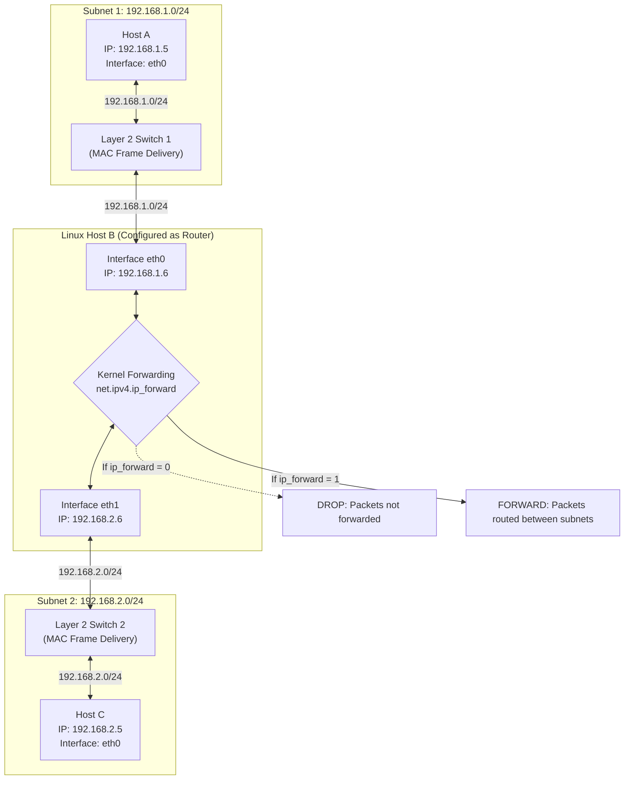
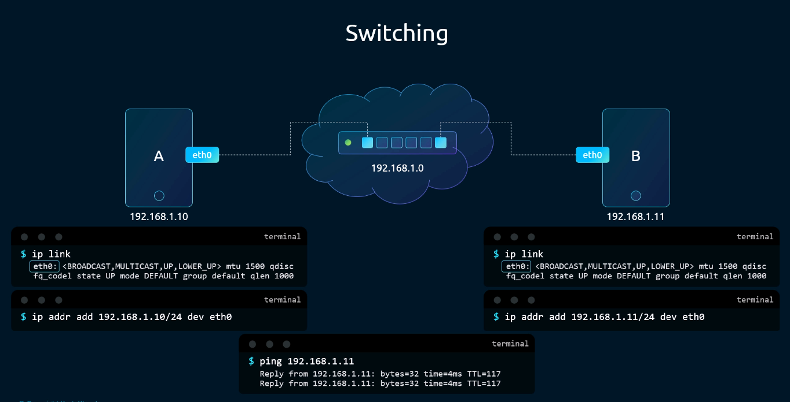
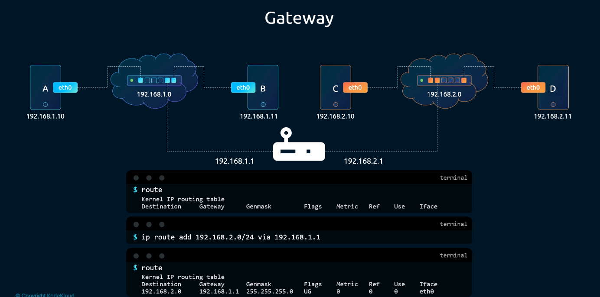
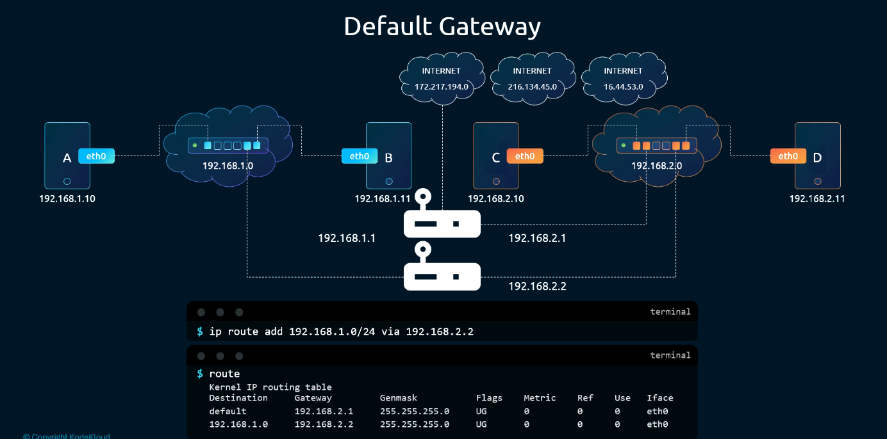
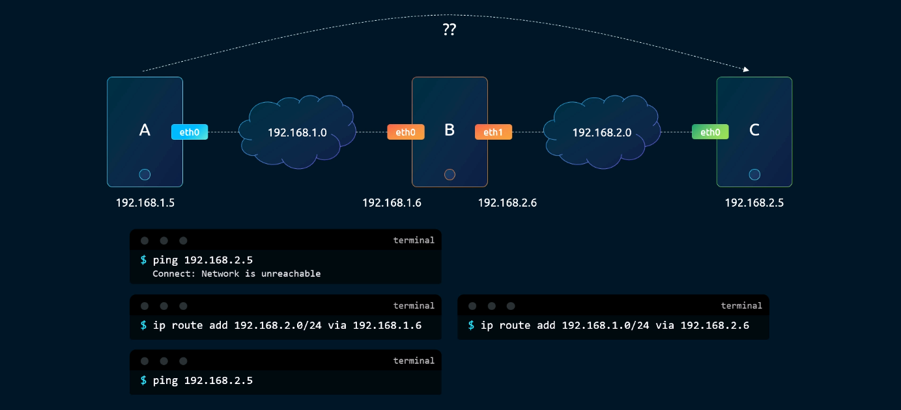
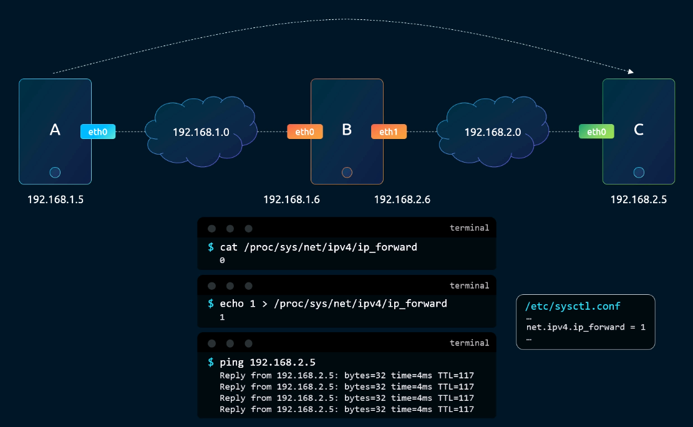
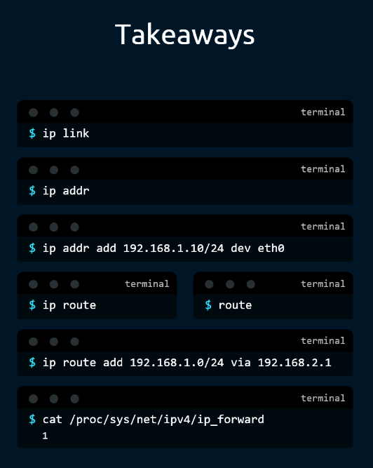

# Linux Networking Fundamentals: Switching, Routing & Gateways - CKA Exam Notes

> **Exam Domain**: Services & Networking (20%) / Troubleshooting (30%)  
> **Weight / Importance**: Critical (Fundamental architectural prerequisite for all Kubernetes networking: CNI plugins, Pod network routing, Linux bridge interfaces, virtual Ethernet pairs, and node pre-flight requirements)  
> **Target Version**: Verified against v1.31 / v1.32 (Current CKA Curriculum)  
> **Allowed Docs Search Keywords**: `Cluster Networking`, `Network Plugins`, `sysctl net.ipv4.ip_forward`, `ip route`, `ip link`, `ip addr`  
> **Source**: Generated from `networking/01-switching-routing-gatewaycni-in-kubernetes-raw.md`

---

## 1. Quick-Reference Summary

- **Layer 2 (Switching) vs. Layer 3 (Routing)**:
  - **Switching (L2)**: Connects hosts within the **same IP subnet** (e.g. `192.168.1.0/24`). Packet delivery relies on Ethernet frames and hardware MAC addresses resolved via ARP.
  - **Routing (L3)**: Connects hosts across **different IP subnets** (e.g. `192.168.1.0/24` to `192.168.2.0/24`). Packet forwarding relies on IP headers, routing tables, and gateway hops.
- **The Gateway Concept**:
  - A gateway is a router interface residing on the local subnet that forwards packets destined for remote or external networks.
  - **Default Gateway (`0.0.0.0/0` or `default`)**: The catch-all route entry used when no specific subnet route matches the destination IP.
- **Linux Kernel IP Forwarding (`net.ipv4.ip_forward`)**:
  - By default, Linux operates strictly as an end-host and **drops packets** received on one network interface that are destined for another interface.
  - To enable Linux to act as a router (mandatory for Kubernetes nodes routing Pod traffic across interfaces), IP forwarding must be enabled:
    ```bash
    # Temporary (runtime):
    echo 1 > /proc/sys/net/ipv4/ip_forward
    # Persistent across reboots:
    sysctl -w net.ipv4.ip_forward=1
    # Ensure entry in /etc/sysctl.d/k8s.conf or /etc/sysctl.conf:
    net.ipv4.ip_forward = 1
    ```
- **Modern `iproute2` CLI Commands**:
  - List / inspect interfaces: `ip link`
  - Assign IP address to interface: `ip addr add <ip>/<cidr> dev <iface>`
  - View routing table: `ip route show` (or: `ip route`)
  - Add specific subnet route: `ip route add <remote-subnet> via <gateway-ip>`
  - Add default gateway: `ip route add default via <gateway-ip>`
  - Identify route chosen by kernel for a destination: `ip route get <target-ip>`
- **The Kubernetes CNI Connection**:
  - Every Kubernetes node acts as a Linux router. The container runtime and CNI plugins attach pods to Linux bridge interfaces (`cbr0` or virtual switches) and configure routing tables and `ip_forward` to enable pod-to-pod communication across nodes.

---

## 2. Conceptual Overview & Mental Model

### Dual-Layer Architectural Understanding

- **Simple English Explanation (How It Works)**:
  - When two computers need to exchange data on the same local network, they plug into a **Switch**. The switch reads the hardware MAC address on each network frame and delivers it directly to the recipient.
  - However, a switch cannot forward packets outside its own network. If a computer with IP `192.168.1.10` wants to talk to a computer on a different network (`192.168.2.10`), the switch cannot help.
  - To connect two different networks, you introduce a **Router** (or a multi-homed Linux server with multiple network cards). The router has an IP address on each network.
  - But how does a computer know to send packets to the router? You configure a **Route** in the operating system's routing table. A route tells the kernel: *"If you want to reach network `192.168.2.0/24`, deliver the packet to router IP `192.168.1.1`"*.
  - For all other addresses (like the public internet), you configure a **Default Gateway** (`0.0.0.0/0`).
  - By default, the Linux kernel refuses to forward packets between its interfaces to prevent accidental network loops. To make a Linux server route packets between networks, you must set the kernel parameter `net.ipv4.ip_forward = 1`.
  - In Kubernetes, this exact mechanism is used: every worker node is a mini-router forwarding packets between the host's physical network card and the virtual bridge where Pod containers live.

- **Formal Linux & Kubernetes Architecture Definition**:
  - Network packet traversal implements the IEEE 802.3 Ethernet framing and RFC 791 IPv4 protocols. The Linux kernel maintains a Forwarding Information Base (FIB) consulted during route lookups via the Longest Prefix Match (LPM) algorithm. When a packet arrives on a network device (`net_device`), the kernel checks the destination IP. If the destination does not match any local interface IP, the kernel consults the `net.ipv4.ip_forward` sysctl. If `ip_forward=0`, the packet is dropped; if `ip_forward=1`, the kernel decrements the TTL, recomputes the IP checksum, performs ARP resolution for the next-hop gateway MAC, and transmits the frame out the egress interface.

### Linux Packet Switching, Routing, and Forwarding Architecture



---

## 3. Deep-Dive Technical Breakdown

### 1. Layer 2 Switching Mechanics

Connecting multiple host network interfaces to a switch creates a local network:



#### Operational Flow:
1. **Interface Detection**: `ip link` displays physical or virtual network interfaces (`eth0`, `ens3`, `veth*`).
2. **IP Assignment**:
   ```bash
   ip addr add 192.168.1.10/24 dev eth0
   ```
3. **Local Subnet Traversal**:
   - Host A (`192.168.1.10`) pings Host B (`192.168.1.11`).
   - Host A calculates that `192.168.1.11` is within its local `/24` subnet.
   - Host A broadcasts an **ARP (Address Resolution Protocol)** request: *"Who has 192.168.1.11? Tell 192.168.1.10"*.
   - Host B responds with its hardware MAC address.
   - Host A encapsulates the IP packet inside an Ethernet frame with Host B's MAC address and transmits it to the switch.
   - The switch forwards the frame directly to Host B's port.

> [!NOTE]
> Switches operate strictly at **Layer 2**. A switch has no awareness of IP addresses or routing tables; it delivers frames solely by matching destination MAC addresses against its internal MAC address table.

---

### 2. Layer 3 Routing & Gateways

When hosts reside on different subnets, Layer 2 switching fails because ARP broadcasts are bounded by the subnet:



#### Inter-Subnet Communication Challenge:
- Host A (`192.168.1.10`) attempts to send a packet to Host C (`192.168.2.10`).
- Host A checks its subnet mask (`255.255.255.0`) and determines that `192.168.2.10` is on a **different network**.
- Without a gateway configured, the Linux kernel aborts with:
  ```text
  connect: Network is unreachable
  ```

#### The Gateway Solution:
A **Router** connects the two subnets, holding an IP on each:
- Router Interface 1: `192.168.1.1` (on Subnet `192.168.1.0/24`)
- Router Interface 2: `192.168.2.1` (on Subnet `192.168.2.0/24`)

To inform Host A how to reach Subnet 2, you add an explicit route:
```bash
ip route add 192.168.2.0/24 via 192.168.1.1
```
Now, when Host A targets `192.168.2.10`, it sends the packet to `192.168.1.1` (the gateway), which routes the packet to Subnet 2.

---

### 3. Default Gateway (`0.0.0.0/0`) & Longest Prefix Match

Individual routes cannot be manually maintained for every possible external destination on the global internet:



#### The Routing Decision Algorithm (Longest Prefix Match):
When the Linux kernel decides where to send a packet, it compares the destination IP against its routing table from most specific to least specific:
1. **Host Route (`/32`)**: Matches a specific single IP.
2. **Subnet Route (`/24`, `/16`)**: Matches a local or remote subnet.
3. **Default Route (`/0` or `default`)**: Matches any IP address not matched by any other rule (`0.0.0.0/0`).

```bash
# Add default gateway via external router
ip route add default via 192.168.2.1
# Equivalent CIDR notation:
ip route add 0.0.0.0/0 via 192.168.2.1
```

```text
Kernel IP routing table
Destination     Gateway         Genmask         Flags Metric Ref    Use Iface
default         192.168.2.1     0.0.0.0         UG    0      0        0 eth0
192.168.1.0     192.168.2.2     255.255.255.0   UG    0      0        0 eth0
192.168.2.0     0.0.0.0         255.255.255.0   U     0      0        0 eth0
```
- **Flag `U`**: Route is Up.
- **Flag `G`**: Route uses a Gateway.

---

### 4. Configuring a Linux Host as an L3 Router

You can configure any standard Linux host with multiple network interfaces to act as an IP router:



#### Topology:
- **Host A**: `192.168.1.5` (Connected to Host B via `192.168.1.0/24`)
- **Host B (Router)**:
  - `eth0`: `192.168.1.6`
  - `eth1`: `192.168.2.6`
- **Host C**: `192.168.2.5` (Connected to Host B via `192.168.2.0/24`)

#### Step 1: Configure Routes on End-Hosts
On Host A:
```bash
ip route add 192.168.2.0/24 via 192.168.1.6
```
On Host C:
```bash
ip route add 192.168.1.0/24 via 192.168.2.6
```

#### Step 2: The Forwarding Blocker (`ip_forward = 0`)
When Host A pings Host C (`ping 192.168.2.5`), packets arrive at Host B's `eth0`.
Host B sees that the destination IP (`192.168.2.5`) is on its `eth1` network.
However, **Host B drops the packet silently** without forwarding!



#### Step 3: Enabling IP Forwarding
In Linux, packet forwarding is disabled by default for security:
```bash
# 1. Inspect current state (0 = disabled, 1 = enabled)
cat /proc/sys/net/ipv4/ip_forward

# 2. Enable immediately in runtime
echo 1 > /proc/sys/net/ipv4/ip_forward

# 3. Persist across system reboots in /etc/sysctl.conf
echo "net.ipv4.ip_forward = 1" >> /etc/sysctl.conf
sysctl -p
```
Once `ip_forward = 1` is applied, Host B forwards the packets from `eth0` to `eth1`, and ping replies succeed with `TTL=117`.

---

### 5. Why This Matters for Kubernetes & CKA

In a Kubernetes cluster:
1. **Pod Network Isolation**: Every Pod lives in its own network namespace with a private IP (e.g., `10.244.1.15`).
2. **Virtual Bridge (`cbr0` / `bridge`)**: The worker node creates a virtual switch (Linux bridge). Pod virtual Ethernet cables (`veth*`) plug into this bridge.
3. **The Worker Node as Router**: When a Pod sends traffic to a Pod on another node or to the external internet, packets travel from the pod's `veth` interface, across the bridge, and out the node's physical `eth0`.
4. **Pre-Flight Cluster Requirement**:
   - If `net.ipv4.ip_forward = 0` on a worker node, the node **cannot forward packets** between the Pod network bridge and the physical network card!
   - `kubeadm init` and `kubeadm join` validate this setting during pre-flight checks and fail with:
     ```text
     [ERROR Sysctl]: net.ipv4.ip_forward contents are not set to 1
     ```

---

## 4. Command Translation & Mapping Tables

### Master CLI Reference: Key Takeaways



| Operational Objective | Modern `iproute2` Command | Legacy `net-tools` Equivalent | Persistence File |
| :--- | :--- | :--- | :--- |
| **List network interfaces** | `ip link` (or: `ip link show`) | `ifconfig -a` | `/etc/network/interfaces` or Netplan |
| **Bring interface up / down** | `ip link set dev eth0 up`<br/>`ip link set dev eth0 down` | `ifconfig eth0 up`<br/>`ifconfig eth0 down` | Interface configuration |
| **View assigned IP addresses** | `ip addr` (or: `ip addr show`) | `ifconfig` | `/etc/netplan/*.yaml` |
| **Assign IP to interface** | `ip addr add 192.168.1.10/24 dev eth0` | `ifconfig eth0 192.168.1.10 netmask 255.255.255.0` | Netplan / NetworkManager |
| **View kernel routing table** | `ip route` (or: `ip route show`) | `route -n` (or: `netstat -rn`) | `/etc/network/routes` |
| **Add static subnet route** | `ip route add 192.168.2.0/24 via 192.168.1.1` | `route add -net 192.168.2.0 netmask 255.255.255.0 gw 192.168.1.1` | Netplan routes block |
| **Add default gateway** | `ip route add default via 192.168.1.1` | `route add default gw 192.168.1.1` | Netplan `gateway4` / `routes` |
| **Check IP forwarding state** | `cat /proc/sys/net/ipv4/ip_forward` | `sysctl net.ipv4.ip_forward` | `/etc/sysctl.d/k8s.conf` |
| **Enable IP forwarding** | `sysctl -w net.ipv4.ip_forward=1` | `echo 1 > /proc/sys/net/ipv4/ip_forward` | `net.ipv4.ip_forward = 1` |

---

## 5. High-Yield CLI & Imperative Commands

### 1. Interface & Address Configuration

```bash
# 1. View all interfaces in concise format
ip -br link

# 2. View all IP addresses with interface bindings
ip -br addr

# 3. Add secondary IP address to an interface
ip addr add 10.0.0.50/24 dev eth0

# 4. Remove an IP address from an interface
ip addr del 10.0.0.50/24 dev eth0
```

### 2. Routing Table Auditing & Troubleshooting

```bash
# 1. Display default route and gateway
ip route show | grep default

# 2. Test kernel routing decision for a specific target IP (Fastest Route Diagnostic!)
ip route get 8.8.8.8
# Sample output:
# 8.8.8.8 via 192.168.1.1 dev eth0 src 192.168.1.100 uid 1000
#   cache

# 3. Add temporary route to a remote cluster pod CIDR
ip route add 10.244.2.0/24 via 192.168.1.20 dev eth0

# 4. Delete a route
ip route del 10.244.2.0/24
```

### 3. Persistent Kernel Parameter Configuration for Kubernetes

```bash
# 1. Create dedicated Kubernetes sysctl configuration file
cat <<EOF | sudo tee /etc/sysctl.d/k8s.conf
net.ipv4.ip_forward = 1
net.bridge.bridge-nf-call-iptables = 1
net.bridge.bridge-nf-call-ip6tables = 1
EOF

# 2. Reload sysctl parameters without rebooting
sudo sysctl --system

# 3. Verify that IP forwarding is active
sysctl net.ipv4.ip_forward
# Output must be: net.ipv4.ip_forward = 1
```

---

## 6. Troubleshooting & Diagnostic Runbook

### Network Routing & Gateway Diagnostic Decision Tree

```mermaid
flowchart TD
    Start["Network Connection Fails: Ping / Curl Fails"] --> Step1{"What error message is returned?"}

    Step1 -->|connect: Network is unreachable| CheckRoute["Inspect local routing table<br/>ip route show"]
    CheckRoute --> HasGateway{"Is a default gateway or matching<br/>subnet route present?"}
    HasGateway -->|No| FixGateway["Remedy: Add missing route or default gateway<br/>ip route add default via <gateway-ip>"]
    HasGateway -->|Yes| CheckIface["Check interface state<br/>ip link show <iface> (State UP?)"]

    Step1 -->|Destination Host Unreachable| CheckARP["Inspect ARP table on sender<br/>ip neigh show (or: arp -n)"]
    CheckARP --> ARPFail{"Is next-hop MAC resolved or FAILED?"}
    ARPFail -->|FAILED / INCOMPLETE| FixL2["L2 Failure! Next-hop gateway IP does not exist<br/>or switch/VLAN configuration error"]
    ARPFail -->|Resolved| CheckNextHop["Gateway received packet; problem is downstream"]

    Step1 -->|Packet Sent but No Reply (Silent Timeout)| CheckRouter["Check router / intermediary host"]
    CheckRouter --> CheckForward{"Is IP forwarding enabled on router?<br/>cat /proc/sys/net/ipv4/ip_forward"}
    CheckForward -->|0 (Disabled)| FixFwd["Remedy: Enable IP forwarding<br/>sysctl -w net.ipv4.ip_forward=1"]
    CheckForward -->|1 (Enabled)| CheckReturnRoute["Check return route on target host!<br/>Does target host know route back to sender?"]
    CheckReturnRoute --> FixReturn["Remedy: Configure return gateway on target"]
```

### Step-by-Step Triage Matrix

| Observed Symptom | Underlying Root Cause | Verification Command | Remediation Action |
| :--- | :--- | :--- | :--- |
| **`connect: Network is unreachable`** | Missing default gateway or route to target subnet | `ip route show` | Add route via `ip route add default via <gw>` or specific subnet route. |
| **`Destination Host Unreachable`** | ARP resolution failed for next hop; gateway IP is incorrect or offline | `ip neigh show` | Verify gateway IP address and ensure physical/virtual interface link is `UP`. |
| **Pings sent through router time out with 0 replies** | Linux router has `net.ipv4.ip_forward = 0` | `cat /proc/sys/net/ipv4/ip_forward` | Execute `echo 1 > /proc/sys/net/ipv4/ip_forward` and add to `/etc/sysctl.conf`. |
| **Asymmetric Routing (Traffic reaches target but cannot return)** | Target host lacks a return route back to sender's subnet | `ip route show` on target host | Add return route pointing to router's interface on target's subnet. |
| **`kubeadm init` fails pre-flight check** | `net.ipv4.ip_forward` is disabled in kernel sysctl | `sysctl net.ipv4.ip_forward` | Add `net.ipv4.ip_forward = 1` to `/etc/sysctl.d/k8s.conf` and run `sysctl --system`. |

---

## 7. CKA Exam Tips, Gotchas & Traps

> [!WARNING]
> **Trap 1: The Ephemeral `ip` Command Trap**  
> In troubleshooting exam tasks where you must fix a broken node:  
> - Running `ip addr add` or `ip route add` fixes the problem **only until the node restarts**!  
> - If the exam task states *"Ensure changes persist across reboots"*, you **MUST** update the system configuration file (e.g. Netplan in `/etc/netplan/` or `/etc/sysctl.d/` for kernel tunables).

> [!IMPORTANT]
> **Trap 2: Asymmetric Routing in Multi-Node Practice Labs**  
> When connecting two networks via a Linux router host:  
> - Configuring Host A to route to Host C via Host B is **only 50% of the job**.  
> - You **must also configure Host C to route back to Host A via Host B**!  
> - If Host C has no return route, packets reach Host C, but Host C cannot reply, resulting in 100% packet loss.

> [!TIP]
> **Trap 3: Instant Route Verification with `ip route get`**  
> Instead of manually parsing a massive routing table with dozens of CNI routes, use:
> ```bash
> ip route get <target-ip>
> ```
> This immediately prints the exact interface, gateway, and source IP that the Linux kernel will select for that packet.

> [!IMPORTANT]
> **Trap 4: Missing `net.ipv4.ip_forward` After Upgrades / Reboots**  
> If worker nodes suddenly stop communicating with pods after an OS upgrade or reboot, inspect `cat /proc/sys/net/ipv4/ip_forward`. If it reverted to `0`, the node is silently dropping routed pod packets. Always persist the setting in `/etc/sysctl.d/k8s.conf`.

---

## 8. Self-Test / Active Recall

Try answering the questions below without looking at the notes, then expand each question to check your understanding.

<details>
<summary><b>1. At which OSI layer does a network switch operate, and what addressing does it use for packet delivery?</b></summary>

Layer 2 (Data Link layer). It delivers Ethernet frames using hardware MAC addresses.
</details>

<details>
<summary><b>2. Why can two hosts with IP addresses `192.168.1.10/24` and `192.168.2.10/24` not communicate through a basic Layer 2 switch?</b></summary>

Because they reside on different IP subnets. Address Resolution Protocol (ARP) broadcasts cannot cross subnet boundaries, requiring a Layer 3 router to forward packets between the subnets.
</details>

<details>
<summary><b>3. What does the destination `default` (or `0.0.0.0/0`) represent in a Linux routing table?</b></summary>

It represents the Default Gateway—the catch-all route chosen by the kernel for all destination IPs that do not match any more specific subnet route.
</details>

<details>
<summary><b>4. What Linux kernel setting must be enabled for a multi-homed Linux host to forward packets between its interfaces?</b></summary>

`net.ipv4.ip_forward = 1` (configured in `/proc/sys/net/ipv4/ip_forward` or `/etc/sysctl.conf`).
</details>

<details>
<summary><b>5. What modern command adds an IP address of `192.168.1.50/24` to interface `eth0`?</b></summary>

`ip addr add 192.168.1.50/24 dev eth0`.
</details>

<details>
<summary><b>6. What modern command routes traffic destined for subnet `10.244.2.0/24` through gateway `192.168.1.20`?</b></summary>

`ip route add 10.244.2.0/24 via 192.168.1.20`.
</details>

<details>
<summary><b>7. Why does `kubeadm init` enforce `net.ipv4.ip_forward = 1` during pre-flight checks?</b></summary>

Because Kubernetes worker nodes act as routers, forwarding packets between host physical interfaces and virtual bridge interfaces connected to Pod network namespaces.
</details>

<details>
<summary><b>8. What command immediately displays the exact route, gateway, and interface the Linux kernel will choose to reach IP `10.96.0.1`?</b></summary>

`ip route get 10.96.0.1`.
</details>

<details>
<summary><b>9. What error message does the Linux network stack return if an application tries to connect to an external IP when no default route exists?</b></summary>

`connect: Network is unreachable`.
</details>

<details>
<summary><b>10. How do you persist sysctl parameters across system reboots on modern systemd-based Linux systems?</b></summary>

Add the parameters to a file in `/etc/sysctl.d/` (e.g. `/etc/sysctl.d/99-k8s.conf`) and apply them with `sysctl --system`.
</details>

---

### Official Documentation Bookmarks

| Documentation Page Title | Allowed Search Query Keyword | Direct Documentation URL |
| :--- | :--- | :--- |
| **Cluster Networking Concepts** | `Cluster Networking` | [https://kubernetes.io/docs/concepts/cluster-administration/networking/](https://kubernetes.io/docs/concepts/cluster-administration/networking/) |
| **Network Plugins** | `Network Plugins CNI` | [https://kubernetes.io/docs/concepts/extend-kubernetes/compute-storage-net/network-plugins/](https://kubernetes.io/docs/concepts/extend-kubernetes/compute-storage-net/network-plugins/) |
| **Forwarding IPv4 and letting iptables see bridged traffic** | `sysctl net.ipv4.ip_forward kubernetes` | [https://kubernetes.io/docs/setup/production-environment/container-runtimes/#forwarding-ipv4-and-letting-iptables-see-bridged-traffic](https://kubernetes.io/docs/setup/production-environment/container-runtimes/#forwarding-ipv4-and-letting-iptables-see-bridged-traffic) |

