# Linux DNS Architecture & Name Resolution - CKA Exam Notes

> **Exam Domain**: Services & Networking (20%) / Troubleshooting (30%)  
> **Weight / Importance**: Critical (Core architectural prerequisite for Kubernetes Service Discovery, CoreDNS operation, Pod `/etc/resolv.conf` generation, `search` domain mechanics, `ndots:5` latency tuning, and cluster network troubleshooting)  
> **Target Version**: Verified against v1.31 / v1.32 (Current CKA Curriculum)  
> **Allowed Docs Search Keywords**: `DNS for Services and Pods`, `CoreDNS`, `resolv.conf`, `search domains`, `Pod DNS Policy`  
> **Source**: Generated from `networking/02-prerequisites-dns-raw.md`

---

## 1. Quick-Reference Summary

- **Linux Name Resolution Subsystem Hierarchy**:
  - Applications request resolution via the C-library resolver (`getaddrinfo(3)`).
  - The resolver reads **`/etc/nsswitch.conf`** (`hosts: files dns`).
  - By default, Linux queries **`/etc/hosts`** first. If not found, it queries the nameservers specified in **`/etc/resolv.conf`**.
- **The Core DNS Configuration Directives (`/etc/resolv.conf`)**:
  - **`nameserver <IP>`**: IPv4/IPv6 address of the DNS server to query (UDP/TCP port 53).
  - **`search <domain1> <domain2>`**: Search list for host-name lookup. Appended to unqualified, single-label domain names (e.g., resolving `web` tries `web.domain1`, then `web.domain2`).
  - **`options ndots:<n>`**: Threshold for the number of dots in a query name. If dots $< n$, the search domains are tried first before querying the name as an absolute FQDN. In Kubernetes pods, this defaults to `ndots:5`.
- **Diagnostic Tool Architecture (The Crucial Exam Distinction)**:
  - **`ping`, `curl`, `ssh`**: Use the system glibc resolver (`/etc/nsswitch.conf`). They **honor** both `/etc/hosts` and `/etc/resolv.conf`.
  - **`nslookup`, `dig`, `host`**: Standalone DNS query utilities. They **completely bypass `/etc/hosts`** and query the nameserver directly via network sockets.
  - **`getent hosts <name>`**: Queries using the system resolver, accurately reflecting what `ping` and `curl` see.
- **Core DNS Record Types**:
  - **`A`**: Maps hostname to IPv4 address (`web-server` $\to$ `192.168.1.1`).
  - **`AAAA`**: Maps hostname to IPv6 address (`web-server` $\to$ `2001:db8::1`).
  - **`CNAME`**: Canonical name alias mapping one hostname to another.
  - **`PTR`**: Pointer record used for reverse DNS lookups (IP to hostname).
  - **`SRV`**: Service locator record defining hostname, protocol, and port (used by Kubernetes for named service ports).
- **In Kubernetes**:
  - `kubelet` automatically injects `/etc/resolv.conf` into every Pod with:
    ```text
    nameserver 10.96.0.10
    search <namespace>.svc.cluster.local svc.cluster.local cluster.local
    options ndots:5
    ```

---

## 2. Conceptual Overview & Mental Model

### Dual-Layer Architectural Understanding

- **Simple English Explanation (How It Works)**:
  - In a small network with two computers, you can give each computer a friendly name by writing their IP addresses into a local text file called **`/etc/hosts`**.
  - As a network grows to dozens or thousands of machines, editing `/etc/hosts` on every single machine becomes unmanageable.
  - To solve this, you set up a central **DNS Server**. Instead of storing names locally, every computer is configured via **`/etc/resolv.conf`** with the IP address of that DNS server.
  - When an application wants to connect to `db`, the operating system consults **`/etc/nsswitch.conf`** to decide where to look first. By default, it checks the local `/etc/hosts` file first; if the name is not there, it sends a UDP network packet on port 53 to the central DNS server.
  - To avoid typing long domain names (like `db.production.mycompany.com`), you add a **`search`** directive in `/etc/resolv.conf`. When you type `ping db`, your operating system automatically appends `.production.mycompany.com` and queries the DNS server.
  - In Kubernetes, every Service and Pod gets a DNS record managed dynamically by **CoreDNS**. When a Pod starts, the `kubelet` automatically writes the CoreDNS IP and cluster search domains into that Pod's `/etc/resolv.conf`.

- **Formal Linux & Kubernetes Architecture Definition**:
  - Name resolution on Linux is mediated by the glibc Name Service Switch (NSS) interface configured in `/etc/nsswitch.conf`. Resolver library stubs (`libnss_files.so`, `libnss_dns.so`) handle resolution requests emitted by `getaddrinfo(3)` system calls. If dispatch routed to `dns` occurs, the resolver stub constructs RFC 1035 UDP/TCP datagrams targeting the nameservers specified in `/etc/resolv.conf`. In Kubernetes, `kubelet` manages in-pod resolv.conf generation via `spec.dnsPolicy` (`ClusterFirst`, `Default`, `None`), establishing the CoreDNS Service ClusterIP as the authoritative resolver and configuring search path expansion for intra-cluster service discovery.

### Linux Name Resolution & Kubernetes CoreDNS Flow

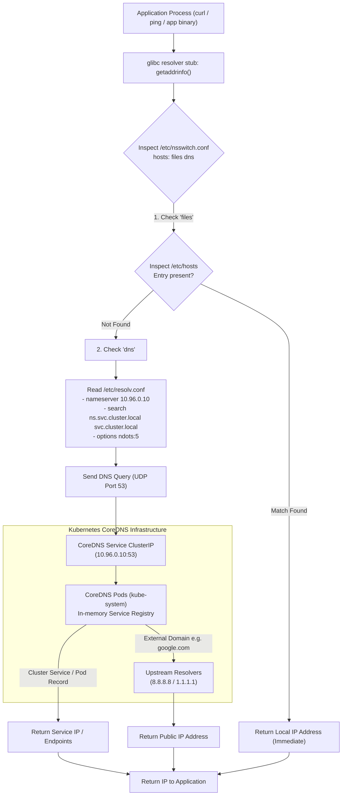

---

## 3. Deep-Dive Technical Breakdown

### 1. Static Name Resolution: `/etc/hosts`

The earliest and simplest form of name resolution in Unix-like systems:

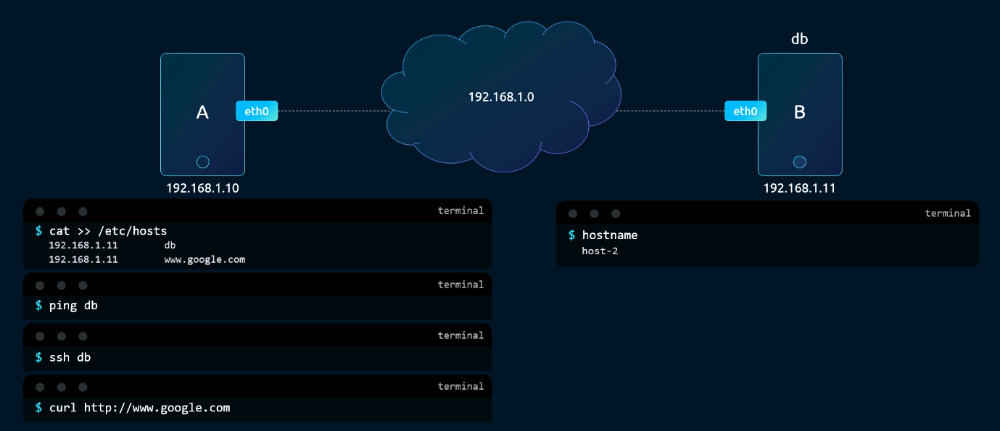

```text
# /etc/hosts format:
# <IP Address>    <Canonical Hostname>    [Aliases...]
127.0.0.1         localhost
192.168.1.10      web-server              web
192.168.1.11      db-server               db database
```

#### Key Mechanics:
- Entries are processed linearly from top to bottom.
- Hostnames in `/etc/hosts` do **not** have to match the machine's actual system hostname (`/etc/hostname`).
- **Limitation**: In distributed environments or container clusters with hundreds of ephemeral nodes and pods, distributing updates to `/etc/hosts` across all machines becomes impossible.

---

### 2. Centralized DNS Resolution: `/etc/resolv.conf`

To scale name resolution, hosts point to a centralized DNS server:

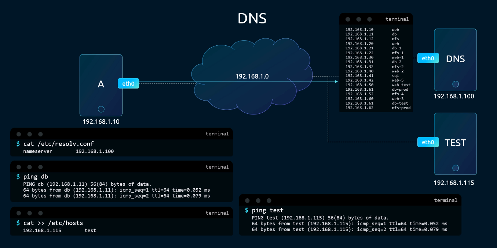

```text
# /etc/resolv.conf
nameserver 192.168.1.100
nameserver 192.168.1.101
```

- When a hostname is not found in `/etc/hosts`, the resolver sends an inquiry to `nameserver 192.168.1.100`.
- If the primary nameserver does not respond, the query fails over to secondary nameservers listed sequentially.

---

### 3. Resolution Precedence: `/etc/nsswitch.conf`

When an IP mapping exists in both `/etc/hosts` and the central DNS server, which one takes precedence?

The file **`/etc/nsswitch.conf`** dictates the order:

```text
# /etc/nsswitch.conf
hosts:          files dns
```

- **`files`**: Look up the name in `/etc/hosts` first.
- **`dns`**: Look up the name via the nameserver in `/etc/resolv.conf` only if `files` does not yield a match.

#### Scenario Demonstration:
Suppose `/etc/hosts` contains:
```text
192.168.1.115   web-server
```
And the central DNS server returns:
```text
web-server.lan  IN A 192.168.1.116
```
Because `files` precedes `dns` in `/etc/nsswitch.conf`, `ping web-server` resolves to **`192.168.1.115`**.

---

### 4. Upstream Forwarding & Public Nameservers

A private DNS server holds records for internal servers, but what happens when a user queries a public domain (e.g., `www.google.com`)?

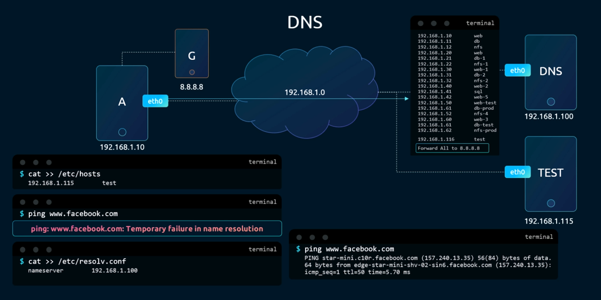

#### Forwarding Architecture:
- Instead of configuring public nameservers (like Google's `8.8.8.8` or Cloudflare's `1.1.1.1`) on every individual client host, the local DNS server is configured as a **forwarding resolver**.
- If a query cannot be answered by internal zone records, the central DNS server forwards the query to upstream public DNS servers, caches the response, and returns it to the client.

---

### 5. Domain Hierarchy & DNS Caching (TTL)

The global DNS namespace is structured as an inverted tree:

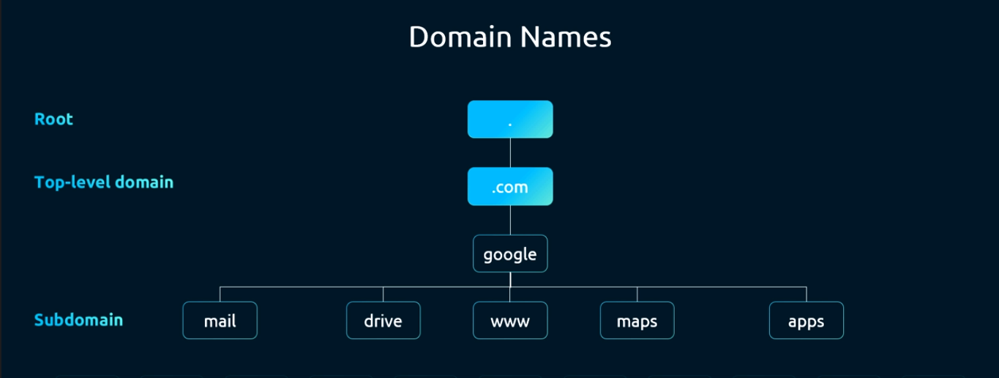

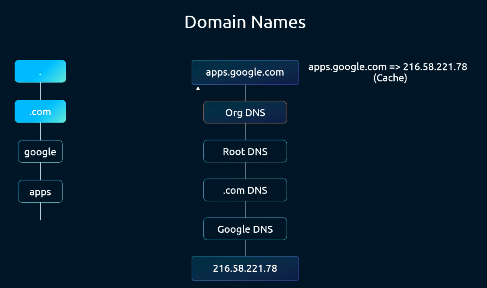

```text
                 . (Root Zone)
                 |
        +--------+--------+
        |                 |
       .com              .org (Top-Level Domains - TLD)
        |
    mycompany.com (Second-Level Domain - SLD)
        |
  +-----+-----+
  |           |
 www         mail (Subdomains)
```

- **Time To Live (TTL)**: When a DNS server resolves a record from an authoritative nameserver, it caches the record locally for the duration specified by the TTL field. Subsequent queries for that domain within the TTL window are served directly from cache without generating network traffic.

---

### 6. Search Domains & Short-Name Resolution

In an enterprise environment or Kubernetes cluster, typing fully qualified domain names (FQDNs) like `web.prod.mycompany.com` for every internal service is cumbersome:

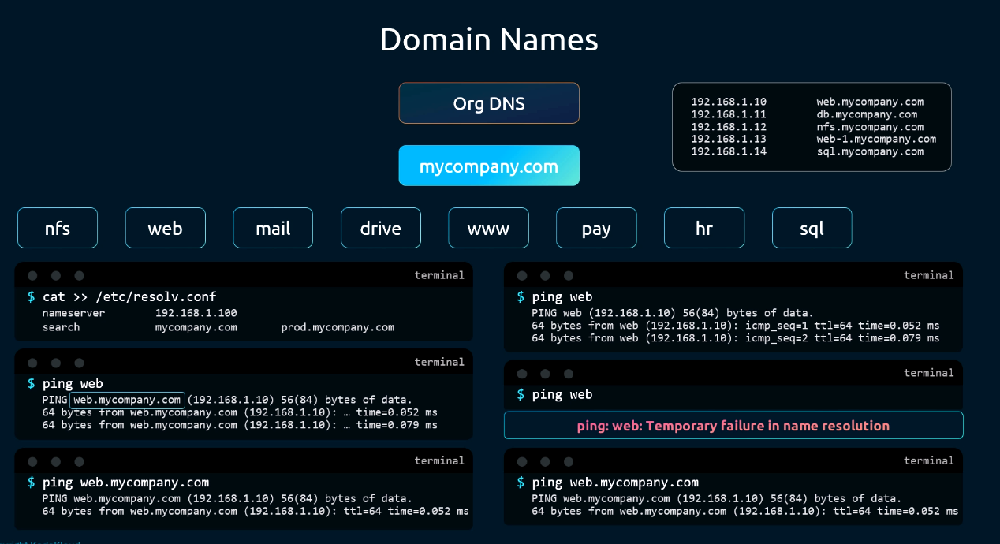

#### The `search` Directive in `/etc/resolv.conf`:
```text
# /etc/resolv.conf
nameserver 192.168.1.100
search prod.mycompany.com dev.mycompany.com
```

- When you run `ping web`:
  1. The resolver checks if `web` is an FQDN.
  2. Because it has no dots, it appends the first search domain: `web.prod.mycompany.com`.
  3. It queries the DNS server. If resolved, it returns the IP.
  4. If not found, it tries the next search domain: `web.dev.mycompany.com`.

#### The Kubernetes Pod `search` Configuration:
Inside every Kubernetes Pod, `kubelet` injects:
```text
nameserver 10.96.0.10
search default.svc.cluster.local svc.cluster.local cluster.local
options ndots:5
```
This is why a Pod in namespace `default` can reach a service named `database` simply by typing `curl database`: the resolver expands it to `database.default.svc.cluster.local` automatically.

---

### 7. Core DNS Record Types

DNS databases organize resource records into standardized types:

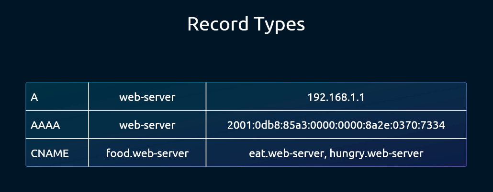

| Record Type | Full Name | Purpose & Function | Kubernetes Use Case | Example Format |
| :---: | :--- | :--- | :--- | :--- |
| **`A`** | Address Record | Maps a hostname to an IPv4 address | ClusterIP Services, Pod IPs | `web-server.default.svc 30 IN A 10.96.0.15` |
| **`AAAA`** | IPv6 Address Record | Maps a hostname to an IPv6 address | Dual-stack Kubernetes clusters | `web-server 30 IN AAAA 2001:db8::1` |
| **`CNAME`** | Canonical Name | Creates an alias pointing one domain to another domain | `ExternalName` Kubernetes Services | `my-service IN CNAME db.external-cloud.com.` |
| **`SRV`** | Service Locator | Specifies hostname, port, and protocol for a service | Discovering named ports on headless Services | `_http._tcp.web.default.svc 30 IN SRV 10 100 80 web-0...` |
| **`PTR`** | Pointer Record | Maps an IP address to a hostname (Reverse DNS) | Reverse IP lookup (`in-addr.arpa`) | `15.0.96.10.in-addr.arpa. IN PTR web-server...` |
| **`TXT`** | Text Record | Arbitrary human/machine-readable text data | Domain verification, SPF records | `mycompany.com. IN TXT "v=spf1 ..."` |

---

### 8. DNS Diagnostic Tools: `dig` vs. `nslookup` vs. `ping`

Understanding how diagnostic tools execute queries is essential for CKA network troubleshooting:

#### `nslookup`: Simple DNS Query Tool

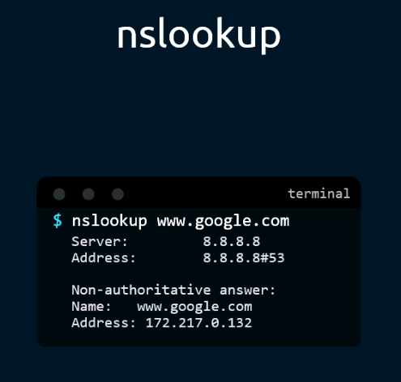

```bash
nslookup www.google.com
# Outputs:
# Server:    8.8.8.8
# Address:   8.8.8.8#53
#
# Non-authoritative answer:
# Name:      www.google.com
# Address:   172.217.0.132
```

#### `dig`: Detailed Domain Information Groper

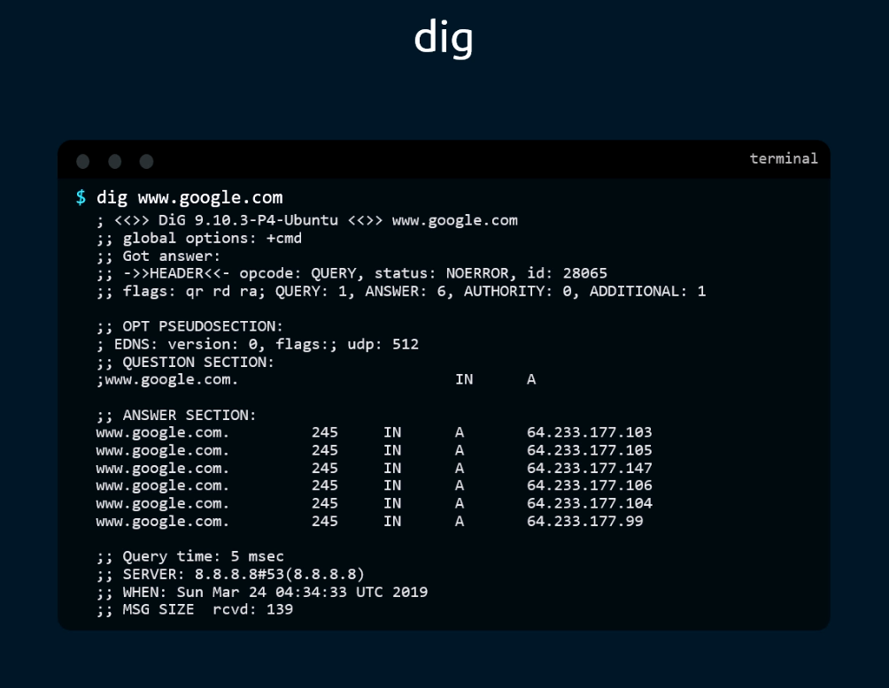

```bash
dig www.google.com
```

#### Anatomical Breakdown of `dig` Output:
1. **HEADER**: Shows query status (`NOERROR`, `NXDOMAIN`, `SERVFAIL`), query ID, and flags (`qr`, `rd`, `ra`).
2. **QUESTION SECTION**: The domain and record type queried (`www.google.com. IN A`).
3. **ANSWER SECTION**: The returned records with TTL values and IP addresses.
4. **FOOTER**: The nameserver that answered (`SERVER: 8.8.8.8#53`), query latency (`Query time: 5 msec`), and timestamp.

> [!WARNING]
> **The `/etc/hosts` Bypass Rule**:  
> Both `nslookup` and `dig` **never consult `/etc/hosts`**. If you add `192.168.1.50 test.local` to `/etc/hosts`, `ping test.local` works, but `nslookup test.local` fails with `NXDOMAIN`! To test the full OS resolution path, use **`getent hosts test.local`**.

---

## 4. Command Translation & Mapping Tables

### Resolution Diagnostic Tools Comparison

| Feature / Behavior | `ping <host>` | `nslookup <host>` | `dig <host>` | `getent hosts <host>` |
| :--- | :---: | :---: | :---: | :---: |
| **Consults `/etc/hosts`** | **YES** | **NO** | **NO** | **YES** |
| **Consults `/etc/nsswitch.conf`** | **YES** | **NO** | **NO** | **YES** |
| **Consults `/etc/resolv.conf`** | **YES** | **YES** | **YES** | **YES** |
| **Query Specific Nameserver** | No | Yes (`nslookup host 10.96.0.10`) | Yes (`dig @10.96.0.10 host`) | No |
| **Inspect Query Latency / TTL** | No | No | **YES** | No |
| **Query Specific Record Types** | No | Yes (`-type=SRV`) | Yes (`dig SRV ...`) | No |

---

## 5. High-Yield CLI & Imperative Commands

### 1. Querying Nameservers with `dig`

```bash
# 1. Concise query returning only the resolved IP address
dig +short www.google.com

# 2. Query a specific DNS server directly (e.g., CoreDNS Service IP)
dig @10.96.0.10 my-service.default.svc.cluster.local +short

# 3. Query a specific record type (e.g., SRV record for named ports)
dig @10.96.0.10 _http._tcp.my-service.default.svc.cluster.local SRV

# 4. Perform a reverse DNS lookup from IP to hostname
dig -x 10.96.0.10 +short
```

### 2. Testing Resolution with `nslookup`

```bash
# 1. Standard A record lookup
nslookup kubernetes.default

# 2. Target a specific nameserver explicitly
nslookup kubernetes.default 10.96.0.10

# 3. Query SRV records
nslookup -type=SRV _http._tcp.my-service.default.svc.cluster.local
```

### 3. Verifying In-Pod DNS in Kubernetes

```bash
# 1. Inspect the Pod's active resolv.conf configuration
kubectl exec -it <pod-name> -- cat /etc/resolv.conf

# 2. Run a fast diagnostic DNS test pod
kubectl run dns-test --rm -it --image=busybox:1.36 --restart=Never -- nslookup kubernetes.default

# 3. Verify CoreDNS Service ClusterIP in kube-system
kubectl get svc kube-dns -n kube-system
```

---

## 6. Troubleshooting & Diagnostic Runbook

### DNS Name Resolution Diagnostic Decision Tree

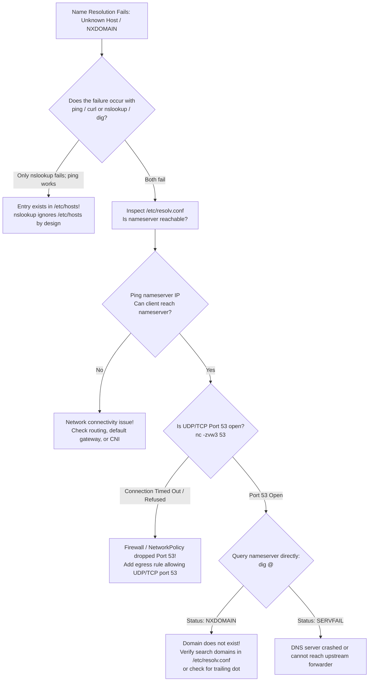

### Step-by-Step Triage Matrix

| Observed Status | Underlying Root Cause | Verification Command | Remediation Action |
| :--- | :--- | :--- | :--- |
| **`NXDOMAIN`** | Domain name does not exist in local search path or upstream DNS | `dig <host> +search` | Verify spelling, check `/etc/resolv.conf` search path, or use absolute FQDN with trailing dot. |
| **`SERVFAIL`** | CoreDNS server unable to query upstream or plugin configuration error | `kubectl logs -n kube-system -l k8s-app=kube-dns` | Check CoreDNS logs, verify upstream DNS in Corefile, check node network. |
| **`connection timed out; no servers could be reached`** | UDP/TCP port 53 blocked by NetworkPolicy or CoreDNS pods crashed | `kubectl get pods -n kube-system -l k8s-app=kube-dns` | Verify CoreDNS pods are `Running`, check NetworkPolicy egress rules on port 53. |
| **`ping` works, but `nslookup` fails** | Hostname is defined in `/etc/hosts` but not on the central DNS server | `getent hosts <name>` vs `nslookup <name>` | `nslookup` ignores `/etc/hosts`. Add record to DNS server if cluster-wide access is needed. |
| **Excessive DNS query latency ($> 5$ seconds)** | `ndots:5` causing multiple iterative search domain failures before external lookup | Run `dig +trace <domain>` | Append trailing dot to external domains (e.g. `google.com.`) to skip search path expansion. |

---

## 7. CKA Exam Tips, Gotchas & Traps

> [!WARNING]
> **Trap 1: The `nslookup` vs. `/etc/hosts` Divergence**  
> If an exam question asks: *"Why can `curl http://backend` connect, but `nslookup backend` reports server can't find backend?"*:  
> - **The Answer**: `curl` uses the system resolver, which reads `/etc/hosts` first (per `/etc/nsswitch.conf`). `nslookup` queries DNS directly and never reads `/etc/hosts`.

> [!IMPORTANT]
> **Trap 2: The `ndots:5` Latency Impact**  
> In Kubernetes, `ndots` defaults to `5`.  
> When a Pod queries an external domain like `api.github.com` (which has only 2 dots):  
> 1. Resolver checks: 2 dots $< 5$.  
> 2. It queries `api.github.com.default.svc.cluster.local` $\to$ `NXDOMAIN`.  
> 3. It queries `api.github.com.svc.cluster.local` $\to$ `NXDOMAIN`.  
> 4. It queries `api.github.com.cluster.local` $\to$ `NXDOMAIN`.  
> 5. Finally, it queries `api.github.com.` as an absolute FQDN $\to$ `SUCCESS`.  
> - **Pro Tip**: Appending a trailing dot (`api.github.com.`) forces the resolver to treat it as an absolute FQDN immediately, bypassing all 3 internal search domain lookups!

> [!TIP]
> **Trap 3: Testing Resolution with `getent hosts`**  
> When debugging a node in the exam, avoid installing third-party tools. Use the built-in system resolver diagnostic:
> ```bash
> getent hosts <hostname>
> ```
> This command uses the exact same C-library code path as Kubernetes node daemons.

> [!IMPORTANT]
> **Trap 4: Egress NetworkPolicy Blocking Port 53**  
> If an exam question isolates a Pod's egress and DNS suddenly stops working:
> You **must** add an egress rule for port 53 UDP and TCP to allow CoreDNS queries.

---

## 8. Self-Test / Active Recall

Try answering the questions below without looking at the notes, then expand each question to check your understanding.

<details>
<summary><b>1. What is the default order of name resolution defined in `/etc/nsswitch.conf` on Linux?</b></summary>

`hosts: files dns` (checks local `/etc/hosts` file first, then queries DNS nameservers).
</details>

<details>
<summary><b>2. Why does `nslookup` fail to resolve an entry that exists in `/etc/hosts`?</b></summary>

Because `nslookup` (along with `dig` and `host`) is a network DNS client that communicates directly with the nameserver via UDP/TCP port 53, completely bypassing the local `/etc/hosts` file.
</details>

<details>
<summary><b>3. What does the `search` directive in `/etc/resolv.conf` do?</b></summary>

It specifies a list of domain suffixes that the resolver automatically appends to unqualified (single-label) hostnames during resolution.
</details>

<details>
<summary><b>4. What does the `ndots:5` setting in a Kubernetes Pod's `/etc/resolv.conf` enforce?</b></summary>

It instructs the resolver that any domain name containing fewer than 5 dots must be queried against the local `search` domains first before being queried as an absolute FQDN.
</details>

<details>
<summary><b>5. How can you bypass the `ndots:5` search domain lookups when connecting to an external domain from a Pod?</b></summary>

By adding a trailing dot to the domain name (e.g. `curl https://api.stripe.com.`), marking it as an absolute Fully Qualified Domain Name (FQDN).
</details>

<details>
<summary><b>6. What are the two transport protocols used by DNS, and what is their default port?</b></summary>

UDP port 53 (standard queries) and TCP port 53 (responses exceeding 512 bytes, EDNS0 fallbacks, and zone transfers).
</details>

<details>
<summary><b>7. What is the difference between an `A` record and a `CNAME` record?</b></summary>

An `A` record maps a hostname directly to an IPv4 address. A `CNAME` (Canonical Name) record creates an alias that maps one hostname to another hostname.
</details>

<details>
<summary><b>8. What DNS record type is utilized in Kubernetes to discover named ports on headless Services?</b></summary>

`SRV` (Service locator) records.
</details>

<details>
<summary><b>9. What command uses the system glibc resolver to look up a hostname exactly as `ping` or `curl` would?</b></summary>

`getent hosts <hostname>`.
</details>

<details>
<summary><b>10. Which command flag in `dig` returns only the resolved IP address without header, question, or footer sections?</b></summary>

`dig +short <hostname>`.
</details>

---

### Official Documentation Bookmarks

| Documentation Page Title | Allowed Search Query Keyword | Direct Documentation URL |
| :--- | :--- | :--- |
| **DNS for Services and Pods** | `DNS for Services and Pods` | [https://kubernetes.io/docs/concepts/services-networking/dns-pod-service/](https://kubernetes.io/docs/concepts/services-networking/dns-pod-service/) |
| **Customizing DNS Service (CoreDNS)** | `CoreDNS Corefile` | [https://kubernetes.io/docs/tasks/administer-cluster/dns-custom-nameservers/](https://kubernetes.io/docs/tasks/administer-cluster/dns-custom-nameservers/) |
| **Debugging DNS Resolution** | `Debugging DNS Resolution` | [https://kubernetes.io/docs/tasks/administer-cluster/dns-debugging-resolution/](https://kubernetes.io/docs/tasks/administer-cluster/dns-debugging-resolution/) |

