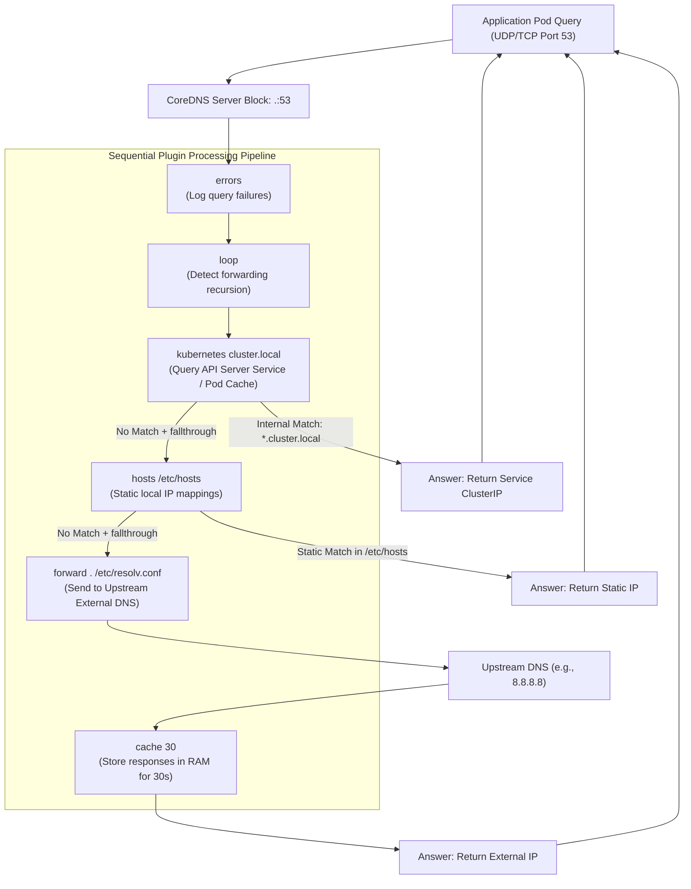
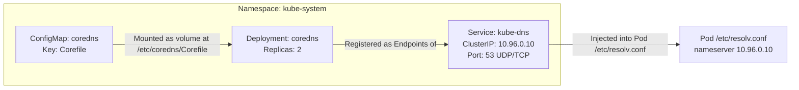
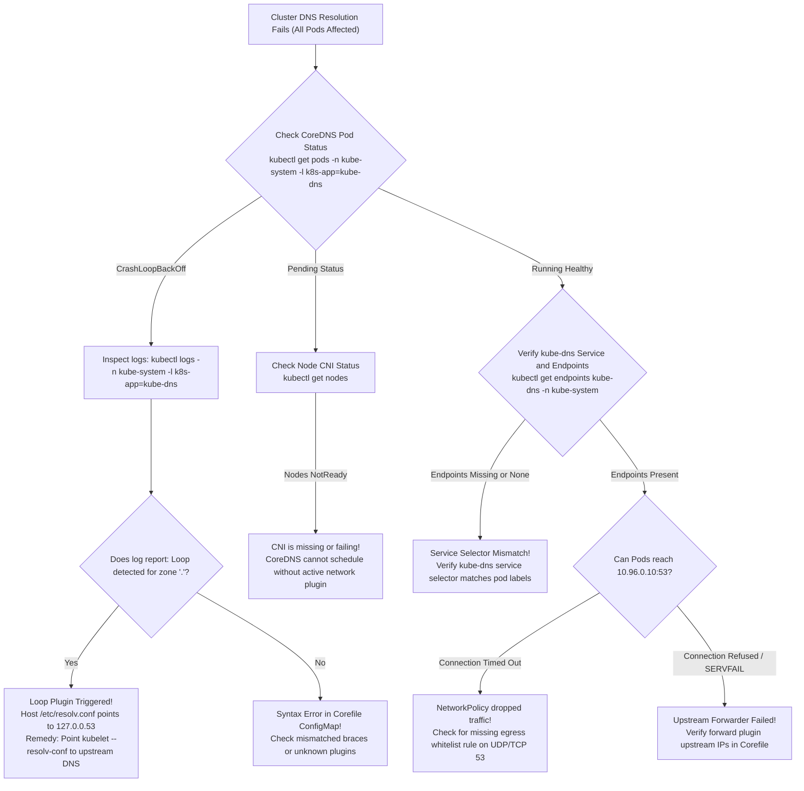

# CoreDNS Architecture, Configuration & Kubernetes Integration - CKA Exam Notes

> **Exam Domain**: Services & Networking (20%) / Troubleshooting (30%)  
> **Weight / Importance**: Critical (Tested in nearly every CKA exam: diagnosing cluster DNS failures, editing the `coredns` ConfigMap, resolving forwarding loops, configuring upstream resolvers, and troubleshooting service discovery)  
> **Target Version**: Verified against v1.31 / v1.32 (Current CKA Curriculum)  
> **Allowed Docs Search Keywords**: `Customizing DNS Service`, `CoreDNS`, `Corefile`, `DNS for Services and Pods`, `Debugging DNS Resolution`  
> **Source**: Generated from `networking/03-coredns-raw.md`

---

## 1. Quick-Reference Summary

- **What is CoreDNS?**:
  - A fast, flexible, cloud-native DNS server written in Go. It has been the default internal cluster DNS provider in Kubernetes since v1.13 (replacing legacy `kube-dns`).
- **The CoreDNS Plugin Pipeline Architecture**:
  - CoreDNS is structured as a chain of **plugins** (middleware pattern).
  - Every incoming DNS query passes sequentially through the configured plugins until one plugin answers the query or drops it.
- **The `Corefile`**:
  - The configuration file for CoreDNS. It defines **Server Blocks** bound to zones and ports (e.g., `.:53` or `cluster.local:53`).
  - Core plugins include:
    - `kubernetes`: Implements Kubernetes service discovery specification for `cluster.local`.
    - `hosts`: Resolves static entries from `/etc/hosts` or inline mappings.
    - `fallthrough`: Continues query processing to subsequent plugins if the current plugin has no match.
    - `forward`: Forwards unmatched queries to upstream external resolvers (e.g. `/etc/resolv.conf`, `8.8.8.8`).
    - `cache`: In-memory TTL caching of responses.
    - `loop`: Detects and aborts infinite forwarding loops.
    - `reload`: Automatically reloads the Corefile on change without server downtime.
- **In-Cluster Kubernetes Deployment Architecture**:
  - **Deployment**: `coredns` in namespace `kube-system` (typically 2 replicas).
  - **Service**: `kube-dns` in `kube-system` with a static ClusterIP (usually `10.96.0.10`).
  - **ConfigMap**: `coredns` in `kube-system` containing the `Corefile`.
- **Core Exposed Ports**:
  - **Port 53 (UDP & TCP)**: Standard DNS query traffic.
  - **Port 9153 (TCP)**: Prometheus metrics endpoint (`/metrics`).
  - **Port 8080 (TCP)**: Health check endpoint (`/health`).
  - **Port 8181 (TCP)**: Readiness probe endpoint (`/ready`).
- **The #1 CKA Gotcha: The `loop` Plugin Crash**:
  - If the host worker node's `/etc/resolv.conf` points to `127.0.0.53` (systemd-resolved) or `127.0.0.1`, CoreDNS forwards queries to itself, triggers the `loop` plugin, and enters **`CrashLoopBackOff`**.

---

## 2. Conceptual Overview & Mental Model

### Dual-Layer Architectural Understanding

- **Simple English Explanation (How It Works)**:
  - In a Kubernetes cluster, Pods and Services are created and destroyed constantly, receiving dynamic IP addresses. Applications need a reliable way to talk to `database-service` without knowing its raw IP address.
  - **CoreDNS** is the central directory server for the cluster.
  - When you install Kubernetes, CoreDNS is deployed as a standard Deployment in the `kube-system` namespace.
  - It continually watches the Kubernetes API server. When a new Service or Pod is created, CoreDNS immediately registers an internal domain name for it (e.g., `database-service.default.svc.cluster.local`).
  - When an application pod queries that name, CoreDNS intercepts the request on port 53 and returns the Service's ClusterIP.
  - CoreDNS is configured through a file called the **Corefile**, stored in a Kubernetes ConfigMap.
  - The Corefile uses a "plugin chain": the request first checks the `kubernetes` plugin for internal services; if it's not a cluster service (like `google.com`), it passes through to the `forward` plugin, which sends the query to external internet DNS servers.

- **Formal Kubernetes Architecture Definition**:
  - CoreDNS is a modular DNS server implementing the Kubernetes DNS-Based Service Discovery Specification. In-cluster instances run as unprivileged pods in `kube-system`, listening on UDP/TCP port 53. The `kubernetes` plugin establishes informers against `kube-apiserver` to maintain real-time in-memory indexes of `Service`, `Endpoints`, and `EndpointSlice` resources. When resolving queries within the cluster domain (`cluster.local`), CoreDNS evaluates A, AAAA, SRV, and PTR records according to specification rules. Unmatched queries traverse the configured middleware pipeline, engaging the `cache`, `forward`, and `metrics` plugins.

### CoreDNS Plugin Pipeline Architecture



---

## 3. Deep-Dive Technical Breakdown

### 1. Standalone CoreDNS Binary Installation

Before deploying into Kubernetes, understanding CoreDNS as a standalone Linux binary demonstrates its underlying mechanics:

```bash
# 1. Download release tarball from GitHub
curl -LO https://github.com/coredns/coredns/releases/download/v1.12.4/coredns_1.12.4_linux_amd64.tgz

# 2. Extract the archive to retrieve the standalone binary
tar -zxf coredns_1.12.4_linux_amd64.tgz

# 3. Verify executable permissions and version
./coredns -version

# 4. Run CoreDNS with a custom Corefile
./coredns -conf Corefile
```

---

### 2. Anatomy of the `Corefile`

The `Corefile` defines how CoreDNS processes requests. It consists of one or more **Server Blocks** defined by `zone:port`:

```text
.:53 {
    # 1. Static file mapping plugin
    hosts /etc/hosts {
        reload 1m
        fallthrough
    }

    # 2. Upstream forwarding plugin
    forward . /etc/resolv.conf {
        max_concurrent 1000
    }

    # 3. In-memory caching plugin
    cache 30

    # 4. Standard query logging
    log

    # 5. Error logging
    errors
}
```

#### Plugin Directives Explained:
1. **`hosts /etc/hosts`**:
   - Reads host-to-IP mappings directly from the specified file.
   - `reload 1m`: Scans the file every 1 minute and reloads changes automatically without restarting the process.
   - **`fallthrough`**: **Critical parameter**. By default, if a domain is queried and not found in `/etc/hosts`, the `hosts` plugin immediately terminates the query and returns `NXDOMAIN`. Specifying `fallthrough` instructs the plugin to pass the unresolved query down the chain to the `forward` plugin!
2. **`forward . /etc/resolv.conf`**:
   - Forwards any query matching `.` (all domains) to the nameservers listed in the host's `/etc/resolv.conf`.
   - `max_concurrent 1000`: Protects the server by capping concurrent outbound queries.
3. **`cache 30`**:
   - Caches both positive and negative responses for up to 30 seconds, dramatically reducing upstream latency.
4. **`log` and `errors`**:
   - Emits structured query and error logs to stdout/stderr.

---

### 3. CoreDNS in Kubernetes: The Complete In-Cluster Setup

In a production Kubernetes cluster, CoreDNS is deployed and managed via three distinct Kubernetes resources:



#### The Production Kubernetes Corefile (ConfigMap):
```yaml
apiVersion: v1
kind: ConfigMap
metadata:
  name: coredns
  namespace: kube-system
data:
  Corefile: |
    .:53 {
        errors
        health {
           lameduck 5s
        }
        ready
        kubernetes cluster.local in-addr.arpa ip6.arpa {
           pods insecure
           fallthrough in-addr.arpa ip6.arpa
           ttl 30
        }
        prometheus :9153
        forward . /etc/resolv.conf
        cache 30
        loop
        reload
        loadbalance
    }
```

#### Kubernetes-Specific Plugins Explained:
- **`kubernetes cluster.local in-addr.arpa ip6.arpa`**:
  - The authoritative plugin for Kubernetes service discovery.
  - Handles queries ending in `.cluster.local` (e.g. `service.namespace.svc.cluster.local`).
  - `pods insecure`: Resolves pod IP records (`10-244-1-5.namespace.pod.cluster.local`) without verifying matching pod names.
  - `ttl 30`: Sets DNS cache TTL to 30 seconds for service records.
- **`health`**:
  - Exposes an HTTP health check endpoint on port 8080 (`http://localhost:8080/health`).
- **`ready`**:
  - Exposes an HTTP readiness probe on port 8181 (`http://localhost:8181/ready`), signaling when all plugins are initialized.
- **`prometheus :9153`**:
  - Exposes OpenMetrics / Prometheus metrics on `http://localhost:9153/metrics`.
- **`loop`**:
  - Detects simple forwarding loops (where CoreDNS forwards a query to an upstream resolver that sends it right back).
- **`reload`**:
  - Watches the mounted ConfigMap. If the ConfigMap is edited, CoreDNS automatically reloads within ~30-45 seconds without dropping queries.
- **`loadbalance`**:
  - Acts as a round-robin DNS load balancer by randomizing the order of A and AAAA records in multi-IP responses.

---

### 4. Customizing CoreDNS: Stub Domains & Custom Upstreams

In enterprise environments, clusters often need to resolve internal corporate domains (e.g. `corp.internal`) using an on-premises DNS server:

```yaml
apiVersion: v1
kind: ConfigMap
metadata:
  name: coredns
  namespace: kube-system
data:
  Corefile: |
    # 1. Custom Server Block for Corporate Domain
    corp.internal:53 {
        forward . 10.0.0.50 10.0.0.51
        cache 60
        errors
    }

    # 2. Primary Cluster Server Block
    .:53 {
        errors
        health
        ready
        kubernetes cluster.local in-addr.arpa ip6.arpa {
           pods insecure
           fallthrough in-addr.arpa ip6.arpa
        }
        prometheus :9153
        forward . 8.8.8.8 1.1.1.1     # Explicit upstream DNS
        cache 30
        loop
        reload
        loadbalance
    }
```

---

## 4. Command Translation & Mapping Tables

### CoreDNS Plugin Feature Matrix

| Plugin Name | Primary Operational Role | Default Port / Endpoint | Critical Options / Gotchas |
| :--- | :--- | :---: | :--- |
| **`kubernetes`** | Service discovery for `cluster.local` | 53 UDP/TCP | Requires `fallthrough` to allow external forwarding |
| **`forward`** | Proxy unmatched queries upstream | Upstream port 53 | Accepts `/etc/resolv.conf` or explicit IPs (`8.8.8.8`) |
| **`hosts`** | Static hostname-to-IP lookup | N/A | **MUST** specify `fallthrough` or non-hosts queries fail |
| **`cache`** | In-memory response caching | N/A | Default 30s; tuning reduces upstream DNS rate limits |
| **`loop`** | Forwarding loop detection | N/A | Triggers `CrashLoopBackOff` if `/etc/resolv.conf` loops |
| **`reload`** | Dynamic Corefile reload | N/A | Avoids pod restarts on ConfigMap modifications |
| **`health`** | Liveness probe monitoring | HTTP 8080 (`/health`) | Used by Kubernetes livenessProbe |
| **`ready`** | Readiness probe monitoring | HTTP 8181 (`/ready`) | Used by Kubernetes readinessProbe |
| **`prometheus`** | Telemetry and performance metrics | HTTP 9153 (`/metrics`) | Scraped by Prometheus / metrics-server |

---

## 5. High-Yield CLI & Imperative Commands

### 1. Inspecting and Editing CoreDNS

```bash
# 1. View the live CoreDNS ConfigMap
kubectl get configmap coredns -n kube-system -o yaml

# 2. Edit the CoreDNS configuration live
kubectl edit configmap coredns -n kube-system

# 3. Check the status of the CoreDNS pods
kubectl get pods -n kube-system -l k8s-app=kube-dns -o wide

# 4. Stream logs from all CoreDNS replicas simultaneously
kubectl logs -n kube-system -l k8s-app=kube-dns -f --tail=100
```

### 2. Forcing CoreDNS Restarts & Verifying Endpoints

```bash
# 1. Restart CoreDNS rollout to immediately pick up ConfigMap updates
kubectl rollout restart deployment/coredns -n kube-system

# 2. Check rollout status
kubectl rollout status deployment/coredns -n kube-system

# 3. Verify kube-dns Service and its backing pod Endpoints
kubectl get svc kube-dns -n kube-system
kubectl get endpoints kube-dns -n kube-system
```

### 3. Active In-Cluster DNS Verification

```bash
# 1. Test intra-cluster service resolution using a temporary busybox pod
kubectl run dns-test --rm -it --image=busybox:1.36 --restart=Never -- nslookup kubernetes.default

# 2. Test external domain resolution from within the cluster
kubectl run dns-ext-test --rm -it --image=busybox:1.36 --restart=Never -- nslookup google.com

# 3. Test SRV record resolution for CoreDNS itself
kubectl run srv-test --rm -it --image=busybox:1.36 --restart=Never -- \
  nslookup -type=SRV _dns._udp.kube-dns.kube-system.svc.cluster.local
```

---

## 6. Troubleshooting & Diagnostic Runbook

### CoreDNS Failure Diagnostic Decision Tree



### Step-by-Step Triage Matrix

| Observed Symptom | Underlying Root Cause | Verification Command | Remediation Action |
| :--- | :--- | :--- | :--- |
| **CoreDNS in `CrashLoopBackOff` (`Loop detected`)** | Host node `/etc/resolv.conf` contains loopback IP (`127.0.0.53` or `127.0.0.1`) | `kubectl logs -n kube-system -l k8s-app=kube-dns` | Configure kubelet flag `--resolv-conf=/run/systemd/resolve/resolv.conf` or update host DNS to `8.8.8.8`. |
| **CoreDNS Pods stuck in `Pending`** | CNI plugin (e.g. Calico, Flannel) is not installed; worker nodes are `NotReady` | `kubectl get nodes` | Install and configure an approved CNI network plugin. |
| **`nslookup: connection timed out; no servers reached`** | Active NetworkPolicy restricts pod egress, blocking UDP port 53 | Inspect NetworkPolicies targeting client pod | Add egress whitelist rule allowing UDP and TCP port 53 to `kube-system`. |
| **`endpoints "kube-dns" not found` or `<none>`** | `kube-dns` Service selector does not match CoreDNS pod labels (`k8s-app: kube-dns`) | `kubectl get svc kube-dns -n kube-system -o yaml` | Correct the selector under `spec.selector` in the `kube-dns` Service manifest. |
| **External domains fail (`SERVFAIL`); internal services work** | Upstream resolver in `forward` plugin is unreachable or misconfigured | Inspect Corefile `forward .` target | Update `forward .` in ConfigMap to use public DNS resolvers (`8.8.8.8 1.1.1.1`). |

---

## 7. CKA Exam Tips, Gotchas & Traps

> [!WARNING]
> **Trap 1: The Corefile Syntax Validation Failure**  
> In troubleshooting scenarios, an exam task might ask you to fix broken DNS where someone made a typo in the `coredns` ConfigMap (e.g., misspelled `kubernetes`, missing closing brace `}`, or broken indentation).  
> - **Behavior**: CoreDNS pods will crash immediately upon reading the ConfigMap.  
> - **Triage**: Check `kubectl logs -n kube-system -l k8s-app=kube-dns`. The log will print the exact line number of the parsing error in the Corefile!

> [!IMPORTANT]
> **Trap 2: The Missing `fallthrough` Directive**  
> If an exam question asks you to add custom static mappings to the Corefile using the `hosts` plugin:
> - **WRONG**:
>   ```text
>   hosts {
>       10.0.0.10 custom.domain.local
>   }
>   ```
>   *(Without `fallthrough`, any domain NOT matching `custom.domain.local` returns NXDOMAIN, breaking all external and cluster resolution!)*
> - **CORRECT**:
>   ```text
>   hosts {
>       10.0.0.10 custom.domain.local
>       fallthrough # MANDATORY: Passes non-matching queries down the chain!
>   }
>   ```

> [!TIP]
> **Trap 3: Forcing Instant Reloads**  
> After editing the `coredns` ConfigMap, the `reload` plugin takes between 30 and 45 seconds to detect the change.  
> In a timed exam, do not wait! Force an immediate reload:
> ```bash
> kubectl rollout restart deployment/coredns -n kube-system
> ```

> [!IMPORTANT]
> **Trap 4: Missing kube-dns Service ClusterIP**  
> If an exam question presents a cluster where all pods fail to resolve DNS, run `kubectl get svc -n kube-system`. Candidates often find that someone deleted or misconfigured the `kube-dns` Service. Verify that the Service ClusterIP matches the `nameserver` IP injected into Pod `/etc/resolv.conf` (typically `10.96.0.10`).

---

## 8. Self-Test / Active Recall

Try answering the questions below without looking at the notes, then expand each question to check your understanding.

<details>
<summary><b>1. What is the default DNS server implementation used in modern Kubernetes clusters?</b></summary>

CoreDNS (deployed as a Deployment in the `kube-system` namespace).
</details>

<details>
<summary><b>2. In which Kubernetes resource is the CoreDNS server configuration stored?</b></summary>

Inside the `coredns` ConfigMap located in the `kube-system` namespace, specifically under the data key `Corefile`.
</details>

<details>
<summary><b>3. What does the `fallthrough` directive accomplish when configured inside the `hosts` plugin?</b></summary>

It instructs the `hosts` plugin that if a queried domain is not found in its mapping file, it must pass the query down to the next plugin in the pipeline (e.g. `forward`) instead of terminating the query with `NXDOMAIN`.
</details>

<details>
<summary><b>4. What causes the CoreDNS `loop` plugin to trigger and crash the pod?</b></summary>

A forwarding loop, typically occurring when CoreDNS is configured to forward queries to `/etc/resolv.conf`, but the host node's `/etc/resolv.conf` points back to a loopback address (`127.0.0.53` or `127.0.0.1`), causing queries to loop indefinitely.
</details>

<details>
<summary><b>5. Which CoreDNS plugin is responsible for answering queries for Kubernetes Services and Pods?</b></summary>

The `kubernetes` plugin (configured with the cluster domain, typically `cluster.local`).
</details>

<details>
<summary><b>6. What are the four default network ports opened by the Kubernetes CoreDNS pod?</b></summary>

Port 53 (UDP & TCP for DNS queries), Port 8080 (HTTP for health checks), Port 8181 (HTTP for readiness checks), and Port 9153 (HTTP for Prometheus metrics).
</details>

<details>
<summary><b>7. What is the fastest way to force CoreDNS to apply ConfigMap changes without waiting for the `reload` plugin interval?</b></summary>

`kubectl rollout restart deployment/coredns -n kube-system`.
</details>

<details>
<summary><b>8. What does the `loadbalance` plugin do in CoreDNS?</b></summary>

It acts as a round-robin DNS load balancer by randomizing the order of A and AAAA records in the answer section of responses containing multiple IPs.
</details>

<details>
<summary><b>9. What Kubernetes Service acts as the front-end load balancer for CoreDNS pods in `kube-system`?</b></summary>

The `kube-dns` Service (usually assigned the static IP `10.96.0.10`).
</details>

<details>
<summary><b>10. If an external query fails with `SERVFAIL` while internal service discovery works, which plugin in the Corefile is likely misconfigured?</b></summary>

The `forward` plugin (unable to connect to upstream DNS servers or invalid upstream IP addresses).
</details>

---

### Official Documentation Bookmarks

| Documentation Page Title | Allowed Search Query Keyword | Direct Documentation URL |
| :--- | :--- | :--- |
| **Customizing DNS Service** | `Customizing DNS Service CoreDNS` | [https://kubernetes.io/docs/tasks/administer-cluster/dns-custom-nameservers/](https://kubernetes.io/docs/tasks/administer-cluster/dns-custom-nameservers/) |
| **DNS for Services and Pods** | `DNS for Services and Pods` | [https://kubernetes.io/docs/concepts/services-networking/dns-pod-service/](https://kubernetes.io/docs/concepts/services-networking/dns-pod-service/) |
| **Debugging DNS Resolution** | `Debugging DNS Resolution` | [https://kubernetes.io/docs/tasks/administer-cluster/dns-debugging-resolution/](https://kubernetes.io/docs/tasks/administer-cluster/dns-debugging-resolution/) |
| **CoreDNS Kubernetes Plugin Documentation** | `CoreDNS kubernetes plugin coredns.io` | [https://coredns.io/plugins/kubernetes/](https://coredns.io/plugins/kubernetes/) |

