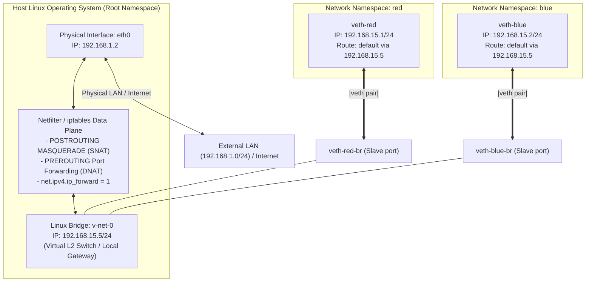
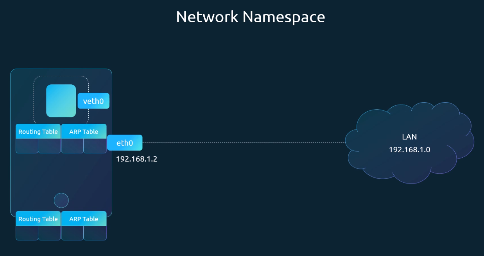
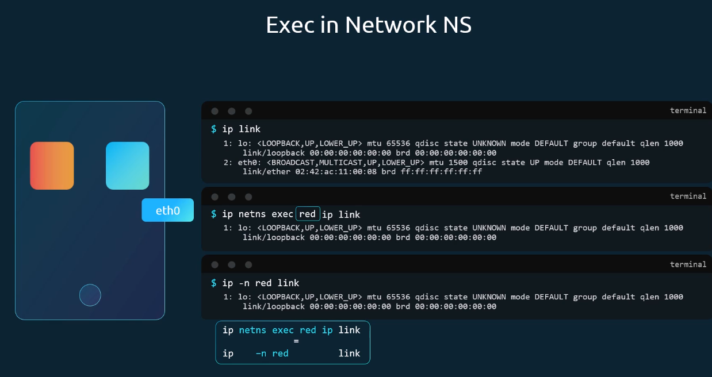
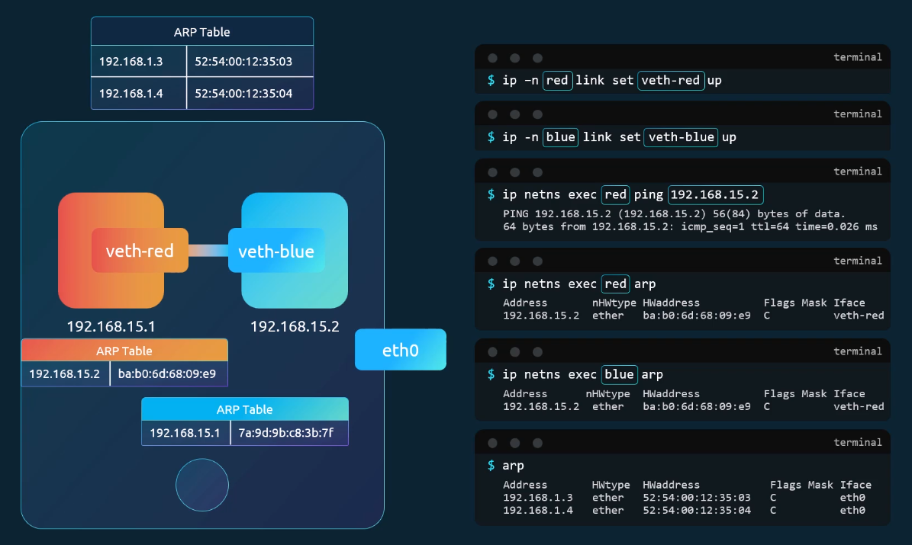
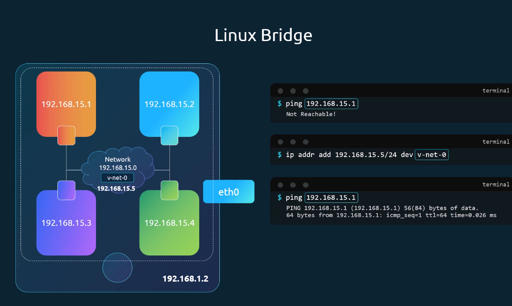
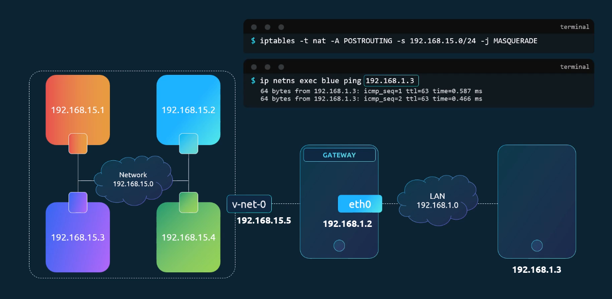
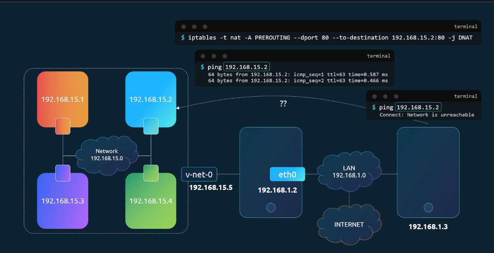
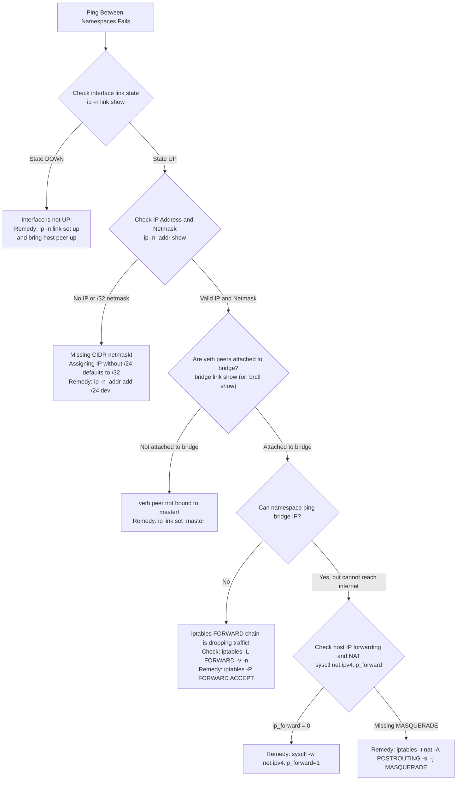

# Linux Network Namespaces, Virtual Ethernet & Bridge Networking - CKA Exam Notes

> **Exam Domain**: Services & Networking (20%) / Troubleshooting (30%)  
> **Weight / Importance**: Critical (The foundational architecture of all Kubernetes Pod networking: CNI plugins, container network isolation, `veth` pair plumbing, Linux bridge switching, and iptables packet forwarding)  
> **Target Version**: Verified against v1.31 / v1.32 (Current CKA Curriculum)  
> **Allowed Docs Search Keywords**: `Cluster Networking`, `Network Plugins`, `Network Namespaces`, `veth`, `bridge`, `iptables MASQUERADE`  
> **Source**: Generated from `networking/04-prerequisites-network-namespaces-raw.md`

---

## 1. Quick-Reference Summary

- **What is a Network Namespace (`netns`)?**:
  - An isolated instance of the Linux network subsystem containing its own network interfaces, routing tables, ARP tables, firewall rules, and socket listeners. Every Kubernetes Pod runs inside its own dedicated network namespace.
- **Fundamental CLI Operations**:
  - Create namespace: `ip netns add <name>`
  - List namespaces: `ip netns list` (or: `ip netns`)
  - Execute command inside namespace: `ip netns exec <name> <cmd>` (or shortcut: `ip -n <name> <cmd>`)
  - Delete namespace: `ip netns del <name>`
- **Virtual Ethernet (`veth`) Pair Mechanics**:
  - A bidirectional virtual cable connecting two network namespaces or connecting a namespace to the host network stack.
  - Creation: `ip link add <veth-a> type veth peer name <veth-b>`
  - Assignment: `ip link set <veth-a> netns <ns-name>`
  - Deletion rule: Deleting one end of a `veth` pair automatically destroys the peer end.
- **Linux Software Bridge (`bridge`)**:
  - Acts as a Layer 2 virtual switch inside the host kernel, enabling multiple network namespaces to communicate over a common subnet without an $O(N^2)$ mesh of peer-to-peer cables.
  - Creation: `ip link add <br-name> type bridge`
  - Attaching slave veth peer: `ip link set <veth-peer> master <br-name>`
  - Enabling host routing: Assign an IP to the bridge (`ip addr add <ip>/<cidr> dev <br-name>`). The bridge IP serves as the default gateway for all attached namespaces.
- **External Outbound Access (Egress NAT / MASQUERADE)**:
  - Requires Linux IP forwarding: `sysctl -w net.ipv4.ip_forward=1`
  - Requires default gateway inside namespace: `ip -n <name> route add default via <bridge-ip>`
  - Requires SNAT masquerading on host:
    ```bash
    iptables -t nat -A POSTROUTING -s <subnet-cidr> -j MASQUERADE
    ```
- **External Inbound Access (Port Forwarding / DNAT)**:
  - Forwards external traffic arriving at a host port into a private namespace IP:
    ```bash
    iptables -t nat -A PREROUTING -p tcp --dport <host-port> -j DNAT --to-destination <netns-ip>:<target-port>
    ```
  - This is the exact mechanism powering Kubernetes NodePort Services and `kube-proxy` iptables mode.

---

## 2. Conceptual Overview & Mental Model

### Dual-Layer Architectural Understanding

- **Simple English Explanation (How It Works)**:
  - By default, every process running on a Linux computer shares the same network card (`eth0`), the same IP address, the same routing table, and the same open port list.
  - When you run containers (like Kubernetes Pods), you do not want one container to interfere with another container's open ports or sniff its network traffic.
  - A **Network Namespace** creates a completely blank, isolated network environment for a container. Inside its namespace, the container sees only a loopback interface (`lo`), an empty routing table, and an empty ARP cache.
  - To connect two isolated namespaces together, you create a **Virtual Ethernet (veth) pair**. A veth pair is a point-to-point bidirectional virtual link with two interconnected peer endpoints: packets transmitted on one end immediately emerge on the other end.
  - If you have three or more namespaces, connecting them with individual peer-to-peer veth pairs creates an unmanageable mesh. Instead, you create a **Linux Bridge** (an in-kernel Layer 2 virtual switch). You connect one end of each veth pair into a namespace and attach the other end as a slave port on the bridge.
  - To let containers communicate with the outside internet, you assign an IP address to the bridge to act as a gateway, turn on **IP forwarding** in the Linux kernel, and use **iptables MASQUERADE (NAT)** so the host replaces the container's private IP with its own public IP.
  - When Kubernetes creates a Pod, this entire process is executed automatically by the **CNI plugin**.

- **Formal Linux & Kubernetes Architecture Definition**:
  - Network namespaces are instantiated via the `CLONE_NEWNET` flag during `clone(2)` or `unshare(2)` system calls, partitioning `struct net` kernel data structures. The virtual Ethernet (`veth`) driver provides a point-to-point software tunnel where packets transmitted on one end are injected into the receive queue of the peer end. The Linux bridge driver (`bridge.ko`) implements an IEEE 802.1D switching fabric inside the kernel, performing frame forwarding based on dynamic MAC address tables. Egress packet rewrite is performed via the Netfilter `POSTROUTING` chain using the `MASQUERADE` target, while ingress port forwarding is managed via the `PREROUTING` chain using destination network address translation (`DNAT`).

### Multi-Namespace Linux Bridge and NAT Packet Traversal Architecture



---

## 3. Deep-Dive Technical Breakdown

### 1. Network Namespace Isolation Mechanics

When a network namespace is created, it completely isolates the network stack from the host:



#### Creating and Inspecting Namespaces:
```bash
# 1. Create two independent network namespaces
ip netns add red
ip netns add blue

# 2. List all network namespaces on the host
ip netns list
# Output:
# blue
# red
```

#### Executing Commands Inside Namespaces:


To execute commands within the isolated network namespace context:
```bash
# Full syntax:
ip netns exec red ip link

# Modern shortcut:
ip -n red link
# Output inside 'red':
# 1: lo: <LOOPBACK> mtu 65536 qdisc noop state DOWN mode DEFAULT group default qlen 1000
#     link/loopback 00:00:00:00:00:00 brd 00:00:00:00:00:00
```

Notice that the namespace only contains an unconfigured loopback interface (`lo`). It cannot see the host's `eth0`, the host's ARP table, or the host's routing table:
```bash
# Host ARP table vs Namespace ARP table:
arp                      # Displays host ARP cache
ip -n red arp            # Returns empty (no network visibility)

# Host routing table vs Namespace routing table:
ip route                 # Displays host routes
ip -n red route          # Returns empty (no routes configured)
```

---

### 2. Point-to-Point Interconnection: The `veth` Pair

To enable communication between two namespaces directly, you establish a virtual Ethernet cable:



#### Step-by-Step Configuration:
```bash
# Step 1: Create the veth pair on the host
ip link add veth-red type veth peer name veth-blue

# Step 2: Move each peer endpoint into its respective namespace
ip link set veth-red netns red
ip link set veth-blue netns blue

# Step 3: Assign IP addresses to each endpoint (Always include CIDR netmask!)
ip -n red addr add 192.168.15.1/24 dev veth-red
ip -n blue addr add 192.168.15.2/24 dev veth-blue

# Step 4: Bring the interfaces UP
ip -n red link set veth-red up
ip -n blue link set veth-blue up
ip -n red link set lo up
ip -n blue link set lo up

# Step 5: Verify point-to-point connectivity
ip netns exec red ping -c 2 192.168.15.2
```

#### ARP Table State:
- Inspecting ARP inside `red` shows `veth-red` has resolved the MAC address of `192.168.15.2` (`veth-blue`).
- The host's ARP table remains completely unaware of these private namespace IPs and MAC addresses.

---

### 3. Scaling to Multiple Namespaces: The Linux Bridge

Point-to-point `veth` pairs do not scale. Connecting 10 namespaces directly would require 45 separate `veth` pairs ($N(N-1)/2$). 

The solution is an in-kernel virtual switch: a **Linux Bridge**:



#### Step-by-Step Bridge Architecture:

```bash
# 1. Create the virtual bridge interface on the host
ip link add v-net-0 type bridge

# 2. Bring the bridge interface UP
ip link set dev v-net-0 up

# 3. Create a veth pair for namespace 'red'
ip link add veth-red type veth peer name veth-red-br

# 4. Attach one end to namespace 'red' and the other end to the bridge
ip link set veth-red netns red
ip link set veth-red-br master v-net-0

# 5. Repeat for namespace 'blue'
ip link add veth-blue type veth peer name veth-blue-br
ip link set veth-blue netns blue
ip link set veth-blue-br master v-net-0

# 6. Assign IP addresses and bring all links UP
ip -n red addr add 192.168.15.1/24 dev veth-red
ip -n blue addr add 192.168.15.2/24 dev veth-blue

ip -n red link set veth-red up
ip -n blue link set veth-blue up
ip link set veth-red-br up
ip link set veth-blue-br up
```

#### Connecting Host to Bridge:
At this stage, `red` can ping `blue` through the bridge. However, the host itself cannot ping either namespace because the bridge interface has no IP address assigned.
```bash
# Assign gateway IP to the bridge interface on the host:
ip addr add 192.168.15.5/24 dev v-net-0

# Now the host can ping any namespace connected to the bridge:
ping -c 2 192.168.15.1
```

---

### 4. Outbound External Routing & NAT Masquerading

Namespaces can now communicate with each other and the host, but cannot reach external networks (like other LAN servers `192.168.1.0/24` or the internet `8.8.8.8`):



#### The Problem:
1. When `blue` pings `192.168.1.10`, it has no route to `192.168.1.0/24`, failing with `connect: Network is unreachable`.
2. Even if we add a default route pointing to the bridge (`192.168.15.5`), the external LAN host receives a packet originating from `192.168.15.2`. Because the external LAN host has no route back to private subnet `192.168.15.0/24`, return packets are dropped!

#### The Solution (Egress NAT):
1. **Add Default Route in the Namespace**:
   ```bash
   ip -n blue route add default via 192.168.15.5
   ip -n red route add default via 192.168.15.5
   ```
2. **Enable Kernel IP Forwarding on the Host**:
   ```bash
   sysctl -w net.ipv4.ip_forward=1
   ```
3. **Configure iptables MASQUERADE (SNAT)**:
   Instruct Netfilter on the host to rewrite the source IP of all outgoing packets leaving `192.168.15.0/24` with the host's own physical IP (`192.168.1.2`):
   ```bash
   iptables -t nat -A POSTROUTING -s 192.168.15.0/24 -j MASQUERADE
   ```
   Now, external hosts see packets arriving from the host (`192.168.1.2`) and send replies back to the host, which automatically translates them back to the private namespace IP!

---

### 5. Inbound Access: Port Forwarding (DNAT)

How can an external system on the LAN access a service running inside a private network namespace (e.g., an nginx web server listening on port 80 in `blue` at `192.168.15.2`)?



#### The Solution (Destination NAT / DNAT):
Add an iptables PREROUTING rule on the host to intercept traffic arriving at host port `80` and redirect it to the namespace IP:

```bash
iptables -t nat -A PREROUTING -p tcp --dport 80 -j DNAT --to-destination 192.168.15.2:80
```

- When external client `192.168.1.10` visits `http://192.168.1.2:80` (the host's IP), the kernel rewrites the destination header to `192.168.15.2:80` and forwards the packet across the bridge.
- **The Kubernetes Connection**: This is the exact mechanism that powers **Kubernetes NodePort Services** and **Docker `-p 80:80` container publishing**.

---

## 4. Command Translation & Mapping Tables

### Linux Primitives vs. Kubernetes / CNI Architectural Equivalents

| Linux Networking Primitive | Manual CLI Command | Kubernetes / CNI Equivalent Component |
| :--- | :--- | :--- |
| **Network Namespace (`netns`)** | `ip netns add <name>` | **Pod Sandbox**: Every Pod is an isolated network namespace |
| **Virtual Ethernet (`veth`) Pair** | `ip link add veth-a type veth peer name veth-b` | **Pod Interface Plumb**: One end inside pod (`eth0`), other on host (`veth*`) |
| **Linux Bridge (`bridge`)** | `ip link add v-net-0 type bridge` | **`cbr0` / `docker0`**: The default node bridge switch |
| **Bridge Attachment** | `ip link set veth-peer master v-net-0` | **CNI Bridge Plugin**: Automatically binds pod veth to host bridge |
| **Default Gateway Route** | `ip -n <ns> route add default via <gw>` | **Pod Routing Table**: Injected by CNI pointing to host bridge IP |
| **Egress SNAT / MASQUERADE** | `iptables -t nat -A POSTROUTING -j MASQUERADE` | **CNI Egress NAT**: Enables pods to access external IPs and internet |
| **Ingress DNAT / Port Forward** | `iptables -t nat -A PREROUTING -j DNAT` | **`kube-proxy` & NodePort Services**: Forwards node ports to Pod IPs |

---

## 5. High-Yield CLI & Imperative Commands

### Complete End-to-End Build Recipe: Constructing Container Networking from Scratch

Run this sequence on any Linux machine to build and test complete container network plumbing:

```bash
# ----------------------------------------------------
# 1. Create Namespaces and Bridge Switch
# ----------------------------------------------------
ip netns add red
ip netns add blue
ip link add v-net-0 type bridge
ip link set v-net-0 up

# ----------------------------------------------------
# 2. Plumb veth Cables to Bridge
# ----------------------------------------------------
ip link add veth-red type veth peer name veth-red-br
ip link add veth-blue type veth peer name veth-blue-br

ip link set veth-red netns red
ip link set veth-blue netns blue

ip link set veth-red-br master v-net-0
ip link set veth-blue-br master v-net-0

# ----------------------------------------------------
# 3. Configure IPs and Bring Links UP
# ----------------------------------------------------
ip -n red addr add 192.168.15.1/24 dev veth-red
ip -n blue addr add 192.168.15.2/24 dev veth-blue
ip addr add 192.168.15.5/24 dev v-net-0

ip -n red link set veth-red up
ip -n blue link set veth-blue up
ip -n red link set lo up
ip -n blue link set lo up
ip link set veth-red-br up
ip link set veth-blue-br up

# ----------------------------------------------------
# 4. Configure Default Routes inside Namespaces
# ----------------------------------------------------
ip -n red route add default via 192.168.15.5
ip -n blue route add default via 192.168.15.5

# ----------------------------------------------------
# 5. Enable Host Routing and NAT Masquerading
# ----------------------------------------------------
sysctl -w net.ipv4.ip_forward=1
iptables -t nat -A POSTROUTING -s 192.168.15.0/24 -j MASQUERADE

# ----------------------------------------------------
# 6. Verify Full Connectivity
# ----------------------------------------------------
# Test intra-namespace ping:
ip netns exec red ping -c 2 192.168.15.2

# Test namespace to host bridge ping:
ip netns exec red ping -c 2 192.168.15.5

# Test namespace to public internet (Google DNS) via NAT:
ip netns exec red ping -c 2 8.8.8.8
```

---

## 6. Troubleshooting & Diagnostic Runbook

### Network Namespace Diagnostic Decision Tree



### Step-by-Step Triage Matrix

| Observed Symptom | Underlying Root Cause | Verification Command | Remediation Action |
| :--- | :--- | :--- | :--- |
| **`connect: Network is unreachable` inside namespace** | Assigned IP address without netmask (`/24`), defaulting to `/32` (host-only) | `ip -n <ns> addr show` | Re-add IP with proper CIDR: `ip -n <ns> addr add 192.168.15.1/24 dev <veth>`. |
| **Intra-bridge pings drop with 0 replies** | Host iptables `FORWARD` chain policy is set to `DROP` (standard Docker default) | `iptables -L FORWARD -n -v` | Allow bridge forwarding: `iptables -A FORWARD -i <br> -j ACCEPT` or set default policy to `ACCEPT`. |
| **Deleting one veth interface breaks connection** | Deleting one end of a `veth` pair destroys both ends automatically | `ip link show` | Recreate the `veth` pair and re-attach endpoints. |
| **Pings to external internet time out** | Host missing iptables MASQUERADE rule or `net.ipv4.ip_forward = 0` | `iptables -t nat -L -n -v` | Enable `net.ipv4.ip_forward=1` and add `POSTROUTING -j MASQUERADE`. |
| **Cannot reach port from outside host** | Missing or incorrect iptables DNAT rule in PREROUTING chain | `iptables -t nat -L PREROUTING -n -v` | Add `PREROUTING -p tcp --dport <port> -j DNAT --to-destination <ip>:<port>`. |

---

## 7. CKA Exam Tips, Gotchas & Traps

> [!WARNING]
> **Trap 1: The Missing Subnet Mask Pitfall**  
> When setting an IP address on a virtual interface, if you type:  
> `ip -n red addr add 192.168.15.1 dev veth-red` *(omitting `/24`)*:  
> - Linux defaults the netmask to **/32**!  
> - With a `/32` netmask, the namespace believes no other IP address exists on its subnet.  
> - Pinging `192.168.15.2` immediately fails with: `connect: Network is unreachable`.  
> - **Always include the CIDR mask**: `192.168.15.1/24`.

> [!IMPORTANT]
> **Trap 2: Both Ends of the `veth` Cable Must Be Brought UP**  
> A `veth` pair has two distinct ends: one inside the namespace (`veth-red`) and one on the host (`veth-red-br`).  
> Bringing `veth-red` UP inside the namespace is not enough; if `veth-red-br` on the host remains in state `DOWN`, the link will not pass frames!

> [!TIP]
> **Trap 3: Pair Destruction Rule**  
> If you need to clean up a `veth` pair, you do not need to delete both ends. Running:  
> `ip -n red link del veth-red`  
> automatically deletes its host peer `veth-red-br` simultaneously.

> [!IMPORTANT]
> **Trap 4: Docker & Kubernetes iptables FORWARD Conflicts**  
> If Docker is installed on a node alongside Kubernetes, Docker sets the default policy of the Linux `FORWARD` iptables chain to `DROP`. This frequently blocks traffic traveling across the Kubernetes bridge (`cbr0`). Ensure the CNI plugin or a manual rule permits forwarding across bridge interfaces:
> ```bash
> iptables -A FORWARD -i cbr0 -j ACCEPT
> ```

---

## 8. Self-Test / Active Recall

Try answering the questions below without looking at the notes, then expand each question to check your understanding.

<details>
<summary><b>1. What Linux kernel feature provides network stack isolation for containers and Kubernetes Pods?</b></summary>

Network Namespaces (`netns`), created via the `CLONE_NEWNET` system call flag or `ip netns add`.
</details>

<details>
<summary><b>2. What command executes `ip link show` inside a network namespace named `blue`?</b></summary>

`ip -n blue link` (or: `ip netns exec blue ip link show`).
</details>

<details>
<summary><b>3. What is a `veth` pair and how does it function?</b></summary>

A virtual Ethernet (`veth`) pair is a software-based point-to-point virtual cable with two endpoints. Packets transmitted into one endpoint immediately emerge from the other endpoint.
</details>

<details>
<summary><b>4. What happens to the peer end of a `veth` pair if one of the endpoints is deleted?</b></summary>

Deleting one end of a `veth` pair automatically and permanently deletes the peer end as well.
</details>

<details>
<summary><b>5. How do you attach a virtual interface named `veth-red-br` to a Linux bridge named `v-net-0`?</b></summary>

`ip link set veth-red-br master v-net-0`.
</details>

<details>
<summary><b>6. Why does assigning an IP address without a CIDR prefix (e.g. `ip addr add 192.168.1.1 dev veth0`) cause `Network is unreachable` errors?</b></summary>

Because Linux defaults the prefix length to `/32` (a single-host subnet), preventing the kernel from recognizing any other IPs as belonging to the local broadcast domain.
</details>

<details>
<summary><b>7. What is the role of a Linux bridge interface IP (e.g. `192.168.15.5/24`) in container networking?</b></summary>

It connects the host's root network stack to the virtual bridge, serving as the local default gateway for all attached container namespaces.
</details>

<details>
<summary><b>8. What `iptables` rule enables outbound internet access for a private container subnet `192.168.15.0/24` via the host's physical network?</b></summary>

`iptables -t nat -A POSTROUTING -s 192.168.15.0/24 -j MASQUERADE`.
</details>

<details>
<summary><b>9. What `iptables` mechanism forwards incoming traffic from host port 80 to a container listening on `192.168.15.2:80`?</b></summary>

Destination Network Address Translation (DNAT) in the PREROUTING chain:  
`iptables -t nat -A PREROUTING -p tcp --dport 80 -j DNAT --to-destination 192.168.15.2:80`.
</details>

<details>
<summary><b>10. What Kubernetes component automates the creation of network namespaces, veth pairs, and bridge attachment for newly scheduled Pods?</b></summary>

The Container Network Interface (CNI) plugin (e.g. Calico, Flannel, or the standard CNI bridge plugin).
</details>

---

### Official Documentation Bookmarks

| Documentation Page Title | Allowed Search Query Keyword | Direct Documentation URL |
| :--- | :--- | :--- |
| **Cluster Networking Concepts** | `Cluster Networking` | [https://kubernetes.io/docs/concepts/cluster-administration/networking/](https://kubernetes.io/docs/concepts/cluster-administration/networking/) |
| **Network Plugins** | `Network Plugins CNI` | [https://kubernetes.io/docs/concepts/extend-kubernetes/compute-storage-net/network-plugins/](https://kubernetes.io/docs/concepts/extend-kubernetes/compute-storage-net/network-plugins/) |
| **ip-netns(8) Linux Manual Page** | `man ip-netns` | [https://man7.org/linux/man-pages/man8/ip-netns.8.html](https://man7.org/linux/man-pages/man8/ip-netns.8.html) |
| **veth(4) Virtual Ethernet Device** | `man 4 veth` | [https://man7.org/linux/man-pages/man4/veth.4.html](https://man7.org/linux/man-pages/man4/veth.4.html) |
