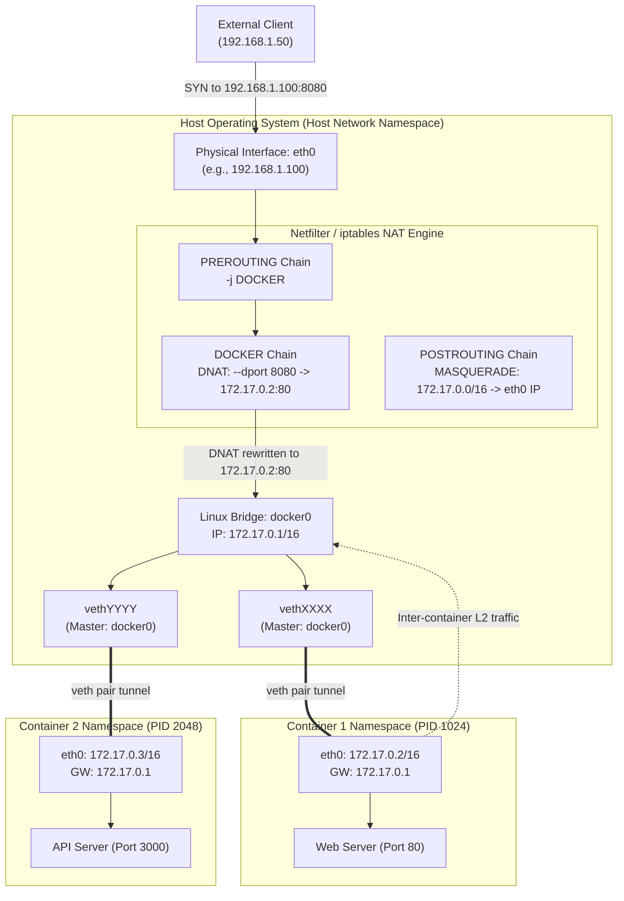
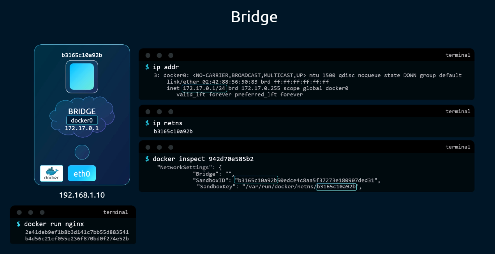
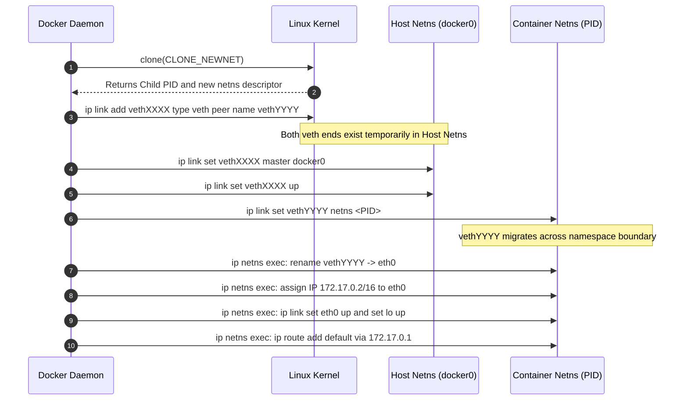
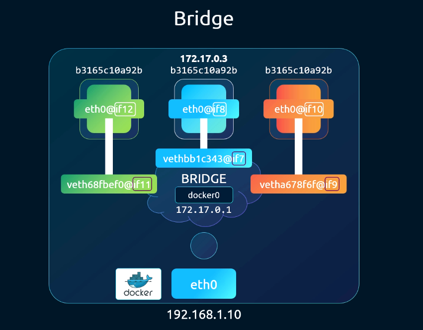
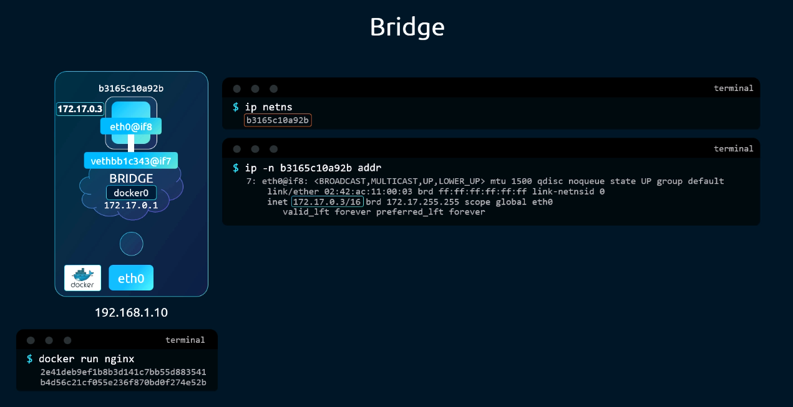
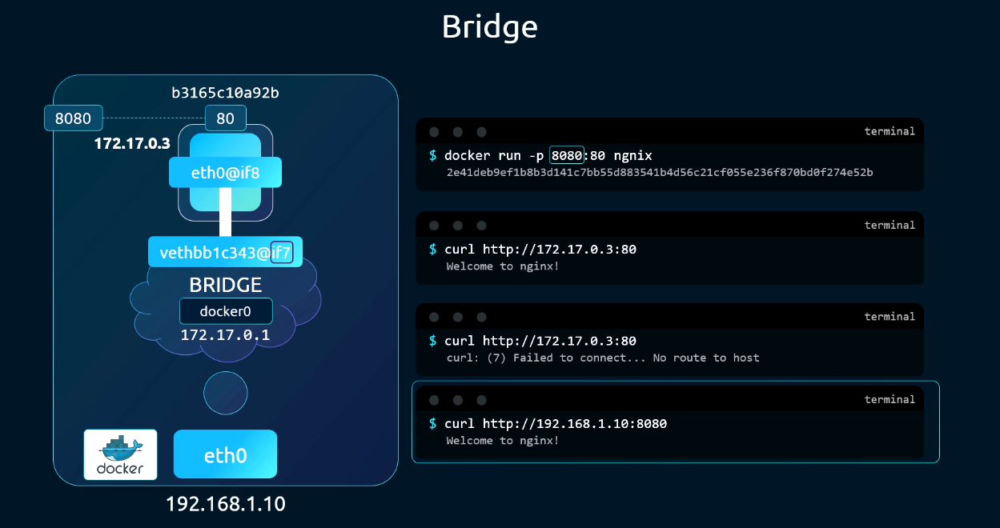
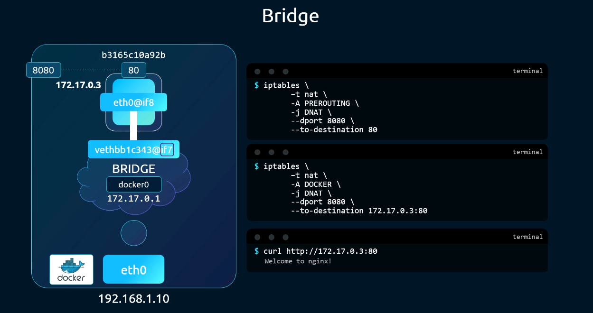
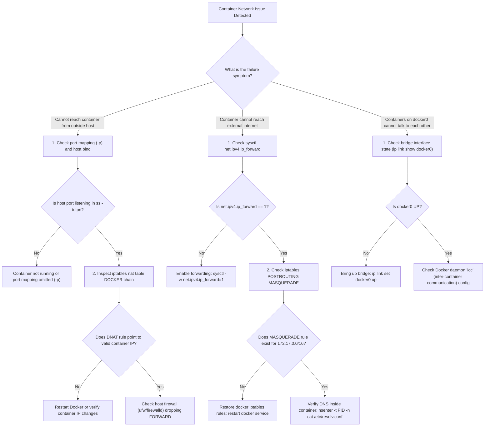

# 05 - Prerequisite: Docker Networking

## Exam Metadata
- **Domain**: Services & Networking (20%) / Fundamental Networking Prerequisites
- **Importance**: High (Architectural Foundation for CNI, Pod Network Namespaces, and Kubelet Container Runtimes)
- **Target Version**: Kubernetes v1.31 / v1.32
- **Allowed Docs Search Keywords**: `container network interface`, `network plugins`, `ports and protocols`, `cluster networking`
- **Source**: `networking/05-prerequisite-docker-networking-raw.md`

---

## 1. Quick-Reference Summary
- **Network Drivers**:
  - `none` (`--network none`): Container possesses only a loopback interface (`lo`). Completely isolated; no external or inter-container packet flow.
  - `host` (`--network host`): Container shares the host network namespace. No network namespace isolation; binds directly to host IP and ports; port conflicts occur if multiple processes attempt to bind the same host port.
  - `bridge` (default, `--network bridge`): Container connects to a virtual Layer 2 Linux software bridge on the host (`docker0`, default subnet `172.17.0.0/16`, bridge gateway IP `172.17.0.1`).
- **Network Namespace Plumbing**:
  - A virtual Ethernet pair (`veth`) is instantiated in the host network namespace.
  - One end is attached as a slave interface to `docker0` (`ip link set <veth> master docker0`).
  - The peer end is transferred into the container network namespace (`ip link set <peer> netns <PID>`), renamed to `eth0`, brought up, and assigned an internal IP (e.g., `172.17.0.2/16`).
- **Namespace Discovery**:
  - Docker does not register namespaces in the standard Linux path (`/var/run/netns/`). Instead, Docker manages them in `/var/run/docker/netns/`.
  - To inspect Docker namespaces with native `ip netns`, symlink `/var/run/docker/netns/*` into `/var/run/netns/`, or use `nsenter -t <PID> -n <command>`.
- **Port Mapping & NAT**:
  - `-p <hostPort>:<containerPort>` creates an iptables Destination NAT (DNAT) rule in the `nat` table's `DOCKER` chain:
    `iptables -t nat -A DOCKER -p tcp --dport <hostPort> -j DNAT --to-destination <containerIP>:<containerPort>`.
  - A userland daemon `docker-proxy` also runs as a fallback for loopback/hairpin traffic.
  - Outbound traffic from containers to the external network undergoes Source NAT (SNAT / MASQUERADE) via iptables `POSTROUTING`.
- **Prerequisite for Kubernetes CNI**:
  - Kubernetes deprecated Dockershim in v1.24. Modern CRI runtimes (`containerd`, `CRI-O`) do not use `docker0`. Instead, the Container Runtime Interface (CRI) invokes CNI plugins (`bridge`, `ptp`, `calico`, `flannel`) to configure namespaces and connect Pods directly to cluster-wide networks without double NAT.

---

## 2. Conceptual Overview & Mental Model

### Simple English Explanation
A container runtime isolates processes using Linux namespaces. When isolating the network, the runtime gives each container its own network stack—its own routing table, ARP table, iptables chains, and network interfaces.

Docker provides three primary ways to handle this networking:
1. **None**: The runtime creates an isolated network namespace containing only a loopback adapter. The container cannot send or receive any network packets outside itself.
2. **Host**: The runtime creates no network namespace for the container at all. The container process runs directly in the host's network namespace, accessing the physical network interfaces directly.
3. **Bridge**: The runtime creates an isolated network namespace for the container and links it to a Linux software bridge (`docker0`) on the host using a virtual Ethernet (`veth`) cable. The bridge acts as a software switch allowing containers on the same host to communicate. Outbound internet access is enabled by translating container private IPs into the host's IP via iptables NAT (MASQUERADE). Inbound traffic is enabled by mapping host ports to container private IPs via iptables Destination NAT (DNAT).

### Formal Technical Definition
Docker container networking is a userland-and-kernel orchestration framework that configures Linux network namespaces (`CLONE_NEWNET`), virtual Ethernet pairs (`veth`), kernel software bridges (`bridge.ko`), and Netfilter/iptables rules to enforce network isolation, Layer 2 packet switching on single nodes, and Layer 3/4 Network Address Translation (NAT) for ingress and egress routing.

### Architecture Flowchart: Docker Bridge Networking & Port Forwarding



---

## 3. Deep-Dive Technical Breakdown

### Docker Network Drivers & Characteristics

| Driver Mode | Flag | Network Namespace Created? | IP Assigned? | Port Mapping Needed? | Port Conflicts on Host? | Use Case |
| :--- | :--- | :--- | :--- | :--- | :--- | :--- |
| **None** | `--network none` | Yes (isolated `lo` only) | No | Not applicable | No | Isolated batch jobs, security sandboxes, offline computation. |
| **Host** | `--network host` | No (shares host `netns`) | Uses Host IP | No (direct bind) | Yes (cannot bind same port twice) | High-performance network apps, system monitoring daemons. |
| **Bridge** | `--network bridge` (default) | Yes (isolated `eth0` + `lo`) | Yes (`172.17.0.x`) | Yes (`-p host:container`) | No (isolated per container) | Default container applications on a single host. |
| **Overlay** | `--network overlay` | Yes | Yes (overlay subnet) | Optional (ingress mesh) | No | Multi-host Docker Swarm clustering (deprecated for K8s). |
| **Macvlan** | `--network macvlan` | Yes | Yes (physical subnet) | No | No (distinct MAC per container) | Direct physical network attachment without bridge or NAT. |

---

### The Bridge Network (`docker0`) Architecture

Upon installation of the Docker engine, a software bridge named `docker0` is created by the daemon:



When inspected using Linux network utilities:
- `docker0` is registered as a Linux network device with driver type `bridge`.
- It acts simultaneously as:
  1. A **network interface** to the host operating system, assigned the gateway IP `172.17.0.1/16`.
  2. A **Layer 2 virtual switch** to all container namespaces attached to it.

```bash
# Equivalent manual Linux command executed by Docker daemon at startup:
ip link add docker0 type bridge
ip addr add 172.17.0.1/16 dev docker0
ip link set docker0 up
```

---

### Step-by-Step Veth Pair Plumbing Lifecycle

When a container is started with `docker run --network bridge nginx`, the kernel and Docker execute a multi-step sequence:



#### Detailed Namespace Lifecycle Analysis:
1. **Initial Creation in Host Namespace**:
   When Linux creates a `veth` pair (`ip link add vethA type veth peer name vethB`), both ends of the pair are initially instantiated inside the calling process's network namespace (the **host network namespace**).
2. **Namespace Migration**:
   Docker attaches one end (`vethXXXX`) as a slave port to the `docker0` bridge. It then invokes the `ip link set vethYYYY netns <PID>` operation to transfer the peer endpoint into the target container's network namespace.
3. **Renaming & Addressing**:
   Once inside the container namespace, the interface is renamed to standard `eth0`, assigned an IP from the IPAM pool (`172.17.0.2`), and configured with a default route pointing to `172.17.0.1` (`docker0`).
4. **Observation Window**:
   Because migration occurs within milliseconds during container creation, external inspection tools like `ip link` on the host will only ever observe the host-side `vethXXXX` interface.





---

### Network Namespace Discovery: Docker vs. Standard Linux

By convention, Linux utilities (`ip netns list`, `ip netns exec`) inspect network namespace file descriptors located in `/var/run/netns/`.

Docker, however, creates and stores its container network namespace file descriptors under `/var/run/docker/netns/` to prevent external namespace collision.

```bash
# Verify Docker netns directory
ls -la /var/run/docker/netns/

# Make Docker namespaces accessible to standard ip netns utility:
mkdir -p /var/run/netns
ln -sf /var/run/docker/netns/* /var/run/netns/

# Now ip netns can list and interact with them:
ip netns list
```

Alternatively, any container namespace can be inspected directly via its process ID (`PID`) using `nsenter`:
```bash
PID=$(docker inspect -f '{{.State.Pid}}' <container-id-or-name>)
nsenter -t $PID -n ip addr show
```

---

### Port Mapping & iptables Netfilter Implementation

Containers on `docker0` reside on an internal private subnet (`172.17.0.0/16`). Outside networks cannot route directly to `172.17.0.x` addresses unless the host advertises the route.

To expose services, Docker implements **Port Forwarding (Publishing)** using `-p <hostPort>:<containerPort>`:





#### Ingress Packet Flow (DNAT):
When external traffic arrives on host port `8080` intended for container port `80`:
1. The packet hits the host physical interface (`eth0`).
2. The packet enters the Netfilter `PREROUTING` chain in the `nat` table.
3. The `PREROUTING` chain jumps to the custom `DOCKER` chain.
4. The `DOCKER` chain contains a Destination NAT rule:
   ```text
   -A DOCKER -p tcp -m tcp --dport 8080 -j DNAT --to-destination 172.17.0.2:80
   ```
5. The kernel replaces the destination IP (`192.168.1.100`) and destination port (`8080`) with `172.17.0.2:80`.
6. The routing engine checks the route for `172.17.0.2`, identifies `docker0` as the output device, and transmits the packet across the `veth` pair into the container.

#### Egress Packet Flow (SNAT / MASQUERADE):
When a container initiates an outbound connection (e.g., `curl https://example.com`):
1. The container transmits the packet via its default gateway `172.17.0.1` (`docker0`).
2. The packet leaves the host via `eth0` and enters Netfilter `POSTROUTING` in the `nat` table.
3. An iptables rule masquerades the source address:
   ```text
   -A POSTROUTING -s 172.17.0.0/16 ! -o docker0 -j MASQUERADE
   ```
4. The source IP is rewritten from `172.17.0.2` to the host's physical IP (`192.168.1.100`), allowing remote servers on the Internet to reply.

#### The `docker-proxy` Process:
In addition to iptables rules, Docker spawns a userland proxy process for every published port:
```bash
# Process list output:
/usr/bin/docker-proxy -proto tcp -host-ip 0.0.0.0 -host-port 8080 -container-ip 172.17.0.2 -container-port 80
```
The `docker-proxy` acts as a fallback to handle loopback traffic originating on the host itself (hairpin traffic from `localhost:8080`), ensuring connectivity even if iptables bridge-nf filters bypass local sockets.

---

### Architectural Evolution: Docker vs. Kubernetes CNI

| Dimension | Docker Engine Networking | Kubernetes CNI Architecture |
| :--- | :--- | :--- |
| **Primary Bridge** | `docker0` (managed by Docker engine) | CNI bridge (e.g., `cbr0`, `cni0`, or direct veth via Calico/Cilium) |
| **IP Model** | Host-private subnet (`172.17.0.0/16`), unique per host | Cluster-wide Pod CIDR (every Pod gets a cluster-unique IP) |
| **Port Mapping** | Mandatory for external access (`-p host:container`) | Not required for Pod-to-Pod; Services / NodePorts handle routing |
| **Cross-Host Routing** | Requires port mapping or Swarm overlay | Mandatory flat routing: all Pods communicate without NAT |
| **Pod Namespace** | 1 container = 1 network namespace | 1 Pod = 1 network namespace (shared by all containers via `pause`) |
| **Runtime Plugin** | Monolithic Docker daemon | Standardized CNI plugins invoked via CRI (`containerd`, `CRI-O`) |

---

## 4. Command Translation & Mapping Tables

### Docker CLI vs. Native Linux Kernel Plumbing

| Action | High-Level Docker Command | Under-the-Hood Linux Kernel Equivalent |
| :--- | :--- | :--- |
| **Create isolated container** | `docker run --network none nginx` | `unshare --net /bin/sh` |
| **Create host-shared container** | `docker run --network host nginx` | Standard process execution in host PID/netns |
| **Create bridge container** | `docker run -d --name web nginx` | `ip link add ... type veth` + `ip link set ... netns` |
| **Publish port** | `docker run -p 8080:80 nginx` | `iptables -t nat -A DOCKER -p tcp --dport 8080 -j DNAT --to 172.17.0.2:80` |
| **List networks** | `docker network ls` | `ip link show type bridge` |
| **Inspect bridge subnet** | `docker network inspect bridge` | `ip addr show dev docker0` |
| **Inspect container IP** | `docker inspect -f '{{.NetworkSettings.IPAddress}}' <id>` | `nsenter -t <pid> -n ip addr show dev eth0` |

### Docker Network Modes vs. Kubernetes Pod Specs

| Docker Option | Kubernetes Pod Equivalent | Functional Description |
| :--- | :--- | :--- |
| `--network host` | `spec.hostNetwork: true` | Pod attaches directly to node network namespace; uses node IP. |
| `--network none` | Not directly supported (simulated via empty CNI / NetPol) | Pod has loopback interface; ingress and egress denied. |
| `--network bridge` | Standard Pod networking (default) | CNI provisions veth pair into Pod namespace; assigns Pod IP. |
| `--net=container:<id>` | Standard multi-container Pod | Containers within a Pod share the network namespace of the `pause` container. |

---

## 5. High-Yield CLI & Imperative Commands

### Inspecting Docker Bridge & Interfaces
```bash
# 1. View all bridge devices on the host
ip link show type bridge
# Output: docker0

# 2. View IP address and subnet assigned to docker0
ip addr show dev docker0
# Output: inet 172.17.0.1/16 brd 172.17.255.255 scope global docker0

# 3. View slave interfaces attached to docker0 (veth interfaces)
bridge link show dev docker0
# Alternative using bridge-utils:
brctl show docker0
```

### Inspecting Container Namespaces with Native Linux Tools
```bash
# 1. Extract process ID (PID) of running container
CONTAINER_PID=$(docker inspect -f '{{.State.Pid}}' web-container)
echo "Container PID is: ${CONTAINER_PID}"

# 2. Inspect container network configuration directly without docker exec
nsenter -t ${CONTAINER_PID} -n ip addr show
nsenter -t ${CONTAINER_PID} -n ip route show

# 3. Expose Docker netns to standard iproute2 tools
sudo mkdir -p /var/run/netns
sudo ln -sf /var/run/docker/netns/* /var/run/netns/

# 4. Execute commands within Docker namespaces via ip netns
ip netns list
ip netns exec <netns-name> ip addr show
```

### Inspecting iptables NAT Rules Created by Docker
```bash
# 1. Inspect the PREROUTING chain in the nat table
sudo iptables -t nat -nvL PREROUTING --line-numbers

# 2. Inspect the custom DOCKER chain for DNAT rules
sudo iptables -t nat -nvL DOCKER --line-numbers

# 3. Inspect the POSTROUTING chain for outbound MASQUERADE rules
sudo iptables -t nat -nvL POSTROUTING --line-numbers

# 4. Inspect raw iptables rules in save format
sudo iptables-save -t nat | grep -E "(DOCKER|POSTROUTING)"
```

### Testing Kernel Forwarding & Connectivity
```bash
# 1. Verify that IPv4 forwarding is active on the host
sysctl net.ipv4.ip_forward
# Must return: net.ipv4.ip_forward = 1

# 2. Verify docker-proxy processes listening on the host
sudo ss -tulpn | grep docker-proxy

# 3. Curl container endpoint internally from the host
curl -I http://172.17.0.2:80

# 4. Curl container endpoint via published host port
curl -I http://127.0.0.1:8080
curl -I http://<host-ip>:8080
```

---

## 6. Troubleshooting & Diagnostic Runbook

### Diagnostic Decision Tree



### Triage Sequence Matrix

| Step | Scope | Diagnostic Command | Expected Output | Remediation if Failed |
| :--- | :--- | :--- | :--- | :--- |
| **1. Bridge State** | Host Kernel | `ip link show docker0` | `state UP` (or `UNKNOWN`), flags `LOWER_UP` | `ip link set docker0 up` |
| **2. IP Forwarding** | Host Kernel | `sysctl net.ipv4.ip_forward` | `net.ipv4.ip_forward = 1` | `sysctl -w net.ipv4.ip_forward=1` and persist in `/etc/sysctl.d/k8s.conf` |
| **3. Host Port Listen**| Sockets | `ss -tulpn \| grep :<port>` | `LISTEN` on `0.0.0.0:<port>` | Verify `-p <hostPort>:<containerPort>` flag was supplied |
| **4. DNAT Rule** | Netfilter | `iptables -t nat -nvL DOCKER` | `DNAT tcp -- * * 0.0.0.0/0 0.0.0.0/0 tcp dpt:8080 to:172.17.0.2:80` | Restart container or manually reload Docker daemon iptables |
| **5. Forward Chain** | Netfilter | `iptables -S FORWARD` | `-P FORWARD DROP` with `-A FORWARD -o docker0 -j ACCEPT` | Check `ufw` or `firewalld` defaults; ensure forwarded packets are accepted |
| **6. Container IP** | Namespace | `nsenter -t $PID -n ip addr show eth0` | `inet 172.17.0.x/16` | Check Docker IPAM pool exhaustion |
| **7. Container Route**| Namespace | `nsenter -t $PID -n ip route show` | `default via 172.17.0.1 dev eth0` | Re-create container or verify bridge gateway configuration |

---

## 7. CKA Exam Tips, Gotchas & Traps

> [!WARNING]
> **Dockershim Deprecation in Modern CKA (v1.24 through v1.32)**
> The Docker engine is no longer the default container runtime in Kubernetes. The CKA exam tests clusters running on **containerd** or **CRI-O**. Do NOT attempt to run `docker` commands on CKA exam nodes unless a task explicitly states Docker is installed for a legacy standalone host. Use `crictl` for container inspection, and remember that CNI plugins—not Docker—plumb the network interfaces in Kubernetes!

> [!IMPORTANT]
> **The Invisible Namespace Trap (`/var/run/netns` vs `/var/run/docker/netns`)**
> Running `ip netns list` on a host running Docker will output nothing by default. This does not mean namespaces do not exist! Docker keeps namespace files in `/var/run/docker/netns/`.
> To inspect container namespaces without Docker:
> 1. Use `nsenter -t <PID> -n <command>` using the container PID from `docker inspect` or `ps aux`.
> 2. Symlink the directory: `ln -s /var/run/docker/netns /var/run/netns`.

> [!IMPORTANT]
> **Kernel Packet Forwarding Drop Trap**
> Both Docker and Kubernetes CNI require packet routing across interfaces. If `net.ipv4.ip_forward` is set to `0`, the Linux kernel silently drops all packets forwarded between `docker0` (or `cbr0`) and the physical network interface (`eth0`). If nodes lose internet egress or cross-pod routing fails after a reboot, always inspect `/etc/sysctl.conf` or `/etc/sysctl.d/` for `net.ipv4.ip_forward = 1`.

> [!TIP]
> **Understanding the Kubernetes `pause` Container via Docker Model**
> In Docker, you can attach a container to another container's network namespace using `docker run --net=container:<target-id>`. This is the exact mechanism Kubernetes uses! The `pause` container (infrastructure container) is started first to hold the network namespace, IP, and routing tables open. All application containers in the Pod join the `pause` container's network namespace, allowing them to communicate via `localhost`.

---

## 8. Self-Test / Active Recall

<details>
<summary><strong>1. What network interfaces are present inside a container started with <code>--network none</code>?</strong></summary>

Only the loopback interface (`lo`). It has no `eth0` device and cannot communicate outside the container namespace.
</details>

<details>
<summary><strong>2. If a container runs with <code>--network host</code> and listens on port 8080, can a second container also start with <code>--network host</code> listening on port 8080? Why or why not?</strong></summary>

No. Both containers share the host's network namespace. Two distinct processes cannot bind to the same IP and port tuple simultaneously; the second container will crash with `EADDRINUSE` (Address already in use).
</details>

<details>
<summary><strong>3. On which network namespace are both ends of a virtual Ethernet (veth) pair initially created?</strong></summary>

Both ends are initially created inside the host network namespace. Immediately afterward, Docker moves one end into the container's network namespace using the equivalent of `ip link set <veth-peer> netns <PID>`.
</details>

<details>
<summary><strong>4. What is the default subnet and gateway IP assigned to the <code>docker0</code> bridge interface?</strong></summary>

Subnet: `172.17.0.0/16`. Gateway IP: `172.17.0.1` (assigned directly to the `docker0` interface on the host).
</details>

<details>
<summary><strong>5. Why does running <code>ip netns list</code> show no entries on a standard Docker host with running containers?</strong></summary>

By default, the `iproute2` tool only scans `/var/run/netns/`. Docker manages its network namespace mount points under `/var/run/docker/netns/`.
</details>

<details>
<summary><strong>6. What exact iptables table and chain handles port publishing (e.g., <code>-p 8080:80</code>)? What target is used?</strong></summary>

Table: `nat`. Chain: `DOCKER` (traversed from `PREROUTING`). Target: `DNAT` (Destination Network Address Translation) with `--to-destination <container-ip>:80`.
</details>

<details>
<summary><strong>7. How does a container on <code>docker0</code> send outbound traffic to the Internet when it has only a private IP address?</strong></summary>

The host kernel applies Source NAT (SNAT) using the `MASQUERADE` target in the `POSTROUTING` chain of the `nat` table, rewriting the source IP from the container private IP to the host's external interface IP.
</details>

<details>
<summary><strong>8. What is the purpose of the <code>docker-proxy</code> userland process?</strong></summary>

It acts as a fallback to forward traffic from host loopback sockets (e.g., `127.0.0.1:8080`) to the container's private endpoint, ensuring port-forwarded traffic works from localhost even when iptables bridge rules do not catch local sockets.
</details>

<details>
<summary><strong>9. Which Linux kernel tunable must be enabled (<code>= 1</code>) for containers on a bridge to communicate with external networks?</strong></summary>

`net.ipv4.ip_forward = 1`.
</details>

<details>
<summary><strong>10. How did Kubernetes adapt Docker's multi-container networking model into Pods?</strong></summary>

Kubernetes creates a `pause` container that owns the Pod's network namespace and IP. All application containers in the Pod join that existing namespace (equivalent to Docker's `--net=container:<pause-id>`), sharing `localhost` and the network stack.
</details>

---

## 9. Official Documentation Bookmarks

| Resource | Documentation Path / Anchor | Purpose |
| :--- | :--- | :--- |
| **Kubernetes Network Plugins** | `Concepts > Cluster Administration > Network Plugins` | Understanding CNI specification and plugin requirements |
| **Cluster Networking Model** | `Concepts > Cluster Administration > Cluster Networking` | The "IP-per-Pod" flat network rules vs Docker host-private model |
| **Container Runtimes** | `Getting Started > Production Environment > Container Runtimes` | Configuring CRI runtimes (`containerd`, `CRI-O`) and sysctl prerequisites |
| **Ports and Protocols** | `Reference > Ports and Protocols` | Control plane and worker node port binding requirements |

