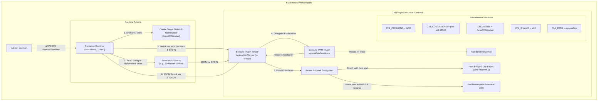
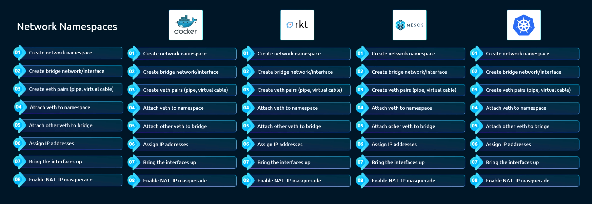
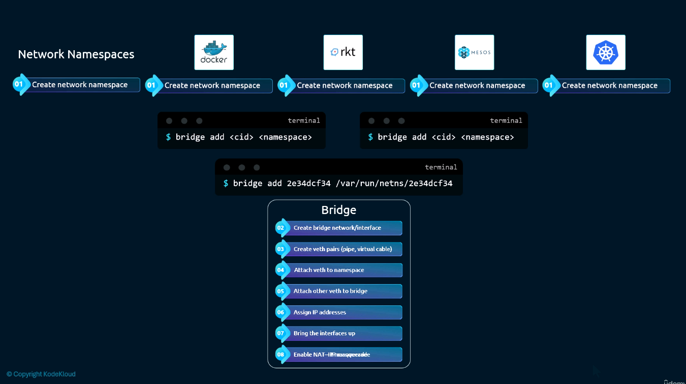
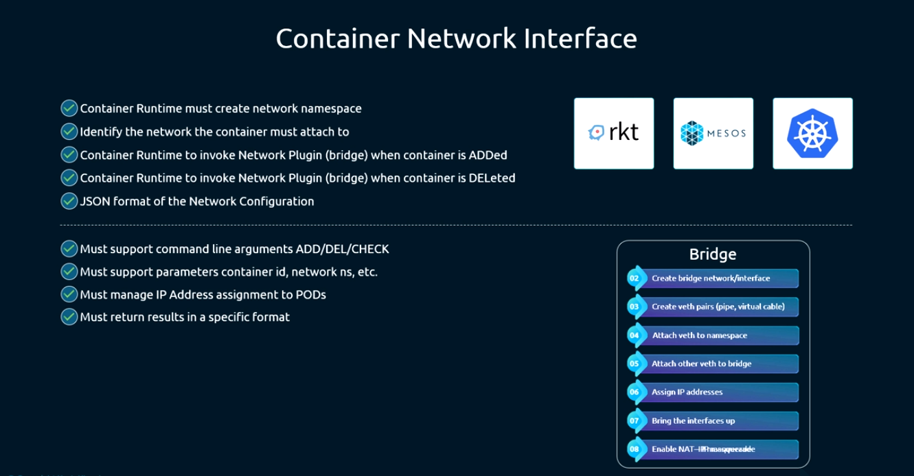
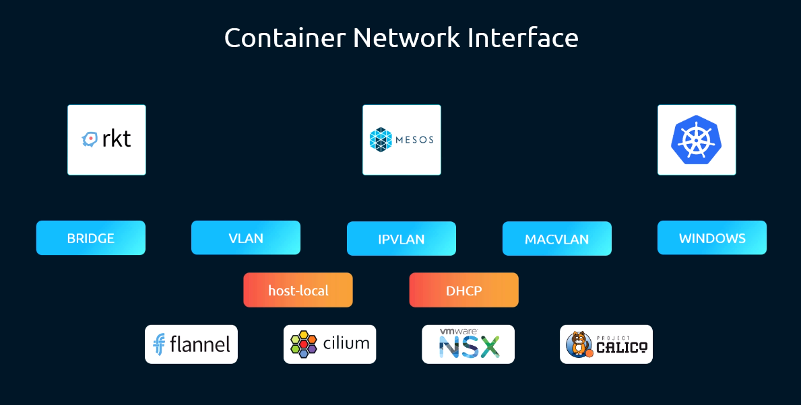
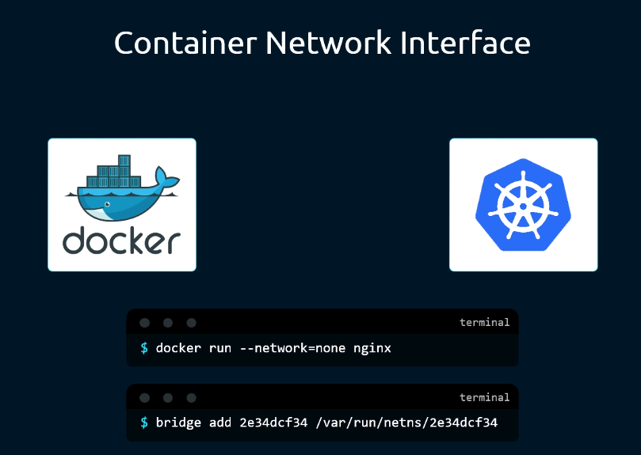
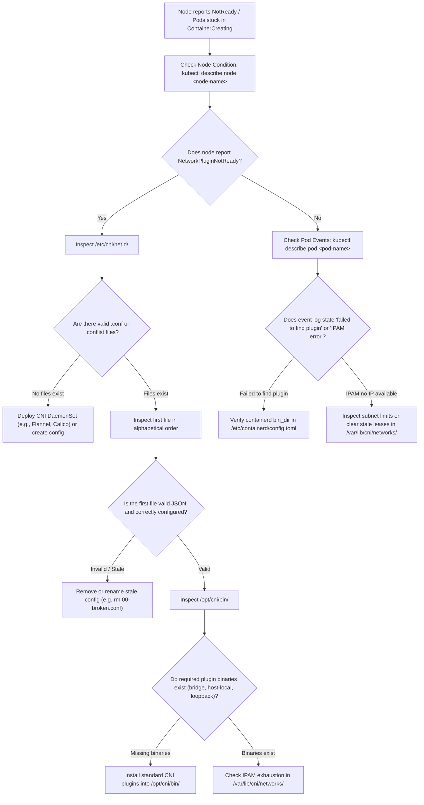

# 06 - Prerequisite: CNI (Container Network Interface)

## Exam Metadata
- **Domain**: Services & Networking (20%) / Cluster Architecture, Installation & Configuration (25%)
- **Importance**: Critical (Defines the standard interface for Pod network plumbing, IPAM allocation, and Node readiness)
- **Target Version**: Kubernetes v1.31 / v1.32
- **Allowed Docs Search Keywords**: `container network interface`, `network plugins`, `cni specification`, `cni plugins`
- **Source**: `networking/06-Prerequisite-CNI-raw.md`

---

## 1. Quick-Reference Summary
- **CNI Definition**: Container Network Interface (CNI) is a Cloud Native Computing Foundation (CNCF) project specifying an agnostic API and reference plugins to configure network interfaces in Linux containers.
- **Architecture Contract**:
  - **Runtime Role** (`containerd`, `CRI-O`): Creates the network namespace (`netns`), locates network definitions, executes CNI binaries via environment variables (`CNI_COMMAND`, `CNI_NETNS`, `CNI_IFNAME`) and passes JSON configuration via `STDIN`.
  - **Plugin Role** (`bridge`, `ptp`, `calico`, `flannel`): Receives parameters, creates virtual Ethernet pairs (`veth`), assigns IP addresses, configures routes, and returns standardized JSON results via `STDOUT`.
- **Standard Operations (Commands)**:
  - `ADD`: Plumb and configure container network interfaces and routing.
  - `DEL`: Release allocated resources, delete interfaces, and free IPAM allocations.
  - `CHECK`: Validate that container network configuration matches expected state.
  - `VERSION`: Return supported CNI specification versions.
- **Key System File Paths**:
  - **CNI Plugin Binaries**: `/opt/cni/bin/` (contains executables: `bridge`, `loopback`, `host-local`, `portmap`, `tuning`, etc.).
  - **CNI Network Configurations**: `/etc/cni/net.d/` (contains `.conf`, `.conflist`, or `.json` configuration files).
  - **IPAM Local Lease Database**: `/var/lib/cni/networks/<network-name>/` (for `host-local` plugin).
- **Lexicographical Selection Rule**:
  - The container runtime inspects `/etc/cni/net.d/` and selects the **first configuration file in lexicographical (alphabetical) order**. A stale `00-bad.conf` will break cluster networking even if `10-flannel.conflist` is present.
- **CNI vs. Docker CNM**:
  - Docker uses Container Network Model (CNM via `libnetwork`); Docker does not natively support CNI.
  - In legacy Kubernetes (pre-v1.24 dockershim), containers were started with `--network none` and kubelet invoked CNI plugins directly.
  - Modern Kubernetes (v1.24+) uses CRI runtimes (`containerd`, `CRI-O`) that interact with CNI natively without Docker.
- **Node Readiness Dependency**:
  - Kubelet sets the Node condition `NetworkPluginNotReady` (causing `NotReady` status) until a valid CNI configuration is detected in `/etc/cni/net.d/` and loopback is configured.

---

## 2. Conceptual Overview & Mental Model

### Simple English Explanation
When multiple container engines emerged (Docker, rkt, Mesos, LXC), each engine wrote its own custom networking scripts. A networking plugin written for Docker could not work on rkt or Kubernetes without being completely rewritten.

The Container Network Interface (CNI) solves this by defining an open standard interface between container runtimes and network plugins:
1. The container runtime (such as `containerd` or `CRI-O`) is responsible only for creating an empty Linux network namespace for the container.
2. The runtime does not implement network routing itself. Instead, it executes an external binary program (the CNI plugin) residing on the host disk at `/opt/cni/bin/`.
3. The runtime tells the plugin what to do using standard environment variables (e.g., `CNI_COMMAND=ADD`, `CNI_NETNS=/var/run/netns/pod123`) and passes configuration details (subnets, gateway, DNS) as JSON through standard input (`STDIN`).
4. The plugin creates the virtual Ethernet (`veth`) pair, connects one end to a bridge or overlay fabric, assigns an IP address to the container, and sets up routes.
5. The plugin outputs the resulting network configuration as JSON to standard output (`STDOUT`) and exits.

### Formal Technical Definition
The Container Network Interface (CNI) is a CNCF specification and standardized execution interface defining how container runtimes invoke external executable binaries to configure, verify, and dismantle network interfaces, routing tables, and IP address allocations within Linux kernel network namespaces (`CLONE_NEWNET`) using environment variables and JSON-formatted data streams over standard I/O channels.

### Architecture Flowchart: Container Runtime to CNI Execution Flow



---

## 3. Deep-Dive Technical Breakdown

### The Fragmentation Problem Across Container Engines
Before CNI standardization, every container runtime developed proprietary networking implementations:



Because each runtime handled networking differently, network providers had to maintain separate drivers for Docker, rkt, Mesos, and Kubernetes. CNI decoupled runtime execution from network infrastructure.

---

### The Generic Bridge Tool & Offloading Model
By offloading the network setup to a specialized external tool, container runtimes remain small and agnostic to physical or virtual underlying network fabrics:



The container runtime simply triggers the plugin with the command `ADD`, passing the network namespace path and target interface name. The plugin handles bridge creation, `veth` pair plumbing, MAC assignment, and route injection.

---

### CNI Architecture & Execution Contract



#### 1. Runtime Responsibilities:
- Manage container lifecycles (create, monitor, terminate).
- Create a distinct Linux network namespace for each container/Pod prior to invoking any plugin.
- Identify which networks the container must join.
- Scan `/etc/cni/net.d/` and parse the network configuration.
- Execute plugins found in `/opt/cni/bin/` sequentially (for `.conflist`) using `ADD` on creation and `DEL` on termination.
- Ensure plugins are invoked in reverse order during `DEL` operations.

#### 2. Plugin Responsibilities:
- Accept commands: `ADD`, `DEL`, `CHECK`, and `VERSION`.
- Parse environment variables and JSON payloads from `STDIN`.
- Plumb network interfaces into the specified namespace (`CNI_NETNS`) using the interface name specified by `CNI_IFNAME` (standardized to `eth0` in Kubernetes).
- Assign an IP address and subnet mask to the container interface.
- Establish default routes and any required static routing rules.
- Delegate IP address assignment to specialized IPAM plugins.
- Emit a compliant JSON result object to `STDOUT` and exit with return code `0`.

---

### CNI Environment Variables Specification

The container runtime communicates essential execution parameters to the plugin binary via environment variables:

| Variable | Type | Description | Example |
| :--- | :--- | :--- | :--- |
| `CNI_COMMAND` | String | Operation to execute (`ADD`, `DEL`, `CHECK`, `VERSION`). | `ADD` |
| `CNI_CONTAINERID` | String | Unique identifier of the container (Pod UID). | `3fa85f64-5717-4562-b3fc` |
| `CNI_NETNS` | String | Path to the Linux network namespace file. | `/proc/14292/ns/net` or `/var/run/netns/test` |
| `CNI_IFNAME` | String | Interface name inside the container namespace. | `eth0` |
| `CNI_ARGS` | String | Optional extra key-value arguments (semicolon-delimited). | `K8S_POD_NAME=web;K8S_POD_NAMESPACE=default` |
| `CNI_PATH` | String | List of paths on host disk containing CNI plugin binaries. | `/opt/cni/bin` |

---

### CNI Configuration Files & JSON Formats

CNI configuration files reside in `/etc/cni/net.d/`. Two formats exist:
1. **Single Plugin Configuration (`.conf` / `.json`)**: Describes a single CNI plugin invocation.
2. **Network Configuration List (`.conflist`)**: Describes an ordered chain of plugins invoked sequentially (standard in Kubernetes).

#### Example `.conflist` (Chained Plugin Execution):
```json
{
  "cniVersion": "1.0.0",
  "name": "cbr0-net",
  "plugins": [
    {
      "type": "bridge",
      "bridge": "cbr0",
      "isGateway": true,
      "ipMasq": true,
      "hairpinMode": true,
      "ipam": {
        "type": "host-local",
        "subnet": "10.244.1.0/24",
        "routes": [
          { "dst": "0.0.0.0/0" }
        ]
      }
    },
    {
      "type": "portmap",
      "capabilities": {
        "portMappings": true
      }
    }
  ]
}
```

---

### CNI Plugin Ecosystem



CNI plugins are categorized into three main types:

| Category | Plugins | Purpose |
| :--- | :--- | :--- |
| **Main (Interfaces)** | `bridge`, `ptp`, `macvlan`, `ipvlan`, `host-device`, `vlan` | Creates network devices (`veth`, VLANs) and attaches them to namespaces or host switches. |
| **IPAM (Allocation)** | `host-local`, `dhcp`, `static` | Allocates and tracks IP address leases, subnets, and routes for containers. |
| **Meta (Chained/Tuning)**| `tuning`, `portmap`, `bandwidth`, `firewall`, `sbr` | Modifies sysctl parameters, configures host port mapping, sets traffic shaping limits. |

---

### CNI vs. Docker CNM (Container Network Model)

Docker does not adhere to the CNI specification. Instead, Docker adheres to the **Container Network Model (CNM)** implemented by Docker's `libnetwork` library:



#### Differences & Workarounds:
- **Direct Incompatibility**: You cannot execute `docker run --network <cni-plugin>` directly; Docker will fail because it does not know how to invoke CNI binaries.
- **Legacy Workaround (Dockershim)**:
  When Kubernetes historically used Docker as its runtime:
  1. Kubelet commanded Docker to create the container with `--network none`.
  2. Docker created the container process inside an isolated network namespace with only a loopback device.
  3. Kubelet located the container's network namespace (`/proc/<pid>/ns/net`) and manually executed the configured CNI plugin to attach `veth` interfaces, assign the Pod IP, and set up routing.
- **Modern Architecture (CRI)**:
  Kubernetes v1.24 completely removed Dockershim. Modern runtimes (`containerd`, `CRI-O`) natively implement the CNI client specification. When kubelet requests `RunPodSandbox`, `containerd` invokes CNI plugins directly without any Docker involvement.

---

## 4. Command Translation & Mapping Tables

### CNI Operations vs. Runtime Lifecycle

| CNI Operation | Runtime Lifecycle Event | Actions Performed by CNI Plugin |
| :--- | :--- | :--- |
| `ADD` | Pod creation (`RunPodSandbox`) | Creates `veth` pair, moves peer to Pod netns, calls IPAM for IP, sets default route, brings up interface. |
| `DEL` | Pod termination (`StopPodSandbox`) | Deletes `veth` pair, releases IP address back to IPAM pool, tears down host firewall rules. |
| `CHECK` | Periodic health inspection | Inspects interfaces and routes in Pod netns; verifies state matches initial configuration. |
| `VERSION` | Runtime initialization | Reports CNI specification version supported by the plugin binary. |

### CNI vs. Docker CNM Feature Comparison

| Architectural Feature | CNI (Container Network Interface) | CNM (Container Network Model - Docker) |
| :--- | :--- | :--- |
| **Governing Body** | Cloud Native Computing Foundation (CNCF) | Docker / Moby (`libnetwork`) |
| **Invocation Pattern** | Executable binaries invoked via CLI/env vars/STDIN | Golang daemon plugins communicating over HTTP/socket |
| **Kubernetes Support** | Native standard across all CRI runtimes | Not natively supported (required legacy dockershim) |
| **State Storage** | Stateless or disk-based (e.g. `/var/lib/cni/`) | Key-value store (Consul, Etcd) or local engine state |
| **Pod Namespace** | Multiple containers share single network namespace | Historically 1 container per endpoint |

---

## 5. High-Yield CLI & Imperative Commands

### Inspecting CNI Binaries and Configurations
```bash
# 1. View all available CNI plugin binaries on the node
ls -la /opt/cni/bin/
# Common binaries: bridge, host-local, loopback, portmap, tuning, flannel, calico

# 2. View active CNI configuration files (alphabetical order matters!)
ls -la /etc/cni/net.d/

# 3. Read active CNI configuration
cat /etc/cni/net.d/*.conflist

# 4. View IPAM allocations stored by the host-local plugin
ls -la /var/lib/cni/networks/
cat /var/lib/cni/networks/*/*
```

### Manually Executing a CNI Plugin for Testing & Triage
CNI plugins are standalone executables. You can test them manually by supplying environment variables and passing JSON config through `STDIN`:

```bash
# 1. Create a dummy test network namespace
sudo ip netns add test-netns

# 2. Prepare sample JSON configuration
cat <<EOF > /tmp/cni-test.json
{
  "cniVersion": "0.4.0",
  "name": "mynet",
  "type": "bridge",
  "bridge": "cni-test0",
  "isGateway": true,
  "ipMasq": true,
  "ipam": {
    "type": "host-local",
    "subnet": "10.22.0.0/16",
    "routes": [
      { "dst": "0.0.0.0/0" }
    ]
  }
}
EOF

# 3. Manually invoke the CNI bridge plugin to ADD network
sudo CNI_COMMAND=ADD \
     CNI_CONTAINERID=dummy12345 \
     CNI_NETNS=/var/run/netns/test-netns \
     CNI_IFNAME=eth0 \
     CNI_PATH=/opt/cni/bin \
     /opt/cni/bin/bridge < /tmp/cni-test.json

# 4. Verify interface and IP assigned inside the test namespace
sudo ip netns exec test-netns ip addr show dev eth0
sudo ip netns exec test-netns ip route show

# 5. Clean up by manually invoking CNI DEL
sudo CNI_COMMAND=DEL \
     CNI_CONTAINERID=dummy12345 \
     CNI_NETNS=/var/run/netns/test-netns \
     CNI_IFNAME=eth0 \
     CNI_PATH=/opt/cni/bin \
     /opt/cni/bin/bridge < /tmp/cni-test.json

# 6. Delete test network namespace
sudo ip netns del test-netns
```

### Inspecting Container Runtime (containerd) CNI Configuration
```bash
# Inspect containerd's CNI settings in config.toml
grep -A 10 '\[plugins."io.containerd.grpc.v1.cri".cni\]' /etc/containerd/config.toml

# Expected output shows configured paths:
# bin_dir = "/opt/cni/bin"
# conf_dir = "/etc/cni/net.d"
```

---

## 6. Troubleshooting & Diagnostic Runbook

### Diagnostic Decision Tree



### Triage Sequence Matrix

| Step | Scope | Diagnostic Command | Expected Healthy Output | Remediation if Failed |
| :--- | :--- | :--- | :--- | :--- |
| **1. Node Network Status** | Control Plane | `kubectl get nodes` | Node status is `Ready` | If `NotReady`, inspect `NetworkPluginNotReady` in node conditions. |
| **2. CNI Config Directory** | Node FS | `ls -la /etc/cni/net.d/` | Contains at least one valid `.conf` or `.conflist` file | Deploy CNI provider manifest (Calico/Flannel/Cilium) or create config. |
| **3. Config Syntax** | Node FS | `jq . /etc/cni/net.d/*.conflist` | Valid parsed JSON without syntax errors | Fix JSON formatting errors or invalid keys. |
| **4. Plugin Binaries** | Node FS | `ls -la /opt/cni/bin/` | Executables present with `+x` permissions | Reinstall CNI plugins: `curl -L ... \| tar -xz -C /opt/cni/bin` |
| **5. Loopback Plugin** | Node FS | `test -x /opt/cni/bin/loopback` | Exit code `0` | The `loopback` plugin is mandatory; ensure it is present and executable. |
| **6. IPAM Allocations** | Node FS | `ls /var/lib/cni/networks/*` | File per allocated IP address | If subnet exhausted, expand IPAM subnet in CNI config or remove dead leases. |
| **7. Runtime Logs** | systemd | `journalctl -u containerd -n 50 --no-pager` | Clean gRPC calls without CNI plugin execution errors | Inspect failed binary path or missing shared libraries. |

---

## 7. CKA Exam Tips, Gotchas & Traps

> [!WARNING]
> **The Lexicographical Order Trap in `/etc/cni/net.d/`**
> Container runtimes do NOT pick configuration files randomly. They pick the **first file in alphabetical order**!
> If you have `00-bad.conf` and `10-calico.conflist` in `/etc/cni/net.d/`, the runtime loads `00-bad.conf`. If that file has invalid syntax or references missing binaries, **all Pod scheduling fails and the node enters `NotReady`**.
> Always clean up old or backup configuration files (e.g. `10-flannel.conflist.bak` might still be loaded if the runtime checks all `.conflist*` extensions).

> [!IMPORTANT]
> **Node `NotReady` Due to `NetworkPluginNotReady`**
> In CKA troubleshooting scenarios, a node may appear in `NotReady` status right after cluster bootstrap.
> Run `kubectl describe node <name>` and look at `Conditions`:
> `NetworkReady: False (NetworkPluginNotReady: Network plugin returns error: cni plugin not initialized)`
> Root causes to check immediately:
> 1. Is `/etc/cni/net.d/` empty? (CNI provider has not been deployed).
> 2. Are binaries missing from `/opt/cni/bin/`?
> 3. Is the CNI DaemonSet pod crashing on that node?

> [!IMPORTANT]
> **Two-Part Plugin Delegation (Main vs. IPAM)**
> CNI splits interface plumbing from IP assignment. A configuration file referencing `"type": "bridge"` almost always defines `"ipam": { "type": "host-local" }`.
> If the `bridge` binary is present in `/opt/cni/bin/` but `host-local` is missing, the plugin fails with an error like `failed to run IPAM plugin: exec: "host-local": executable file not found in $PATH`.

> [!TIP]
> **Dockershim is Gone in CKA v1.24+**
> Remember that `--network-plugin=cni`, `--cni-bin-dir`, and `--cni-conf-dir` flags on `kubelet` were removed with Dockershim in v1.24.
> CNI directories are now configured inside the container runtime configuration (e.g., `/etc/containerd/config.toml`). Do not try to add `--network-plugin=cni` to `/var/lib/kubelet/kubeadm-flags.env`!

---

## 8. Self-Test / Active Recall

<details>
<summary><strong>1. What are the four primary operations (commands) that every CNI plugin must support?</strong></summary>

`ADD` (configure network), `DEL` (destroy network), `CHECK` (validate state), and `VERSION` (report supported versions).
</details>

<details>
<summary><strong>2. How does a container runtime pass execution parameters like command, namespace, and interface name to a CNI plugin?</strong></summary>

Via standard environment variables: `CNI_COMMAND`, `CNI_CONTAINERID`, `CNI_NETNS`, `CNI_IFNAME`, `CNI_ARGS`, and `CNI_PATH`.
</details>

<details>
<summary><strong>3. How does a container runtime supply network configuration details (e.g., subnets, gateways) to a CNI plugin?</strong></summary>

Via JSON format streamed directly into the CNI plugin's standard input (`STDIN`).
</details>

<details>
<summary><strong>4. In which directory on the node do CNI plugin binaries reside by default?</strong></summary>

`/opt/cni/bin/`.
</details>

<details>
<summary><strong>5. In which directory on the node do CNI network configuration files reside?</strong></summary>

`/etc/cni/net.d/`.
</details>

<details>
<summary><strong>6. If both <code>10-flannel.conflist</code> and <code>20-calico.conflist</code> exist in <code>/etc/cni/net.d/</code>, which one will the container runtime use?</strong></summary>

`10-flannel.conflist`, because the container runtime selects the first configuration file in lexicographical (alphabetical) order.
</details>

<details>
<summary><strong>7. What role does the <code>host-local</code> plugin play in a CNI setup?</strong></summary>

It is an IPAM (IP Address Management) plugin that assigns IP addresses from a locally configured subnet pool and tracks leases locally in `/var/lib/cni/networks/`.
</details>

<details>
<summary><strong>8. Why can you not use a CNI plugin directly with native Docker CLI commands (e.g., <code>docker run --network ...</code>)?</strong></summary>

Docker implements the Container Network Model (CNM via `libnetwork`), not CNI. Docker lacks native support for invoking CNI executable binaries.
</details>

<details>
<summary><strong>9. If a worker node is in <code>NotReady</code> status with the condition <code>NetworkPluginNotReady</code>, what are the two file system directories to inspect first?</strong></summary>

`/etc/cni/net.d/` (to check for missing or invalid configuration files) and `/opt/cni/bin/` (to check for missing plugin executables).
</details>

<details>
<summary><strong>10. Since Kubernetes v1.24 (removal of Dockershim), which component directly invokes CNI plugins when a Pod is scheduled?</strong></summary>

The Container Runtime Interface (CRI) runtime (such as `containerd` or `CRI-O`), rather than kubelet or Docker.
</details>

---

## 9. Official Documentation Bookmarks

| Resource | Documentation Path / Anchor | Purpose |
| :--- | :--- | :--- |
| **Network Plugins Overview** | `Concepts > Cluster Administration > Network Plugins` | Official specification and kubelet plugin requirements |
| **Installing a CNI Plugin** | `Setup > Production Environment > Installing Addons` | Instructions for deploying cluster CNI network providers |
| **Cluster Networking Model** | `Concepts > Cluster Administration > Cluster Networking` | The fundamental networking constraints enforced by CNI |
| **Container Runtime Configuration**| `Getting Started > Production Environment > Container Runtimes` | Configuring CNI paths in `containerd` and `CRI-O` |

