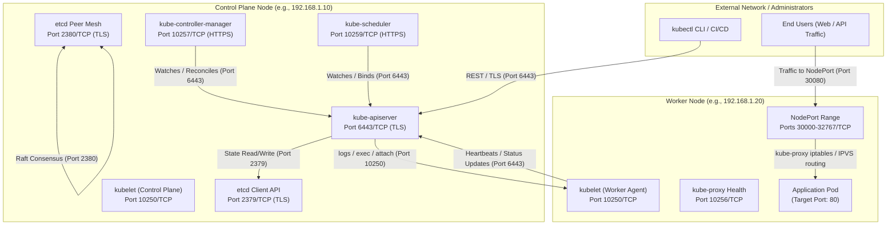
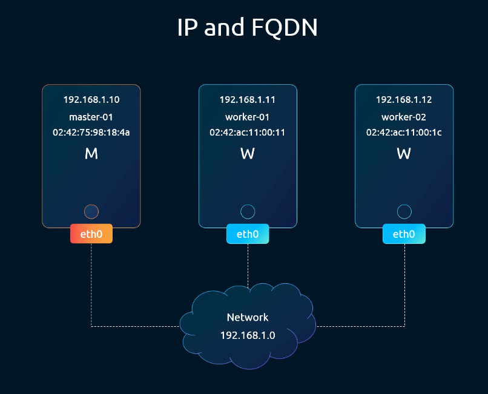
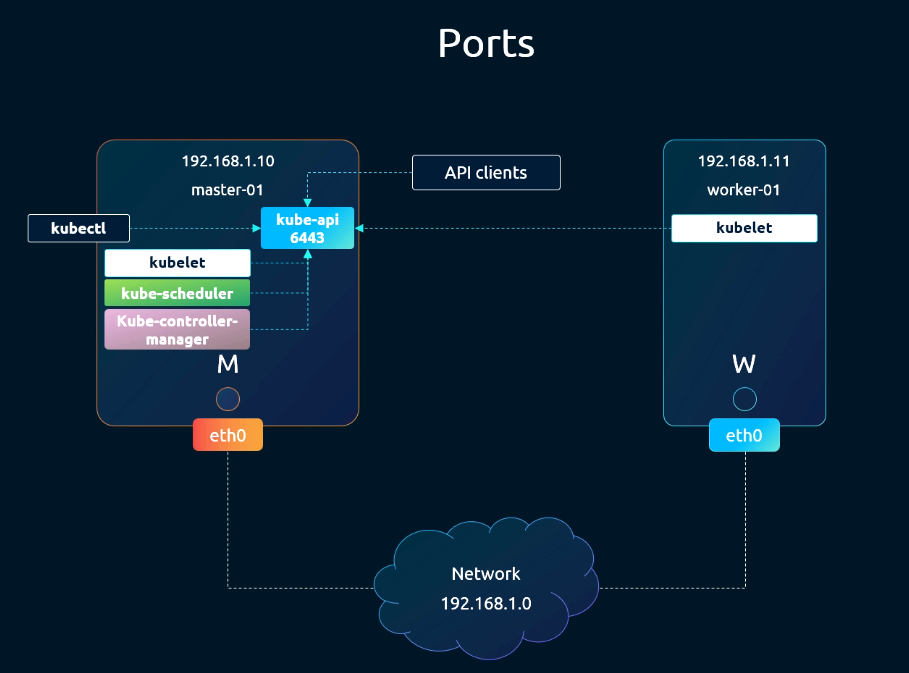
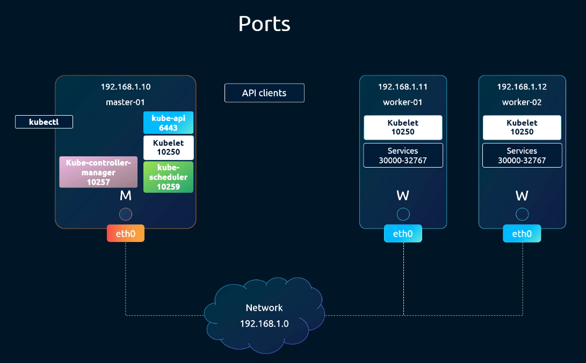
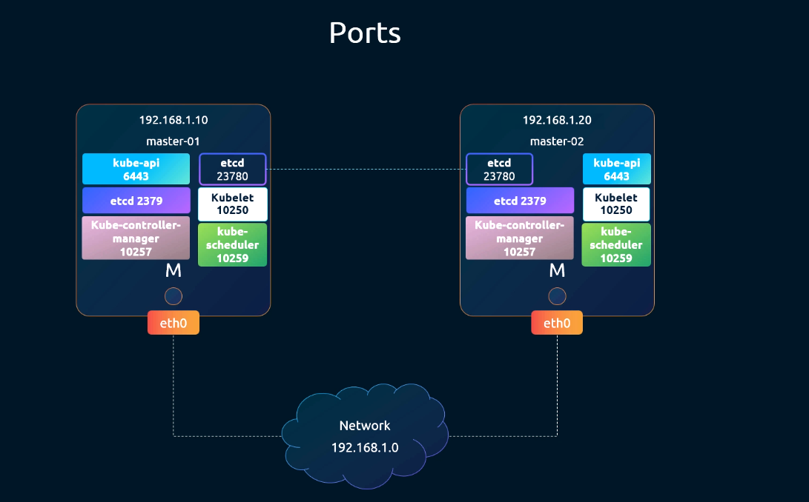
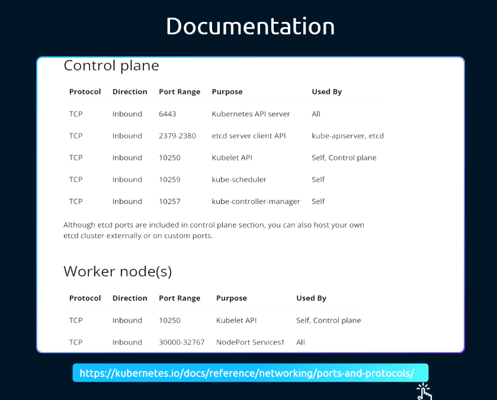
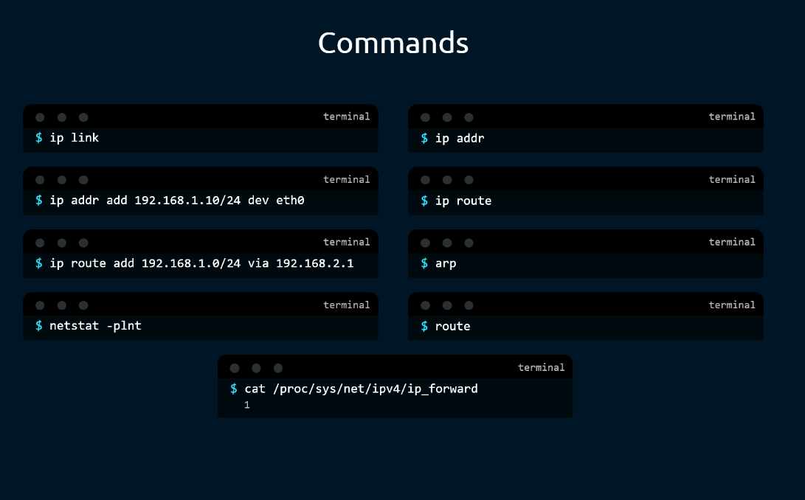
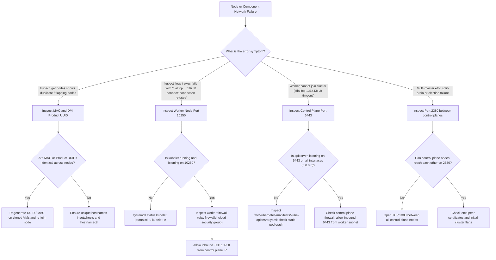

# 07 - Cluster Networking: Host Configuration & Port Requirements

## Exam Metadata
- **Domain**: Services & Networking (20%) / Cluster Architecture, Installation & Configuration (25%)
- **Importance**: High (Host Pre-flight Invariants, Control Plane & Worker Port Matrices, Socket Inspection, and Firewall Triage)
- **Target Version**: Kubernetes v1.31 / v1.32
- **Allowed Docs Search Keywords**: `ports and protocols`, `cluster networking`, `install kubeadm`, `node prerequisites`
- **Source**: `networking/07-cluster-networking-raw.md`

---

## 1. Quick-Reference Summary
- **Node Pre-Flight Invariants**:
  - **Unique Hostname**: Every node must have a unique, resolvable hostname (`hostnamectl set-hostname`).
  - **Unique MAC Address**: Every physical/virtual interface must have a distinct MAC address (`cat /sys/class/net/<iface>/address`). Duplicate MACs (common in cloned VMs) cause node registration conflicts.
  - **Unique Product UUID**: The DMI system UUID must be globally unique per host (`sudo cat /sys/class/dmi/id/product_uuid`).
  - **Kernel Prerequisite**: IP forwarding must be enabled (`net.ipv4.ip_forward = 1`) and bridge netfilter modules loaded (`br_netfilter`, `overlay`).
  - **Swap**: Must be disabled (`swapoff -a`) unless explicitly configured with `NodeSwap` feature gate.
- **Control Plane Inbound Ports**:
  - `6443/TCP`: `kube-apiserver` (inbound from kubectl, worker kubelets, controller-manager, scheduler).
  - `2379/TCP`: `etcd` Client API (inbound from `kube-apiserver` and `etcdctl`).
  - `2380/TCP`: `etcd` Peer Communication (inbound from other etcd members in HA clusters).
  - `10250/TCP`: `kubelet` API (inbound from `kube-apiserver` for logs, exec, metrics).
  - `10257/TCP`: `kube-controller-manager` (HTTPS metrics, health, leader election).
  - `10259/TCP`: `kube-scheduler` (HTTPS metrics, health, leader election).
- **Worker Node Inbound Ports**:
  - `10250/TCP`: `kubelet` API (inbound from control plane `kube-apiserver`).
  - `10256/TCP`: `kube-proxy` (health check server).
  - `30000-32767/TCP`: `NodePort` Services (inbound external traffic for application workloads).
- **Socket Inspection Commands**:
  - `ss -tulpn` or `netstat -tulpn` (`-t` TCP, `-u` UDP, `-l` listening, `-p` process/PID, `-n` numeric).
  - Prefer `ss` over `netstat` because `iproute2` (`ss`) is natively installed on modern minimal Linux distributions, whereas `net-tools` (`netstat`) is deprecated.
- **etcd Port Demarcation**:
  - `2379`: Multiple active connections from apiserver worker threads.
  - `2380`: Dedicated peer-to-peer mesh between etcd cluster members only (zero or one connection on single-node control planes).

---

## 2. Conceptual Overview & Mental Model

### Simple English Explanation
A Kubernetes cluster consists of separate physical servers or virtual machines that coordinate over an IP network. For this coordination to succeed, the machines must satisfy two foundational layers:

1. **Host Identity & Operating System Layer**:
   The operating system must provide a unique identity for each machine. When a node registers with the control plane, Kubernetes checks its MAC address and motherboard UUID. If two virtual machines were cloned from the same template without regenerating these IDs, Kubernetes treats them as the same machine, causing nodes to flap between `Ready` and `NotReady` as they overwrite each other's registration records.

2. **Network Transport & Port Binding Layer**:
   Kubernetes runs specific server programs (daemons) on designated TCP ports. The central control plane component is the API server, which listens on port 6443. All other components—the scheduler, the controller manager, the database (etcd), and worker node agents (kubelets)—connect to the API server or expose their own listening ports to receive commands. If an operating system firewall (like `iptables` or `ufw`) or a cloud security group blocks any of these ports, communication breaks down: worker nodes cannot join, pods cannot be scheduled, or `kubectl logs` cannot reach the running containers.

### Formal Technical Definition
Kubernetes cluster networking is an L3/L4 transport topology requiring deterministic socket reachability across distributed control plane daemons, node execution agents, and overlay encapsulation meshes. The topology relies on kernel-level host invariants (unique DMI UUIDs and hardware MAC addresses), strict kernel packet forwarding (`net.ipv4.ip_forward = 1`), and non-conflicting TCP/UDP port bindings for TLS-secured REST, gRPC, and Raft consensus protocols.

### Architecture Flowchart: Cluster Port Connectivity Matrix



---

## 3. Deep-Dive Technical Breakdown

### Host Prerequisites & Identity Invariants

Before initializing a cluster with `kubeadm` or joining a worker node, three unique identity parameters must be verified:

1. **Hostname Uniqueness**:
   ```bash
   hostnamectl status
   # Must return a unique FQDN or hostname across all cluster nodes
   ```
2. **MAC Address Uniqueness**:
   ```bash
   ip link
   # Verify the link/ether address of physical or bridge interfaces:
   cat /sys/class/net/*/address
   ```
   If two VMs have identical MAC addresses, ARP tables on physical switches poison each other, causing intermittent packet loss.
3. **Product UUID Uniqueness**:
   ```bash
   sudo cat /sys/class/dmi/id/product_uuid
   ```
   Kubernetes node controllers track nodes uniquely via BIOS/DMI product UUIDs. If cloned virtual machines share the same UUID, `kubelet` registrations will collide.

---

### Detailed Port Requirements Matrix

#### 1. Control Plane Node Port Bindings





| Protocol | Port Range | Component | Purpose | Access Source |
| :--- | :--- | :--- | :--- | :--- |
| **TCP** | `6443` | `kube-apiserver` | Kubernetes API Server (REST, TLS) | `kubectl`, worker kubelets, controller-manager, scheduler |
| **TCP** | `2379` | `etcd` server client API | Cluster state datastore client access | `kube-apiserver`, `etcdctl` |
| **TCP** | `2380` | `etcd` server peer API | Multi-master Raft consensus replication | Other `etcd` cluster nodes (HA setup) |
| **TCP** | `10250` | `kubelet` API | Node agent management & metrics | `kube-apiserver` (for logs, exec, port-forward) |
| **TCP** | `10259` | `kube-scheduler` | Scheduler secure HTTPS metrics/health | Self, Prometheus / Admin |
| **TCP** | `10257` | `kube-controller-manager`| Controller Manager secure HTTPS metrics/health | Self, Prometheus / Admin |

> [!WARNING]
> In legacy Kubernetes documentation and tutorials, insecure ports `10251` (kube-scheduler HTTP) and `10252` (kube-controller-manager HTTP) were referenced. These insecure HTTP ports have been completely removed in modern Kubernetes versions (v1.24+). Do NOT configure or expect listening sockets on ports 10251 or 10252!

---

#### 2. Worker Node Port Bindings





| Protocol | Port Range | Component | Purpose | Access Source |
| :--- | :--- | :--- | :--- | :--- |
| **TCP** | `10250` | `kubelet` API | Pod lifecycle management, log streaming | `kube-apiserver` |
| **TCP** | `10256` | `kube-proxy` | Health check endpoint | Self, Load Balancers |
| **TCP** | `30000-32767` | `NodePort` Services | External client access to application services | External clients, Ingress controllers |

---

### Official Documentation Port Mapping Summary



#### Common CNI Overlay Ports (Inbound Across All Nodes):
When using an overlay CNI provider, additional UDP/TCP ports must be open between all cluster nodes:
- **Flannel VXLAN**: `8472/UDP`
- **Calico BGP**: `179/TCP` (direct routing) or `4789/UDP` (VXLAN mode) or `51820/UDP` (WireGuard encryption)
- **Cilium VXLAN**: `8472/UDP` (or `4240/TCP` for health checks)
- **Weave Net**: `6783/TCP` (control) and `6783-6784/UDP` (data encapsulation)

---

### Deep-Dive: etcd Connection Demarcation (Port 2379 vs 2380)

In the raw note, socket queries on ports `2379` and `2380` show vastly different connection counts:
```bash
netstat -npa | grep -i etcd | grep -i 2379 | wc -l
# Output: 68 connections

netstat -npa | grep -i etcd | grep -i 2380 | wc -l
# Output: 1 connection (or 0)
```

#### Why This Occurs:
1. **Port 2379 (Client API)**:
   The `kube-apiserver` maintains active HTTP/2 gRPC streams to etcd. Because the apiserver runs multiple worker threads, watch channels, and cache synchronizations, dozens of persistent TCP connections are maintained on port 2379.
2. **Port 2380 (Peer-to-Peer API)**:
   Port 2380 is reserved strictly for the **Raft consensus algorithm**. Only other etcd control plane members connect to port 2380 to replicate WAL (Write-Ahead Logs) and perform leader heartbeats. On a single-node control plane cluster, port 2380 has no external peer connections (or only 1 internal loopback peer socket).

---

### Network Socket Inspection: `ss` vs. `netstat`



#### Why `ss` is Preferred Over `netstat`:
- `netstat` reads sequentially from `/proc/net/` files, making it slow on systems with thousands of active connections.
- `netstat` is part of the deprecated `net-tools` package and is often missing from minimal base images.
- `ss` (Socket Statistics) communicates directly with kernel Netlink subsystems, providing instant output even under heavy load.

#### Anatomy of Flag Parameters:
- `-t`: Filter for **TCP** sockets.
- `-u`: Filter for **UDP** sockets.
- `-l`: Show only **Listening** sockets (omits established client connections).
- `-p`: Show the **Process** name and Process ID (`PID`) owning the socket (requires `sudo`).
- `-n`: **Numeric** output. Suppresses reverse DNS resolution and service name lookup (e.g. shows `6443` instead of attempting to resolve service names), preventing CLI timeouts during DNS outages.
- `-a`: Show **All** sockets (both listening and established).

---

## 4. Command Translation & Mapping Tables

### Network Inspection Command Equivalence Table

| Diagnostic Goal | Deprecated `netstat` Syntax | Modern `ss` Equivalent | Native Kernel / Proc Alternative |
| :--- | :--- | :--- | :--- |
| **All listening TCP sockets** | `netstat -tlpn` | `ss -tlpn` | `lsof -iTCP -sTCP:LISTEN -P -n` |
| **All listening TCP & UDP** | `netstat -tulpn` | `ss -tulpn` | `lsof -i -P -n \| grep LISTEN` |
| **Find process on port 6443** | `netstat -tlpn \| grep 6443` | `ss -tlpn 'sport = :6443'` | `fuser 6443/tcp` |
| **Count etcd client sockets** | `netstat -an \| grep :2379 \| wc -l` | `ss -tan 'sport = :2379' \| wc -l` | `cat /proc/net/tcp` parsed |
| **Show bridge interfaces** | `brctl show` | `ip link show type bridge` | `bridge link` |
| **Show routing table** | `netstat -rn` | `ip route show` | `cat /proc/net/route` |

### Kubernetes Component to Socket & Config Mapping

| Component | Default Listening Port | Process Name | Static Pod / Service Location |
| :--- | :--- | :--- | :--- |
| **kube-apiserver** | `6443/TCP` | `kube-apiserver` | `/etc/kubernetes/manifests/kube-apiserver.yaml` |
| **etcd (client)** | `2379/TCP` | `etcd` | `/etc/kubernetes/manifests/etcd.yaml` |
| **etcd (peer)** | `2380/TCP` | `etcd` | `/etc/kubernetes/manifests/etcd.yaml` |
| **kube-scheduler** | `10259/TCP` | `kube-scheduler` | `/etc/kubernetes/manifests/kube-scheduler.yaml` |
| **kube-controller-manager** | `10257/TCP` | `kube-controller-manager` | `/etc/kubernetes/manifests/kube-controller-manager.yaml` |
| **kubelet** | `10250/TCP` | `kubelet` | `systemctl status kubelet` (`/var/lib/kubelet/config.yaml`) |
| **kube-proxy** | `10256/TCP` | `kube-proxy` | DaemonSet (`kubectl -n kube-system get ds kube-proxy`) |

---

## 5. High-Yield CLI & Imperative Commands

### Verifying Host Pre-flight Invariants
```bash
# 1. Check unique product UUID
sudo cat /sys/class/dmi/id/product_uuid

# 2. Check MAC addresses of all network interfaces
ip link show | grep -E "link/ether"

# 3. Verify swap is completely off (required by kubelet)
free -m
# Swap total must report 0
sudo swapoff -a

# 4. Check kernel packet forwarding and bridge netfilter
sysctl net.ipv4.ip_forward
# Must output: net.ipv4.ip_forward = 1
sysctl net.bridge.bridge-nf-call-iptables
# Must output: net.bridge.bridge-nf-call-iptables = 1
```

### Inspecting Component Listening Sockets with `ss`
```bash
# 1. View all listening Kubernetes control plane ports
sudo ss -tlpn | grep -E "(6443|2379|2380|10250|10257|10259)"

# 2. Verify kube-apiserver is listening on 6443
sudo ss -tlpn 'sport = :6443'

# 3. Check etcd client connections (count active streams from apiserver)
sudo ss -tan 'sport = :2379' | wc -l

# 4. Check etcd peer connections
sudo ss -tan 'sport = :2380'

# 5. Check worker node kubelet listening status
sudo ss -tlpn 'sport = :10250'

# 6. Check active NodePort bindings
sudo ss -tlpn | grep -E ":3[0-2][0-9]{3}"
```

### Testing Remote Port Reachability Across Nodes
```bash
# 1. From Worker Node: Test connectivity to control plane API server (port 6443)
nc -z -v -w 3 192.168.1.10 6443
# Or using curl:
curl -k -m 3 https://192.168.1.10:6443/version

# 2. From Control Plane Node: Test connectivity to worker Kubelet (port 10250)
nc -z -v -w 3 192.168.1.20 10250
# Or using curl:
curl -k -m 3 https://192.168.1.20:10250/healthz

# 3. Test raw socket via Bash built-in (no nc/curl required):
timeout 2 bash -c "</dev/tcp/192.168.1.10/6443" && echo "Port 6443 is OPEN" || echo "Port 6443 is BLOCKED"
```

---

## 6. Troubleshooting & Diagnostic Runbook

### Diagnostic Decision Tree



### Triage Sequence Matrix

| Step | Failure Condition | Diagnostic Command | Expected Value | Resolution Action |
| :--- | :--- | :--- | :--- | :--- |
| **1. API Server Reachability** | `connection refused` or `timeout` on 6443 | `nc -zv <cp-ip> 6443` | `Connection to <cp-ip> 6443 port [tcp] succeeded!` | Verify apiserver container is running; open port 6443 in cloud security groups. |
| **2. Kubelet Reachability** | `kubectl logs` fails with `dial tcp ...:10250` | `curl -k https://<worker-ip>:10250/healthz` | `Unauthorized` or `ok` (HTTP 401 or 200) | If timeout: open port 10250 on worker. If refused: start kubelet. |
| **3. etcd Consensus** | etcd members cannot find leader | `nc -zv <peer-cp-ip> 2380` | Port 2380 open | Unblock port 2380 between all control plane nodes in HA topology. |
| **4. Duplicate Node Registration** | Nodes flap or replace each other | `sudo cat /sys/class/dmi/id/product_uuid` | Unique 128-bit hex string per machine | Regenerate UUID in hypervisor settings; re-initialize kubelet. |
| **5. NodePort Ingress** | External app requests time out | `ss -tlpn \| grep :<nodeport>` | `kube-proxy` listening on port | Check `iptables -t nat -nvL KUBE-NODEPORTS`; open port in node firewall. |
| **6. IP Forwarding Failure** | Pods cannot route across nodes | `cat /proc/sys/net/ipv4/ip_forward` | `1` | `echo 1 > /proc/sys/net/ipv4/ip_forward`; add to `/etc/sysctl.d/k8s.conf`. |

---

## 7. CKA Exam Tips, Gotchas & Traps

> [!WARNING]
> **The `kubectl logs` Port 10250 Trap**
> Remember that the communication path for `kubectl logs`, `kubectl exec`, and `kubectl attach` is **control plane $\rightarrow$ worker node**.
> When you type `kubectl logs <pod>`, your client talks to `kube-apiserver:6443`. Then `kube-apiserver` acts as a reverse proxy, initiating an outbound connection to the worker node's `kubelet` on port `10250`.
> If a firewall rule on the worker node blocks inbound port 10250, `kubectl get pods` will show the pod as `Running` (because kubelet reported status over outbound 6443), but running `kubectl logs` will fail with:
> `Error from server: Get "https://192.168.1.20:10250/containerLogs/...": dial tcp 192.168.1.20:10250: i/o timeout`.

> [!IMPORTANT]
> **The Cloned VM Duplicate MAC / UUID Gotcha**
> In home lab or exam simulator scenarios built with VirtualBox, VMware, or cloud templates, cloning a base VM without resetting the network adapter creates duplicate MAC addresses and identical DMI product UUIDs.
> If two nodes share the same DMI UUID, `kubeadm join` will succeed, but `kubectl get nodes` will alternate between the two nodes or show only one node name. Always verify `/sys/class/dmi/id/product_uuid`!

> [!IMPORTANT]
> **Secure vs. Insecure Ports in Modern Kubernetes**
> Modern CKA questions (v1.24 through v1.32) exclusively test TLS-secured endpoints:
> - `kube-scheduler`: `10259/TCP` (Secure HTTPS). Port `10251` is defunct.
> - `kube-controller-manager`: `10257/TCP` (Secure HTTPS). Port `10252` is defunct.
> - `kube-apiserver`: `6443/TCP` (Secure HTTPS). Insecure port `8080` was removed.

> [!TIP]
> **Checking Open Ports Without `nc` or `netstat`**
> On minimal CKA exam worker nodes, neither `netstat` nor `nc` (netcat) may be installed.
> Use bash's built-in TCP socket device redirection to perform zero-dependency port checks:
> ```bash
> timeout 1 bash -c 'cat < /dev/null > /dev/tcp/192.168.1.10/6443' && echo "OPEN" || echo "CLOSED"
> ```

---

## 8. Self-Test / Active Recall

<details>
<summary><strong>1. On which port does the Kubernetes API Server listen for inbound REST and gRPC connections by default?</strong></summary>

Port `6443/TCP`.
</details>

<details>
<summary><strong>2. Which port must be reachable on a worker node for <code>kubectl logs</code> and <code>kubectl exec</code> to function?</strong></summary>

Port `10250/TCP` (the Kubelet API).
</details>

<details>
<summary><strong>3. What is the difference between port 2379 and port 2380 on an etcd server?</strong></summary>

Port `2379` is the client API port used by `kube-apiserver` and `etcdctl` to query and mutate cluster state. Port `2380` is the peer-to-peer port used strictly for Raft consensus and replication between etcd cluster nodes.
</details>

<details>
<summary><strong>4. What symptom occurs in the cluster if two worker nodes share the exact same DMI product UUID?</strong></summary>

Node registration conflicts occur; the nodes will repeatedly overwrite each other's status in the API server, causing nodes to flap or disappear from `kubectl get nodes`.
</details>

<details>
<summary><strong>5. What is the default port range allocated for Kubernetes NodePort services?</strong></summary>

Ports `30000` through `32767` (TCP).
</details>

<details>
<summary><strong>6. Which modern CLI utility should be used instead of deprecated <code>netstat</code> to inspect listening sockets on Linux?</strong></summary>

`ss` (Socket Statistics), e.g., `ss -tulpn`.
</details>

<details>
<summary><strong>7. Why is the <code>-n</code> flag critical when running socket diagnostic commands under network duress?</strong></summary>

`-n` enforces numeric output, preventing the tool from performing reverse DNS lookups for IP addresses or port service names, which would otherwise hang if DNS is impaired.
</details>

<details>
<summary><strong>8. What are the secure HTTPS listening ports for <code>kube-scheduler</code> and <code>kube-controller-manager</code>?</strong></summary>

`kube-scheduler`: Port `10259/TCP`. `kube-controller-manager`: Port `10257/TCP`.
</details>

<details>
<summary><strong>9. Why does <code>netstat -npa | grep 2379</code> report dozens of connections while port 2380 reports only one or zero on a single master node?</strong></summary>

Port 2379 handles many concurrent client connections and watch channels from API server worker threads. Port 2380 is strictly for multi-master peer replication, which is unused when there is only one control plane node.
</details>

<details>
<summary><strong>10. How can you test TCP port reachability to a remote node if neither <code>curl</code> nor <code>nc</code> is installed?</strong></summary>

Use bash's built-in TCP pseudodevice: `timeout 2 bash -c "</dev/tcp/<IP>/<PORT>"` and check the exit code (`0` = open).
</details>

---

## 9. Official Documentation Bookmarks

| Resource | Documentation Path / Anchor | Purpose |
| :--- | :--- | :--- |
| **Ports and Protocols** | `Reference > Ports and Protocols` | Authoritative list of control plane and worker port bindings |
| **Installing kubeadm** | `Setup > Production Environment > Tools > kubeadm > Installing kubeadm` | Pre-flight host invariants (MAC, UUID, swap, netfilter) |
| **Troubleshooting kubeadm** | `Setup > Production Environment > Tools > kubeadm > Troubleshooting` | Diagnosing port conflicts and unreachable API servers |
| **Cluster Networking** | `Concepts > Cluster Administration > Cluster Networking` | L3/L4 node-to-node connectivity requirements |

