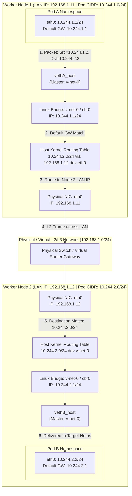
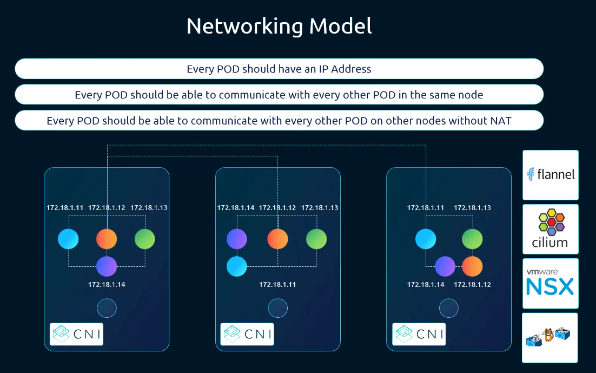
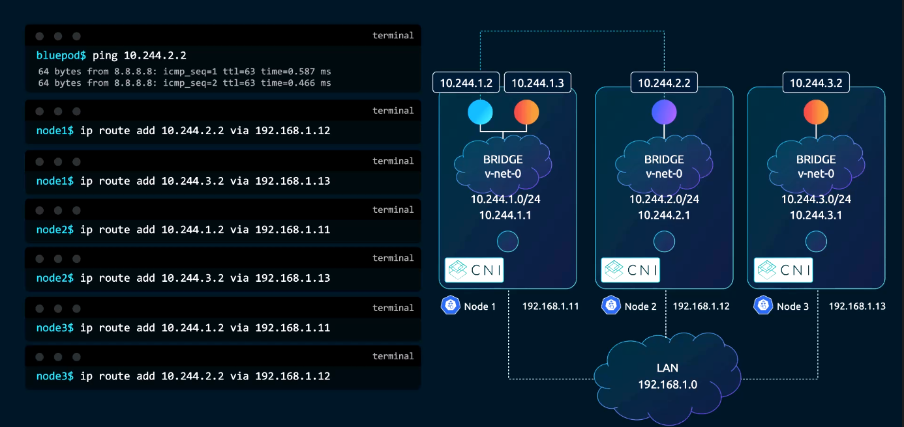
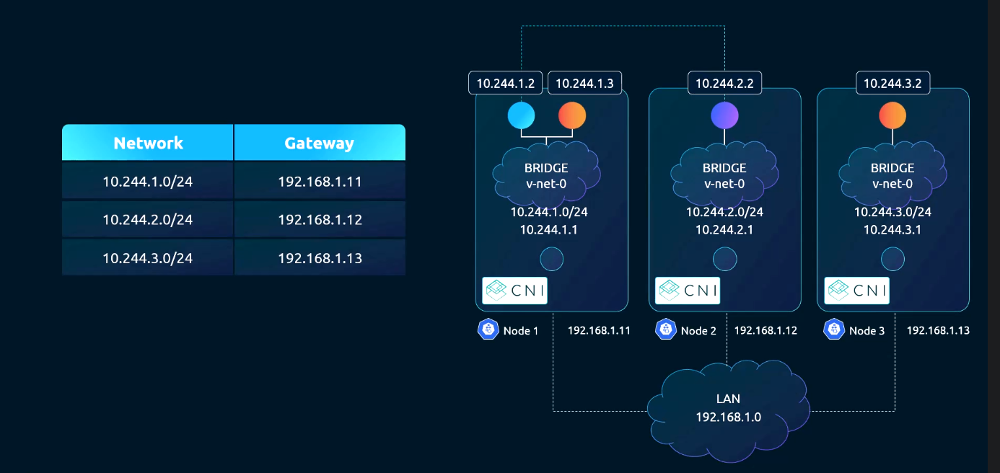
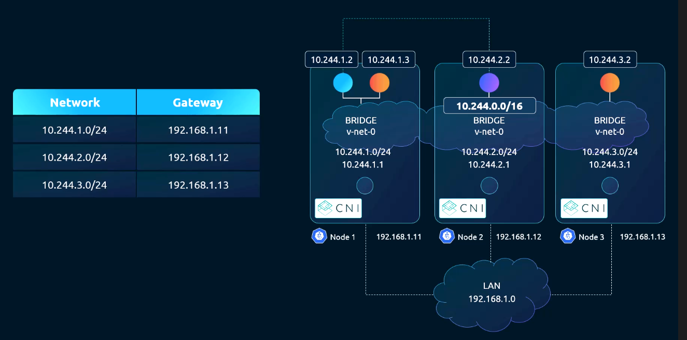
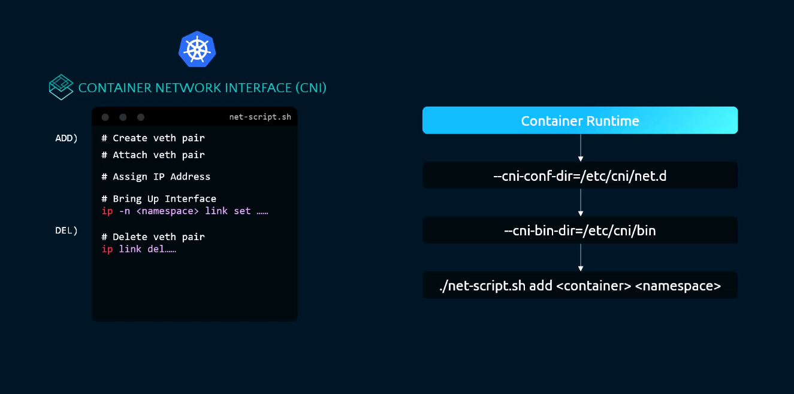
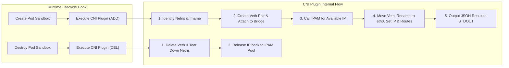
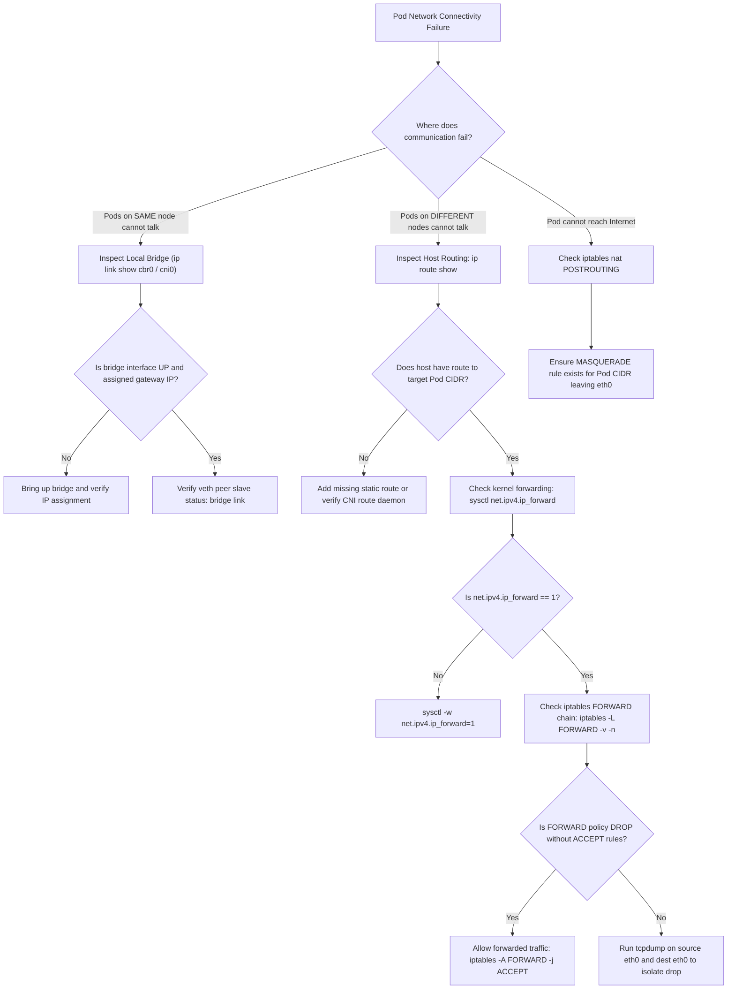

# 08 - Pod Network Modeling: From Kernel Primitives to Flat IP Routing

## Exam Metadata
- **Domain**: Services & Networking (20%) / Fundamental Pod Networking
- **Importance**: Critical (The Core Mental Model of Kubernetes Networking: IP-per-Pod, Un-NATted Communication, and CNI Automation)
- **Target Version**: Kubernetes v1.31 / v1.32
- **Allowed Docs Search Keywords**: `cluster networking`, `network plugins`, `cni specification`, `pod networking`
- **Source**: `networking/08-pod-network-modeling-raw.md`

---

## 1. Quick-Reference Summary
- **The Core Kubernetes Network Invariants (The "IP-per-Pod" Model)**:
  1. Every Pod receives its own unique, routable IP address in the cluster.
  2. Pods on any node can communicate with all Pods on every other node **without Network Address Translation (NAT)**.
  3. Agents on a node (e.g., `kubelet`, host daemons) can communicate with all Pods running on that same node.
  4. Pods configured with `hostNetwork: true` can communicate with all Pods on all nodes without NAT.
- **Node-Level Virtual Devices**:
  - **Linux Bridge** (`cbr0`, `v-net-0`): Acts as a Layer 2 virtual switch on the node, assigned the default gateway IP of the node's allocated Pod CIDR (e.g., `10.244.1.1/24` on Node 1).
  - **Virtual Ethernet Pair** (`veth`): A bidirectional virtual cable connecting the Pod namespace interface (`eth0`) to a slave port on the host bridge (`veth...`).
- **Cluster Subnet Allocation**:
  - The cluster designates an overarching Pod CIDR (e.g., `10.244.0.0/16`).
  - The control plane (`kube-controller-manager`) partitions this block, assigning a unique non-overlapping subnet (e.g., `10.244.1.0/24`, `10.244.2.0/24`) to each node recorded in `node.spec.podCIDR`.
- **Cross-Node Routing Approaches**:
  - **Host Routing Table Mesh**: Static routes on every node pointing foreign Pod CIDRs to the respective node's physical LAN IP (`ip route add 10.244.2.0/24 via 192.168.1.12`).
  - **Gateway Router**: Physical/virtual L3 router configured with routes for all Pod CIDRs, serving as default gateway for all nodes.
  - **Overlay / Encapsulation (CNI)**: Encapsulates Pod L2/L3 packets inside host L4 UDP packets (e.g., VXLAN, Geneve) to traverse arbitrary underlying networks.
- **CNI Automation**:
  - The Container Runtime Interface (CRI) offloads the manual execution of `ip link`, namespace migration, IP allocation (IPAM), and route configuration to standardized CNI plugins invoked via `ADD` and `DEL` operations.

---

## 2. Conceptual Overview & Mental Model

### Simple English Explanation
In standard Docker networking, containers on different servers cannot easily talk to each other because each server creates the same private IP network (`172.17.0.0/16`). As a result, containers on different hosts collide with identical IP addresses, requiring complex port forwarding (NAT).

Kubernetes completely eliminates this problem by enforcing a flat, un-NATted network model where every single Pod gets a unique IP address across the entire cluster.

To understand how this operates under the hood without magic:
1. **Node Subnets**: Each worker node is assigned its own private slice of the cluster IP pool. For example, Node 1 gets `10.244.1.0/24` and Node 2 gets `10.244.2.0/24`.
2. **Local Switching**: On Node 1, the system creates a virtual switch (a Linux bridge named `v-net-0` or `cbr0`) and gives it the gateway address `10.244.1.1`.
3. **Container Plumbing**: When a Pod is created, the system creates a virtual Ethernet cable (`veth` pair). One end plugs into the local bridge; the other end is placed inside the Pod's private network namespace, renamed to `eth0`, and given an IP address like `10.244.1.2`. Containers on the same node communicate locally across this bridge.
4. **Cross-Node Routing**: When Pod `10.244.1.2` on Node 1 sends a packet to Pod `10.244.2.2` on Node 2:
   - The packet travels from Pod 1 through its `veth` pair to Node 1's bridge.
   - Node 1's kernel checks its routing table and sees that `10.244.2.0/24` is reachable via Node 2's physical network address (`192.168.1.12`).
   - Node 1 puts the packet on the physical LAN with Node 2 as the destination MAC and IP.
   - Node 2 receives the packet, recognizes the destination `10.244.2.2`, and forwards it to its local bridge (`v-net-0`), which delivers it directly to Pod 2.
   - The packet retains the original source IP (`10.244.1.2`) and destination IP (`10.244.2.2`) throughout its entire journey without NAT.
5. **CNI Plugins**: A CNI plugin is simply an automated program that executes these exact Linux commands whenever a Pod is scheduled or destroyed.

### Formal Technical Definition
The Kubernetes Pod network model is an un-NATted, IP-per-Pod flat routing architecture wherein every workload endpoint is assigned a globally unique Layer 3 IP address from a topologically partitioned cluster CIDR. Inter-Pod packet transit relies on kernel virtual bridges (`bridge.ko`), namespace-bridging virtual Ethernet interfaces (`veth.c`), and deterministic Layer 3 hop-by-hop forwarding (direct host static routing, BGP dynamic routing, or L4 UDP packet encapsulation).

### Architecture Flowchart: End-to-End Pod-to-Pod Packet Flow



---

## 3. Deep-Dive Technical Breakdown

### The Fundamental Kubernetes Network Model



#### The Three Immutable Invariants:
1. **All Pods can communicate with all other Pods without NAT**:
   A Pod sees its own IP address as exactly the same IP address that all other Pods in the cluster see it as. There is no port translation, source rewriting, or masquerading between Pod endpoints.
2. **All Nodes can communicate with all Pods without NAT**:
   System processes running in the host network namespace (such as `kubelet` or monitoring daemons) can initiate connections directly to any Pod IP address without proxying.
3. **The IP that a Pod sees as its own is the same IP that other Pods see for it**:
   Self-registration protocols, peer-discovery engines, and distributed databases (e.g. etcd, ZooKeeper, Cassandra) require that a node's local socket address matches its externally advertised cluster address.

---

### Step-by-Step Manual Linux Implementation

To understand how CNI automates networking, here is the exact manual Linux command sequence required to establish the Pod network model on a host:

#### Step 1: Create and Configure the Host Bridge
```bash
# 1. Create a Linux software bridge interface
sudo ip link add v-net-0 type bridge

# 2. Assign the Pod subnet gateway address to the bridge interface
sudo ip addr add 10.244.1.1/24 dev v-net-0

# 3. Bring the bridge interface online
sudo ip link set dev v-net-0 up
```

#### Step 2: Create Pod Network Namespace
```bash
# Create an isolated network namespace for the container
sudo ip netns add pod1-netns
```

#### Step 3: Instantiate Virtual Ethernet (Veth) Pair
```bash
# Create bidirectional virtual Ethernet pair
sudo ip link add veth-pod1 type veth peer name veth-pod1-br
```

#### Step 4: Attach Host-End to Bridge
```bash
# Attach host end to v-net-0 bridge as a slave device
sudo ip link set dev veth-pod1-br master v-net-0
sudo ip link set dev veth-pod1-br up
```

#### Step 5: Migrate Peer-End into Container Namespace & Configure
```bash
# 1. Move peer end into the container network namespace
sudo ip link set dev veth-pod1 netns pod1-netns

# 2. Rename inside namespace to standard 'eth0'
sudo ip -n pod1-netns link set dev veth-pod1 name eth0

# 3. Assign unique Pod IP address from the node's subnet
sudo ip -n pod1-netns addr add 10.244.1.2/24 dev eth0

# 4. Bring up loopback and eth0 interfaces
sudo ip -n pod1-netns link set dev eth0 up
sudo ip -n pod1-netns link set dev lo up

# 5. Set default gateway pointing to the bridge interface IP
sudo ip -n pod1-netns route add default via 10.244.1.1 dev eth0
```

---

### Cross-Node Routing Solutions

Once Pods on the same node communicate through `v-net-0`, cross-node routing must be established so Pod `10.244.1.2` (Node 1) can reach Pod `10.244.2.2` (Node 2).

Three architectural patterns achieve this:

#### 1. Host-Level Routing Table Mesh





In this design, every node maintains explicit static routing entries for every other node's Pod CIDR:

```bash
# On Node 1 (192.168.1.11):
sudo ip route add 10.244.2.0/24 via 192.168.1.12 dev eth0
sudo ip route add 10.244.3.0/24 via 192.168.1.13 dev eth0

# On Node 2 (192.168.1.12):
sudo ip route add 10.244.1.0/24 via 192.168.1.11 dev eth0
sudo ip route add 10.244.3.0/24 via 192.168.1.13 dev eth0
```
- **Limitation**: Scalability bottleneck. In an $N$-node cluster, this requires $O(N^2)$ routes configured across all machines.

---

#### 2. Centralized Gateway Router



Instead of updating every host, all nodes send cross-subnet traffic to a centralized physical or virtual router:
- Nodes configure their default gateway pointing to the router: `default via 192.168.1.1 dev eth0`.
- The router maintains the master routing table mapping each `/24` Pod CIDR to its hosting node's physical LAN IP.
- The router aggregates individual `/24` subnets into the cluster's supernet (e.g. `10.244.0.0/16`).

---

#### 3. Overlay Networks (Encapsulation via CNI)
When underlying physical networks cannot be reconfigured or do not support direct routing (such as multi-tenant cloud VPCs with strict MAC/IP binding):
- A CNI plugin (e.g., Flannel VXLAN, Calico VXLAN/IPIP, Cilium) encapsulates the entire Pod IP packet inside an outer UDP packet on the sending node.
- The outer packet travels across standard L3 networks using the host LAN IPs.
- The receiving node de-encapsulates the UDP packet, extracts the original inner Pod IP packet, and passes it to the local bridge.

---

### From Manual Plumbing to CNI Automation



Executing manual shell commands for every container is error-prone and unscalable. CNI formalizes this sequence into a structured executable script or binary:



The CNI specification defines:
- **How the runtime calls the script**: Passing container ID, netns path, and interface name via standard environment variables (`CNI_COMMAND`, `CNI_NETNS`, `CNI_IFNAME`).
- **How parameters are supplied**: Passing subnets, gateways, and IPAM rules via JSON on `STDIN`.
- **How results are returned**: Standardized JSON report on `STDOUT`.

---

## 4. Command Translation & Mapping Tables

### Comparison of Cross-Node Routing Approaches

| Architectural Pattern | Mechanism | Configuration Point | Performance Overhead | Cloud / Underlay Compatibility |
| :--- | :--- | :--- | :--- | :--- |
| **Host Static Routing** | Kernel routing tables (`ip route`) | Every cluster node ($O(N^2)$ routes) | Zero (Native line-rate kernel routing) | Requires direct L2 adjacency or router cooperation |
| **Gateway Router** | Upstream L3 router table | Central network switch / router | Zero (Native line-rate hardware forwarding) | Requires control over physical network infrastructure |
| **Overlay (VXLAN)** | L2/L3 frame encapsulated in UDP port 8472 | CNI DaemonSet (Flannel, Calico, Cilium) | Minor CPU overhead due to MTU reduction & packet encapsulation | Universal (works on any network allowing UDP) |
| **Dynamic Routing (BGP)** | Route distribution via BGP peer mesh | CNI daemon (Calico, Cilium, kube-router) | Zero (Direct kernel routing without encapsulation) | Supported on bare-metal and BGP-capable cloud VPCs |

### Manual Linux Commands vs. Standard CNI Bridge Plugin Equivalent

| Manual Linux Operation | CNI Bridge Plugin Equivalent Config |
| :--- | :--- |
| `ip link add cbr0 type bridge` | `"bridge": "cbr0"` in JSON config |
| `ip addr add 10.244.1.1/24 dev cbr0` | `"isGateway": true` + `"subnet": "10.244.1.0/24"` |
| `ip link add veth... type veth` | Handled internally by CNI `bridge` binary |
| `ip link set veth... netns <PID>` | Driven by `CNI_NETNS` environment variable |
| Manual IP tracking spreadsheet | `"ipam": { "type": "host-local" }` |
| `ip route add default via 10.244.1.1` | `"routes": [{ "dst": "0.0.0.0/0" }]` |

---

## 5. High-Yield CLI & Imperative Commands

### Inspecting Node Pod CIDRs in Kubernetes
```bash
# 1. View allocated Pod CIDR for all cluster nodes
kubectl get nodes -o custom-columns=NAME:.metadata.name,POD_CIDR:.spec.podCIDR,INTERNAL_IP:.status.addresses[0].address

# 2. View specific node podCIDR allocation via JSONPath
kubectl get node node01 -o jsonpath='{.spec.podCIDR}{"\n"}'
# Example Output: 10.244.1.0/24
```

### Inspecting Host Kernel Routing and Bridge Links
```bash
# 1. View kernel routing table for Pod CIDRs
ip route show

# 2. View all interfaces attached as slave ports to the bridge
bridge link show dev cbr0
# Or dev v-net-0 / cni0

# 3. View ARP cache entries on the host for Pod endpoints
ip neigh show
```

### Simulating Pod-to-Pod Network Routing via Linux CLI
```bash
# 1. Check if packet forwarding is enabled
sudo sysctl net.ipv4.ip_forward

# 2. Manually add a route to a foreign node's Pod CIDR
sudo ip route add 10.244.2.0/24 via 192.168.1.12 dev eth0

# 3. Verify route path used by kernel to reach a specific Pod IP
ip route get 10.244.2.2
# Expected Output: 10.244.2.2 via 192.168.1.12 dev eth0 src 192.168.1.11
```

### Real-Time Packet Tracing with `tcpdump`
```bash
# 1. Trace ICMP packets on the physical host interface (verifying cross-node transit)
sudo tcpdump -nn -i eth0 icmp

# 2. Trace ICMP packets entering the bridge interface
sudo tcpdump -nn -i cbr0 icmp

# 3. Trace ICMP packets inside a specific network namespace
sudo ip netns exec <netns-name> tcpdump -nn -i eth0 icmp
```

---

## 6. Troubleshooting & Diagnostic Runbook

### Diagnostic Decision Tree



### Triage Sequence Matrix

| Step | Scope | Diagnostic Command | Expected Value | Remediation Action |
| :--- | :--- | :--- | :--- | :--- |
| **1. Node PodCIDR** | Control Plane | `kubectl get nodes -o yaml \| grep -i podcidr` | Non-empty unique CIDR per node | Verify `--allocate-node-cidrs=true` and `--cluster-cidr` on controller-manager. |
| **2. Kernel Forwarding**| Host Kernel | `sysctl net.ipv4.ip_forward` | `net.ipv4.ip_forward = 1` | `sysctl -w net.ipv4.ip_forward=1` and persist in `/etc/sysctl.d/k8s.conf`. |
| **3. Host Route Entry**| Host Kernel | `ip route get <remote-pod-ip>` | Routed via remote node LAN IP | Add static route or restart CNI DaemonSet to re-establish routes. |
| **4. Netfilter FORWARD**| Netfilter | `iptables -S FORWARD` | Contains `-A FORWARD -j ACCEPT` for bridge/pods | If policy is `DROP`, inject accept rule or configure CNI firewall plugin. |
| **5. Bridge Status** | Host Devices | `ip link show type bridge` | Status `UP` | `ip link set <bridge-name> up`. |
| **6. Veth Attachment**| Host Devices | `bridge link` | Both veth endpoints active | Check CNI logs in `/var/log/pods/` or `journalctl -u containerd`. |
| **7. Wire Packet Flow** | Physical NIC | `tcpdump -nn -i eth0 host <remote-pod-ip>` | Packets visible leaving source and entering dest | If packet leaves source but never arrives at dest, check cloud security groups / VPC routing. |

---

## 7. CKA Exam Tips, Gotchas & Traps

> [!WARNING]
> **The `iptables -P FORWARD DROP` Trap**
> On systems where Docker was previously installed or where `ufw` is active, the default policy of the Linux kernel `FORWARD` chain is set to `DROP`.
> In Kubernetes, packets routed between Pods on different nodes MUST traverse the host's `FORWARD` chain. If the policy is `DROP` and no rule accepts traffic between the Pod CIDR subnets, cross-node Pod communication will silently fail with 100% packet loss!
> Remediation: Verify with `sudo iptables -L FORWARD -v -n` and ensure CNI-managed ACCEPT rules exist.

> [!IMPORTANT]
> **The `kube-controller-manager` Pod CIDR Allocator**
> In clusters deployed via `kubeadm`, `kube-controller-manager` automatically carves up the `--cluster-cidr` (e.g. `10.244.0.0/16`) into `/24` subnets per node.
> If a student manually provisions a cluster without setting `--allocate-node-cidrs=true` and `--cluster-cidr` on the controller manager, the nodes will have empty `.spec.podCIDR` fields, causing Flannel, Calico, or custom CNI plugins to crash immediately on startup!

> [!IMPORTANT]
> **No-NAT Violation: Never Masquerade Pod-to-Pod Traffic**
> A common networking misconfiguration is applying an iptables `MASQUERADE` rule to all outbound traffic indiscriminately:
> `iptables -t nat -A POSTROUTING -j MASQUERADE` (WRONG!).
> This rewrites the Pod's source IP to the node IP when talking to other Pods, violating Kubernetes Invariant #1. The correct rule must specifically exclude traffic destined to other Pod subnets:
> `iptables -t nat -A POSTROUTING -s 10.244.0.0/16 ! -d 10.244.0.0/16 -j MASQUERADE`.

> [!TIP]
> **`ip route get` Fast Diagnosis**
> When troubleshooting why a Pod cannot reach an external IP or another Pod, run `ip route get <destination-ip>` on the host. The Linux kernel immediately returns the exact device, gateway, and source IP it intends to use, instantly revealing missing or misdirected routes.

---

## 8. Self-Test / Active Recall

<details>
<summary><strong>1. What are the three core principles of the Kubernetes Pod networking model?</strong></summary>

1. All Pods can communicate with all other Pods without NAT.
2. All Nodes can communicate with all Pods without NAT.
3. The IP that a Pod sees as its own is the same IP that other Pods and nodes see for it.
</details>

<details>
<summary><strong>2. Why does standard Docker bridge networking fail to meet the Kubernetes networking model across multiple nodes?</strong></summary>

Docker assigns overlapping private subnets (e.g., `172.17.0.0/16`) on each node and requires Network Address Translation (port mapping) for external and cross-host communication, violating the un-NATted flat IP requirement.
</details>

<details>
<summary><strong>3. Which Kubernetes control plane component is responsible for allocating a unique <code>podCIDR</code> subnet to each node?</strong></summary>

`kube-controller-manager` (using the `--allocate-node-cidrs=true` and `--cluster-cidr` flags).
</details>

<details>
<summary><strong>4. How do two Pods running on the SAME worker node communicate with each other?</strong></summary>

Locally across the host's Linux software bridge (e.g., `cbr0` or `cni0`) via their connected `veth` pair endpoints, without leaving the host or involving external physical network interfaces.
</details>

<details>
<summary><strong>5. When Pod A (10.244.1.2) sends a packet to Pod B (10.244.2.2) on another node via a static routing mesh, what are the source and destination IP addresses in the packet header when it traverses the physical LAN?</strong></summary>

Source IP: `10.244.1.2`, Destination IP: `10.244.2.2`. (The IP addresses are never rewritten; only the Layer 2 Ethernet MAC addresses correspond to the physical node interfaces).
</details>

<details>
<summary><strong>6. What is the scalability limitation of using host-level static routing tables for cross-node Pod communication?</strong></summary>

It requires maintaining $O(N^2)$ routes across the cluster, becoming unmanageable as the number of nodes increases.
</details>

<details>
<summary><strong>7. How does an overlay network (e.g., VXLAN) solve the cross-node routing problem without modifying physical router tables?</strong></summary>

It encapsulates the Layer 2/3 Pod IP packet inside an outer Layer 4 UDP packet addressed to the destination node's physical LAN IP, allowing Pod traffic to traverse any intermediate network transparently.
</details>

<details>
<summary><strong>8. What Linux kernel setting must be set to <code>1</code> for a host to forward packets between its bridge interface and physical network card?</strong></summary>

`net.ipv4.ip_forward = 1`.
</details>

<details>
<summary><strong>9. If the Linux Netfilter <code>FORWARD</code> chain default policy is set to <code>DROP</code>, what happens to cross-node Pod traffic?</strong></summary>

The host kernel silently discards the forwarded packets, causing complete connection failure between Pods on different nodes.
</details>

<details>
<summary><strong>10. Where in the Kubernetes API can you inspect the subnet assigned to a specific node?</strong></summary>

In the Node object specification under `spec.podCIDR` (or `spec.podCIDRs` for dual-stack).
</details>

---

## 9. Official Documentation Bookmarks

| Resource | Documentation Path / Anchor | Purpose |
| :--- | :--- | :--- |
| **Cluster Networking** | `Concepts > Cluster Administration > Cluster Networking` | The foundational specification of the IP-per-Pod model |
| **Network Plugins** | `Concepts > Cluster Administration > Network Plugins` | How CNI implements the Pod network model |
| **kube-controller-manager** | `Reference > Command line tools > kube-controller-manager` | Flags for `--cluster-cidr` and `--allocate-node-cidrs` |
| **Pod Networking Mechanics** | `Concepts > Workloads > Pods > Pod Lifecycle` | How Pod sandboxes and network namespaces are initialized |

