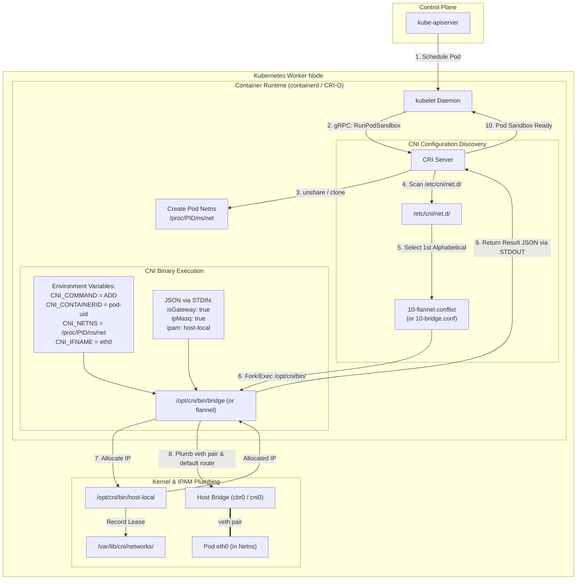
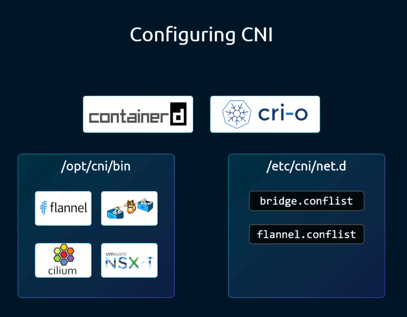
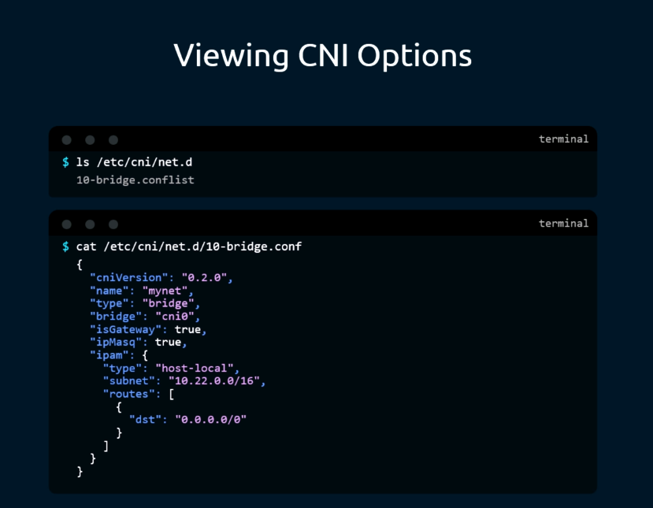
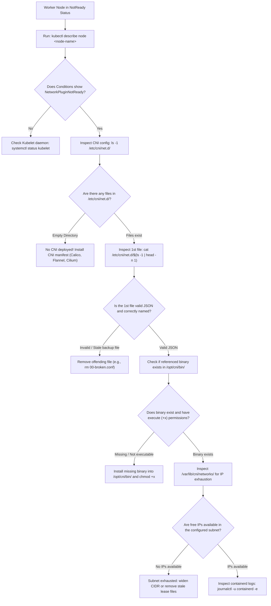

# 09 - CNI in Kubernetes: Runtime Integration, Config Schemas & Diagnostics

## Exam Metadata
- **Domain**: Services & Networking (20%) / Cluster Architecture, Installation & Configuration (25%)
- **Importance**: High (Direct CKA Exam Archetype: Identifying Active CNI, Troubleshooting `/etc/cni/net.d/`, and Resolving Node `NotReady` Status)
- **Target Version**: Kubernetes v1.31 / v1.32
- **Allowed Docs Search Keywords**: `network plugins`, `cni configuration`, `container runtime cni`, `cni plugins`
- **Source**: `networking/09-cni-in-kubernetes-raw.md`

---

## 1. Quick-Reference Summary
- **Runtime Delegation**:
  - `kubelet` does not execute CNI plugins directly.
  - `kubelet` issues a `RunPodSandbox` gRPC request over the Container Runtime Interface (CRI) to the container runtime (`containerd` or `CRI-O`).
  - The CRI runtime reads the CNI configuration directory and executes the plugin binaries.
- **Key System File Paths**:
  - **CNI Configuration Directory**: `/etc/cni/net.d/` (`.conf`, `.conflist`, `.json`).
  - **CNI Executable Binaries Directory**: `/opt/cni/bin/` (`bridge`, `loopback`, `host-local`, `portmap`, `flannel`, `calico`, etc.).
  - **IPAM Lease Cache (`host-local`)**: `/var/lib/cni/networks/<network-name>/`.
- **The Lexicographical Selection Rule**:
  - The container runtime inspects `/etc/cni/net.d/` and loads the **first file in alphabetical order** (`ls -1 /etc/cni/net.d/ | head -n 1`).
  - Any backup or dead configuration files (e.g. `00-dummy.conf`) placed before the real configuration will override the cluster network plugin and break Pod scheduling.
- **Core CNI Configuration Options**:
  - `isGateway`: If `true`, assigns an IP address to the bridge interface so it acts as the default gateway for local Pods.
  - `ipMasq`: If `true`, configures iptables `MASQUERADE` (SNAT) for outbound traffic from Pods to destinations outside the bridge subnet.
  - `hairpinMode`: Enables Pods to communicate with themselves through their own ClusterIP or NodePort Services.
  - `ipam.type`: Defines IP management (`host-local` for host-managed flat allocations, `dhcp` for external DHCP).
- **Exam Inspection Technique**:
  - To determine the active CNI plugin on any cluster node, inspect the first file in `/etc/cni/net.d/` and check the `.type` or `.plugins[0].type` field.

---

## 2. Conceptual Overview & Mental Model

### Simple English Explanation
When the Kubernetes control plane tells a worker node to start a Pod, the `kubelet` process is responsible for getting the container running. However, `kubelet` does not manipulate Linux network interfaces or IP addresses itself.

Instead, `kubelet` delegates the task to the container runtime (such as `containerd` or `CRI-O`) using the Container Runtime Interface (CRI):
1. `kubelet` sends a `RunPodSandbox` command to `containerd`.
2. `containerd` creates an isolated Linux network namespace for the Pod.
3. `containerd` looks into `/etc/cni/net.d/` on the local file system. It sorts all configuration files alphabetically and picks the very first one (for example, `10-flannel.conflist`).
4. `containerd` reads the JSON configuration inside that file. The configuration specifies which plugin binary to run (e.g. `flannel` or `bridge`), whether to enable IP masquerading (`ipMasq`), and which IPAM plugin to use (`host-local`).
5. `containerd` executes that binary from `/opt/cni/bin/`, passing `CNI_COMMAND=ADD` and the network namespace path as environment variables.
6. The CNI binary creates the virtual Ethernet cable, attaches it to the bridge, asks the IPAM plugin for an unused IP address, and configures the default route.
7. The binary returns the allocated IP to `containerd` via standard output (`STDOUT`).
8. `containerd` then launches the actual application containers inside that configured namespace.

### Formal Technical Definition
Kubernetes CNI integration is a decoupled, runtime-delegated network lifecycle architecture wherein `kubelet` commands CRI runtimes (`containerd` / `CRI-O`) via gRPC RPCs (`RunPodSandbox`, `StopPodSandbox`), and the runtime executes host-resident CNI plugin binaries according to the first lexicographically sorted JSON configuration in `/etc/cni/net.d/` using environment variables and JSON STDIN/STDOUT streams.

### Architecture Flowchart: Kubelet to CNI Integration Workflow



---

## 3. Deep-Dive Technical Breakdown

### The Architectural Evolution: Dockershim Deprecation

In early versions of Kubernetes (pre-v1.24):
- Kubelet directly managed container networking through an internal adapter called **Dockershim**.
- Kubelet CLI arguments included flags such as `--network-plugin=cni`, `--cni-bin-dir=/opt/cni/bin`, and `--cni-conf-dir=/etc/cni/net.d`.
- Because Docker used CNM instead of CNI, Dockershim created Docker containers with `--network none` and manually invoked CNI binaries against the container namespace.

In modern Kubernetes (v1.24 through v1.32):
- **Dockershim is completely removed**.
- Kubelet no longer has a `--network-plugin` flag.
- Kubelet communicates strictly via CRI gRPC endpoints (e.g., `unix:///run/containerd/containerd.sock`).
- Networking configuration is owned entirely by the CRI runtime (`containerd` configuration in `/etc/containerd/config.toml`).

---

### CNI Configuration Files & JSON Schemas

The container runtime discovers network plugins by scanning the configuration directory `/etc/cni/net.d/`:



#### The Lexicographical Sort Rule:
If multiple files exist in `/etc/cni/net.d/`, the runtime sorts all filenames alphabetically and executes **only the first matching configuration**:
```bash
ls -1 /etc/cni/net.d/
# Output:
# 10-flannel.conflist
# 20-calico.conflist
# 99-loopback.conf
```
In this scenario, `10-flannel.conflist` is chosen. If an administrator creates `00-test.conf`, the runtime will switch to `00-test.conf` immediately!

---

### Detailed Analysis of CNI JSON Options



#### Example Standalone Bridge Configuration (`.conf`):
```json
{
  "cniVersion": "0.4.0",
  "name": "mynet",
  "type": "bridge",
  "bridge": "cbr0",
  "isGateway": true,
  "ipMasq": true,
  "hairpinMode": true,
  "ipam": {
    "type": "host-local",
    "subnet": "10.244.1.0/24",
    "routes": [
      { "dst": "0.0.0.0/0" }
    ]
  }
}
```

#### Field-by-Field Technical Breakdown:

| JSON Key | Type | Description & Technical Effect |
| :--- | :--- | :--- |
| `cniVersion` | String | Semantic version of the CNI specification supported by this configuration file (e.g. `0.4.0`, `1.0.0`). |
| `name` | String | Human-readable network label. Used by IPAM plugins to create segregated lease directories in `/var/lib/cni/networks/<name>`. |
| `type` | String | **The plugin binary name**. The runtime searches for an executable with this exact name inside `/opt/cni/bin/` (e.g. `bridge`, `flannel`, `calico`). |
| `bridge` | String | The name of the Linux software bridge interface created on the host (e.g., `cbr0`, `cni0`). |
| `isGateway` | Boolean | If `true`, assigns the first address of the subnet (e.g. `10.244.1.1`) to the bridge interface so it functions as the default gateway for Pods. |
| `ipMasq` | Boolean | If `true`, the plugin configures an iptables `MASQUERADE` rule in the `POSTROUTING` chain of the `nat` table, translating Pod source IPs when communicating outside the cluster CIDR. |
| `hairpinMode` | Boolean | If `true`, enables promiscuous / hairpin mode on the bridge veth ports, allowing a Pod to send requests to a Service Virtual IP that routes back to itself. |
| `ipam` | Object | Sub-configuration delegated to an IP Address Management plugin. |
| `ipam.type` | String | The IPAM plugin executable in `/opt/cni/bin/`. Typically `host-local` (allocates IPs locally from a fixed CIDR) or `dhcp` (requests leases from external DHCP daemon). |
| `ipam.subnet`| String | The specific IP subnet allocated to this node from which Pod IPs are carved. |
| `ipam.routes`| Array | Static routes injected into the Pod network namespace. `{ "dst": "0.0.0.0/0" }` creates the default gateway route. |

---

### IPAM Mechanisms: `host-local` vs. `dhcp`

#### 1. `host-local` IPAM (Standard in Kubernetes):
- Manages IP allocations entirely on the local node file system without external dependencies.
- Stores allocated IP address leases as empty flat files named after the IP under `/var/lib/cni/networks/<network-name>/`:
  ```bash
  ls /var/lib/cni/networks/mynet/
  # Output: 10.244.1.2  10.244.1.3  10.244.1.4  last_reserved_ip.0
  ```
- Each file contains the container ID that owns the lease.
- When `CNI_COMMAND=DEL` is invoked, the file corresponding to the container's IP is unlinked.

#### 2. `dhcp` IPAM:
- Used in environments where Pods must receive IP addresses from an external corporate network DHCP server.
- Requires a persistent background daemon running on the host: `/opt/cni/bin/dhcp daemon`.
- The `dhcp` plugin broadcasts DHCP requests over the physical network interface on behalf of container namespaces.

---

## 4. Command Translation & Mapping Tables

### CNI Configuration Keys vs. Linux Kernel / Netfilter Impact

| JSON Configuration Key | Linux Kernel / Netfilter Command Executed |
| :--- | :--- |
| `"bridge": "cbr0"` | `ip link add cbr0 type bridge` |
| `"isGateway": true` | `ip addr add 10.244.1.1/24 dev cbr0; ip link set cbr0 up` |
| `"ipMasq": true` | `iptables -t nat -A POSTROUTING -s 10.244.1.0/24 ! -d 10.244.1.0/24 -j MASQUERADE` |
| `"hairpinMode": true` | `brctl hairpin cbr0 vethXXXX on` (or `bridge link set dev vethXXXX hairpin on`) |
| `"routes": [{"dst": "0.0.0.0/0"}]` | `ip -n <netns> route add default via 10.244.1.1 dev eth0` |

### CKA Exam Question Archetypes for CNI

| Exam Question Type | Target Knowledge | Authoritative CLI Resolution |
| :--- | :--- | :--- |
| **"Identify the CNI plugin used on this node"** | Directory inspection & JSON parsing | `cat /etc/cni/net.d/$(ls -1 /etc/cni/net.d/ \| head -n 1) \| grep -E '"type"'` |
| **"Find where CNI binaries are installed"** | Filesystem location standards | `ls -la /opt/cni/bin/` |
| **"Identify why Node is NotReady"** | Lexicographical order trap | Check `kubectl describe node`, look for `NetworkPluginNotReady`, inspect first file in `/etc/cni/net.d/`. |
| **"Inspect container runtime CNI config"** | containerd / CRI-O integration | `grep -A 10 'cni' /etc/containerd/config.toml` |

---

## 5. High-Yield CLI & Imperative Commands

### Identifying the Active CNI Plugin on a Node (Exam Essential)
```bash
# 1. List files in /etc/cni/net.d/ in lexicographical order
ls -1 /etc/cni/net.d/

# 2. Extract the active plugin type using jq
ACTIVE_FILE=$(ls -1 /etc/cni/net.d/ | head -n 1)
echo "Active CNI configuration file: /etc/cni/net.d/${ACTIVE_FILE}"
jq -r '.type // .plugins[0].type' /etc/cni/net.d/${ACTIVE_FILE}

# 3. View full configuration formatted
cat /etc/cni/net.d/${ACTIVE_FILE} | jq .
```

### Investigating Kubelet Options & Runtime Endpoints
In the raw note, `ps aux | grep -i kubelet` was used to inspect runtime arguments.

```bash
# 1. Inspect running kubelet process options
# The '-i' flag enables case-insensitive pattern matching
ps aux | grep -i kubelet

# 2. Filter specifically for container runtime flags
ps aux | grep -i kubelet | grep -E "container-runtime|config"

# 3. View kubeadm environment flags file
cat /var/lib/kubelet/kubeadm-flags.env

# 4. View active kubelet systemd configuration
systemctl cat kubelet
```

### Inspecting Containerd CNI Configuration
```bash
# 1. View containerd CNI plugin configuration
grep -A 10 '\[plugins."io.containerd.grpc.v1.cri".cni\]' /etc/containerd/config.toml

# 2. Check containerd status and errors related to CNI
journalctl -u containerd -n 50 --no-pager | grep -i cni
```

### Inspecting Local IPAM Leases (`host-local`)
```bash
# 1. List IPAM networks managed on the host
ls -la /var/lib/cni/networks/

# 2. View all active IP leases allocated to Pods
ls -la /var/lib/cni/networks/*

# 3. Inspect which Pod / container ID owns an IP
cat /var/lib/cni/networks/*/<assigned-ip>
```

---

## 6. Troubleshooting & Diagnostic Runbook

### Diagnostic Decision Tree



### Triage Sequence Matrix

| Step | Failure Condition | Diagnostic Command | Expected Output | Remediation Action |
| :--- | :--- | :--- | :--- | :--- |
| **1. Node Condition** | `NetworkPluginNotReady` | `kubectl describe node <name> \| grep NetworkReady` | `NetworkReady: True` | If `False`, CNI plugin is missing, misconfigured, or crashed. |
| **2. Active CNI File** | Broken alphabetical file | `ls -1 /etc/cni/net.d/` | Legitimate `.conflist` first | Delete stray `00-*.conf` files overriding real config. |
| **3. CNI JSON Syntax** | Parser error | `jq . /etc/cni/net.d/*` | Formatted valid JSON | Correct invalid commas, quotes, or broken brackets. |
| **4. Plugin Binary** | `exec: "plugin": not found`| `ls -la /opt/cni/bin/<plugin-type>` | Executable present (`-rwxr-xr-x`) | Re-install CNI binaries package or copy binary to `/opt/cni/bin/`. |
| **5. Loopback Device** | Pod sandbox fails | `test -x /opt/cni/bin/loopback` | Exit code `0` | Install `loopback` binary; mandatory for all Pod sandboxes. |
| **6. IPAM Exhaustion** | `no IP addresses available`| `wc -l /var/lib/cni/networks/*/*` | Total leases < subnet size | Expand node CIDR or clean orphaned leases from dead containers. |
| **7. Runtime Path** | containerd misses CNI | `grep bin_dir /etc/containerd/config.toml` | `bin_dir = "/opt/cni/bin"` | Correct CNI paths in `config.toml` and restart containerd. |

---

## 7. CKA Exam Tips, Gotchas & Traps

> [!WARNING]
> **The CKA Question: "What is the CNI plugin configured on this cluster?"**
> A frequent CKA trap occurs when multiple CNI DaemonSets (e.g. both Flannel and Calico) have manifests in `/etc/kubernetes/` or namespaces.
> Do NOT guess based on pod names in `kube-system`!
> Log onto the requested node and inspect `/etc/cni/net.d/`. The **first file in alphabetical order** determines the active CNI plugin:
> ```bash
> ls -1 /etc/cni/net.d/ | head -n 1
> ```
> Whatever plugin binary is specified in that file is the ONLY authoritative answer!

> [!IMPORTANT]
> **The Kubelet Flag Removal in v1.24+**
> In older study guides, you may see instructions to edit `/var/lib/kubelet/kubeadm-flags.env` and add:
> `--network-plugin=cni --cni-bin-dir=/opt/cni/bin --cni-conf-dir=/etc/cni/net.d`.
> **DO NOT DO THIS!** In Kubernetes v1.24 through v1.32, adding `--network-plugin` causes `kubelet` to crash immediately with:
> `unknown flag: --network-plugin`.
> Modern CKA networking is configured entirely through the CRI runtime (`/etc/containerd/config.toml`).

> [!IMPORTANT]
> **The `grep -i` Flag Explained**
> In the raw notes, the user queried: `ps aux | grep -i kubelet`.
> In bash, the `-i` flag instructs `grep` to perform **case-insensitive** searches (matching `kubelet`, `Kubelet`, `KUBELET`).
> When diagnosing process arguments under exam pressure, always use `-i` to avoid missing processes due to capitalization variations.

> [!TIP]
> **Fixing a Node Stuck in `NotReady` Due to Network Plugin**
> If an exam question asks why a worker node is `NotReady`, the fast-triage sequence is:
> 1. `kubectl describe node <name>` $\rightarrow$ confirm `NetworkPluginNotReady`.
> 2. SSH to node $\rightarrow$ `ls -1 /etc/cni/net.d/`.
> 3. If empty, check if CNI daemonset pod on that node is crashlooping.
> 4. If a file like `00-dummy.conf` exists, delete or rename it so the proper `10-*.conflist` takes precedence, and wait 10 seconds for the node to transition to `Ready`.

---

## 8. Self-Test / Active Recall

<details>
<summary><strong>1. Which component on a Kubernetes node directly invokes CNI plugin binaries?</strong></summary>

The container runtime (e.g., `containerd` or `CRI-O`), responding to a `RunPodSandbox` gRPC request from `kubelet`.
</details>

<details>
<summary><strong>2. If <code>/etc/cni/net.d/</code> contains <code>20-flannel.conflist</code>, <code>05-bridge.conf</code>, and <code>10-calico.conflist</code>, which one does the runtime load?</strong></summary>

`05-bridge.conf`, because the runtime selects the first configuration file in lexicographical (alphabetical) order.
</details>

<details>
<summary><strong>3. Where are CNI plugin binaries located on a standard Kubernetes node by default?</strong></summary>

`/opt/cni/bin/`.
</details>

<details>
<summary><strong>4. What does the <code>isGateway: true</code> configuration option do on a bridge CNI plugin?</strong></summary>

It assigns an IP address to the Linux software bridge interface on the host, enabling it to act as the default gateway for Pods attached to that bridge.
</details>

<details>
<summary><strong>5. What does the <code>ipMasq: true</code> configuration option do?</strong></summary>

It configures iptables `MASQUERADE` rules in the `nat` table, translating the private Pod source IP into the host's physical IP for packets outbound to external networks.
</details>

<details>
<summary><strong>6. What is the role of the <code>hairpinMode: true</code> setting in CNI bridge configuration?</strong></summary>

It enables hairpin (reflective) packet routing on the bridge, allowing a Pod to communicate with itself via its own Service ClusterIP or NodePort.
</details>

<details>
<summary><strong>7. How does the <code>host-local</code> IPAM plugin store allocated IP leases on the host?</strong></summary>

As flat files named after each allocated IP inside `/var/lib/cni/networks/<network-name>/`.
</details>

<details>
<summary><strong>8. What node status condition indicates that CNI is missing, misconfigured, or uninitialized?</strong></summary>

`NetworkPluginNotReady` under `status.conditions` where `NetworkReady` is `False`.
</details>

<details>
<summary><strong>9. What happens if you add <code>--network-plugin=cni</code> to kubelet flags in Kubernetes v1.31?</strong></summary>

Kubelet crashes with an `unknown flag: --network-plugin` fatal error because Dockershim was removed in v1.24.
</details>

<details>
<summary><strong>10. What does the <code>-i</code> flag do when running <code>grep -i kubelet</code>?</strong></summary>

It enables case-insensitive matching, allowing the pattern to match `kubelet`, `Kubelet`, or `KUBELET`.
</details>

---

## 9. Official Documentation Bookmarks

| Resource | Documentation Path / Anchor | Purpose |
| :--- | :--- | :--- |
| **Network Plugins** | `Concepts > Cluster Administration > Network Plugins` | Kubelet and CRI network plugin configuration reference |
| **Container Runtimes** | `Getting Started > Production Environment > Container Runtimes` | Configuring CNI directories in `containerd` |
| **Node Status Conditions** | `Concepts > Architecture > Nodes` | Understanding `Ready` vs `NetworkPluginNotReady` conditions |
| **Cluster Networking** | `Concepts > Cluster Administration > Cluster Networking` | Pod network design invariants and CNI requirements |
