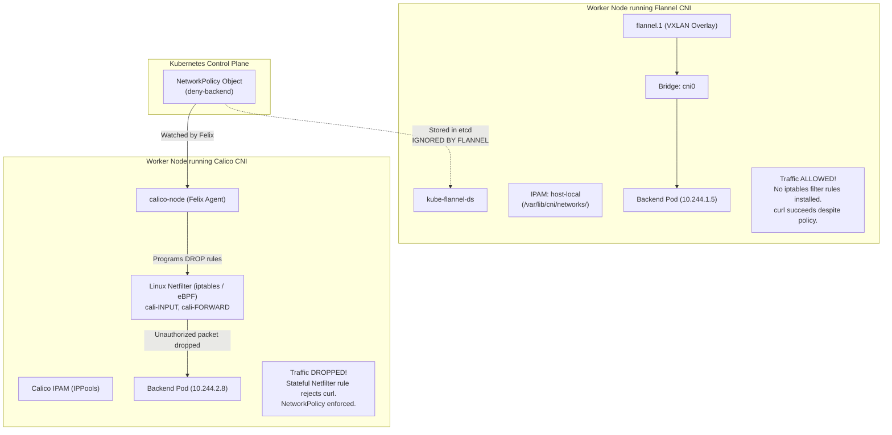
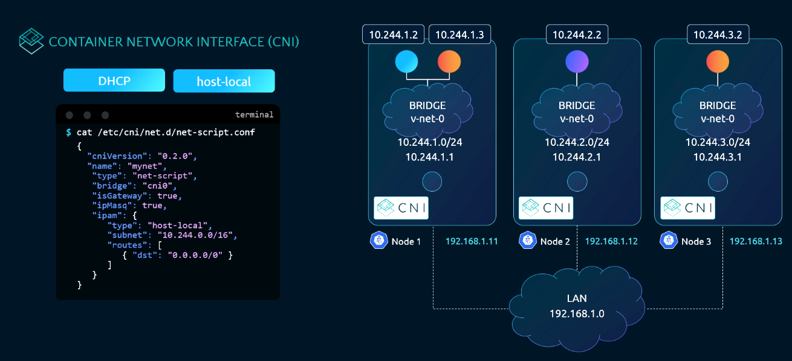
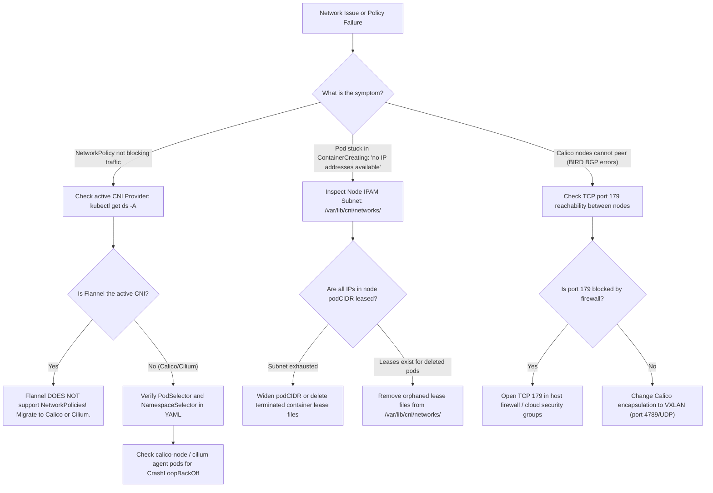

# 10 - IP Address Management (IPAM) & CNI Providers: Flannel, Calico & Weave

## Exam Metadata
- **Domain**: Services & Networking (20%) / Cluster Architecture, Installation & Configuration (25%)
- **Importance**: High (IPAM Subnet Allocation, CNI Provider Differences, NetworkPolicy Enforcement Dependencies, and CNI Triage)
- **Target Version**: Kubernetes v1.31 / v1.32
- **Allowed Docs Search Keywords**: `network plugins`, `cni configuration`, `network policies`, `install cni`
- **Source**: `networking/10-ipam-weave-raw.md`

---

## 1. Quick-Reference Summary
- **IPAM Definition**: IP Address Management (IPAM) is the subsystem within the CNI architecture responsible for allocating, tracking, and freeing Layer 3 IP addresses for Pod network namespaces without collisions.
- **Two-Tier Address Allocation**:
  1. **Cluster-Level IPAM**: `kube-controller-manager` assigns a non-overlapping subnet (e.g., `10.244.1.0/24`) to each node, recorded in `node.spec.podCIDR`.
  2. **Node-Level IPAM**: A node-resident IPAM plugin carves individual Pod IPs (e.g., `10.244.1.5`) from that node's assigned subnet.
- **Standard CNI IPAM Plugins**:
  - `host-local`: Manages IP allocations entirely on the local node file system using lock files under `/var/lib/cni/networks/<network-name>/`.
  - `dhcp`: Offloads lease management to an external DHCP server via a local daemon (`/opt/cni/bin/dhcp daemon`).
  - `calico-ipam`: Custom IPAM managed by Calico using Kubernetes Custom Resource Definitions (`IPPool`).
- **CNI Providers & NetworkPolicy Enforcement**:
  - **Flannel**: Simple L2/L3 overlay (VXLAN). **Does NOT enforce NetworkPolicies**. Packets bypass policy restrictions entirely.
  - **Calico**: Full L3 routing (BGP) or overlay (VXLAN/IPIP). **Natively enforces NetworkPolicies** via Linux Netfilter (iptables) or eBPF.
  - **Weave Net**: Historical peer-to-peer mesh CNI utilizing gossip protocols and CRDT-based IPAM. Supports NetworkPolicies (deprecated upstream).
  - **Cilium**: High-performance eBPF-based CNI supporting L3/L4 and L7 NetworkPolicies without iptables overhead.
- **The Silent Flannel NetworkPolicy Trap**:
  - You can create `NetworkPolicy` objects in a Flannel cluster without any API errors, but **traffic is never blocked** because Flannel lacks a policy enforcement engine.
- **CNI Migration / Removal Sequence**:
  - Drain node $\rightarrow$ delete CNI DaemonSet and ConfigMap $\rightarrow$ remove `/etc/cni/net.d/*` configuration $\rightarrow$ remove virtual interfaces (`cni0`, `flannel.1`) $\rightarrow$ clear `/var/lib/cni/` $\rightarrow$ install new CNI provider.

---

## 2. Conceptual Overview & Mental Model

### Simple English Explanation
When hundreds of Pods rapidly start and stop across a cluster, each Pod must receive a unique IP address. If two Pods ever receive the same IP address, network traffic becomes corrupted.

This task is handled by **IP Address Management (IPAM)**. Instead of requiring a massive central database that every container runtime must query over the network, Kubernetes splits the responsibility:
1. The Kubernetes control plane gives each worker node its own dedicated slice of the cluster's IP pool (for example, Node 1 gets `10.244.1.0/24`, Node 2 gets `10.244.2.0/24`).
2. When a Pod starts on Node 1, the CNI plugin calls an IPAM plugin named `host-local`.
3. `host-local` simply creates a file on Node 1's hard drive at `/var/lib/cni/networks/cbr0-net/<ip>`, containing the container's ID. Because Node 1 only assigns IPs from its own slice, it never conflicts with Node 2, and no network calls are needed to allocate an IP. When the Pod terminates, `host-local` deletes the file, returning the IP to the pool.

However, different CNI plugins do much more than assign IPs—they define cluster security:
- **Flannel** is like a basic virtual bridge: it connects Pods across nodes using VXLAN tunnels, but it has no firewall capabilities. If you create a `NetworkPolicy` to block traffic to a database, Flannel completely ignores it, and the database remains exposed.
- **Calico** is both a network router and a security firewall: it manages IPs, routes packets, and runs an agent on every node that reads Kubernetes `NetworkPolicy` objects and programs the Linux kernel's firewall (`iptables` or `eBPF`) to drop unauthorized packets.
- **Weave Net** forms an automatic peer-to-peer mesh between nodes, using a gossip protocol to announce node subnets and handle routing automatically.

### Formal Technical Definition
Kubernetes IP Address Management (IPAM) is a delegated CNI sub-specification responsible for collision-free IP allocation, gateway resolution, and static route injection within container network namespaces (`CLONE_NEWNET`). CNI providers integrate IPAM with varying data plane implementations, ranging from un-firewalled VXLAN packet encapsulation (Flannel) to programmable Netfilter/eBPF stateful firewall engines enforcing Kubernetes `networking.k8s.io/v1` `NetworkPolicy` primitives (Calico, Cilium).

### Architecture Flowchart: Flannel vs. Calico Architecture & Policy Enforcement



---

## 3. Deep-Dive Technical Breakdown

### CNI IPAM Configuration Schema

The `ipam` block within a CNI configuration file dictates which IPAM plugin executes and what IP ranges it manages:



#### Standard `host-local` JSON Configuration:
```json
{
  "cniVersion": "0.4.0",
  "name": "cbr0-net",
  "type": "bridge",
  "bridge": "cbr0",
  "isGateway": true,
  "ipMasq": true,
  "ipam": {
    "type": "host-local",
    "subnet": "10.244.1.0/24",
    "rangeStart": "10.244.1.10",
    "rangeEnd": "10.244.1.250",
    "gateway": "10.244.1.1",
    "routes": [
      { "dst": "0.0.0.0/0" }
    ]
  }
}
```

#### IPAM JSON Field Breakdown:
- `ipam.type`: Name of the executable in `/opt/cni/bin/` invoked for IP lifecycle management.
- `ipam.subnet`: The CIDR block assigned to this node.
- `ipam.rangeStart` / `ipam.rangeEnd`: (Optional) Restricts allocation to a subset of the CIDR (reserving addresses for gateways or static services).
- `ipam.gateway`: Gateway IP assigned to the container interface default route.
- `ipam.routes`: Static routing entries injected into the Pod's network namespace routing table.

---

### Host-Local Storage Mechanics

The `host-local` IPAM plugin is completely stateless in memory; all state is persisted directly on the local host file system:
- **Directory Path**: `/var/lib/cni/networks/<network-name>/`
- **Lease Files**: For every allocated IP address, a file named after the IP is created:
  ```bash
  sudo ls -la /var/lib/cni/networks/cbr0-net/
  # Output:
  # -rw-r--r-- 1 root root 64 Oct 14 16:20 10.244.1.2
  # -rw-r--r-- 1 root root 64 Oct 14 16:22 10.244.1.3
  # -rw-r--r-- 1 root root  0 Oct 14 16:19 lock
  ```
- **File Content**: Contains the container ID / sandbox ID holding the lease:
  ```bash
  cat /var/lib/cni/networks/cbr0-net/10.244.1.2
  # Output: 4f8b91a27e5c... (Container ID)
  ```
- **Locking**: A `lock` file guarantees that concurrent `ADD` operations across multiple Pods do not allocate identical IPs.

---

### CNI Provider Comparison Matrix

| CNI Provider | Primary Datapath | NetworkPolicy Support | IPAM Mechanism | Protocol / Ports | Best Suited For |
| :--- | :--- | :--- | :--- | :--- | :--- |
| **Flannel** | VXLAN (UDP 8472) or `host-gw` | **NO** (Never enforces policies) | `host-local` | VXLAN: `8472/UDP` | Simple dev/test clusters, edge nodes, minimal resource environments. |
| **Calico** | Direct BGP, VXLAN (`4789/UDP`), or WireGuard | **YES** (Standard K8s & extended Calico GlobalNetPol) | Calico IPAM (`IPPool` CRD) | BGP: `179/TCP`<br/>VXLAN: `4789/UDP` | Production enterprise clusters, strict compliance, fine-grained egress/ingress. |
| **Weave Net** | P2P Mesh Overlay (fastdp/sleeve) | **YES** (Standard K8s NetPol) | Weave Mesh IPAM (CRDT gossip) | Control: `6783/TCP`<br/>Data: `6783-6784/UDP` | Historic lightweight mesh (upstream maintenance discontinued). |
| **Cilium** | Native eBPF, VXLAN/Geneve | **YES** (L3/L4 & L7 API-aware NetPol) | Cilium IPAM (CRD, host-local, AWS/Azure ENI) | VXLAN: `8472/UDP`<br/>Health: `4240/TCP` | High-throughput, cloud-native observability (Hubble), service mesh. |

---

### Root Cause Analysis: The Flannel NetworkPolicy Failure

In the raw note's lab session, a critical failure occurred:
> *"We have a `deny-backend` network policy in place... Why did the curl command succeed?"*

#### Technical Explanation:
1. When you create a `NetworkPolicy` resource via `kubectl apply -f policy.yaml`, the **kube-apiserver validates and stores the YAML** in etcd. The API server returns success (`networkpolicy.networking.k8s.io/deny-backend created`).
2. However, the API server **does not enforce network policies itself**.
3. Policy enforcement requires an **in-tree or node-level policy controller** listening to the API server and programming host firewall rules.
4. **Flannel contains zero policy logic**:
   - Flannel only creates `cni0` (bridge) and `flannel.1` (VXLAN tunnel device).
   - Flannel does not install iptables rules into the `filter` table (`INPUT`, `FORWARD`, `OUTPUT`).
   - Consequently, the Linux kernel continues to forward packets through `cni0` without evaluating any policy filters.
5. To enforce NetworkPolicies, you **must install a policy-capable CNI** such as Calico or Cilium, or install a standalone policy engine (e.g. `kube-router` in policy-only mode).

---

### Step-by-Step Procedure: Migrating from Flannel to Calico

To replace Flannel with Calico on a cluster:

#### Step 1: Remove Flannel Resources from the Cluster
```bash
# 1. Delete Flannel DaemonSet
kubectl delete daemonset kube-flannel-ds -n kube-flannel

# 2. Delete Flannel ConfigMap and ServiceAccount
kubectl delete configmap kube-flannel-cfg -n kube-flannel
kubectl delete namespace kube-flannel
```

#### Step 2: Clean Node File Systems (Run on EVERY Node)
```bash
# 1. Remove Flannel CNI configuration file
sudo rm -f /etc/cni/net.d/10-flannel.conflist

# 2. Remove virtual network interfaces created by Flannel
sudo ip link delete cni0
sudo ip link delete flannel.1

# 3. Clean stale IPAM leases
sudo rm -rf /var/lib/cni/networks/*

# 4. Restart container runtime to clear network state
sudo systemctl restart containerd
```

#### Step 3: Deploy Calico via Tigera Operator or Manifest
```bash
# 1. Install Tigera Calico Operator
kubectl create -f https://raw.githubusercontent.com/projectcalico/calico/v3.28.0/manifests/tigera-operator.yaml

# 2. Create Custom Resources (defining Pod CIDR matching cluster-cidr)
kubectl create -f - <<EOF
apiVersion: operator.tigera.io/v1
kind: Installation
metadata:
  name: default
spec:
  calicoNetwork:
    ipPools:
    - name: default-ipv4-ippool
      cidr: 10.244.0.0/16
      encapsulation: VXLAN
      natOutgoing: Enabled
      nodeSelector: all()
EOF
```

#### Step 4: Verify Calico & NetworkPolicy Enforcement
```bash
# 1. Verify Calico pods are running
kubectl get pods -n calico-system

# 2. Test curl again - NetworkPolicy deny will now immediately block traffic!
```

---

## 4. Command Translation & Mapping Tables

### CNI Provider Capabilities & Architectures

| Feature | Flannel | Calico | Weave Net | Cilium |
| :--- | :--- | :--- | :--- | :--- |
| **NetworkPolicy Support** | ❌ No | ✅ Full (L3/L4 + Global) | ✅ Full (L3/L4) | ✅ Full (L3/L4/L7) |
| **Data Plane Engine** | Kernel Linux Bridge + VXLAN | Netfilter (iptables) / eBPF | Open vSwitch / PCAP | Linux eBPF |
| **Default IPAM** | `host-local` | `calico-ipam` | Weave mesh allocator | Cilium host-scope / CRD |
| **BGP Support** | ❌ No | ✅ Yes (Native BIRD engine) | ❌ No | ✅ Yes (MetalLB / BGP Control Plane) |
| **Encryption Support**| ❌ No | ✅ WireGuard | ✅ IPSec / fastdp | ✅ WireGuard / IPSec |

### IPAM Plugin Types in CNI

| IPAM Type | Where State is Stored | Multi-Node Coordination | Use Case |
| :--- | :--- | :--- | :--- |
| `host-local` | `/var/lib/cni/networks/` on local disk | Relies on Kubernetes controller-manager `podCIDR` | Default Kubernetes bridge and Flannel setups |
| `calico-ipam` | Kubernetes API (`IPPool`, `IPAMBlock` CRDs) | Native Kubernetes API watch | Dynamic cross-node CIDR lending and Calico BGP |
| `dhcp` | External DHCP server | Managed by DHCP lease protocol | Pods directly bridging to corporate L2 networks |

---

## 5. High-Yield CLI & Imperative Commands

### Querying Pod IPs & Node Placements Across All Namespaces
```bash
# 1. List all Pods with IPs and node mappings across the entire cluster
kubectl get pods -A -o wide

# 2. Check if all Pod IPs on node01 fall within node01's podCIDR
NODE01_CIDR=$(kubectl get node node01 -o jsonpath='{.spec.podCIDR}')
echo "Node01 allocated CIDR: ${NODE01_CIDR}"
kubectl get pods -A -o wide --field-selector spec.nodeName=node01
```

### Inspecting CNI DaemonSets & Operational Health
```bash
# 1. Identify which CNI DaemonSet is currently active
kubectl get ds -A | grep -E "(flannel|calico|weave|cilium)"

# 2. Inspect Calico IPPool resources
kubectl get ippools.crd.projectcalico.org -o wide

# 3. View IPPool details (CIDR and Encapsulation mode)
kubectl get ippool -o jsonpath='{range .items[*]}{.metadata.name}{"\t"}{.spec.cidr}{"\t"}{.spec.encapsulation}{"\n"}{end}'
```

### Investigating & Cleaning Host-Local IPAM Leases
```bash
# 1. View all allocated IP leases on the current worker node
sudo ls -la /var/lib/cni/networks/*/

# 2. Count active allocated IPs
sudo ls -1 /var/lib/cni/networks/* | grep -E "^[0-9]+\.[0-9]+" | wc -l

# 3. Find which container owns a specific IP address
CONTAINER_ID=$(cat /var/lib/cni/networks/*/<ip-address>)
crictl inspect --output yaml ${CONTAINER_ID} | grep -E "name:|namespace:"
```

### Validating NetworkPolicy Enforcement via CLI
```bash
# 1. Launch a temporary client pod to test connectivity
kubectl run test-curl --image=curlimages/curl --restart=Never -- sleep 3600

# 2. Attempt to curl a protected backend service
kubectl exec test-curl -- curl -s -m 2 http://backend-service:80

# 3. If policy is working, curl exits with code 28 (Connection timed out)
# If Flannel is running (no policy), curl succeeds immediately with HTTP 200!
```

---

## 6. Troubleshooting & Diagnostic Runbook

### Diagnostic Decision Tree



### Triage Sequence Matrix

| Step | Scope | Diagnostic Command | Expected Value | Remediation Action |
| :--- | :--- | :--- | :--- | :--- |
| **1. Policy Engine** | Cluster CNI | `kubectl get ds -A \| grep -i flannel` | Flannel present = NO policy enforcement | Migrate to Calico/Cilium if NetworkPolicies are required. |
| **2. Calico Agent Health** | Node Daemons | `kubectl get pods -n calico-system` | All `calico-node` pods `Running 1/1` | Check `kubectl logs -n calico-system -l k8s-app=calico-node` for BGP/IPAM errors. |
| **3. IPAM Exhaustion** | Node FS | `ls /var/lib/cni/networks/* \| wc -l` | Count < total hosts in `/24` (254) | Clear dead lease files or scale pods across other nodes. |
| **4. Stale CNI Config** | Node FS | `ls -1 /etc/cni/net.d/` | Single matching CNI config | Remove old CNI configs (e.g. `10-flannel.conflist`) after migrating to Calico. |
| **5. Overlay Interfaces**| Node Devices | `ip link show` | Device present (`flannel.1` or `vxlan.calico`) | Verify MTU matches physical interface minus overlay headers (e.g. 1450 vs 1500). |
| **6. IPPool CIDR Match** | Calico CRD | `kubectl get ippool -o yaml \| grep cidr` | Matches cluster `--cluster-cidr` | Edit IPPool to align with `kube-controller-manager` CIDR. |

---

## 7. CKA Exam Tips, Gotchas & Traps

> [!WARNING]
> **The Flannel NetworkPolicy Illusion Trap**
> On the CKA exam, a question may ask you to restrict traffic to a sensitive database Pod using a `NetworkPolicy`.
> If you create the `NetworkPolicy` correctly and then run a test pod to verify with `curl`, but the test pod still successfully connects to the database:
> **Check the CNI provider first!** If the lab cluster is configured with Flannel, the policy will never be enforced. The exam grading script checks the Kubernetes API definition of the `NetworkPolicy` object, not whether Flannel enforced it! Do not spend 15 minutes rewriting a correct YAML manifest if the underlying CNI lacks enforcement capability.

> [!IMPORTANT]
> **Orphaned Configuration Files After CNI Removal**
> If an exam question asks you to install or switch a CNI provider (e.g., from Flannel to Calico):
> Simply applying the Calico manifest is **NOT enough**. You MUST manually remove `/etc/cni/net.d/10-flannel.conflist` on each node!
> If `10-flannel.conflist` remains in `/etc/cni/net.d/`, the container runtime will continue executing Flannel because it appears earlier alphabetically than `calico`, leading to crashlooping pods.

> [!IMPORTANT]
> **Calico IPPool Overlap with Host Subnet**
> When defining a Calico `IPPool`, ensure the CIDR does **not** overlap with the physical host node IP network (e.g., `192.168.1.0/24`).
> The IPPool CIDR must match the cluster's Pod CIDR (e.g., `10.244.0.0/16`). If an IPPool overlaps with the node network, nodes will lose network access to each other and drop into `NotReady`.

> [!TIP]
> **Quick Pod IP Listing Across All Namespaces**
> Under exam time pressure, always use the `-A` and `-o wide` flags together:
> ```bash
> kubectl get pods -A -o wide
> ```
> This immediately shows the namespace, Pod name, Pod IP, and node assignment in a single, compact table.

---

## 8. Self-Test / Active Recall

<details>
<summary><strong>1. Why did a <code>curl</code> request succeed against a backend Pod even though a valid <code>deny-backend</code> NetworkPolicy was deployed?</strong></summary>

Because the cluster was running Flannel as its CNI provider, and Flannel does not have a policy controller or firewall integration to enforce Kubernetes NetworkPolicies.
</details>

<details>
<summary><strong>2. Where does the standard <code>host-local</code> IPAM plugin store allocated Pod IP leases on the host?</strong></summary>

Under `/var/lib/cni/networks/<network-name>/` as flat files named after each allocated IP address.
</details>

<details>
<summary><strong>3. Which Kubernetes component assigns the initial <code>podCIDR</code> subnet (e.g., <code>10.244.1.0/24</code>) to each node?</strong></summary>

`kube-controller-manager` (via the `--allocate-node-cidrs=true` and `--cluster-cidr` flags).
</details>

<details>
<summary><strong>4. What happens if you deploy Calico on a node but forget to remove <code>/etc/cni/net.d/10-flannel.conflist</code>?</strong></summary>

The container runtime will continue to execute the Flannel plugin because `10-flannel.conflist` precedes Calico alphabetically, causing network failures.
</details>

<details>
<summary><strong>5. What custom resource does Calico use to define and manage Pod CIDR pools and encapsulation modes?</strong></summary>

The `IPPool` custom resource (`ippools.crd.projectcalico.org`).
</details>

<details>
<summary><strong>6. What transport protocol and port does Flannel use by default for cross-node VXLAN encapsulation?</strong></summary>

`UDP` on port `8472`.
</details>

<details>
<summary><strong>7. What transport protocol and port does Calico use by default when operating in direct BGP mode?</strong></summary>

`TCP` on port `179`.
</details>

<details>
<summary><strong>8. How does the <code>host-local</code> IPAM plugin prevent race conditions when two containers request IPs simultaneously on the same node?</strong></summary>

It uses a filesystem lock file (`lock`) inside `/var/lib/cni/networks/<network-name>/` to synchronize allocations.
</details>

<details>
<summary><strong>9. Which modern CNI provider uses eBPF programs rather than Netfilter (iptables) to enforce NetworkPolicies and route traffic?</strong></summary>

Cilium (and Calico when configured in eBPF data plane mode).
</details>

<details>
<summary><strong>10. What command lists all Pods across all namespaces along with their assigned Pod IPs and hosting node names?</strong></summary>

`kubectl get pods -A -o wide`.
</details>

---

## 9. Official Documentation Bookmarks

| Resource | Documentation Path / Anchor | Purpose |
| :--- | :--- | :--- |
| **Network Plugins** | `Concepts > Cluster Administration > Network Plugins` | CNI plugin and IPAM specification requirements |
| **Network Policies** | `Concepts > Services, Load Balancing, and Networking > Network Policies` | Prerequisites for NetworkPolicy enforcement |
| **Installing Addons (CNI)** | `Setup > Production Environment > Installing Addons` | Deployment links and commands for Calico, Flannel, and Cilium |
| **Cluster Networking** | `Concepts > Cluster Administration > Cluster Networking` | The overall IPAM architecture and IP-per-Pod model |

