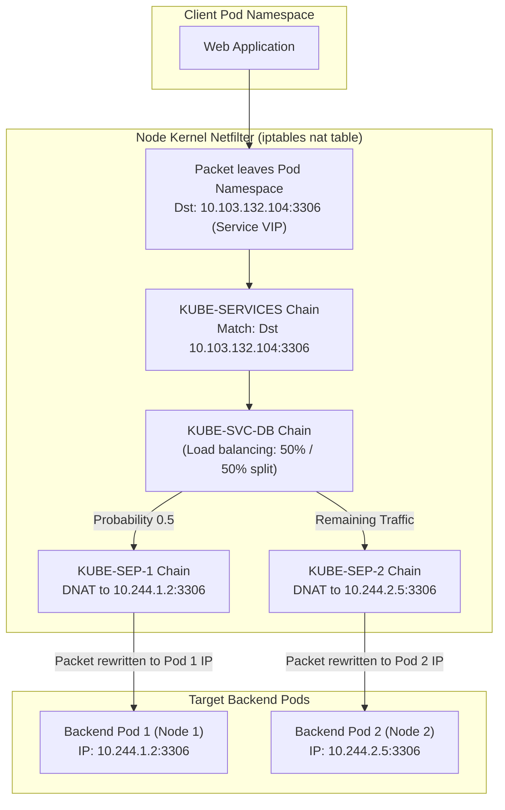
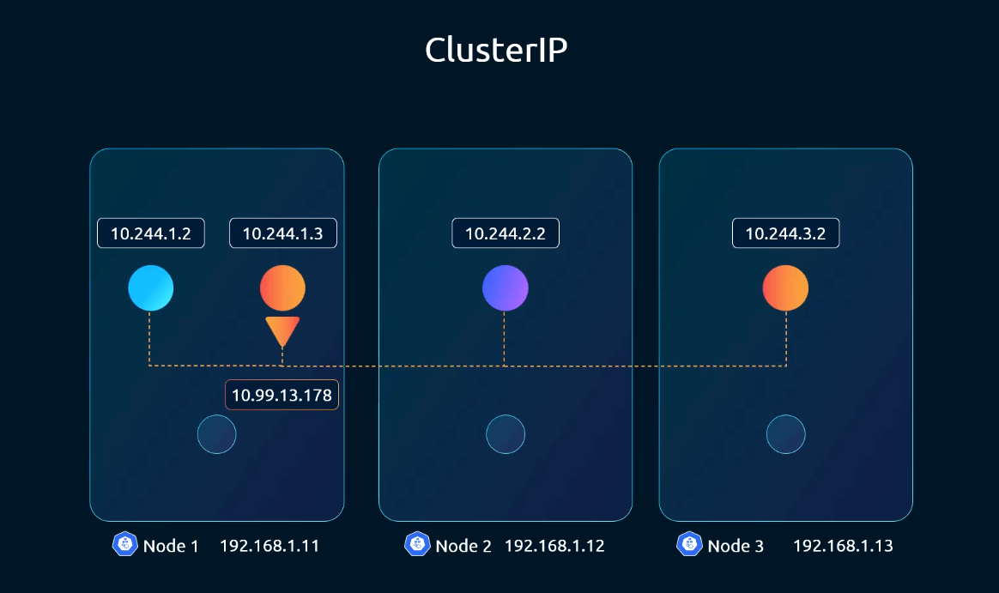
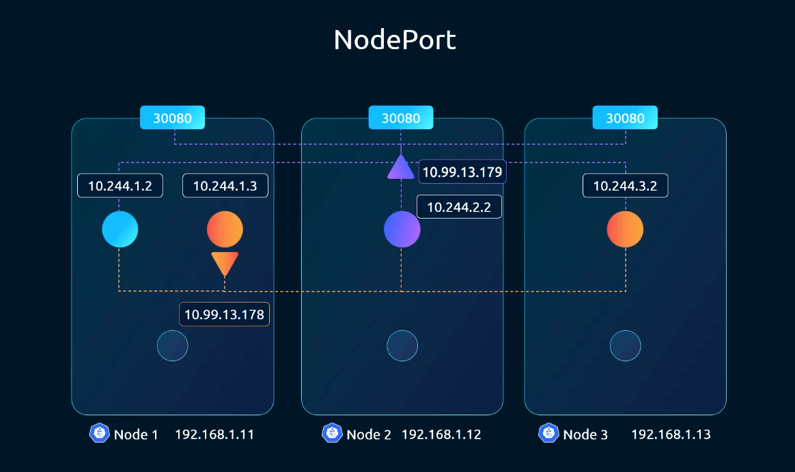
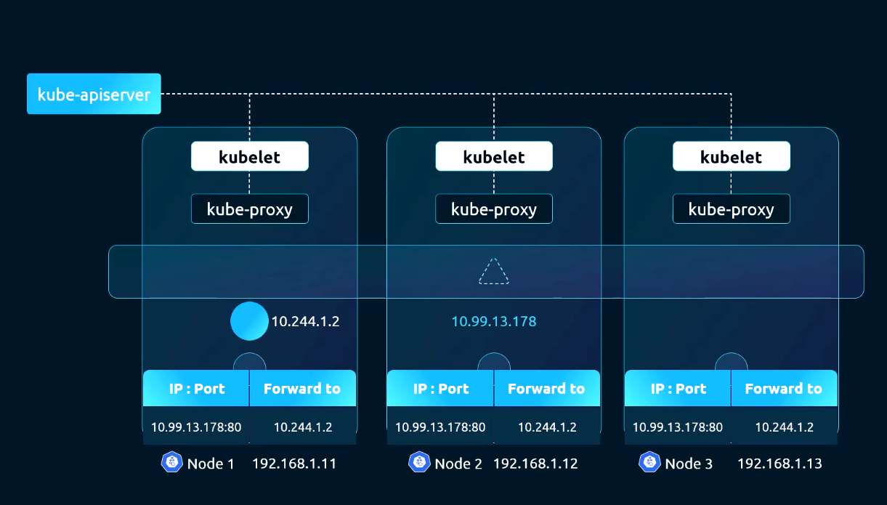
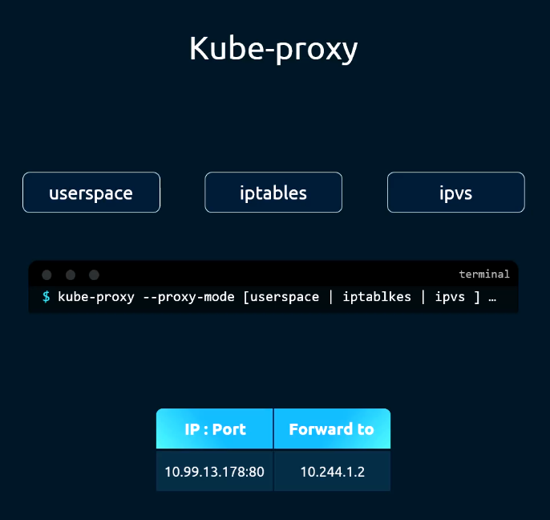
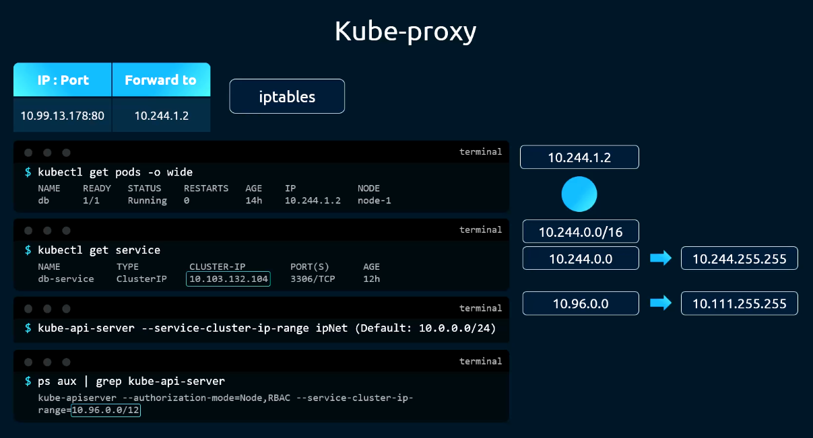
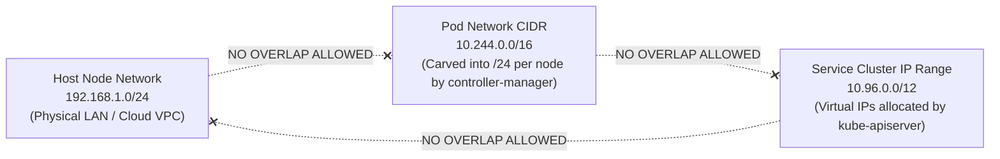
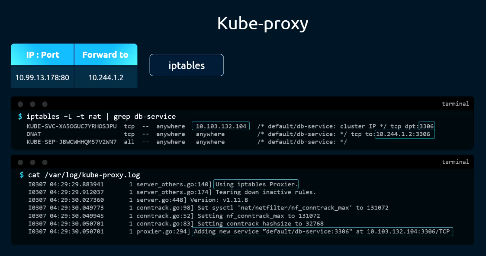
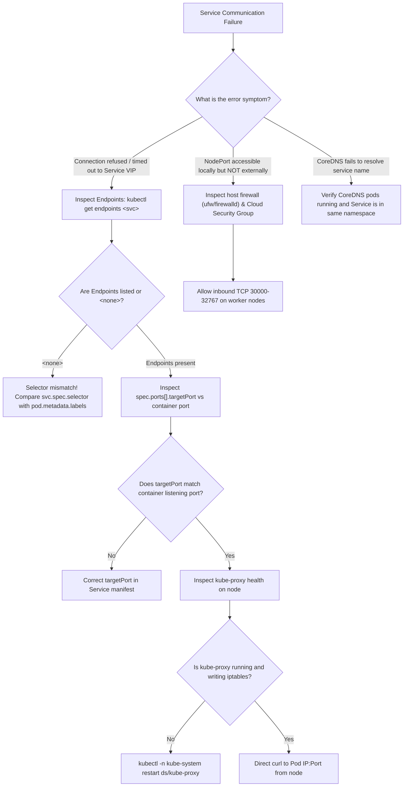

# 11 - Service Networking: Virtual IPs, Kube-Proxy & In-Kernel Packet Translation

## Exam Metadata
- **Domain**: Services & Networking (20%)
- **Importance**: Critical (Directly tested in every CKA exam: ClusterIP, NodePort, kube-proxy modes, iptables DNAT rules, Endpoints/EndpointSlices, and Subnet Non-Overlap rules)
- **Target Version**: Kubernetes v1.31 / v1.32
- **Allowed Docs Search Keywords**: `service networking`, `kube-proxy`, `service cluster ip range`, `virtual ips and service proxies`
- **Source**: `networking/11-service-networking-raw.md`

---

## 1. Quick-Reference Summary
- **Virtual IP (VIP) Reality**:
  - A Service ClusterIP does not correspond to any physical or virtual network interface (`eth0`, `cbr0`, `lo`), MAC address, or listening daemon socket on any host.
  - A Service is purely an in-kernel packet rewrite rule programmed into Linux Netfilter (iptables) or IPVS on every cluster node.
- **Service Types**:
  - `ClusterIP` (default): Stable internal virtual IP and cluster-internal DNS name reachable only by Pods and nodes within the cluster.
  - `NodePort`: Allocates a static port from the range `30000-32767` across every node in the cluster, routing external traffic through the node's IP to backend Pods.
  - `LoadBalancer`: Automates cloud provider load balancer provisioning, routing external traffic to the allocated `NodePort`.
  - `ExternalName`: Internal DNS CNAME redirect without proxying or virtual IPs.
- **Kube-Proxy Operational Role**:
  - Runs as a `DaemonSet` (`kube-proxy`) in the `kube-system` namespace across all nodes.
  - Watches `Service` and `EndpointSlice` resources via `kube-apiserver`.
  - Reconciles state by injecting or deleting forwarding rules in local kernel tables (`iptables`, `ipvs`).
- **Core Address Spaces (The Non-Overlap Invariant)**:
  - **Service Cluster IP Range**: Configured on `kube-apiserver` via `--service-cluster-ip-range` (e.g., `10.96.0.0/12`).
  - **Pod Network CIDR**: Configured on `kube-controller-manager` via `--cluster-cidr` (e.g., `10.244.0.0/16`).
  - **Node Physical Network**: Host subnet (e.g., `192.168.1.0/24`).
  - **Rule**: These three subnets **MUST NOT OVERLAP**.
- **Kube-Proxy Modes**:
  - `iptables` (default): $O(N)$ rule evaluation using Netfilter chains (`KUBE-SERVICES`, `KUBE-SVC-*`, `KUBE-SEP-*`). Pseudo-random load balancing via probability weights.
  - `ipvs`: High-performance $O(1)$ IP Virtual Server hash table engine for large-scale clusters (5,000+ services).
  - `nftables`: Modern replacement for iptables (graduating in recent Kubernetes releases).

---

## 2. Conceptual Overview & Mental Model

### Simple English Explanation
In Kubernetes, Pods are temporary and replaceable. If a backend Pod crashes or a Deployment scales up and down, Pods receive new, unpredictable IP addresses. If frontend applications tried to connect directly to individual backend Pod IPs, the application would constantly fail.

A Kubernetes **Service** solves this by providing a single, permanent virtual IP address (ClusterIP) and DNS name in front of a group of backend Pods.

The most critical fact to understand is that **a Service IP does not physically exist**:
1. You will never find a Service IP assigned to any network card if you run `ip addr show`.
2. There is no web server or proxy program listening on that IP address.
3. If you try to `ping` a Service IP, it will not respond because ping uses ICMP, and Kubernetes only creates rules for TCP and UDP ports.

Instead, a Service is an **in-kernel packet redirection rule programmed on every single server in the cluster by a background agent named `kube-proxy`**.

When a Pod sends a packet to a Service IP (e.g. `10.103.132.104:3306`):
1. The packet leaves the container and enters the host kernel's network stack.
2. The Linux kernel's firewall engine (Netfilter) intercepts the packet before it leaves the node.
3. An iptables rule created by `kube-proxy` recognizes the Service IP and port, and rewrites the destination address (Destination NAT) to the actual IP of one of the backend Pods (e.g. `10.244.1.2:3306`).
4. The kernel then routes the packet across the Pod network to that backend Pod.

### Formal Technical Definition
Kubernetes Service networking is a decentralized, in-kernel Layer 4 reverse-proxying and load-balancing architecture managed by node-resident `kube-proxy` daemons. Kube-proxy translates control plane `v1.Service` and `discovery.k8s.io/v1.EndpointSlice` specifications into stateful Netfilter/iptables Destination NAT (DNAT) chains or IPVS virtual servers, enabling deterministic service discovery, load balancing, and ingress routing across dynamic Pod topologies without application-level proxy overhead.

### Architecture Flowchart: End-to-End Service Packet Translation



---

## 3. Deep-Dive Technical Breakdown

### Service Types & Access Topologies

#### 1. ClusterIP (Default)



- **Scope**: Internal to cluster only.
- **Mechanism**: Allocates a virtual IP from `--service-cluster-ip-range`. Accessible by any Pod or Node inside the cluster via IP or CoreDNS (`<svc-name>.<namespace>.svc.cluster.local`).

#### 2. NodePort



- **Scope**: External and internal access.
- **Mechanism**: In addition to allocating a ClusterIP, opens a dedicated port from the range `30000-32767` on **every node's external IP address**.
- External traffic hitting `<Any-Node-IP>:<NodePort>` is forwarded to backend Pods, regardless of which node hosts the target Pod.

---

### How Services Function: The Component Division of Labor



| Component | Execution Scope | Primary Responsibility | Interaction with Services |
| :--- | :--- | :--- | :--- |
| **Kubelet** | Node-level daemon | Manages Pod lifecycles, static pods, probes, and CRI/CNI execution. | Completely unaware of Service objects; handles only containers and Pod IPs. |
| **kube-proxy** | Node-level DaemonSet | Watches cluster state; programs local kernel packet translation rules. | Reconciles Services and Endpoints into `iptables` or `ipvs` rules on every node. |
| **kube-apiserver** | Control Plane | REST API hub, validates resources, allocates ClusterIPs. | Assigns unique ClusterIP from configured range upon Service creation. |
| **CoreDNS** | Cluster Addon | Provides internal domain name resolution. | Resolves `<svc-name>.<namespace>.svc.cluster.local` to the allocated ClusterIP. |

---

### Kube-Proxy Modes & Architectural Trade-offs



The proxy mode is configured in the `kube-proxy` ConfigMap (`/var/lib/kube-proxy/config.conf`):

```yaml
apiVersion: kubeproxy.config.k8s.io/v1alpha1
kind: KubeProxyConfiguration
mode: "iptables"  # Options: "iptables", "ipvs", "nftables"
```

#### Detailed Mode Comparison:

| Characteristic | `iptables` Mode (Default) | `ipvs` Mode | `userspace` Mode (Historical) |
| :--- | :--- | :--- | :--- |
| **Kernel Subsystem** | Netfilter (`iptables`) | IP Virtual Server (Netlink) | Userland Socket Proxy |
| **Data Plane Path** | Pure in-kernel packet filtering | Pure in-kernel hash table lookup | Kernel $\leftrightarrow$ Userland context switches |
| **Rule Complexity** | $O(N)$ sequential rule evaluation | $O(1)$ constant-time lookup | High CPU context-switch overhead |
| **Cluster Scale Limit** | Degrades at ~5,000 Services (~25,000 rules)| Scales easily to 100,000+ Services | Barely usable past 100 Services |
| **Load Balancing Logic**| Probability-based random weights | rr, lc, dh, sh, sed, nq algorithms | Round-robin in userland process |
| **Prerequisites** | Standard Linux kernel | Kernel modules: `ip_vs`, `ip_vs_rr`, etc. | None |

---

### Cluster Address Space Demarcation (The Non-Overlap Rule)



A Kubernetes cluster operates with three mutually exclusive IP address spaces:



#### Verification on Running Cluster:
1. **Service Cluster IP Range**:
   Configured on `kube-apiserver`:
   ```bash
   ps aux | grep -i kube-apiserver | grep -o -- '--service-cluster-ip-range=[^ ]*'
   # Example Output: --service-cluster-ip-range=10.96.0.0/12
   ```
   With a `/12` subnet, ClusterIPs are dynamically allocated from `10.96.0.0` through `10.111.255.255`.
2. **Pod Network CIDR**:
   Configured on `kube-controller-manager`:
   ```bash
   ps aux | grep -i kube-controller-manager | grep -o -- '--cluster-cidr=[^ ]*'
   # Example Output: --cluster-cidr=10.244.0.0/16
   ```

---

### Under-the-Hood: Netfilter iptables Chain Traversal



When `kube-proxy` operates in `iptables` mode, it inserts custom chains into the `nat` table:

```bash
# Search for rules belonging to a specific service:
sudo iptables -t nat -S | grep db-service
```

#### Step-by-Step Chain Processing:
1. **Entry Point (`PREROUTING` & `OUTPUT`)**:
   Packets generated locally or entering from interfaces jump to the master service chain:
   ```text
   -A PREROUTING -m comment --comment "kubernetes service portals" -j KUBE-SERVICES
   -A OUTPUT -m comment --comment "kubernetes service portals" -j KUBE-SERVICES
   ```
2. **Service Matching (`KUBE-SERVICES`)**:
   Checks whether the packet's destination IP matches any defined Service VIP:
   ```text
   -A KUBE-SERVICES -d 10.103.132.104/32 -p tcp -m tcp --dport 3306 -j KUBE-SVC-X7P2ABC
   ```
3. **Load Balancing via Random Probability (`KUBE-SVC-*`)**:
   If the service has two backend Pods, `kube-proxy` injects probability weights:
   ```text
   -A KUBE-SVC-X7P2ABC -m statistic --mode random --probability 0.50000000000 -j KUBE-SEP-AAAA
   -A KUBE-SVC-X7P2ABC -j KUBE-SEP-BBBB
   ```
   - 50% of connections match `KUBE-SEP-AAAA`.
   - The remaining 50% fall through to `KUBE-SEP-BBBB`.
4. **Destination NAT (`KUBE-SEP-*`)**:
   The endpoint chain rewrites the packet destination to the concrete backend Pod IP:
   ```text
   -A KUBE-SEP-AAAA -p tcp -m tcp -j DNAT --to-destination 10.244.1.2:3306
   -A KUBE-SEP-BBBB -p tcp -m tcp -j DNAT --to-destination 10.244.2.5:3306
   ```

---

### NodePort Packet Flow & Source Masquerading

When external traffic hits a worker node on port `30080`:
1. The packet enters Netfilter and matches the `KUBE-NODEPORTS` chain:
   ```text
   -A KUBE-NODEPORTS -p tcp -m tcp --dport 30080 -j KUBE-SVC-X7P2ABC
   ```
2. In addition to DNAT rewriting the destination to the Pod IP, `kube-proxy` applies a mark:
   ```text
   -A KUBE-NODEPORTS -j KUBE-MARK-MASQ
   ```
3. In `POSTROUTING`, packets with the masquerade mark undergo **SNAT (MASQUERADE)**. This ensures that when the backend Pod replies, the reply packet travels back to the receiving node first, preserving symmetrical connection tracking for the external client.

---

## 4. Command Translation & Mapping Tables

### Netfilter Chain Roles Created by Kube-Proxy

| Chain Name | Table | Purpose & Packet Flow Function |
| :--- | :--- | :--- |
| `KUBE-SERVICES` | `nat` | Top-level dispatcher; intercepts packets matching any Service ClusterIP. |
| `KUBE-SVC-*` | `nat` | Service-specific chain; performs random statistical load balancing across endpoints. |
| `KUBE-SEP-*` | `nat` | Service Endpoint chain; applies `-j DNAT --to-destination <pod-ip>:<port>`. |
| `KUBE-NODEPORTS` | `nat` | Intercepts packets matching high ports (`30000-32767`) on local node interfaces. |
| `KUBE-MARK-MASQ`| `nat` | Marks packets for source address translation (SNAT) in `POSTROUTING`. |
| `KUBE-POSTROUTING`| `nat` | Applies `MASQUERADE` to marked packets to prevent asymmetric routing. |

### Service Configuration Schema Mapping

| YAML Parameter | Field Purpose | Common Pitfall / Rule |
| :--- | :--- | :--- |
| `spec.ports[].port` | Port exposed on the Service ClusterIP | The port clients connect to inside the cluster. |
| `spec.ports[].targetPort` | Port application container listens on | Must match container's `containerPort`. Defaults to `port` if omitted. |
| `spec.ports[].nodePort` | Port exposed on host node IPs | Must fall in `30000-32767` range. Automatically allocated if omitted. |
| `spec.selector` | Label query to select target backend Pods | If selector fails to match any Pod, `Endpoints` will be `<none>`. |

---

## 5. High-Yield CLI & Imperative Commands

### Discovering Cluster CIDR Ranges (Direct CKA Questions)
```bash
# 1. Discover the Service Cluster IP Range
ps aux | grep -i kube-apiserver | grep -o -- '--service-cluster-ip-range=[^ ]*'
# Or if kube-apiserver is a static pod:
grep -i service-cluster-ip-range /etc/kubernetes/manifests/kube-apiserver.yaml

# 2. Discover Pod CIDRs assigned across nodes
kubectl get nodes -o custom-columns=NAME:.metadata.name,POD_CIDR:.spec.podCIDR

# 3. Discover Primary Node IP and Subnet Mask
kubectl get nodes -o wide
# Cross-reference with host network interface:
ip addr show
```

### Investigating Kube-Proxy DaemonSet & Proxy Mode
```bash
# 1. Verify kube-proxy is running on all nodes
kubectl get daemonset -n kube-system kube-proxy

# 2. Inspect kube-proxy proxy mode from its ConfigMap
kubectl -n kube-system get cm kube-proxy -o yaml | grep -i "mode:"

# 3. Check active kube-proxy logs for operational mode
KUBE_PROXY_POD=$(kubectl -n kube-system get pods -l k8s-app=kube-proxy -o jsonpath='{.items[0].metadata.name}')
kubectl -n kube-system logs ${KUBE_PROXY_POD} | grep -i "using"
# Expected Output: Using iptables proxy (or Using ipvs proxy)
```

### Inspecting Endpoints & Tracing Netfilter Chains
```bash
# 1. View Service ClusterIP and Port mapping
kubectl get svc -A

# 2. View Endpoints associated with a Service
kubectl get endpoints <service-name>
# Modern equivalent (EndpointSlices):
kubectl get endpointslices -l kubernetes.io/service-name=<service-name>

# 3. View iptables rules for a specific service by name
sudo iptables -t nat -S | grep <service-name>

# 4. View statistics and packet hit counts for a service
sudo iptables -t nat -nvL KUBE-SERVICES | grep <service-name>
```

### Imperative Creation of Services for CKA
```bash
# 1. Expose a Deployment as a ClusterIP service on port 80 targeting container port 8080
kubectl expose deployment my-dep --name=my-svc --port=80 --target-port=8080 --type=ClusterIP

# 2. Expose a Pod as a NodePort service
kubectl expose pod nginx-pod --name=nginx-np --port=80 --type=NodePort

# 3. Generate Service YAML without applying (dry-run)
kubectl create service clusterip test-svc --tcp=80:8080 --dry-run=client -o yaml > svc.yaml
```

---

## 6. Troubleshooting & Diagnostic Runbook

### Diagnostic Decision Tree



### Triage Sequence Matrix

| Step | Failure Condition | Diagnostic Command | Expected Output | Remediation Action |
| :--- | :--- | :--- | :--- | :--- |
| **1. Endpoint Presence** | `ENDPOINTS <none>` | `kubectl get endpoints <svc-name>` | List of `<pod-ip>:<port>` | Fix `spec.selector` in Service YAML to match target Pod labels. |
| **2. TargetPort Match** | Connection Refused | `kubectl get svc <svc-name> -o yaml \| grep targetPort` | Matches application port | Update `targetPort` to match container process socket. |
| **3. kube-proxy Daemon** | Stale / Missing Rules | `kubectl get ds -n kube-system kube-proxy` | `DESIRED == READY` | If crashed, inspect logs: `kubectl logs -n kube-system ds/kube-proxy`. |
| **4. Direct Pod Probe** | Container Unhealthy | `curl -m 2 http://<pod-ip>:<targetPort>` | HTTP response | Check container readiness probe; Pod might be unready or crashed. |
| **5. iptables Rules** | Packets Not Redirected| `iptables -t nat -nvL \| grep <svc-name>` | Chains `KUBE-SVC-*` exist | Verify `--service-cluster-ip-range` is configured properly. |
| **6. NodePort Security**| External Timeout | `nc -zv <node-ip> <node-port>` | `Connection succeeded` | Open port range `30000-32767` in cloud security group / UFW. |

---

## 7. CKA Exam Tips, Gotchas & Traps

> [!WARNING]
> **The Service Virtual IP Ping Trap**
> In the exam, NEVER attempt to verify a Service by running `ping <cluster-ip>`.
> Pinging a ClusterIP will almost ALWAYS fail with 100% packet loss!
> Netfilter rules created by `kube-proxy` only translate TCP and UDP packets matching the defined service port; they do NOT translate ICMP Echo Requests.
> Always test Services using `curl -m 2 http://<cluster-ip>:<port>` or `nc -zv <cluster-ip> <port>`.

> [!IMPORTANT]
> **The `port` vs. `targetPort` Confusion**
> Under exam pressure, students frequently invert `port` and `targetPort`:
> - `port`: The port that **clients connect to** on the Service Virtual IP (e.g., port 80).
> - `targetPort`: The port that the **application process listens on** inside the container (e.g., port 8080).
> If you configure `port: 80` and `targetPort: 80`, but the container runs on 8080, `kubectl get endpoints` will show healthy endpoints, but connecting to the service will return `connection refused`!

> [!IMPORTANT]
> **The `ENDPOINTS <none>` Selector Gotcha**
> A common CKA troubleshooting question presents a non-functional Service.
> Running `kubectl describe svc <name>` will reveal:
> `Endpoints: <none>`.
> Immediate root cause: The labels defined under `spec.selector` in the Service manifest do not match the labels in the Pod's `metadata.labels`. Check labels carefully with `kubectl get pods --show-labels`!

> [!TIP]
> **How to Rapidly Find Service & Pod CIDRs in CKA**
> If an exam question asks: *"What is the Pod Network CIDR and Service Cluster IP Range?"*
> 1. Service Range: `grep -i service-cluster-ip-range /etc/kubernetes/manifests/kube-apiserver.yaml`
> 2. Pod Network CIDR: `grep -i cluster-cidr /etc/kubernetes/manifests/kube-controller-manager.yaml` (or `kubectl get node -o jsonpath='{.items[0].spec.podCIDR}'`)

---

## 8. Self-Test / Active Recall

<details>
<summary><strong>1. Why does running <code>ping &lt;ClusterIP&gt;</code> typically fail even when the Service is completely healthy?</strong></summary>

ClusterIPs are virtual constructs managed by Netfilter/iptables rules that only rewrite Layer 4 TCP and UDP packets matching the specified service port. ICMP echo packets are not translated and are dropped by the host kernel.
</details>

<details>
<summary><strong>2. Which component running on every Kubernetes node is responsible for programming Netfilter or IPVS rules for Services?</strong></summary>

`kube-proxy` (running as a DaemonSet in the `kube-system` namespace).
</details>

<details>
<summary><strong>3. Where is the Service Cluster IP Range configured in a cluster bootstrapped with kubeadm?</strong></summary>

On the `kube-apiserver` static pod manifest (`/etc/kubernetes/manifests/kube-apiserver.yaml`) using the flag `--service-cluster-ip-range`.
</details>

<details>
<summary><strong>4. What is the fundamental requirement regarding the IP subnets used for the Node Network, Pod CIDR, and Service Cluster IP Range?</strong></summary>

They must be mutually exclusive and **never overlap**.
</details>

<details>
<summary><strong>5. If a Service manifest specifies <code>port: 80</code> and <code>targetPort: 8080</code>, which port does an internal client Pod connect to?</strong></summary>

Port `80` (the Service VIP port). The kernel rewrites the destination to port `8080` when forwarding to the backend Pod.
</details>

<details>
<summary><strong>6. What does it indicate if <code>kubectl get endpoints my-service</code> outputs <code>&lt;none&gt;</code>?</strong></summary>

The Service's `spec.selector` does not match the labels on any running, healthy Pods in that namespace.
</details>

<details>
<summary><strong>7. How does kube-proxy distribute traffic across multiple backend Pods when running in <code>iptables</code> mode?</strong></summary>

Using iptables random statistical probability weights (e.g. `-m statistic --mode random --probability 0.5`) across individual endpoint chains (`KUBE-SEP-*`).
</details>

<details>
<summary><strong>8. Why is <code>ipvs</code> mode superior to <code>iptables</code> mode in clusters with thousands of Services?</strong></summary>

`ipvs` utilizes kernel hash tables offering $O(1)$ constant-time lookup performance, whereas `iptables` evaluates sequential chains with $O(N)$ overhead that degrades throughput at large scale.
</details>

<details>
<summary><strong>9. What is the default port range reserved for Kubernetes NodePort services?</strong></summary>

`30000` through `32767` (TCP).
</details>

<details>
<summary><strong>10. How can you find the active proxy mode (iptables vs ipvs) of kube-proxy on a cluster?</strong></summary>

Inspect the `kube-proxy` ConfigMap (`kubectl -n kube-system get cm kube-proxy -o yaml | grep mode`), or check the logs of a kube-proxy pod (`kubectl -n kube-system logs ds/kube-proxy | grep -i "using"`).
</details>

---

## 9. Official Documentation Bookmarks

| Resource | Documentation Path / Anchor | Purpose |
| :--- | :--- | :--- |
| **Service Networking** | `Concepts > Services, Load Balancing, and Networking > Service` | Comprehensive definition of ClusterIP, NodePort, and LoadBalancer |
| **Virtual IPs and Service Proxies**| `Concepts > Services, Load Balancing, and Networking > Virtual IPs and Service Proxies` | In-depth explanation of kube-proxy, iptables, and IPVS internals |
| **EndpointSlices** | `Concepts > Services, Load Balancing, and Networking > EndpointSlices` | Scalable endpoint tracking mechanism used by kube-proxy |
| **kube-apiserver Reference** | `Reference > Command line tools > kube-apiserver` | Documentation for `--service-cluster-ip-range` |

