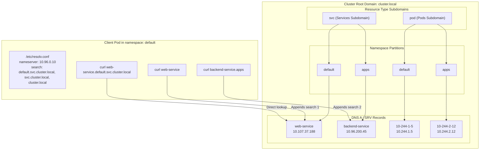
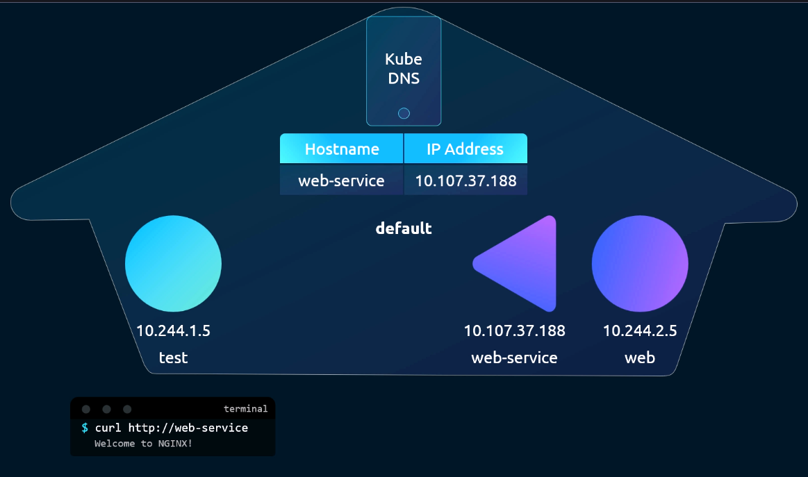
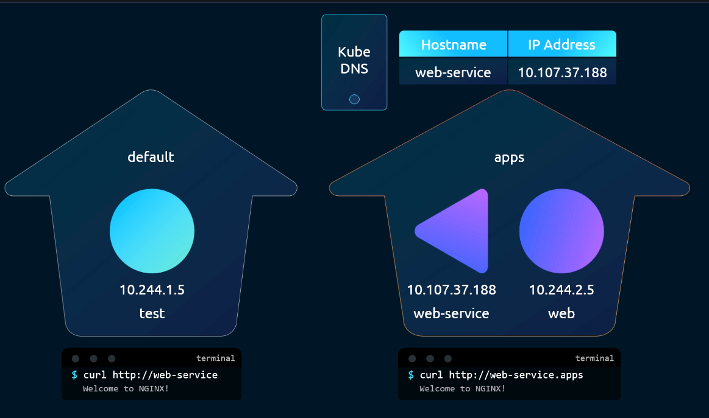
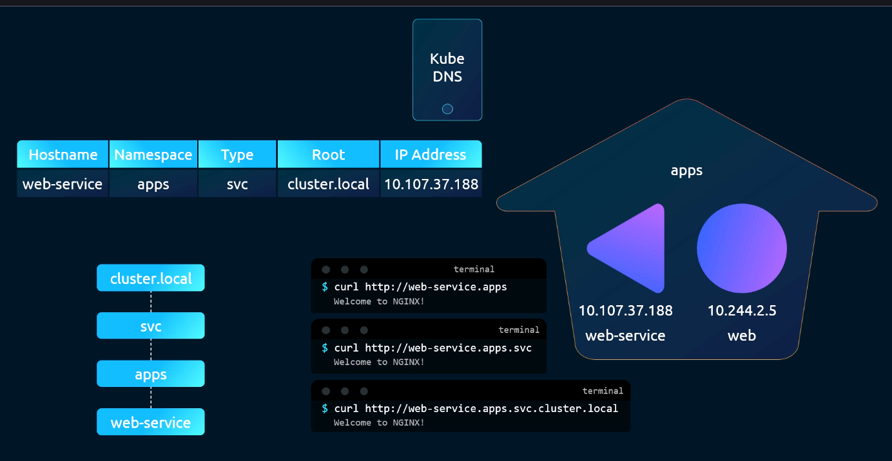
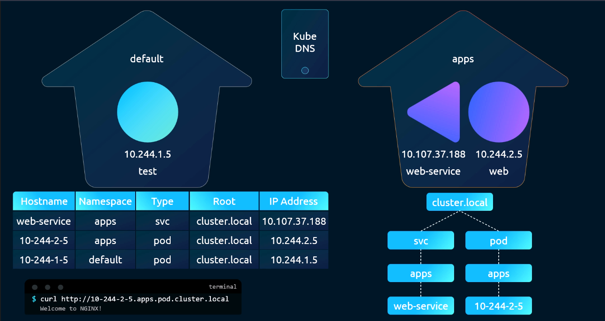
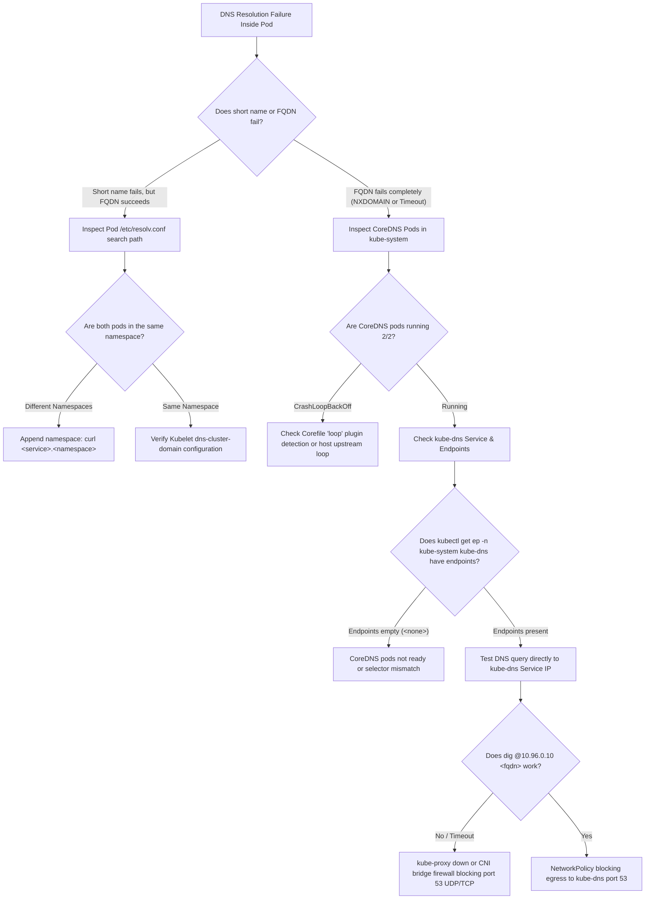

# 12 - DNS in Kubernetes: Service Discovery, Pod FQDNs & Resolver Mechanics

## Exam Metadata
- **Domain**: Services & Networking (20%)
- **Importance**: Critical (Directly tested in CKA: Service FQDN resolution, cross-namespace communication, Headless Services, and Pod `/etc/resolv.conf` search paths)
- **Target Version**: Kubernetes v1.31 / v1.32
- **Allowed Docs Search Keywords**: `dns for services and pods`, `dns pod service`, `coredns`, `ndots`
- **Source**: `networking/12-dns-in-kubernetes-raw.md`

---

## 1. Quick-Reference Summary
- **Service FQDN Format**:
  - Full Syntax: `<service-name>.<namespace>.svc.<cluster-domain>`
  - Default: `<service-name>.<namespace>.svc.cluster.local`
- **Name Resolution Hierarchy**:
  - **Same Namespace**: `http://<service-name>` (resolves via local namespace search path).
  - **Cross-Namespace**: `http://<service-name>.<namespace>` (e.g., `web-service.apps`).
  - **Fully Qualified**: `http://<service-name>.<namespace>.svc.cluster.local`.
- **Pod DNS Record Format**:
  - Standard IP-dashed Syntax: `<ip-with-dashes>.<namespace>.pod.<cluster-domain>`
  - Example: For Pod IP `10.244.1.5` in namespace `default` $\rightarrow$ `10-244-1-5.default.pod.cluster.local`.
  - StatefulSet / Headless Pod Syntax: `<hostname>.<subdomain>.<namespace>.svc.<cluster-domain>` (when `spec.hostname` and `spec.subdomain` match a headless service name).
- **Headless Service Records (`clusterIP: None`)**:
  - Does not allocate a virtual IP.
  - Returns direct DNS `A`/`AAAA` records containing all currently ready backend Pod IP addresses.
- **Pod `/etc/resolv.conf` Injection**:
  - `nameserver`: Points to the ClusterIP of the `kube-dns` Service (typically `10.96.0.10`).
  - `search`: `<namespace>.svc.cluster.local`, `svc.cluster.local`, `cluster.local`, plus any node-level search domains.
  - `options ndots:5`: Dictates that any query containing fewer than 5 dots is treated as an incomplete domain and iterated across all `search` paths first.
- **SRV Records**:
  - Format: `_<port-name>._<protocol>.<service-name>.<namespace>.svc.<cluster-domain>`.
  - Discovers port numbers and target hostnames for named service ports.

---

## 2. Conceptual Overview & Mental Model

### Simple English Explanation
In a dynamic container cluster, Pods receive new IP addresses whenever they are rescheduled, restarted, or updated. If applications tried to connect to each other using raw IP addresses, the cluster would constantly break.

Kubernetes solves this with built-in DNS service discovery (CoreDNS):
1. **Services get stable domain names**: Whenever a `Service` object is created, the cluster DNS server automatically registers an `A record` mapping the Service's name to its virtual ClusterIP.
2. **Hierarchical domain naming**:
   The domain name is built hierarchically:
   - First is the Service name (e.g., `web-service`).
   - Next is the Namespace where it lives (e.g., `apps`).
   - Next is the type of resource (always `svc` for Services).
   - Finally, the cluster root domain (by default, `cluster.local`).
   Putting this together creates the Fully Qualified Domain Name (FQDN): `web-service.apps.svc.cluster.local`.
3. **Automated Search Paths**:
   When an application runs `curl http://web-service`, it does not need to type the full FQDN. When Kubernetes starts a Pod, it configures the Pod's internal `/etc/resolv.conf` file with a list of search paths. If both Pods are in the `apps` namespace, the operating system automatically appends `.apps.svc.cluster.local`, resolving the IP address instantly. To reach a Service in another namespace, you only need to type `<service-name>.<namespace>` (e.g., `web-service.apps`).
4. **DNS for Pods**:
   Individual Pods also receive DNS names. Because Pod names might not be DNS-compliant or unique across lifecycles, Kubernetes takes the Pod's IP address and replaces all dots with dashes (for example, `10.244.1.5` becomes `10-244-1-5.default.pod.cluster.local`).

### Formal Technical Definition
Kubernetes Cluster DNS is an in-cluster RFC 1035-compliant naming service orchestrated by CoreDNS daemons that monitor the `kube-apiserver` via API watches. CoreDNS dynamically populates and resolves forward `A`, `AAAA`, `SRV`, and reverse `PTR` records for `v1.Service` ClusterIPs, `discovery.k8s.io/v1.EndpointSlice` Pod IP endpoints, and individual Pod sandboxes under designated cluster root zones (default: `cluster.local`).

### Architecture Flowchart: Kubernetes DNS Hierarchy & Lookup Paths



---

## 3. Deep-Dive Technical Breakdown

### Service DNS Resolution Scopes

#### 1. Intra-Namespace Service Resolution (Same Namespace)



When two Pods and a Service reside in the same namespace (e.g., `default`):
- The client Pod runs:
  ```bash
  curl http://web-service
  ```
- The local resolver checks `/etc/resolv.conf`.
- Because `default.svc.cluster.local` is the first entry in the `search` directive, the query `web-service.default.svc.cluster.local` is transmitted to the DNS server (`10.96.0.10`).
- CoreDNS returns an `A` record pointing to the Service ClusterIP (`10.107.37.188`).

---

#### 2. Inter-Namespace Service Resolution (Different Namespaces)



When a client Pod in the `default` namespace accesses a Service residing in the `apps` namespace:
- If the client attempts `curl http://web-service`, the resolver appends `.default.svc.cluster.local`, which fails with `NXDOMAIN`.
- The client must explicitly specify the target namespace:
  ```bash
  curl http://web-service.apps
  ```
- The local resolver checks the `search` paths:
  1. `web-service.apps.default.svc.cluster.local` $\rightarrow$ `NXDOMAIN`
  2. `web-service.apps.svc.cluster.local` $\rightarrow$ **MATCH!**
- CoreDNS resolves the domain to the Service's ClusterIP.

---

### The Fully Qualified Domain Name (FQDN) Anatomy for Services



Every Kubernetes Service receives a standardized FQDN composed of five distinct components:

$$\underbrace{\text{web-service}}_{\text{1. Service Name}} \ . \ \underbrace{\text{apps}}_{\text{2. Namespace}} \ . \ \underbrace{\text{svc}}_{\text{3. Type Subdomain}} \ . \ \underbrace{\text{cluster.local}}_{\text{4. Cluster Domain}} \ .$$

| Component | Technical Function | Example |
| :--- | :--- | :--- |
| **Service Name** | Matches `metadata.name` in the `Service` manifest. | `web-service` |
| **Namespace** | Matches `metadata.namespace` where the Service is deployed. | `apps` |
| **Subdomain (`svc`)** | Discriminator identifying the record as a Service resource. | `svc` |
| **Cluster Domain** | Base domain of the Kubernetes cluster (configured in `kubelet` / `kubeadm`). | `cluster.local` |
| **Trailing Dot (`.`)** | Absolute root terminator (bypasses OS search path evaluation). | `.` |

---

### DNS Records for Pods



#### 1. Standard IP-Dashed Pod Records:
Unlike Services, individual Pods are not assigned DNS records based on their `metadata.name` by default because Pod names can collide or change dynamically during replica scaling.

Instead, Kubernetes provisions deterministic DNS records for Pods using their assigned IP addresses:
- Every dot (`.`) in the IPv4 address is replaced with a dash (`-`).
- The subdomain discriminator is set to `pod`.
- **Syntax**: `<ip-with-dashes>.<namespace>.pod.<cluster-domain>`
- **Example**: A Pod with IP `10.244.1.5` in the `default` namespace resolves at:
  ```text
  10-244-1-5.default.pod.cluster.local
  ```

---

#### 2. Stateful Pods: Hostname and Subdomain Pairing

To give Pods human-readable, predictable DNS names (e.g. for distributed databases like ZooKeeper, Kafka, or Cassandra), Kubernetes allows configuring `spec.hostname` and `spec.subdomain` in the Pod manifest:

```yaml
apiVersion: v1
kind: Pod
metadata:
  name: database-0
  namespace: data
spec:
  hostname: db-primary
  subdomain: db-cluster
  containers:
  - name: postgres
    image: postgres:16
```

To activate this DNS name, a matching **Headless Service** (`clusterIP: None`) must exist with the same name as the `subdomain`:

```yaml
apiVersion: v1
kind: Service
metadata:
  name: db-cluster
  namespace: data
spec:
  clusterIP: None
  selector:
    app: database
  ports:
  - port: 5432
```

- **Resulting FQDN**:
  ```text
  db-primary.db-cluster.data.svc.cluster.local
  ```
- **StatefulSet Native Integration**:
  StatefulSets implement this pattern automatically. A StatefulSet with `serviceName: db-cluster` creates deterministic hostnames for every replica:
  - `web-0.db-cluster.data.svc.cluster.local`
  - `web-1.db-cluster.data.svc.cluster.local`
  - `web-2.db-cluster.data.svc.cluster.local`

---

### Headless Services (`clusterIP: None`)

A standard Service provides a single virtual IP that load-balances across backends. A **Headless Service** is defined by setting `spec.clusterIP: None`.

#### How Headless DNS Differs from ClusterIP:
1. **No Virtual IP**: CoreDNS does not create an `A` record pointing to a VIP.
2. **Multi-A Records**: CoreDNS creates multiple `A` records pointing directly to the individual IP addresses of all healthy backend Pods matching the selector.
3. **DNS Response**:
   When a client resolves `my-headless.default.svc.cluster.local`:
   ```text
   Name:    my-headless.default.svc.cluster.local
   Address: 10.244.1.20
   Address: 10.244.2.35
   Address: 10.244.1.42
   ```
   The client receives the complete list of endpoint Pod IPs and performs client-side load balancing or direct clustering.

---

### Service Port Discovery: SRV Records

Kubernetes generates **SRV (Service) records** for every named port defined on a Service:

- **Syntax**: `_<port-name>._<protocol>.<service-name>.<namespace>.svc.<cluster-domain>`
- **Example**: A Service with port definition:
  ```yaml
  ports:
  - name: http-web
    port: 8080
    protocol: TCP
  ```
  Generates the SRV record:
  ```text
  _http-web._tcp.web-service.default.svc.cluster.local
  ```
- **Query Result**:
  Returns the target port (`8080`) and the canonical FQDN of the Service, enabling dynamic port discovery without hardcoding.

---

### Deep-Dive: Pod `/etc/resolv.conf` & The `ndots:5` Mechanism

When `kubelet` initializes a Pod sandbox, it writes `/etc/resolv.conf` inside the container:

```text
nameserver 10.96.0.10
search default.svc.cluster.local svc.cluster.local cluster.local
options ndots:5
```

#### The `ndots:5` Rule Explained:
- In standard POSIX resolvers, `ndots:N` specifies the threshold of dot characters (`.`) required in a query string before the resolver considers it an absolute domain.
- If a query string has **fewer than 5 dots**, the resolver treats it as an incomplete local name and iterates through every domain in the `search` path sequentially before querying the root.

#### Example: Querying External Domain `google.com` (1 dot):
Because `1 < 5`, the container resolver executes:
1. `google.com.default.svc.cluster.local` $\rightarrow$ `NXDOMAIN`
2. `google.com.svc.cluster.local` $\rightarrow$ `NXDOMAIN`
3. `google.com.cluster.local` $\rightarrow$ `NXDOMAIN`
4. `google.com` $\rightarrow$ **Resolved via upstream external DNS**.

> [!WARNING]
> This creates a $4\times$ DNS query amplification for external API calls from within Kubernetes Pods! Appending a trailing dot (`google.com.`) instructs the resolver that the domain is already fully qualified, immediately bypassing all search path iterations.

---

## 4. Command Translation & Mapping Tables

### DNS Query Resolution Matrix

| Application Target String | Querying Pod Namespace | Resolver Search Applied | Final Resolved FQDN |
| :--- | :--- | :--- | :--- |
| `curl web-service` | `default` | `default.svc.cluster.local` | `web-service.default.svc.cluster.local` |
| `curl web-service` | `apps` | `apps.svc.cluster.local` | `web-service.apps.svc.cluster.local` (or `NXDOMAIN`) |
| `curl web-service.apps` | `default` | `svc.cluster.local` | `web-service.apps.svc.cluster.local` |
| `curl web-service.apps.svc` | `default` | `cluster.local` | `web-service.apps.svc.cluster.local` |
| `curl 10-244-1-5.pod` | `default` | `cluster.local` | `10-244-1-5.default.pod.cluster.local` |
| `curl web-service.apps.svc.cluster.local.`| Any | None (Trailing dot) | `web-service.apps.svc.cluster.local` |

### Service Type vs. Generated DNS Records

| Service Type | Generated DNS Record Types | Resolved Value |
| :--- | :--- | :--- |
| **ClusterIP** | `A` / `AAAA` + `SRV` | Single virtual ClusterIP |
| **Headless (`None`)** | `A` / `AAAA` (Multi) + `SRV` | List of all ready backing Pod IPs |
| **NodePort** | `A` / `AAAA` + `SRV` | Virtual ClusterIP (internally exposed on node ports) |
| **ExternalName** | `CNAME` | External domain alias (e.g. `api.external.com`) |

---

## 5. High-Yield CLI & Imperative Commands

### Interactive DNS Debugging Inside the Cluster
```bash
# 1. Run a temporary DNS diagnostic utility pod
kubectl run dnsutils --image=registry.k8s.io/e2e-test-images/jessie-dnsutils:1.3 --restart=Never -i --tty --rm -- /bin/bash

# Modern alternative using curlimages:
kubectl run curl-test --image=curlimages/curl --restart=Never -i --tty --rm -- /bin/sh
```

### Performing DNS Lookups with `nslookup` and `dig`
```bash
# 1. Resolve Service short name (within same namespace)
nslookup web-service

# 2. Resolve Service across namespaces
nslookup web-service.apps

# 3. Resolve Full FQDN
nslookup web-service.apps.svc.cluster.local

# 4. Use dig for concise IP extraction (+short)
dig web-service.default.svc.cluster.local +short

# 5. Query SRV records for named service ports
dig SRV _http._tcp.web-service.default.svc.cluster.local +short

# 6. Resolve Pod IP-dashed hostname
dig 10-244-1-5.default.pod.cluster.local +short
```

### Inspecting Pod Resolver & Cluster DNS Configuration
```bash
# 1. Inspect /etc/resolv.conf inside a running container
kubectl exec web-pod -- cat /etc/resolv.conf

# 2. Identify the ClusterIP of the kube-dns service
kubectl get svc -n kube-system -l k8s-app=kube-dns
# Output reveals the DNS nameserver IP (e.g., 10.96.0.10)

# 3. Inspect CoreDNS deployment status and pod health
kubectl get pods -n kube-system -l k8s-app=kube-dns -o wide
```

### Customizing Pod DNS Configuration via Pod Spec
```yaml
apiVersion: v1
kind: Pod
metadata:
  name: custom-dns-pod
spec:
  containers:
  - name: app
    image: nginx
  dnsPolicy: "None"
  dnsConfig:
    nameservers:
      - 10.96.0.10
      - 8.8.8.8
    searches:
      - custom.corp.internal
      - default.svc.cluster.local
    options:
      - name: ndots
        value: "2"
```

---

## 6. Troubleshooting & Diagnostic Runbook

### Diagnostic Decision Tree



### Triage Sequence Matrix

| Step | Scope | Diagnostic Command | Expected Output | Remediation Action |
| :--- | :--- | :--- | :--- | :--- |
| **1. CoreDNS Pod Status** | Control Plane | `kubectl get pods -n kube-system -l k8s-app=kube-dns` | All pods `1/1 Running` | If crashing, inspect `kubectl logs -n kube-system -l k8s-app=kube-dns`. |
| **2. DNS Service Endpoints**| Control Plane | `kubectl get ep -n kube-system kube-dns` | Lists CoreDNS Pod IPs on port 53 | Verify selector in `kube-dns` matches running CoreDNS pod labels. |
| **3. Pod Resolver State** | Container | `kubectl exec <pod> -- cat /etc/resolv.conf` | `nameserver 10.96.0.10` | Check kubelet flag `--cluster-dns=10.96.0.10`. |
| **4. Direct Query Probe** | Network | `kubectl exec <pod> -- nslookup kubernetes.default` | Returns `10.96.0.1` | If timeout, check if NetworkPolicy blocks egress to UDP 53. |
| **5. CoreDNS Logs** | Daemon Logs | `kubectl logs -n kube-system ds/kube-proxy` | Clean iptables sync | Ensure port 53 rules are programmed in `KUBE-SERVICES`. |
| **6. Cross-Namespace Syntax**| Application | `curl http://<svc>.<target-ns>` | HTTP response | Ensure target namespace is appended when querying foreign services. |

---

## 7. CKA Exam Tips, Gotchas & Traps

> [!WARNING]
> **The `busybox:latest` DNS Bug in CKA Exam**
> When asked to debug DNS or verify service connectivity during the CKA exam, **DO NOT run `kubectl run test --image=busybox --restart=Never` without a version tag**!
> Modern versions of BusyBox (post-1.28) have a known bug with their internal `libc` DNS resolver that mishandles the `ndots:5` search domain evaluation, causing `nslookup` on short names to return `Server can't find <service>: NXDOMAIN` even when DNS is perfectly healthy!
> **Exam Solution**: Always use `busybox:1.28`:
> ```bash
> kubectl run busybox --image=busybox:1.28 --restart=Never -- sleep 3600
> ```

> [!IMPORTANT]
> **Cross-Namespace Short Name Trap**
> In the exam, you may be asked to configure an application in namespace `dev` to communicate with a database Service `mysql` in namespace `prod`.
> Writing `mysql` as the database host will fail because the Pod resolver only appends `dev.svc.cluster.local`.
> You **MUST** specify at least:
> `mysql.prod` (or `mysql.prod.svc.cluster.local`).

> [!IMPORTANT]
> **Pod DNS Name: Dashes, Never Dots!**
> A common active recall trap: If a Pod has IP `10.244.2.15`, what is its DNS record?
> - `10.244.2.15.default.pod.cluster.local` $\rightarrow$ **WRONG!**
> - `10-244-2-15.default.pod.cluster.local` $\rightarrow$ **CORRECT!**
> Dots are subdomain separators in DNS. Kubernetes converts all IP dots into hyphens to create a valid single-level DNS label.

> [!TIP]
> **Quick Headless Service Creation**
> To generate a Headless Service manifest instantly during the exam, use imperative flags:
> ```bash
> kubectl create service clusterip my-headless --tcp=80:80 --clusterip="None" --dry-run=client -o yaml > headless.yaml
> ```

---

## 8. Self-Test / Active Recall

<details>
<summary><strong>1. What is the Fully Qualified Domain Name (FQDN) for a Service named <code>payment</code> running in the <code>finance</code> namespace on a default cluster?</strong></summary>

`payment.finance.svc.cluster.local`.
</details>

<details>
<summary><strong>2. If a client Pod in namespace <code>frontend</code> needs to reach Service <code>auth</code> in namespace <code>security</code>, what is the shortest valid domain name it can use?</strong></summary>

`auth.security` (the resolver appends `.svc.cluster.local` from the search path).
</details>

<details>
<summary><strong>3. What is the DNS name generated for a Pod with IP <code>10.244.3.44</code> in namespace <code>production</code>?</strong></summary>

`10-244-3-44.production.pod.cluster.local`.
</details>

<details>
<summary><strong>4. How does the DNS response of a Headless Service (<code>clusterIP: None</code>) differ from a standard ClusterIP Service?</strong></summary>

A standard Service DNS query returns a single virtual ClusterIP. A Headless Service DNS query returns multiple `A` records pointing directly to the IP addresses of all ready backend Pods.
</details>

<details>
<summary><strong>5. What does the <code>options ndots:5</code> directive in a Pod's <code>/etc/resolv.conf</code> do?</strong></summary>

It tells the system resolver that any query string containing fewer than 5 dots must be checked against the local `search` domains before attempting an absolute top-level domain query.
</details>

<details>
<summary><strong>6. Why does querying an external domain like <code>api.github.com</code> from inside a Pod generate multiple initial DNS failures?</strong></summary>

Because `api.github.com` has only 2 dots (fewer than 5), the resolver first tries appending each cluster search domain (`.default.svc.cluster.local`, `.svc.cluster.local`, `.cluster.local`) before querying `api.github.com` directly.
</details>

<details>
<summary><strong>7. What specific BusyBox image tag should you use during the CKA exam to avoid the libc resolver search path bug?</strong></summary>

`busybox:1.28`.
</details>

<details>
<summary><strong>8. How are named ports discovered in Kubernetes DNS?</strong></summary>

Via SRV records using the format: `_<port-name>._<protocol>.<service-name>.<namespace>.svc.<cluster-domain>`.
</details>

<details>
<summary><strong>9. What two fields in a Pod manifest allow it to have a human-readable custom DNS hostname tied to a Headless Service?</strong></summary>

`spec.hostname` and `spec.subdomain`.
</details>

<details>
<summary><strong>10. Which Kubernetes Service acts as the cluster DNS endpoint, and which namespace does it reside in?</strong></summary>

`kube-dns` in the `kube-system` namespace.
</details>

---

## 9. Official Documentation Bookmarks

| Resource | Documentation Path / Anchor | Purpose |
| :--- | :--- | :--- |
| **DNS for Services and Pods** | `Concepts > Services, Load Balancing, and Networking > DNS for Services and Pods` | Canonical reference for FQDN specifications, SRV records, and Pod DNS |
| **Customizing DNS Service** | `Tasks > Administer a Cluster > DNS Service` | Configuring Corefile and Pod `dnsConfig` / `dnsPolicy` |
| **Headless Services** | `Concepts > Services, Load Balancing, and Networking > Service > Headless Services` | Configuration and DNS behavior of `clusterIP: None` |
| **Debugging DNS Resolution** | `Tasks > Administer a Cluster > Debugging DNS Resolution` | Step-by-step diagnostic sequence for in-cluster name resolution |

