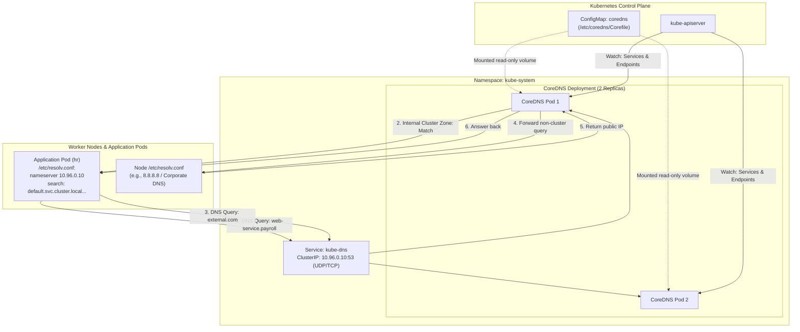
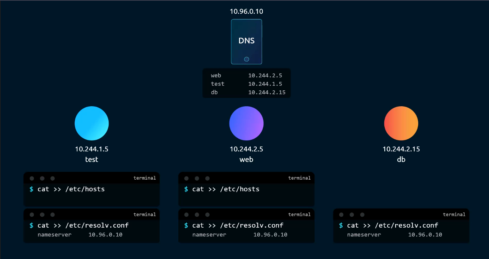
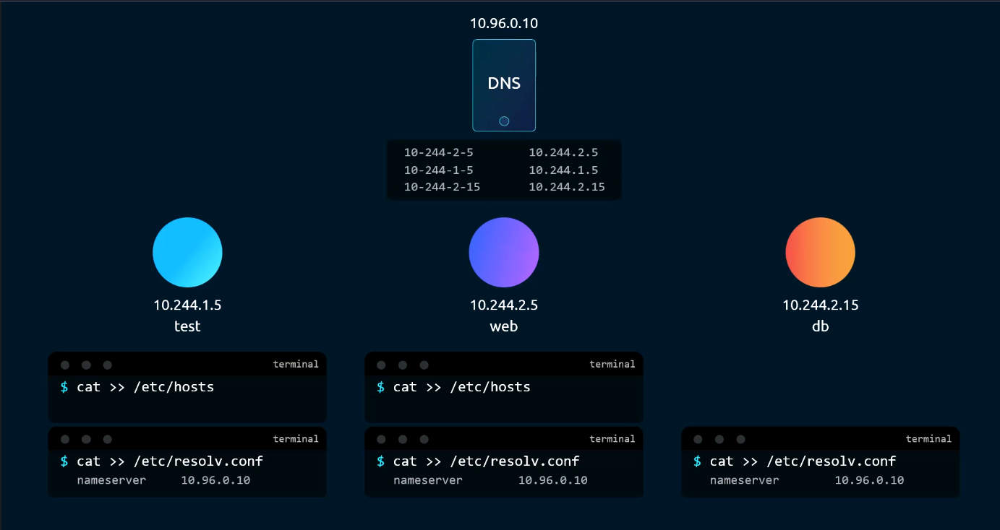
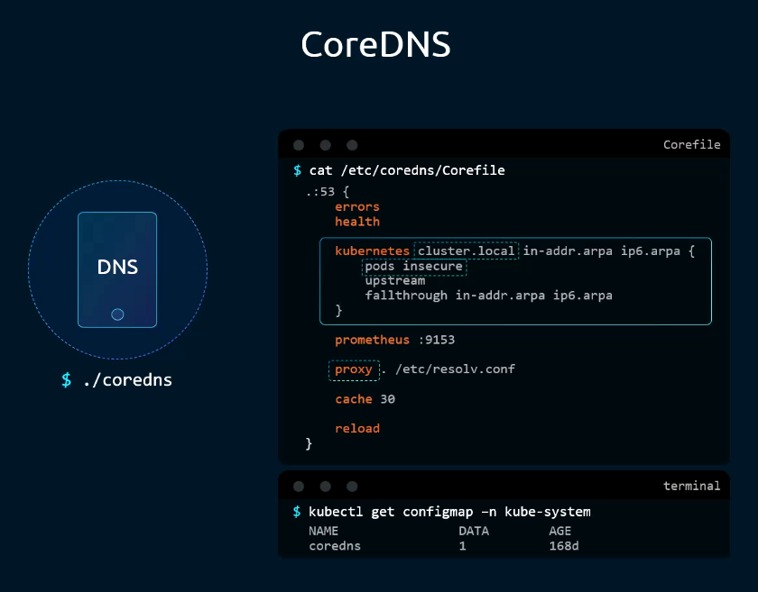
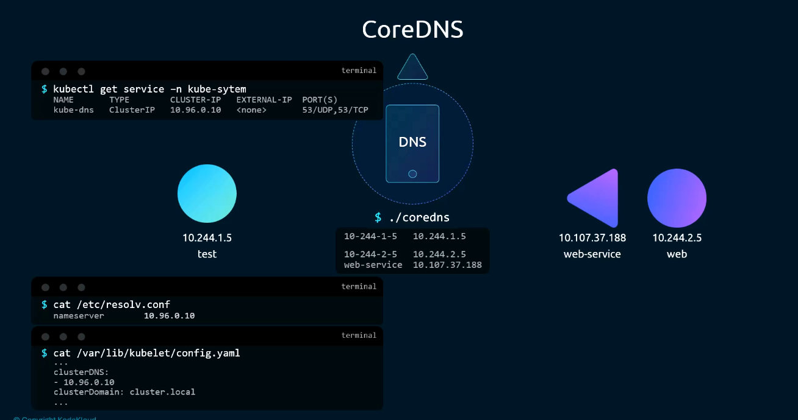
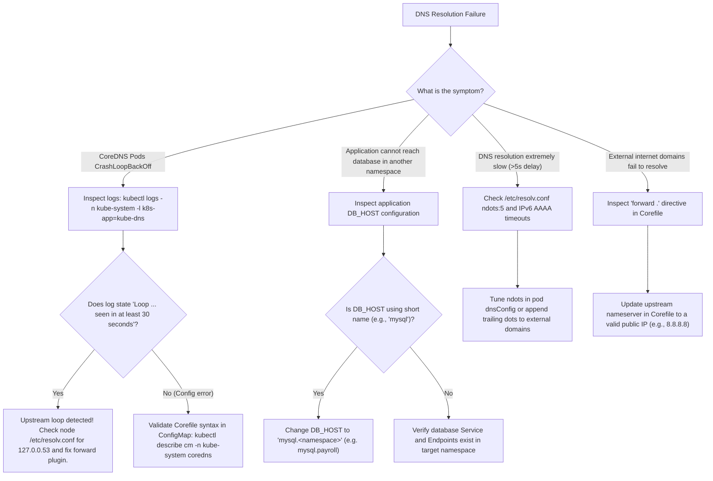

# 13 - CoreDNS in Kubernetes: Architecture, Corefile Plugins & Troubleshooting

## Exam Metadata
- **Domain**: Services & Networking (20%) / Cluster Architecture, Installation & Configuration (25%)
- **Importance**: High (Direct CKA Exam Archetype: Modifying CoreDNS ConfigMap, Diagnosing CrashLoopBackOff Forwarding Loops, Cross-Namespace Troubleshooting, and Output Redirection)
- **Target Version**: Kubernetes v1.31 / v1.32
- **Allowed Docs Search Keywords**: `coredns`, `customizing dns service`, `dns pod service`, `corefile`
- **Source**: `networking/13-coredns-kubernetes-raw.md`

---

## 1. Quick-Reference Summary
- **CoreDNS Deployment Architecture**:
  - Deployed as an `apps/v1.Deployment` named `coredns` in the `kube-system` namespace.
  - Runs with 2 replicas by default for high availability.
  - Exposed via a `ClusterIP` Service named `kube-dns` in `kube-system` listening on port `53/UDP` and `53/TCP`.
- **Configuration & File Storage**:
  - Configured declaratively via a `ConfigMap` named `coredns` in `kube-system`.
  - Mounted read-only into CoreDNS containers at `/etc/coredns/Corefile`.
- **Corefile Plugin Chain**:
  - `errors`: Logs query and operational errors to standard output.
  - `health`: Exposes health endpoint on `http://:8080/health` (`lameduck 5s`).
  - `ready`: Exposes readiness probe endpoint on `http://:8181/ready`.
  - `kubernetes cluster.local`: Authoritative plugin for cluster services and pods; options: `pods insecure` (or `verified`/`disabled`), `fallthrough`, `ttl 30`.
  - `prometheus :9153`: Exposes Prometheus metrics on port 9153.
  - `forward . /etc/resolv.conf`: Forwards non-cluster domain queries to upstream nameservers defined on the host node.
  - `cache 30`: Caches DNS responses in memory for 30 seconds.
  - `loop`: Detects forwarding loops; aborts process if circular resolution is detected.
  - `reload`: Watches for ConfigMap changes and reloads CoreDNS without downtime.
  - `loadbalance`: Round-robin randomizes DNS A/AAAA response order.
- **Kubelet Resolver Injection**:
  - `kubelet` automatically injects `nameserver <kube-dns-service-ip>` (e.g., `10.96.0.10`) and search paths into every Pod sandbox's `/etc/resolv.conf`.
- **Common CKA Exam Tasks**:
  - Resolving cross-namespace database communication by updating environment variables to use `<service>.<namespace>`.
  - Exporting DNS verification commands to a host file: `kubectl exec <pod> -- nslookup <svc>.<ns> > /path/to/file`.
  - Resolving CoreDNS `CrashLoopBackOff` caused by `loop` plugin detecting upstream `127.0.0.53` loops.

---

## 2. Conceptual Overview & Mental Model

### Simple English Explanation
In a Kubernetes cluster, applications cannot rely on static IP addresses because Pods and Services receive dynamic IPs. Instead of requiring administrators to manually update an `/etc/hosts` file on every single container, Kubernetes deploys a centralized DNS server called **CoreDNS**.

CoreDNS runs as a pair of Pods in the `kube-system` namespace. It connects directly to the Kubernetes API server and watches for every new Service and Pod created in the cluster:
1. When a new Service (e.g. `web-service`) is created, CoreDNS immediately adds an internal record mapping `web-service.default.svc.cluster.local` to the Service's virtual IP.
2. When any Pod starts up on a worker node, the `kubelet` agent automatically writes the IP address of the `kube-dns` Service into the container's `/etc/resolv.conf` file.
3. When a container makes a network call to `curl http://web-service`, the container's operating system queries CoreDNS. CoreDNS looks at its internal Kubernetes plugin database, finds the matching IP address, and returns it.
4. If a container queries an external internet address (like `google.com`), CoreDNS recognizes that the query is outside the cluster and forwards it to the upstream DNS servers configured on the physical node.

All CoreDNS behavior is controlled by a single configuration file called the **Corefile**, stored inside a Kubernetes `ConfigMap` named `coredns`.

### Formal Technical Definition
CoreDNS in Kubernetes is a modular, plugin-chained RFC 1035 authoritative DNS server deployed as a high-availability `apps/v1.Deployment` in the `kube-system` namespace. CoreDNS synthesizes dynamic `A`, `AAAA`, `SRV`, and `PTR` records for `v1.Service` ClusterIPs and `v1.Pod` endpoints via API server watch streams, utilizing a declarative `Corefile` managed via `v1.ConfigMap` to chain in-memory caching, Prometheus metric instrumentation, health probing, and recursive upstream forwarding.

### Architecture Flowchart: CoreDNS Operational Workflow



---

## 3. Deep-Dive Technical Breakdown

### CoreDNS vs. Legacy Kube-DNS





Prior to Kubernetes v1.12, DNS was managed by `kube-dns`, which ran three separate containers in each pod:
- `kubedns`: Watched Kubernetes API and translated records into an internal tree structure.
- `dnsmasq`: Handled caching and forwarding.
- `sidecar`: Handled health checks and metrics.

In modern Kubernetes (v1.12 through v1.32), **CoreDNS is the default standard**:
- Written in Go as a single binary with zero sidecar containers.
- Implements a modular, chain-of-responsibility plugin architecture.
- Delivers lower memory footprint, higher query throughput, and native Prometheus telemetry.

---

### Anatomy of the Corefile & Plugin Chain



The CoreDNS configuration file is mounted from the `coredns` ConfigMap in `kube-system`. It defines server blocks matching incoming query zones and port bindings:

```text
.:53 {
    errors
    health {
       lameduck 5s
    }
    ready
    kubernetes cluster.local in-addr.arpa ip6.arpa {
       pods insecure
       fallthrough in-addr.arpa ip6.arpa
       ttl 30
    }
    prometheus :9153
    forward . /etc/resolv.conf {
       max_concurrent 1000
    }
    cache 30
    loop
    reload
    loadbalance
}
```

#### Detailed Breakdown of Corefile Directives:

| Plugin / Directive | Technical Role & Mechanics | Operational Importance |
| :--- | :--- | :--- |
| `.:53` | Zone and port binding; matches all incoming DNS queries on port 53 across all network interfaces. | Defines the scope of the server block. |
| `errors` | Directs error messages to container `stdout`. | Essential for diagnosing query resolution failures via `kubectl logs`. |
| `health` | Exposes an HTTP health check on port `8080/health`. | Used by Kubernetes liveness probes (`lameduck 5s` delays shutdown to drain connections). |
| `ready` | Exposes HTTP readiness endpoint on port `8181/ready`. | Used by Kubernetes readiness probes; signals when all plugins have initialized. |
| `kubernetes` | Authoritative plugin for cluster services and pods. Authoritative for `cluster.local`, reverse IPv4 (`in-addr.arpa`), and reverse IPv6 (`ip6.arpa`). | Connects to API server to resolve Services and Pods. |
| `pods insecure` | Configures Pod DNS A-record generation. Converts Pod IP dots to dashes (e.g. `10-244-1-5.default.pod.cluster.local`). | `insecure` returns A record for any pod in the namespace; `disabled` turns off pod A records. |
| `fallthrough` | Passes queries that do not match Kubernetes records down to the next plugin in the chain. | Prevents Kubernetes plugin from issuing `NXDOMAIN` for unhandled reverse lookups. |
| `ttl 30` | Sets Time-To-Live (TTL) for DNS responses to 30 seconds. | Balance between DNS freshness and client resolver cache efficiency. |
| `prometheus :9153` | Binds Prometheus metrics exporter on port `9153`. | Enables scraping metrics (`coredns_dns_requests_total`, latencies). |
| `forward . /etc/resolv.conf` | Routes non-cluster queries (e.g., `github.com`) to upstream resolvers listed in the node's `/etc/resolv.conf`. | Bridges cluster containers to external public or corporate internet. |
| `cache 30` | In-memory cache holding positive and negative query results for up to 30 seconds. | Protects the API server from query exhaustion. |
| `loop` | Continuously transmits canary queries to detect circular forwarding loops. | Triggers process panic if a forwarding loop is detected (prevents CPU exhaustion). |
| `reload` | Automatically reloads Corefile when the ConfigMap is modified (default check period: 30s). | Allows updating DNS configuration without restarting pods. |
| `loadbalance` | Acts as a round-robin DNS load balancer by randomizing the order of multi-A records in responses. | Distributes traffic evenly across multi-endpoint Headless Services. |

---

### Pod Resolver Configuration Injection



When a Pod starts up, `kubelet` automatically generates `/etc/resolv.conf` inside the container:

```text
nameserver 10.96.0.10
search default.svc.cluster.local svc.cluster.local cluster.local
options ndots:5
```

#### How Search Paths Function During Lookups:
When an application queries `host web-service`:
1. `web-service` has 0 dots ($0 < 5$).
2. Resolver appends search domain 1: `web-service.default.svc.cluster.local` $\rightarrow$ **MATCH!**
3. Query succeeds with address `10.107.37.188`.

When an application queries `host web-service.default`:
1. `web-service.default` has 1 dot ($1 < 5$).
2. Resolver appends search domain 1: `web-service.default.default.svc.cluster.local` $\rightarrow$ `NXDOMAIN`.
3. Resolver appends search domain 2: `web-service.default.svc.cluster.local` $\rightarrow$ **MATCH!**
4. Query succeeds with address `10.107.37.188`.

When an application queries `host web-service.default.svc`:
1. `web-service.default.svc` has 2 dots ($2 < 5$).
2. Resolver appends search domain 1 $\rightarrow$ `NXDOMAIN`.
3. Resolver appends search domain 2 $\rightarrow$ `NXDOMAIN`.
4. Resolver appends search domain 3: `web-service.default.svc.cluster.local` $\rightarrow$ **MATCH!**
5. Query succeeds with address `10.107.37.188`.

> [!IMPORTANT]
> Pod search paths only contain `.svc.cluster.local`. There is **NO search path for `.pod.cluster.local`**!
> You cannot resolve a Pod using `10-244-2-5.default`. You **MUST** specify the full FQDN:
> `10-244-2-5.default.pod.cluster.local`.

---

## 4. Command Translation & Mapping Tables

### CoreDNS Deployment Architecture Reference

| Kubernetes Resource | Name | Namespace | Key Attributes / Flags |
| :--- | :--- | :--- | :--- |
| **Deployment** | `coredns` | `kube-system` | Replicas: 2; Volume: `config-volume` mounted to `/etc/coredns` |
| **Service** | `kube-dns` | `kube-system` | Ports: `53/UDP`, `53/TCP`, `9153/TCP`; Type: `ClusterIP` |
| **ConfigMap** | `coredns` | `kube-system` | Data Key: `Corefile` |
| **ServiceAccount** | `coredns` | `kube-system` | Bound to ClusterRole `system:coredns` (RBAC to watch services/endpoints) |

### Permitted and Forbidden Domain Formats in Cross-Namespace Resolution

Given a client pod in namespace `default` attempting to reach Service `web-service` in namespace `payroll`:

| Domain Form Tested | Resolves? | Explanation |
| :--- | :--- | :--- |
| `web-service` | ❌ **FAIL** | Searches `web-service.default.svc.cluster.local` (looks in caller's local namespace). |
| `web-service.payroll` | ✅ **SUCCESS** | Matches search path 2: `web-service.payroll.svc.cluster.local`. |
| `web-service.payroll.svc` | ✅ **SUCCESS** | Matches search path 3: `web-service.payroll.svc.cluster.local`. |
| `web-service.payroll.svc.cluster.local` | ✅ **SUCCESS** | Absolute cluster FQDN. |
| `web-service.default.pod` | ❌ **FAIL** | Invalid type discriminator; services use `svc`, not `pod`. |
| `web-service.payroll.svc.cluster` | ❌ **FAIL** | Incomplete domain name; missing `.local` suffix. |

---

## 5. High-Yield CLI & Imperative Commands

### Inspecting and Modifying CoreDNS Resources
```bash
# 1. View CoreDNS pods, status, and node assignments
kubectl get pods -n kube-system -l k8s-app=kube-dns -o wide

# 2. View CoreDNS deployment specification and arguments
kubectl describe deployment -n kube-system coredns | grep -A 5 "Args:"
# Output: -conf /etc/coredns/Corefile

# 3. View the live Corefile configuration
kubectl describe configmap -n kube-system coredns

# 4. Edit CoreDNS ConfigMap directly
kubectl edit configmap -n kube-system coredns

# 5. Force instant CoreDNS reload without waiting for polling interval
kubectl rollout restart deployment -n kube-system coredns
```

### Direct In-Cluster DNS Query Testing (Exam Essential)
```bash
# 1. Test DNS resolution from a specific pod (hr) across namespaces
kubectl exec hr -- nslookup web-service.payroll

# 2. Redirect query output directly to a file on the host (Standard CKA Exam Task):
kubectl exec hr -- nslookup mysql.payroll > /root/CKA/nslookup.out
cat /root/CKA/nslookup.out

# 3. Test DNS resolution using the pod's local resolver
kubectl exec hr -- getent hosts web-service.payroll

# 4. Test DNS resolution directly against CoreDNS Pod IP
COREDNS_IP=$(kubectl get pod -n kube-system -l k8s-app=kube-dns -o jsonpath='{.items[0].status.podIP}')
kubectl exec hr -- nslookup web-service.payroll ${COREDNS_IP}
```

### Inspecting CoreDNS Runtime Logs for Errors
```bash
# 1. View real-time logs from all CoreDNS replicas
kubectl logs -n kube-system -l k8s-app=kube-dns --tail=100

# 2. Filter logs for loop detection or panic errors
kubectl logs -n kube-system -l k8s-app=kube-dns | grep -iE "loop|panic|error"
```

---

## 6. Troubleshooting & Diagnostic Runbook

### Diagnostic Decision Tree



### Triage Sequence Matrix

| Step | Failure Condition | Diagnostic Command | Expected Output | Remediation Action |
| :--- | :--- | :--- | :--- | :--- |
| **1. CoreDNS Health** | `CrashLoopBackOff` | `kubectl get pods -n kube-system -l k8s-app=kube-dns` | `2/2 Running` | Check for `loop` plugin trigger or invalid Corefile syntax. |
| **2. Upstream Loop** | Forwarding loop | `kubectl logs -n kube-system ds/coredns` | No `Loop ... detected` | Edit Corefile `forward . <upstream-ip>` bypassing `127.0.0.53`. |
| **3. Service Endpoints**| `kube-dns` unreachable | `kubectl get ep -n kube-system kube-dns` | Contains 2 Pod IPs on port 53 | Ensure CoreDNS pods are ready and match `kube-dns` selector. |
| **4. Cross-Namespace** | `NXDOMAIN` on short name | `kubectl exec <pod> -- nslookup <svc>.<ns>` | Resolves ClusterIP | Update application configuration to include the target namespace. |
| **5. File Redirection** | Exam verification file | `test -s /root/CKA/nslookup.out` | Non-empty file on host | Run `kubectl exec <pod> -- nslookup <svc>.<ns> > /root/CKA/nslookup.out`. |
| **6. Corefile Reload** | Stale configuration | `kubectl rollout restart deployment -n kube-system coredns` | Successful rollout | Force immediate pod restart if ConfigMap auto-reload lags. |

---

## 7. CKA Exam Tips, Gotchas & Traps

> [!WARNING]
> **The `loop` Plugin CrashLoopBackOff Trap**
> On Ubuntu/Debian nodes running `systemd-resolved`, the node's `/etc/resolv.conf` points to local stub resolver `127.0.0.53`.
> When CoreDNS forwards non-cluster queries using `forward . /etc/resolv.conf`, queries loop back to CoreDNS indefinitely.
> The `loop` plugin detects this and panics:
> `[FATAL] plugin/loop: Loop (127.0.0.1:53 -> :53) detected for zone "."`.
> **Exam Fix**:
> Edit the `coredns` ConfigMap:
> ```bash
> kubectl edit cm -n kube-system coredns
> ```
> Replace `forward . /etc/resolv.conf` with a direct upstream nameserver (e.g., `forward . 8.8.8.8`) or remove the loop plugin if required, then restart the deployment:
> `kubectl rollout restart deployment -n kube-system coredns`.

> [!IMPORTANT]
> **Host File Redirection: Run on the Host Terminal, NOT Inside Pod!**
> A frequent CKA question specifies:
> *"Perform an nslookup from the hr pod on the mysql Service in the payroll namespace and store the output in `/root/CKA/nslookup.out`."*
> If you run `kubectl exec -it hr -- sh` and then redirect to `/root/CKA/nslookup.out`, the file is created **inside the container**, not on the exam host! The grading script will mark the question 0%.
> **Correct Command**:
> Run the redirection directly from the controlplane node terminal:
> ```bash
> kubectl exec hr -- nslookup mysql.payroll > /root/CKA/nslookup.out
> ```

> [!IMPORTANT]
> **Troubleshooting Multi-Tier Apps Across Namespaces**
> If a web application pod (`webapp`) in the `default` namespace fails to connect to a database (`mysql`) in the `payroll` namespace:
> 1. Check the Deployment manifest (`webapp-pod-service.yaml`).
> 2. Locate environment variable `DB_Host`.
> 3. If it says `value: mysql`, change it to `value: mysql.payroll`.
> 4. Apply the updated manifest: `kubectl apply -f webapp-pod-service.yaml`.

> [!TIP]
> **Testing Corefile Changes Instantly**
> When you edit the `coredns` ConfigMap, the `reload` plugin can take 30 to 45 seconds to detect the change.
> Under strict CKA exam time limits, do NOT wait! Run:
> ```bash
> kubectl rollout restart deployment -n kube-system coredns
> ```
> This restarts the CoreDNS pods immediately with the updated ConfigMap.

---

## 8. Self-Test / Active Recall

<details>
<summary><strong>1. In which Kubernetes namespace and under what resource type is CoreDNS deployed by default?</strong></summary>

In the `kube-system` namespace as an `apps/v1.Deployment` (named `coredns`) managing 2 replicas.
</details>

<details>
<summary><strong>2. What is the name of the Kubernetes ConfigMap that stores the CoreDNS configuration, and where is it mounted inside the CoreDNS pods?</strong></summary>

ConfigMap name: `coredns` in `kube-system`. Mounted at: `/etc/coredns/Corefile`.
</details>

<details>
<summary><strong>3. If a web application in the <code>default</code> namespace needs to connect to a MySQL service in the <code>payroll</code> namespace, what should the database host variable be set to?</strong></summary>

`mysql.payroll` (or full FQDN: `mysql.payroll.svc.cluster.local`).
</details>

<details>
<summary><strong>4. Why can you NOT reach a Pod using the short name syntax <code>10-244-2-5.default</code>?</strong></summary>

Because the search domains injected into `/etc/resolv.conf` only include service subdomains (`default.svc.cluster.local`, `svc.cluster.local`, `cluster.local`). Pod DNS queries require the explicit discriminator `pod`, meaning the full FQDN `10-244-2-5.default.pod.cluster.local` must be specified.
</details>

<details>
<summary><strong>5. What Corefile plugin causes CoreDNS to enter <code>CrashLoopBackOff</code> when it detects circular query forwarding?</strong></summary>

The `loop` plugin.
</details>

<details>
<summary><strong>6. How do you force CoreDNS pods to pick up a ConfigMap change immediately rather than waiting for the reload plugin interval?</strong></summary>

`kubectl rollout restart deployment -n kube-system coredns`.
</details>

<details>
<summary><strong>7. What is the exact command to execute an <code>nslookup</code> on <code>mysql.payroll</code> from inside pod <code>hr</code> and store the result in <code>/root/CKA/nslookup.out</code> on the host node?</strong></summary>

`kubectl exec hr -- nslookup mysql.payroll > /root/CKA/nslookup.out`.
</details>

<details>
<summary><strong>8. What Corefile directive handles forwarding non-cluster DNS queries to external public/corporate nameservers?</strong></summary>

`forward . /etc/resolv.conf` (or `forward . <nameserver-ip>`).
</details>

<details>
<summary><strong>9. On what port does CoreDNS expose Prometheus metrics for monitoring?</strong></summary>

Port `9153/TCP`.
</details>

<details>
<summary><strong>10. Which Kubernetes component is responsible for writing the CoreDNS Service IP into every application Pod's <code>/etc/resolv.conf</code>?</strong></summary>

The `kubelet` daemon running on each worker node.
</details>

---

## 9. Official Documentation Bookmarks

| Resource | Documentation Path / Anchor | Purpose |
| :--- | :--- | :--- |
| **Customizing DNS Service** | `Tasks > Administer a Cluster > DNS Service` | Authoritative reference for editing CoreDNS ConfigMap and Corefile |
| **DNS for Services and Pods** | `Concepts > Services, Load Balancing, and Networking > DNS for Services and Pods` | Complete naming specification for services, namespaces, and pods |
| **Debugging DNS Resolution** | `Tasks > Administer a Cluster > Debugging DNS Resolution` | Comprehensive troubleshooting steps for CoreDNS and client pods |
| **CoreDNS Upstream Docs** | `https://coredns.io/plugins/kubernetes/` | Detailed documentation on CoreDNS `kubernetes` plugin options |
