# 14 - Ingress: Architecture, Ingress Controllers & Routing Topologies

## Exam Metadata
- **Domain**: Services & Networking (20%)
- **Importance**: Critical (Extensively tested in CKA: Ingress Resource YAML construction, Path-based & Host-based routing, Ingress Controller architecture, and TLS configuration)
- **Target Version**: Kubernetes v1.31 / v1.32
- **Allowed Docs Search Keywords**: `ingress`, `ingress controllers`, `ingress rules`, `ingress tls`
- **Source**: `networking/14-ingress-raw.md`

---

## 1. Quick-Reference Summary
- **Ingress Definition**: An API object managing external Layer 7 (HTTP/HTTPS) access to services within a cluster, providing application-layer load balancing, SSL/TLS termination, and path-/name-based virtual routing.
- **The Core Dichotomy**:
  - **Ingress Resource**: A declarative Kubernetes YAML specification defining routing rules (hosts, paths, backends, TLS secrets). Has zero operational effect without an active Ingress Controller.
  - **Ingress Controller**: An active reverse proxy daemon (e.g., NGINX, HAProxy, Traefik, Envoy) running in the cluster that watches the API server for Ingress resources and dynamically writes its proxy configuration. Not deployed by default.
- **Ingress Controller Components (NGINX Reference)**:
  - **Deployment**: Runs the controller binary (`/nginx-ingress-controller`) with arguments and environment variables (`POD_NAME`, `POD_NAMESPACE`).
  - **ConfigMap**: Decouples NGINX configuration settings (e.g. timeouts, keepalives, body size) from the container image.
  - **Service**: Exposes the Ingress Controller to external traffic (via `NodePort` on ports 80/443 or cloud `LoadBalancer`).
  - **RBAC**: ServiceAccount, ClusterRole, and ClusterRoleBinding providing permissions to watch Ingresses, Services, Endpoints, Secrets, and ConfigMaps.
- **Ingress Resource Routing Patterns**:
  - **Single Service (Default Backend)**: Directs all traffic without rules to a single default Service.
  - **Path-Based Routing**: Splits traffic based on request URI (`/wear` $\rightarrow$ `wear-service`, `/watch` $\rightarrow$ `video-service`).
  - **Host-Based Routing (Virtual Hosting)**: Directs traffic based on the HTTP `Host` header (`wear.myonlinestore.com` vs `watch.myonlinestore.com`).
  - **TLS Termination**: Configured via `spec.tls` referencing a `kubernetes.io/tls` Secret containing `tls.crt` and `tls.key`.
- **Modern API Specification (`networking.k8s.io/v1`)**:
  - Requires explicit `pathType: Prefix` or `pathType: Exact`.
  - Backend syntax requires nested `service.name` and `service.port.number`.

---

## 2. Conceptual Overview & Mental Model

### Simple English Explanation
When you build web applications in Kubernetes, you need a way for external users on the internet to reach your services.
Historically, Kubernetes provided two ways to expose applications:
1. **NodePort Services**: Each Service opens a high-numbered port (like `30080`) across every worker node. However, users do not want to type `http://myonlinestore.com:30080` in their browsers. In on-premises data centers, administrators had to set up and manually maintain an external reverse proxy (like NGINX or HAProxy) outside the cluster to forward port 80 to port 30080.
2. **LoadBalancer Services**: On public clouds (GCP, AWS, Azure), Kubernetes automatically provisions an external cloud load balancer for each Service. However, each cloud load balancer operates at Layer 4 (TCP/UDP) and costs extra money. If you have 10 microservices (e.g., `/wear`, `/video`, `/orders`), paying for and configuring 10 separate cloud load balancers is expensive and complicated to secure with SSL certificates.

Kubernetes solves this problem with **Ingress**:
Ingress acts as a smart, Layer 7 (HTTP/HTTPS) reverse proxy running *inside* the Kubernetes cluster:
- You only need **one single external entry point** (one Cloud Load Balancer or one NodePort) pointing to the Ingress Controller.
- The Ingress Controller inspects incoming HTTP requests. It reads the domain name (e.g., `Host: store.com`) and the request path (e.g., `/wear` vs `/watch`) and forwards the request directly to the appropriate internal Kubernetes Service.
- It also handles SSL/TLS certificates centrally in one place, terminating HTTPS traffic before sending unencrypted requests to the backend pods over the private cluster network.

### Formal Technical Definition
Kubernetes Ingress is an application-layer (OSI Layer 7) reverse proxy and traffic management abstraction governed by the `networking.k8s.io/v1` API group. It consists of an autonomous data-plane Ingress Controller that monitors the control plane via API watches to dynamically compile declarative `Ingress` routing rules, path prefix matching trees, and TLS secret references into native proxy configuration files (e.g. `nginx.conf`), load balancing external HTTP/HTTPS requests directly across backend `EndpointSlice` targets.

### Architecture Flowchart: Layer 7 Ingress Traffic Routing

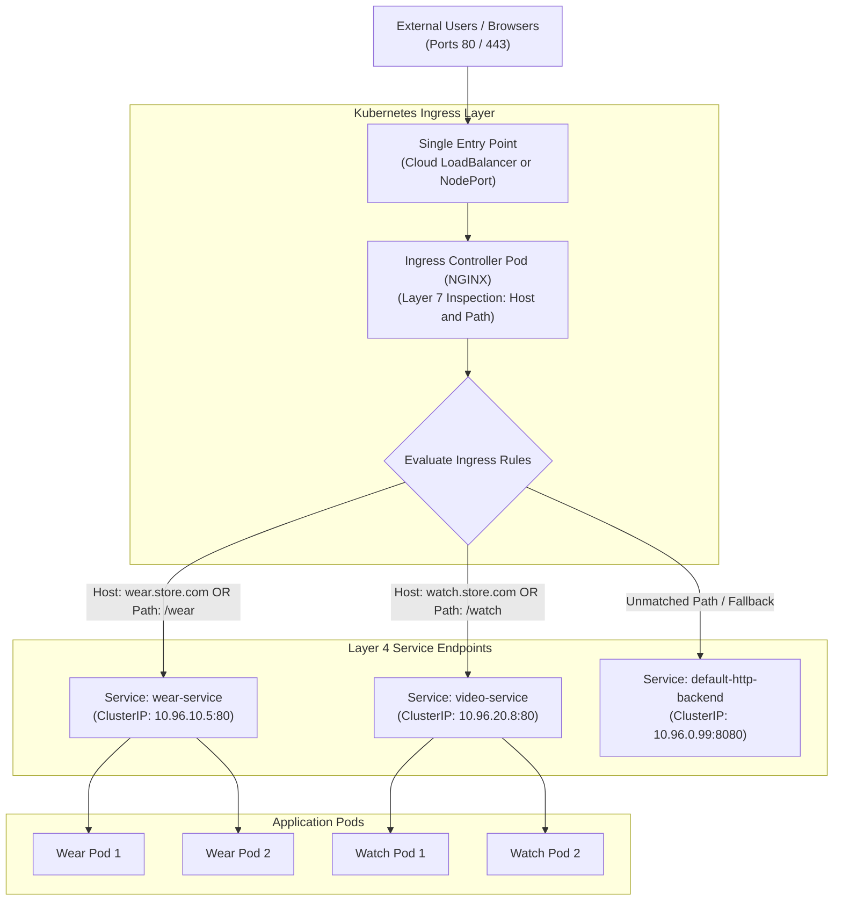

---

## 3. Deep-Dive Technical Breakdown

### The Evolution of External Cluster Access

#### 1. On-Premises NodePort + External Proxy Pattern

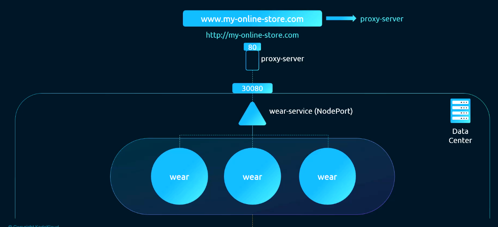

- Application pods connect to a `NodePort` service (e.g., port `30080`).
- External DNS cannot directly point to port `30080`.
- Administrators must maintain an external proxy server outside the cluster to proxy incoming port 80 traffic to `<node-ip>:30080`.

---

#### 2. Cloud-Native LoadBalancer Pattern

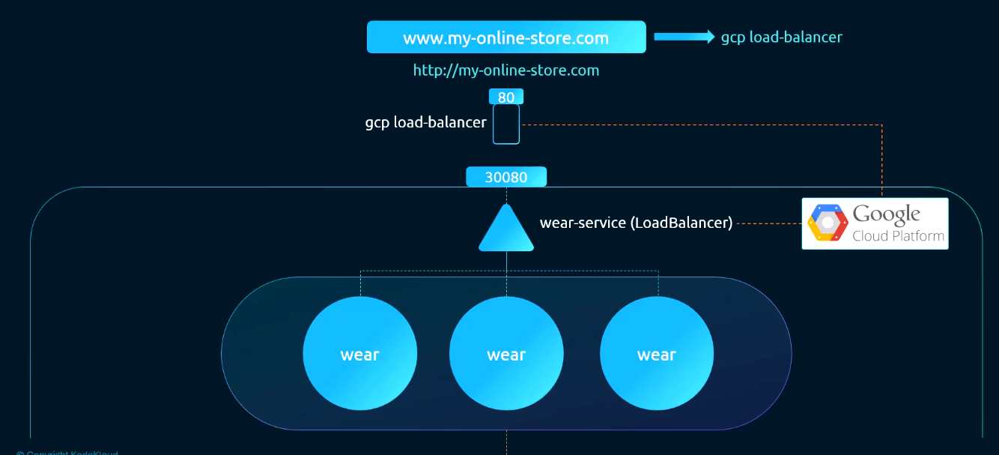

- Setting `type: LoadBalancer` automates the creation of a cloud network load balancer (e.g., Google Cloud Network Load Balancer).
- The cloud load balancer receives a public IP, points to the node ports, and routes traffic directly.

---

#### 3. The Multi-LoadBalancer Cost & Sprawl Problem

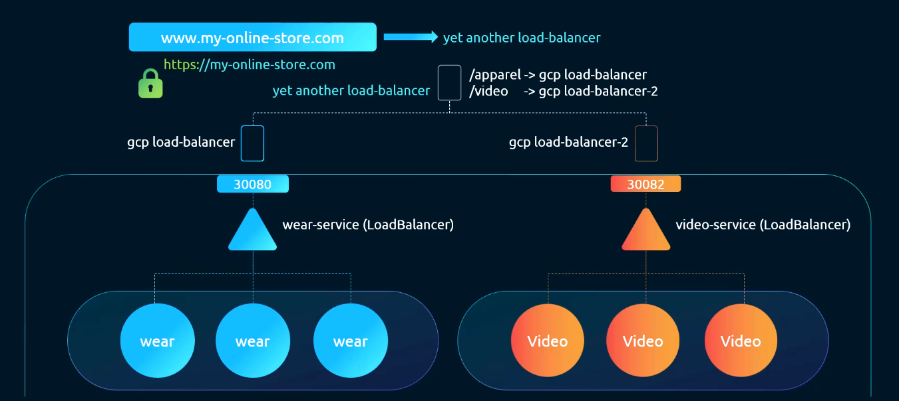

- When an enterprise runs multiple microservices (e.g. `/wear` and `/watch`), deploying each as `type: LoadBalancer` generates multiple cloud load balancers.
- **Drawbacks**:
  - Significant cloud provider billing costs for every load balancer instance.
  - Disparate public IPs requiring complex DNS routing.
  - Fragmented SSL/TLS certificate management across multiple load balancers.

---

#### 4. The Unified Ingress Solution

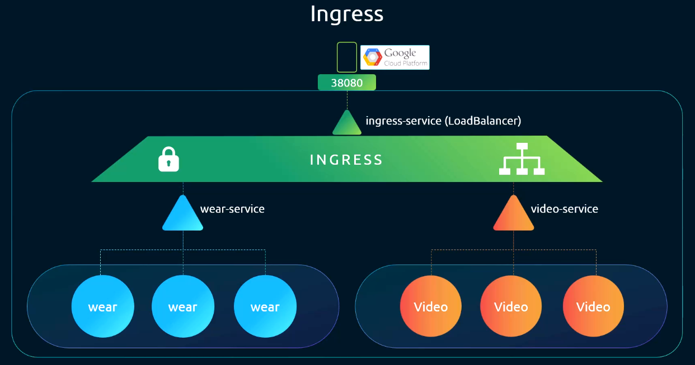

- Ingress consolidates all HTTP/HTTPS routing behind a single entry point.
- Provides native SSL/TLS termination, URL path-based routing, and domain-based routing using Kubernetes manifests.

---

### Ingress Architecture: Controller vs. Resource

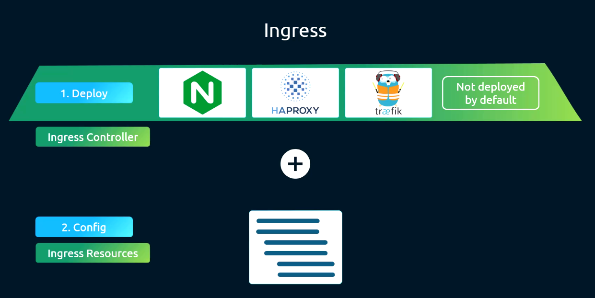

The Ingress system operates as two decoupled components:

1. **The Ingress Controller**:
   The active software daemon running inside the cluster. It is **not** installed by default in a standard Kubernetes cluster.
2. **The Ingress Resource**:
   The declarative Kubernetes object (`kind: Ingress`) created by administrators defining the routes, hostnames, and backend services.

#### Available Ingress Controller Implementations:

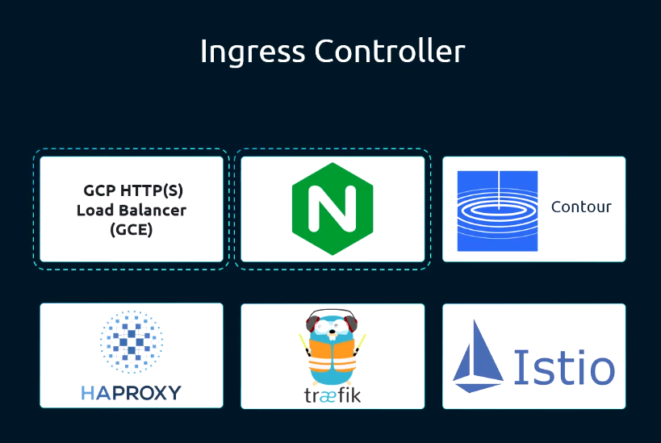

| Controller | Engine Base | Primary Strengths | Ecosystem / Vendor |
| :--- | :--- | :--- | :--- |
| **Ingress NGINX** | NGINX Open Source | Community reference standard; official Kubernetes project. | Kubernetes Community (`kubernetes/ingress-nginx`) |
| **Traefik** | Traefik (Go) | Dynamic configuration, native Let's Encrypt support. | Traefik Labs |
| **HAProxy Ingress** | HAProxy | High-throughput, low-memory footprints. | HAProxy Open Source |
| **Envoy / Contour** | Envoy Proxy | Advanced traffic shifting, observability, gRPC support. | CNCF / Project Contour |
| **AWS ALB Controller**| AWS Application LB | Provisions native AWS Application Load Balancers. | Amazon Web Services |

---

### Step-by-Step Anatomy of an NGINX Ingress Controller Deployment

To understand how an Ingress Controller functions, inspect its required Kubernetes resources:

#### 1. Deployment Specification

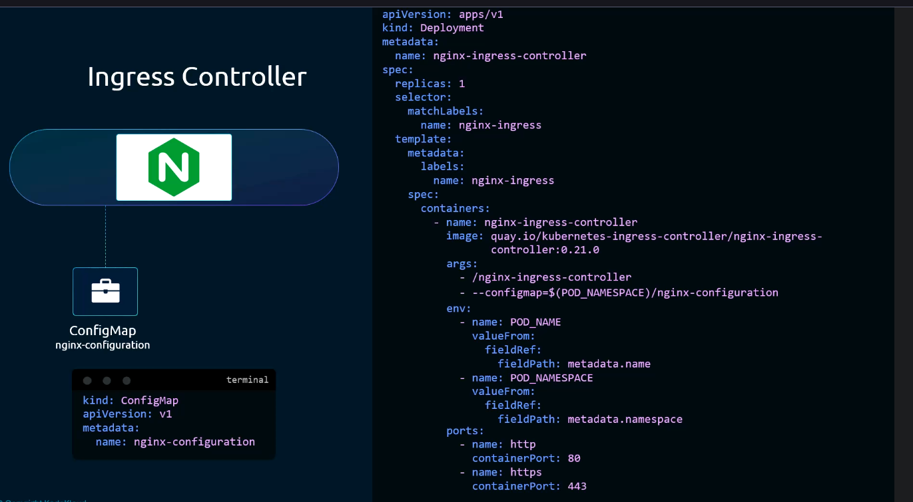

The Ingress Controller runs as a standard Kubernetes Deployment. Inside the container:
- The executable `/nginx-ingress-controller` runs as PID 1.
- It requires environment variables `POD_NAME` and `POD_NAMESPACE` (injected via the downward API) to identify its operational scope.
- It exposes container ports `80` (HTTP) and `443` (HTTPS).

#### 2. ConfigMap Decoupling
To modify NGINX configuration settings (such as `proxy-connect-timeout`, `client-max-body-size`, or `ssl-protocols`) without rebuilding the container image, an empty or customized `ConfigMap` is passed to the controller via CLI flag `--configmap=$(POD_NAMESPACE)/nginx-configuration`.

#### 3. Exposing the Controller via Service

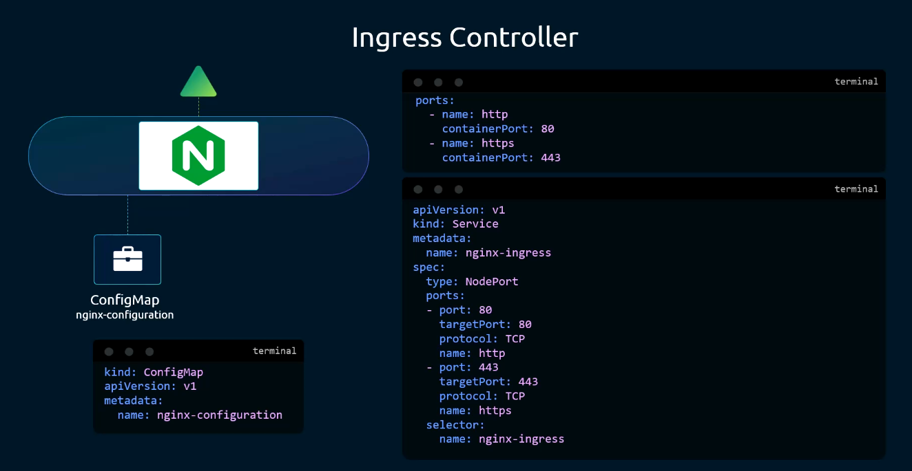

The controller pods need to receive external traffic. A Kubernetes Service of type `NodePort` (or `LoadBalancer`) links external ports to the controller's container ports `80` and `443`.

#### 4. RBAC Authorization (ServiceAccount, ClusterRole)

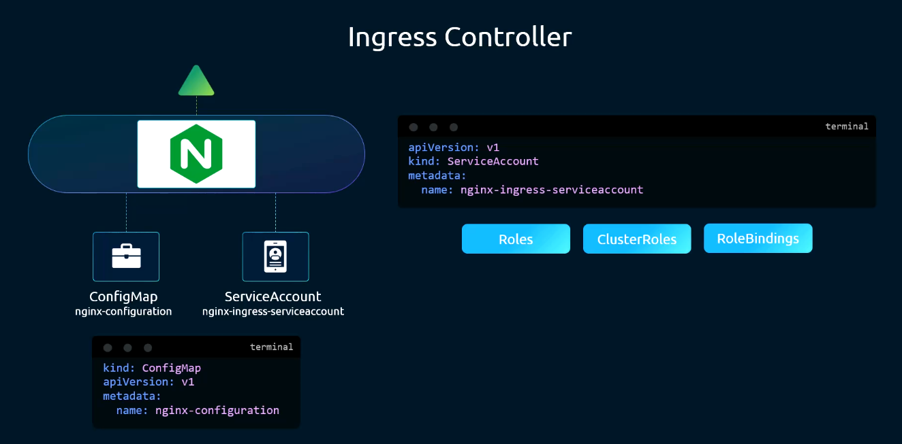

The controller contains internal control loops that constantly monitor the cluster for Ingress objects. To do this, it must run with a `ServiceAccount` bound to a `ClusterRole` granting `get`, `list`, and `watch` permissions on:
- `networking.k8s.io` $\rightarrow$ `ingresses`, `ingressclasses`
- `core` $\rightarrow$ `services`, `endpoints`, `secrets`, `configmaps`

#### 5. Complete Base Topology

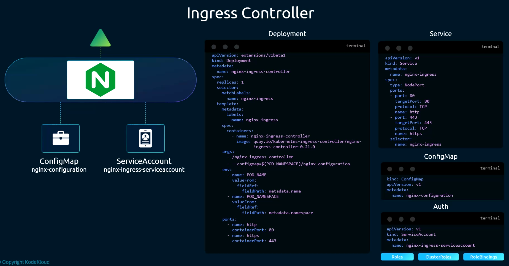

---

### Ingress Resource Topologies & YAML Specifications

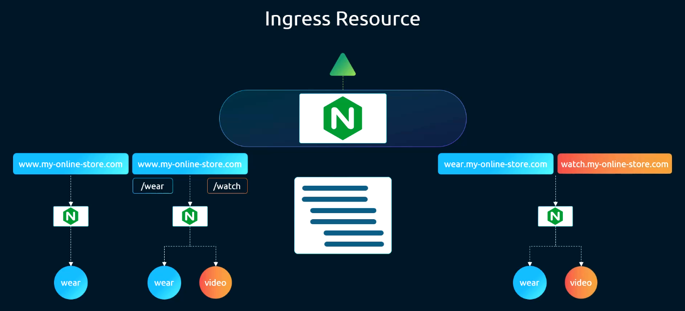

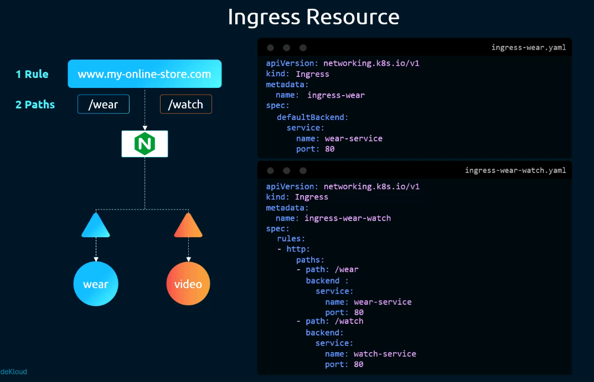

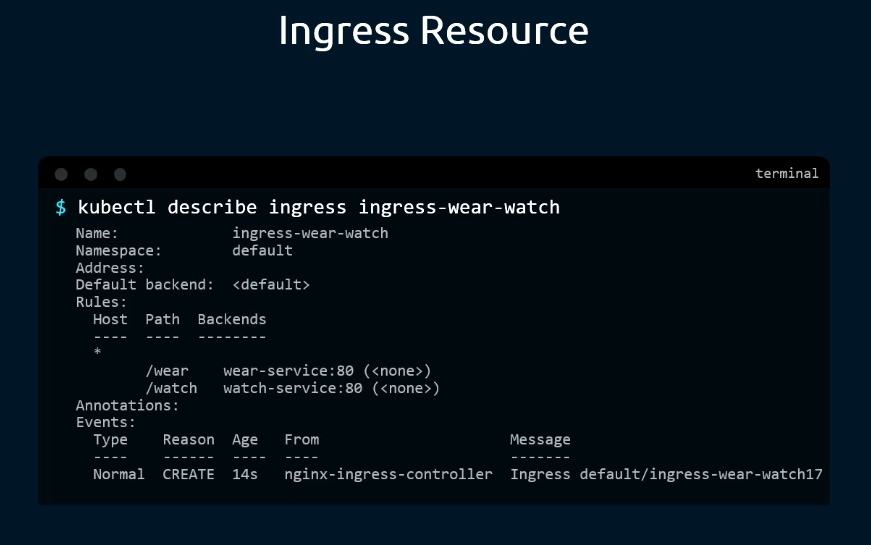

#### 1. Single Service (Default Backend Fallback)
Directs all traffic to a single default Service without evaluating host or path rules:

```yaml
apiVersion: networking.k8s.io/v1
kind: Ingress
metadata:
  name: single-service-ingress
spec:
  defaultBackend:
    service:
      name: primary-app-service
      port:
        number: 80
```

---

#### 2. Path-Based Routing (Fanout Architecture)
Routes requests on the same domain to different backend services based on the URL path:

```yaml
apiVersion: networking.k8s.io/v1
kind: Ingress
metadata:
  name: path-based-ingress
spec:
  rules:
  - http:
      paths:
      - path: /wear
        pathType: Prefix
        backend:
          service:
            name: wear-service
            port:
              number: 80
      - path: /watch
        pathType: Prefix
        backend:
          service:
            name: video-service
            port:
              number: 80
```

---

#### 3. Host-Based Routing (Virtual Hosting Architecture)

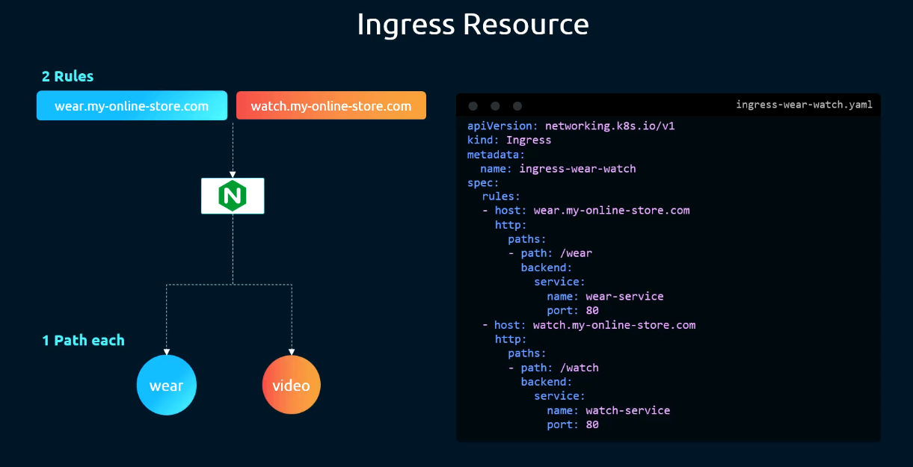

Routes traffic based on the HTTP `Host` header to isolate multiple domain names:

```yaml
apiVersion: networking.k8s.io/v1
kind: Ingress
metadata:
  name: host-based-ingress
spec:
  rules:
  - host: wear.myonlinestore.com
    http:
      paths:
      - path: /
        pathType: Prefix
        backend:
          service:
            name: wear-service
            port:
              number: 80
  - host: watch.myonlinestore.com
    http:
      paths:
      - path: /
        pathType: Prefix
        backend:
          service:
            name: video-service
            port:
              number: 80
```

---

#### 4. TLS / HTTPS Termination
To terminate TLS on the Ingress Controller, store the certificate and private key in a Kubernetes `Secret` of type `kubernetes.io/tls`:

```bash
# Imperatively create the TLS secret
kubectl create secret tls myonlinestore-tls \
  --cert=/path/to/tls.crt \
  --key=/path/to/tls.key
```

Reference the Secret in the `spec.tls` block:
```yaml
apiVersion: networking.k8s.io/v1
kind: Ingress
metadata:
  name: tls-ingress
spec:
  tls:
  - hosts:
    - wear.myonlinestore.com
    - watch.myonlinestore.com
    secretName: myonlinestore-tls
  rules:
  - host: wear.myonlinestore.com
    http:
      paths:
      - path: /
        pathType: Prefix
        backend:
          service:
            name: wear-service
            port:
              number: 80
```

---

## 4. Command Translation & Mapping Tables

### Comparison: Service vs. Ingress

| Feature | Service (`ClusterIP` / `NodePort` / `LoadBalancer`) | Ingress |
| :--- | :--- | :--- |
| **OSI Layer** | Layer 4 (Transport: TCP / UDP) | Layer 7 (Application: HTTP / HTTPS / gRPC) |
| **Routing Basis** | IP address and Port tuple | Domain Name (`Host` header) and URL Path |
| **Traffic Handling** | Linux Kernel Netfilter (iptables) / IPVS | In-cluster reverse proxy daemon (NGINX, Envoy) |
| **SSL/TLS Termination** | ❌ Not supported natively (passes encrypted TCP) | ✅ Built-in centralized TLS termination via Secrets |
| **Path Rewriting** | ❌ None | ✅ Supported via annotations |
| **Cloud Cost** | High (1 cloud load balancer per Service) | Minimal (1 cloud load balancer for all cluster routes) |

### Modern Ingress (`networking.k8s.io/v1`) vs. Legacy (`v1beta1`)

| Element | Modern `v1` Syntax | Legacy `v1beta1` Syntax (Removed) |
| :--- | :--- | :--- |
| **API Version** | `apiVersion: networking.k8s.io/v1` | `apiVersion: networking.k8s.io/v1beta1` |
| **Path Type** | `pathType: Prefix` (Mandatory field) | Omitted or defaulted |
| **Service Backend** | `backend.service.name: my-svc` | `backend.serviceName: my-svc` |
| **Port Backend** | `backend.service.port.number: 80` | `backend.servicePort: 80` |

---

## 5. High-Yield CLI & Imperative Commands

### Creating Ingress Resources Imperatively (CKA Essential)
```bash
# 1. Create a single-rule host and path-based ingress imperatively
kubectl create ingress test-ingress \
  --rule="wear.myonlinestore.com/wear*=wear-service:80"

# 2. Create an ingress with default backend
kubectl create ingress default-ingress \
  --default-backend="default-service:8080"

# 3. Create a multi-host ingress and output YAML
kubectl create ingress multi-host-ingress \
  --rule="wear.store.com/*=wear-svc:80" \
  --rule="watch.store.com/*=watch-svc:80" \
  --dry-run=client -o yaml > ingress.yaml
```

### Inspecting Ingress Resources and Controllers
```bash
# 1. List all Ingress resources in the current namespace
kubectl get ingress

# 2. Inspect Ingress details, including rules, hosts, paths, and backends
kubectl describe ingress <ingress-name>

# 3. Check Ingress Controller Pods (typically in ingress-nginx namespace)
kubectl get pods -A -l app.kubernetes.io/name=ingress-nginx

# 4. View real-time logs from the Ingress Controller to trace incoming requests
kubectl logs -n ingress-nginx -l app.kubernetes.io/name=ingress-nginx --tail=50 -f
```

### Testing Ingress Routing Using `curl`
When testing virtual hosts in a lab or exam environment where local DNS is not configured:
```bash
# 1. Test host-based routing by explicitly setting the Host header
curl -H "Host: wear.myonlinestore.com" http://<node-ip>:<node-port>/wear

# 2. Test using curl's --resolve flag (maps domain to node IP directly)
curl --resolve wear.myonlinestore.com:<node-port>:<node-ip> http://wear.myonlinestore.com:<node-port>/wear

# 3. Test HTTPS with self-signed TLS certificates
curl -k https://wear.myonlinestore.com:<node-port>/wear
```

---

## 6. Troubleshooting & Diagnostic Runbook

### Diagnostic Decision Tree

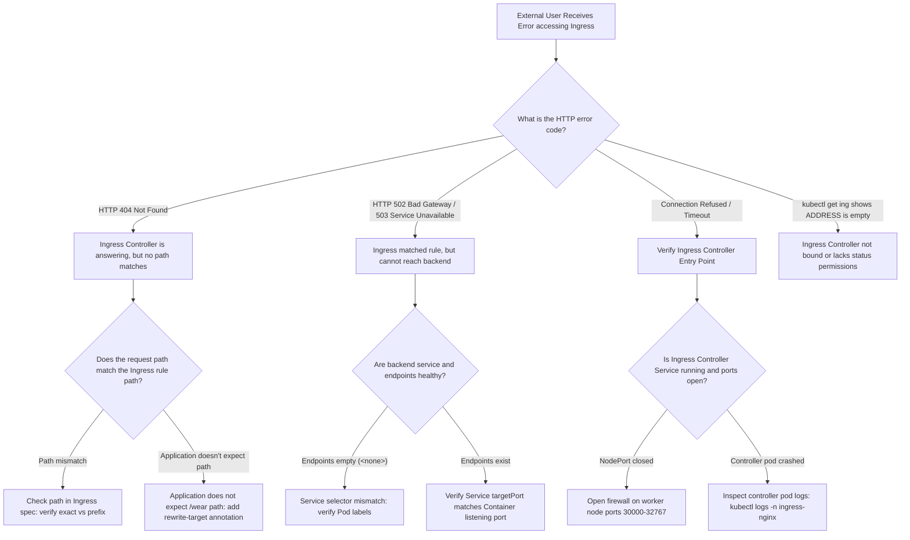

### Triage Sequence Matrix

| Step | Scope | Diagnostic Command | Expected Value | Remediation Action |
| :--- | :--- | :--- | :--- | :--- |
| **1. Controller Pods** | Cluster | `kubectl get pods -A -l app.kubernetes.io/name=ingress-nginx` | `Running 1/1` | If missing, deploy Ingress Controller; Ingress resources do nothing without it. |
| **2. Ingress Address** | Resource | `kubectl get ing <ingress-name>` | Non-empty IP or hostname in `ADDRESS` | If empty, verify Ingress Controller has RBAC to update Ingress status. |
| **3. Backend Endpoints**| Service | `kubectl get endpoints <service-name>` | Valid `<pod-ip>:<port>` list | Fix Service label selector if endpoints report `<none>`. |
| **4. Port Alignment** | Service | `kubectl get svc <service-name> -o yaml` | `port` matches Ingress `backend.service.port.number` | Align Ingress port number with Service `spec.ports[].port`. |
| **5. Controller Logs** | Ingress Daemon | `kubectl logs -n ingress-nginx -l app.kubernetes.io/name=ingress-nginx` | Clean config reloads | Inspect for Lua errors or broken annotation regexes. |
| **6. Secret Type** | Security | `kubectl get secret <secret-name> -o yaml` | `type: kubernetes.io/tls` | Ensure Secret has both `tls.crt` and `tls.key` entries. |

---

## 7. CKA Exam Tips, Gotchas & Traps

> [!WARNING]
> **The Deprecated `v1beta1` Schema Trap**
> Older blog posts and online mock exams frequently use deprecated `extensions/v1beta1` or `networking.k8s.io/v1beta1` schemas:
> - `serviceName: my-service` $\rightarrow$ **INVALID in v1.31+**
> - `servicePort: 80` $\rightarrow$ **INVALID in v1.31+**
> In modern CKA exams, using these deprecated keys will result in schema rejection! Always use:
> ```yaml
> backend:
>   service:
>     name: my-service
>     port:
>       number: 80
> ```
> And always declare `pathType: Prefix` or `pathType: Exact`.

> [!IMPORTANT]
> **The "Empty ADDRESS Field" Gotcha**
> If you deploy an Ingress resource and notice that `kubectl get ingress` shows:
> `NAME          CLASS    HOSTS   ADDRESS   PORTS`
> `test-ing      <none>   *                 80`
> Notice that `ADDRESS` is blank!
> **This means no Ingress Controller is fulfilling the resource.**
> In CKA troubleshooting questions, check whether the Ingress Controller Deployment is scaled down to 0, crashed, or missing completely.

> [!IMPORTANT]
> **Host Header Case-Sensitivity & SNI**
> When testing host-based routing with `curl`:
> If you run `curl http://<node-ip>:<node-port>/wear`, the Ingress Controller receives `Host: <node-ip>` and drops into the `defaultBackend` (returning 404).
> You **MUST** pass the configured hostname:
> `curl -H "Host: wear.myonlinestore.com" http://<node-ip>:<node-port>/wear`.

> [!TIP]
> **Rapid Imperative Ingress Generation in CKA**
> Memorize the `kubectl create ingress` syntax to save time:
> ```bash
> kubectl create ingress test --rule="app.com/api*=api-svc:80" --dry-run=client -o yaml > ing.yaml
> ```
> This creates a syntactically perfect `networking.k8s.io/v1` manifest instantly without typing boilerplate.

---

## 8. Self-Test / Active Recall

<details>
<summary><strong>1. What is the fundamental operational difference between an Ingress Resource and an Ingress Controller?</strong></summary>

An Ingress Resource is a declarative specification of routing rules and TLS settings. An Ingress Controller is the active reverse proxy daemon (e.g. NGINX) that executes in the cluster, watches the Ingress resources, and actually routes the traffic.
</details>

<details>
<summary><strong>2. In the <code>networking.k8s.io/v1</code> Ingress specification, which field under <code>paths[]</code> is mandatory alongside <code>path</code> and <code>backend</code>?</strong></summary>

`pathType` (must be set to `Prefix`, `Exact`, or `ImplementationSpecific`).
</details>

<details>
<summary><strong>3. What happens if incoming traffic reaches an Ingress Controller with a URL path that matches none of the configured rules?</strong></summary>

The Ingress Controller forwards the request to the `defaultBackend` (or returns an HTTP 404 Not Found error if no default backend is configured).
</details>

<details>
<summary><strong>4. How does an Ingress Controller distinguish between two services deployed under the same IP address when using Name-Based Virtual Hosting?</strong></summary>

It inspects the HTTP `Host` header sent by the client browser (e.g., `Host: wear.store.com` vs `Host: watch.store.com`).
</details>

<details>
<summary><strong>5. What Kubernetes Secret type must be used when configuring TLS termination in an Ingress manifest?</strong></summary>

`kubernetes.io/tls` (containing base64-encoded `tls.crt` and `tls.key`).
</details>

<details>
<summary><strong>6. What is the imperative command to create an Ingress named <code>web-ing</code> that routes <code>store.com/cart*</code> to service <code>cart-svc</code> on port 8080?</strong></summary>

`kubectl create ingress web-ing --rule="store.com/cart*=cart-svc:8080"`.
</details>

<details>
<summary><strong>7. Why is a ServiceAccount with ClusterRole permissions required for an Ingress Controller?</strong></summary>

The controller must monitor the Kubernetes API server for updates to `Ingress`, `Service`, `Endpoints`, and `Secret` resources cluster-wide to dynamically reconfigure its routing engine.
</details>

<details>
<summary><strong>8. What service types are typically used to expose an Ingress Controller to external user traffic?</strong></summary>

`NodePort` (for on-prem or bare-metal clusters) or `LoadBalancer` (for cloud provider environments).
</details>

<details>
<summary><strong>9. If an Ingress resource exists and points to a healthy Service, but curl returns HTTP 503, what is the most likely root cause?</strong></summary>

The backend Service has no available Pod endpoints (`Endpoints: <none>`), typically caused by a label selector mismatch or failed readiness probes on the backend pods.
</details>

<details>
<summary><strong>10. How can you test an Ingress host-based rule locally if DNS is not yet pointed to the cluster?</strong></summary>

Using `curl -H "Host: <configured-host>" http://<node-ip>:<node-port>/<path>` or `curl --resolve <host>:<port>:<node-ip>`.
</details>

---

## 9. Official Documentation Bookmarks

| Resource | Documentation Path / Anchor | Purpose |
| :--- | :--- | :--- |
| **Ingress Overview** | `Concepts > Services, Load Balancing, and Networking > Ingress` | Authoritative specification of rules, path types, and backends |
| **Ingress Controllers** | `Concepts > Services, Load Balancing, and Networking > Ingress Controllers` | Reference list of official and third-party controllers |
| **Path Types** | `Concepts > Services, Load Balancing, and Networking > Ingress > Path types` | Exact matching semantics for `Prefix` vs `Exact` |
| **Ingress TLS** | `Concepts > Services, Load Balancing, and Networking > Ingress > TLS` | Configuring TLS Secrets and HTTPS termination |

