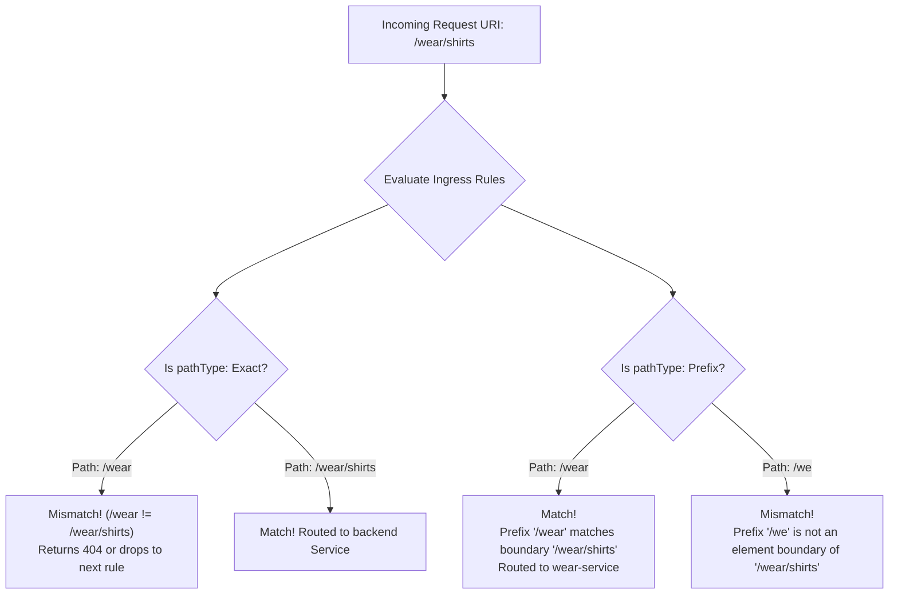

# 15 - Ingress API Evolution, Path Types & Imperative CLI Reference

## Exam Metadata
- **Domain**: Services & Networking (20%) / Ingress Specification Standards
- **Importance**: High (Essential for CKA Speed & Accuracy: `networking.k8s.io/v1` Schema Invariants, `pathType` Matching Semantics, and Imperative `kubectl create ingress`)
- **Target Version**: Kubernetes v1.31 / v1.32
- **Allowed Docs Search Keywords**: `ingress`, `path types`, `kubectl create ingress`, `ingress v1`
- **Source**: `networking/15-article-ingress-raw.md`

---

## 1. Quick-Reference Summary
- **API Version Deprecation History**:
  - `extensions/v1beta1`: Deprecated in v1.14; completely removed in v1.22.
  - `networking.k8s.io/v1beta1`: Deprecated in v1.19; completely removed in v1.22.
  - `networking.k8s.io/v1`: GA since v1.19; the sole mandatory API standard for v1.22 through v1.32+.
- **Structural Schema Invariants in `v1`**:
  - `serviceName` $\rightarrow$ Migrated to `service.name`.
  - `servicePort` $\rightarrow$ Migrated to `service.port.number` (integer) or `service.port.name` (string).
  - `pathType` is a **mandatory** field for every path entry under `rules[].http.paths[]`.
- **The Three `pathType` Matching Semantics**:
  - `Exact`: Matches the exact URL path string with case-sensitivity (`/foo` matches `/foo`, but does NOT match `/foo/` or `/foo/bar`).
  - `Prefix`: Matches URL paths element-by-element split by `/` (`/foo` matches `/foo`, `/foo/`, and `/foo/bar`, but does NOT match `/foobar`).
  - `ImplementationSpecific`: Matching semantics are delegated entirely to the active IngressClass controller.
- **Path Precedence Rule**:
  - When multiple paths match a request, the **longest matching prefix path** takes precedence.
  - If both an `Exact` and a `Prefix` rule match the same string, `Exact` takes precedence.
- **High-Yield Imperative Syntax**:
  - `kubectl create ingress <name> --rule="host/path=service:port"`
  - Wildcard syntax (`path*`) automatically sets `pathType: Prefix`. Omission sets `pathType: Exact`.

---

## 2. Conceptual Overview & Mental Model

### Simple English Explanation
When Ingress was originally introduced into Kubernetes, it lived in an experimental beta API (`v1beta1`). While it worked, the specification had several major flaws:
1. Different Ingress controllers (like NGINX, Traefik, and HAProxy) interpreted path matching differently. A path like `/api` might match `/api/v1` on one cloud provider, but fail on another.
2. The YAML configuration was flat and lacked type safety (e.g., using `serviceName` and `servicePort` side-by-side).

To resolve these ambiguities and ensure uniform behavior across all Kubernetes clusters, the Kubernetes project released the official **`networking.k8s.io/v1`** Ingress API:
- It structured the backend into a clean `service` object with explicit `name` and `port.number`.
- It made **`pathType`** mandatory. Now, you explicitly declare whether you want an **`Exact`** match (e.g., only `/login` and nothing else) or a **`Prefix`** match (e.g., `/wear` should match `/wear`, `/wear/`, and `/wear/shoes`).
- It introduced imperative CLI support: instead of writing 30 lines of YAML from scratch, you can now run a single command like `kubectl create ingress my-ing --rule="store.com/wear*=wear-svc:80"` to instantly create a production-grade Ingress resource.

### Formal Technical Definition
The `networking.k8s.io/v1.Ingress` specification is the canonical Layer 7 HTTP/HTTPS reverse proxy schema in Kubernetes. It enforces deterministic URI dispatching through mandatory RFC-compliant `pathType` matching algorithms (`Exact`, `Prefix`, `ImplementationSpecific`), modularizes backend definitions into `IngressBackend` contracts (`IngressServiceBackend` or `TypedLocalObjectReference`), and enables rapid declarative generation via `kubectl` imperative command flags.

### Architecture Flowchart: `pathType` Matching Decision Tree



---

## 3. Deep-Dive Technical Breakdown

### Side-by-Side Schema Comparison: `v1beta1` vs. `v1`

In modern Kubernetes clusters (v1.22 through v1.32+), applying a manifest using `v1beta1` fails immediately with an API schema validation error.

```yaml
# ❌ DEPRECATED: networking.k8s.io/v1beta1 (DO NOT USE)
apiVersion: networking.k8s.io/v1beta1
kind: Ingress
metadata:
  name: legacy-ingress
spec:
  rules:
  - host: store.com
    http:
      paths:
      - path: /wear
        # pathType is missing or optional
        backend:
          serviceName: wear-service   # Flat field (Removed)
          servicePort: 80             # Flat field (Removed)
```

```yaml
# ✅ MODERN STANDARD: networking.k8s.io/v1 (MANDATORY IN CKA)
apiVersion: networking.k8s.io/v1
kind: Ingress
metadata:
  name: modern-ingress
spec:
  ingressClassName: nginx              # Preferred over legacy annotation
  rules:
  - host: store.com
    http:
      paths:
      - path: /wear
        pathType: Prefix              # MANDATORY in v1
        backend:
          service:
            name: wear-service         # Nested service object
            port:
              number: 80              # Explicit port number
```

---

### Detailed Mechanics of `pathType`

The `pathType` field determines how the Ingress Controller evaluates the incoming HTTP request path against the `path` string declared in the rule:

#### 1. `pathType: Exact`
- Matches the URL path **character-for-character** with case-sensitivity.
- Ignores trailing slashes: `/foo` does **NOT** match `/foo/`.

#### 2. `pathType: Prefix`
- Matches based on a URL path prefix split by the `/` delimiter.
- Matching is performed on an element-by-element basis.
- If the last element in the prefix path is a substring of the first element in the request path, it does **not** match. For example, prefix `/foo` matches `/foo/bar`, but does **NOT** match `/foobar`.

#### Comprehensive Path Matching Truth Table:

| Declared Rule Path | `pathType` | Incoming Request Path | Matches? | Rationale |
| :--- | :--- | :--- | :--- | :--- |
| `/foo` | `Exact` | `/foo` | ✅ **Yes** | Exact character match. |
| `/foo` | `Exact` | `/foo/` | ❌ **No** | Trailing slash differs. |
| `/foo` | `Exact` | `/foo/bar` | ❌ **No** | Additional path segments present. |
| `/foo` | `Prefix` | `/foo` | ✅ **Yes** | Exact match satisfies prefix. |
| `/foo` | `Prefix` | `/foo/` | ✅ **Yes** | Matches prefix element `/foo`. |
| `/foo` | `Prefix` | `/foo/bar` | ✅ **Yes** | Matches element `/foo` followed by `/bar`. |
| `/foo` | `Prefix` | `/foobar` | ❌ **No** | Boundary violation: `/foo` is not an element boundary of `/foobar`. |
| `/` | `Prefix` | `/any/path/here` | ✅ **Yes** | Root `/` prefix matches all paths. |

---

### IngressClass: The Modern Controller Binding

In legacy Kubernetes, an Ingress was bound to a specific controller using the annotation `kubernetes.io/ingress.class: "nginx"`.

In `networking.k8s.io/v1`, this is formalized into a first-class cluster resource:

```yaml
apiVersion: networking.k8s.io/v1
kind: IngressClass
metadata:
  name: nginx
  annotations:
    ingressclass.kubernetes.io/is-default-class: "true"
spec:
  controller: k8s.io/ingress-nginx
```

In the Ingress manifest, you reference the class directly under `spec.ingressClassName`:
```yaml
spec:
  ingressClassName: nginx
```
If an `IngressClass` is marked as the default class via `ingressclass.kubernetes.io/is-default-class: "true"`, any Ingress resource created without an `ingressClassName` automatically binds to it.

---

## 4. Command Translation & Mapping Tables

### Imperative CLI Flags vs. Manifest Schema Mapping

The `kubectl create ingress` command maps directly to `networking.k8s.io/v1` fields:

| Imperative Flag / Argument | Resulting Manifest YAML Field | Example Usage |
| :--- | :--- | :--- |
| `<name>` | `metadata.name` | `kubectl create ingress my-ing` |
| `--rule="host/path=svc:port"` | `spec.rules[].host` + `paths[]` | `--rule="app.com/api=api-svc:80"` (`pathType: Exact`) |
| `--rule="host/path*=svc:port"`| `paths[].pathType: Prefix` | `--rule="app.com/api*=api-svc:80"` (`pathType: Prefix`) |
| `--default-backend="svc:port"`| `spec.defaultBackend.service` | `--default-backend="fallback-svc:8080"` |
| `--class="<class-name>"` | `spec.ingressClassName` | `--class="nginx"` |
| `--annotation="key=val"` | `metadata.annotations` | `--annotation="nginx.ingress.kubernetes.io/rewrite-target=/"` |

---

## 5. High-Yield CLI & Imperative Commands

### Fast Imperative Generation (CKA Time Savers)
```bash
# 1. Create a single-path prefix-based ingress
kubectl create ingress wear-ingress \
  --rule="wear.my-online-store.com/wear*=wear-service:80"

# 2. Create a multi-path ingress across different services
kubectl create ingress store-ingress \
  --rule="my-store.com/wear*=wear-service:80" \
  --rule="my-store.com/watch*=video-service:80"

# 3. Create a multi-host ingress with explicit IngressClass
kubectl create ingress multi-host-ing \
  --class="nginx" \
  --rule="wear.store.com/*=wear-svc:80" \
  --rule="watch.store.com/*=watch-svc:80"

# 4. Create an ingress with both rules and a default backend
kubectl create ingress full-ing \
  --rule="app.com/portal*=portal-svc:80" \
  --default-backend="default-backend-svc:8080"

# 5. Output full YAML template without deploying (dry-run)
kubectl create ingress demo-ingress \
  --rule="api.corp.com/v1*=api-v1-svc:8080" \
  --dry-run=client -o yaml > demo-ingress.yaml
```

### Inspecting and Validating Ingress Objects
```bash
# 1. List Ingress resources with their assigned IngressClasses and Hosts
kubectl get ingress

# 2. View full parsed rules and backends
kubectl describe ingress <ingress-name>

# 3. List IngressClass resources available on the cluster
kubectl get ingressclass

# 4. Check which IngressClass is configured as the cluster default
kubectl get ingressclass -o jsonpath='{range .items[*]}{.metadata.name}{"\t"}{.metadata.annotations.ingressclass\.kubernetes\.io/is-default-class}{"\n"}{end}'
```

---

## 6. Troubleshooting & Diagnostic Runbook

### Diagnostic Decision Tree

```mermaid
flowchart TD
    Start["Ingress Resource Rejected or Failing to Route"] --> Q1{"What is the error?"}

    Q1 -->|"kubectl apply fails: 'unknown field serviceName'"| FixSchema["Update manifest to networking.k8s.io/v1: use backend.service.name and service.port.number"]
    
    Q1 -->|"kubectl apply fails: 'missing required field pathType'"| AddPathType["Add pathType: Prefix (or Exact) under each paths[] entry"]

    Q1 -->|"Traffic to /wear/shoes returns 404, but /wear works"| CheckType["Inspect pathType setting"]
    CheckType --> Q2{"Is pathType set to Exact?"| FixExact["Change pathType to Prefix to allow subpaths: /wear/shoes"]

    Q1 -->|"kubectl get ing shows CLASS is empty"| CheckClass["Specify spec.ingressClassName or set default IngressClass"]
```

### Triage Sequence Matrix

| Step | Failure Condition | Diagnostic Command | Expected Value | Remediation Action |
| :--- | :--- | :--- | :--- | :--- |
| **1. API Rejection** | Schema parse error | `kubectl apply --dry-run=client -f ing.yaml` | `ingress.networking.k8s.io/<name> validated` | Migrate legacy `v1beta1` keys to `v1` nested structure. |
| **2. Missing PathType**| Admission webhook error| `grep -i pathType ing.yaml` | `pathType: Prefix` or `Exact` | Add `pathType` to every item in the `paths` array. |
| **3. Port Spec Type** | Invalid port format | `grep -A 3 port ing.yaml` | `number: 80` or `name: http` | Replace raw integer `port: 80` with `port.number: 80`. |
| **4. Subpath Routing**| 404 on child routes | `kubectl get ing <name> -o yaml \| grep pathType` | `pathType: Prefix` | If `Exact`, subpaths are rejected; change to `Prefix`. |
| **5. Class Binding** | Controller ignores Ingress | `kubectl get ing <name> -o jsonpath='{.spec.ingressClassName}'` | Valid controller class (e.g., `nginx`) | Add `spec.ingressClassName: <class>` matching `kubectl get ingressclass`. |

---

## 7. CKA Exam Tips, Gotchas & Traps

> [!WARNING]
> **The `*` Wildcard Trap in `kubectl create ingress`**
> When generating an Ingress imperatively using `kubectl create ingress`:
> - `--rule="host/path*=service:port"` $\rightarrow$ Sets `path: /path` and `pathType: Prefix`.
> - `--rule="host/path=service:port"` $\rightarrow$ Sets `path: /path` and `pathType: Exact`.
> If an exam question asks for a prefix match (e.g. *"all requests beginning with `/wear`"*), **you MUST include the trailing asterisk (`*`) in the flag**! Omission causes the CLI to emit `pathType: Exact`, which will fail requests to `/wear/catalog` during grading.

> [!IMPORTANT]
> **Port Representation in `v1`: `number` vs. `name`**
> In `networking.k8s.io/v1`, you cannot pass a raw integer to `port`:
> ```yaml
> # ❌ INVALID in v1:
> port: 80
> 
> # ✅ VALID in v1 (using numeric port):
> port:
>   number: 80
> 
> # ✅ VALID in v1 (using named port from Service definition):
> port:
>   name: http-web
> ```

> [!IMPORTANT]
> **The Substring Prefix Trap**
> Remember that `pathType: Prefix` evaluates elements between slashes (`/`), not literal string prefixes.
> A rule with path `/wear` and `pathType: Prefix` will match `/wear/` and `/wear/shoes`, but will **NEVER** match `/wearing` or `/wearable`!

> [!TIP]
> **Quickly Fixing Legacy Manifests in CKA**
> If an exam scenario gives you an old manifest in `extensions/v1beta1` or `networking.k8s.io/v1beta1`:
> 1. Change `apiVersion` to `networking.k8s.io/v1`.
> 2. Add `pathType: Prefix` under `path`.
> 3. Wrap `serviceName` and `servicePort` inside `service: { name: ..., port: { number: ... } }`.
> 4. Test with `kubectl apply -f file.yaml --dry-run=client`.

---

## 8. Self-Test / Active Recall

<details>
<summary><strong>1. What is the current General Availability (GA) API version for Ingress resources in Kubernetes v1.31?</strong></summary>

`networking.k8s.io/v1`.
</details>

<details>
<summary><strong>2. In the <code>v1</code> Ingress schema, what happened to the legacy fields <code>serviceName</code> and <code>servicePort</code>?</strong></summary>

They were migrated into a nested `service` object: `service.name` (string) and `service.port.number` (integer) or `service.port.name` (string).
</details>

<details>
<summary><strong>3. What are the three valid values for the mandatory <code>pathType</code> field?</strong></summary>

`Exact`, `Prefix`, and `ImplementationSpecific`.
</details>

<details>
<summary><strong>4. If an Ingress rule declares <code>path: /api</code> with <code>pathType: Prefix</code>, will it match an incoming request for <code>/apidocs</code>? Why or why not?</strong></summary>

No. `Prefix` matches based on URL path elements split by `/`. `/apidocs` is a different element, so it is not considered a prefix match.
</details>

<details>
<summary><strong>5. What is the imperative <code>kubectl</code> command to create an Ingress named <code>shop-ing</code> with a Prefix path rule for <code>shop.com/items</code> pointing to <code>item-svc</code> on port 80?</strong></summary>

`kubectl create ingress shop-ing --rule="shop.com/items*=item-svc:80"`.
</details>

<details>
<summary><strong>6. What happens if you omit the trailing asterisk in the imperative flag: <code>--rule="shop.com/items=item-svc:80"</code>?</strong></summary>

The command generates an Ingress with `pathType: Exact` instead of `pathType: Prefix`.
</details>

<details>
<summary><strong>7. How do you specify an IngressClass named <code>nginx</code> imperatively using <code>kubectl create ingress</code>?</strong></summary>

Using the `--class` flag: `kubectl create ingress <name> --class="nginx" --rule="..."`.
</details>

<details>
<summary><strong>8. If a request path matches both an <code>Exact</code> rule for <code>/app</code> and a <code>Prefix</code> rule for <code>/app</code>, which rule takes precedence?</strong></summary>

The `Exact` rule takes precedence.
</details>

<details>
<summary><strong>9. How does an Ingress resource specify a default IngressClass when multiple controllers are deployed?</strong></summary>

Via the `spec.ingressClassName` field in the Ingress manifest (or through an IngressClass annotated with `ingressclass.kubernetes.io/is-default-class: "true"`).
</details>

<details>
<summary><strong>10. How can you validate that an Ingress manifest is compliant with the <code>v1</code> schema without applying it to the cluster?</strong></summary>

`kubectl apply -f ingress.yaml --dry-run=client`.
</details>

---

## 9. Official Documentation Bookmarks

| Resource | Documentation Path / Anchor | Purpose |
| :--- | :--- | :--- |
| **Ingress Path Types** | `Concepts > Services, Load Balancing, and Networking > Ingress > Path types` | Authoritative matching rules and truth tables |
| **Ingress API Reference** | `Reference > Kubernetes API > Workload Resources > Ingress v1` | Complete v1 schema field reference |
| **kubectl create ingress** | `Reference > Command line tools (kubectl) > kubectl commands > create ingress` | Full syntax and flags for imperative ingress creation |
| **IngressClass Specification** | `Concepts > Services, Load Balancing, and Networking > Ingress > IngressClass` | Defining and defaulting IngressClass controllers |

