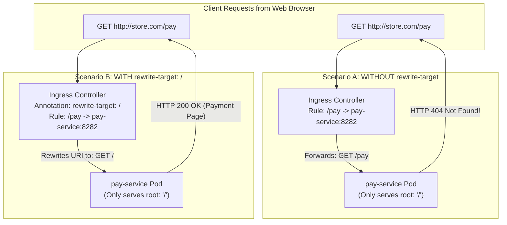
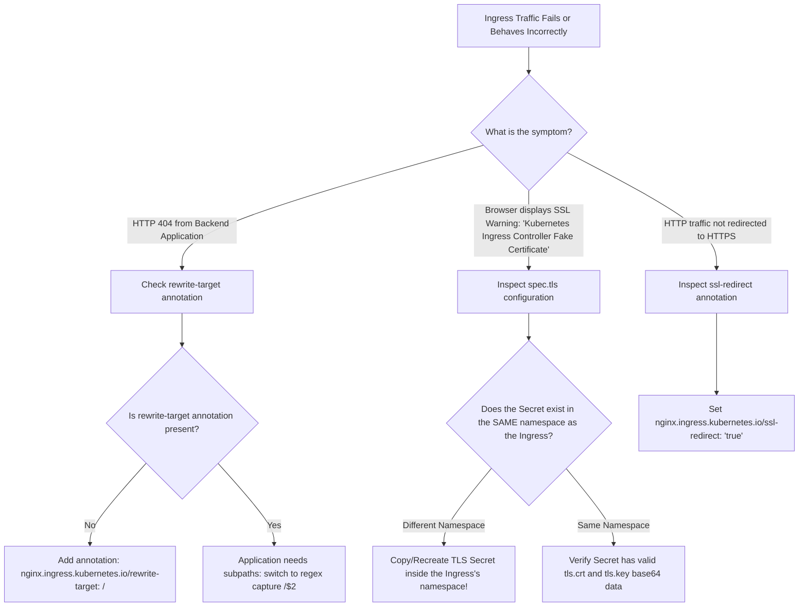

# 16 - Ingress Annotations, URL Rewriting & TLS Termination

## Exam Metadata
- **Domain**: Services & Networking (20%) / Ingress Traffic Engineering
- **Importance**: High (Frequently tested in CKA: Resolving 404 errors via `rewrite-target`, SSL redirect enforcement, and TLS secret integration across namespaces)
- **Target Version**: Kubernetes v1.31 / v1.32
- **Allowed Docs Search Keywords**: `ingress`, `ingress annotations`, `rewrite-target`, `ingress tls`
- **Source**: `networking/16-Ingress-Annotations-and-rewrite-target-raw.md`

---

## 1. Quick-Reference Summary
- **The Rewrite-Target Problem**:
  - By default, Ingress controllers forward the client request URI verbatim to backend Pods (e.g., `GET /watch` is forwarded as `GET /watch`).
  - If the backend application only serves content from the root directory (`/`), it returns an **HTTP 404 Not Found** error.
- **NGINX Rewrite Annotations**:
  - **Static Root Rewrite**:
    `nginx.ingress.kubernetes.io/rewrite-target: /`
    Replaces the matched path with `/`.
  - **Dynamic Regex Subpath Rewrite**:
    Path: `path: /something(/|$)(.*)`
    Annotation: `nginx.ingress.kubernetes.io/rewrite-target: /$2`
    Strips the `/something` prefix while dynamically preserving all trailing subpaths and query strings.
- **SSL / TLS Redirection Annotations**:
  - `nginx.ingress.kubernetes.io/ssl-redirect: "true"`: Automatically issues an HTTP 308 redirect from HTTP (port 80) to HTTPS (port 443).
  - `nginx.ingress.kubernetes.io/ssl-redirect: "false"`: Disables HTTPS redirection (useful in non-TLS test environments).
- **TLS Secret Invariant (Namespace Locality)**:
  - The Secret referenced in `spec.tls[].secretName` **must reside in the exact same namespace as the Ingress resource**. Cross-namespace Secret referencing is forbidden for security isolation.
- **Imperative Creation with Annotations**:
  - `kubectl create ingress <name> -n <ns> --rule="path=service:port" --annotation "key=value"`
  - Example: `kubectl create ingress critical-ingress -n critical-space --rule="/pay=pay-service:8282" --annotation "nginx.ingress.kubernetes.io/rewrite-target=/"`

---

## 2. Conceptual Overview & Mental Model

### Simple English Explanation
When you expose multiple microservices using a single Ingress rule, users access them using clean subpaths like `http://example.com/watch`, `http://example.com/wear`, or `http://example.com/pay`.

However, the software running inside those backend pods was written independently:
- The video streaming app displays its homepage at `http://video-service:8080/`.
- The apparel store app displays its homepage at `http://wear-service:8080/`.
- The payment app processes transactions at `http://pay-service:8282/`.

None of these applications have a folder named `/watch`, `/wear`, or `/pay`. If the Ingress controller forwards the incoming request as-is, the request hits the payment pod as `GET /pay`. The payment pod finds no matching route and returns an **HTTP 404 Not Found** error!

To fix this without rewriting your application code, Kubernetes Ingress supports **Annotations**:
1. An annotation is a metadata key-value pair that configures the underlying reverse proxy (such as NGINX or Traefik).
2. The **`rewrite-target: /`** annotation acts as a search-and-replace rule: it tells the Ingress controller, *"When you receive a request at `/pay`, strip `/pay` off the path and forward the request to the backend pod as `/`."*
3. For applications where subfolders must be kept (e.g. `/api/v1/users` should reach the app as `/v1/users`), regex capture groups are used: `/api(/|$)(.*)` rewrites to `/$2`.
4. Similarly, the **`ssl-redirect: "true"`** annotation forces all insecure HTTP connections to automatically bounce to encrypted HTTPS port 443 using the TLS certificate stored in a Kubernetes Secret.

### Formal Technical Definition
Ingress annotations are non-identifying metadata directives processed by data-plane Ingress Controller control loops to dynamically mutate the proxy's active configuration files (such as `nginx.conf`). The `nginx.ingress.kubernetes.io/rewrite-target` annotation instructs the NGINX Lua/PCRE rewrite engine to perform URI rewriting prior to proxying requests to upstream `EndpointSlice` socket addresses, while `spec.tls` configurations orchestrate Layer 7 TLS handshake termination using in-namespace `kubernetes.io/tls` Secrets.

### Architecture Flowchart: With vs. Without Rewrite-Target



---

## 3. Deep-Dive Technical Breakdown

### The 404 Error Anatomy

When a microservice architecture exposes endpoints through subpaths:

$$\text{Client Browser} \xrightarrow{\text{GET } /watch} \text{Ingress Controller} \xrightarrow{\text{GET } /watch} \text{Target Pod } (\text{Listens only on } /) \implies \mathbf{404 \text{ Not Found}}$$

#### Why This Occurs:
1. The Ingress rule declares:
   ```yaml
   - path: /watch
     pathType: Prefix
     backend:
       service:
         name: watch-service
         port:
           number: 8080
   ```
2. By default, NGINX passes `$uri` verbatim: `proxy_pass http://upstream_watch/watch`.
3. The application running in the container has routes defined for `/index.html`, `/videos`, etc., but has no route handler for `/watch`.
4. The application returns `404 Not Found`.

---

### URL Rewriting Patterns in NGINX Ingress

#### Pattern 1: Static Target Replacement (`rewrite-target: /`)
Used when an application serves solely out of root (`/`) and does not take dynamic subpaths:

```yaml
apiVersion: networking.k8s.io/v1
kind: Ingress
metadata:
  name: critical-ingress
  namespace: critical-space
  annotations:
    nginx.ingress.kubernetes.io/rewrite-target: /
spec:
  rules:
  - http:
      paths:
      - path: /pay
        pathType: Prefix
        backend:
          service:
            name: pay-service
            port:
              number: 8282
```
- **Transformation**: `replace("/pay", "/")`
  - Client queries: `http://<ingress-ip>/pay` $\rightarrow$ Target receives: `http://pay-service:8282/`

---

#### Pattern 2: Regex Capture Groups (`rewrite-target: /$2`)
Used when an application needs to preserve trailing paths, parameters, or subdirectories while stripping the ingress routing prefix:

```yaml
apiVersion: networking.k8s.io/v1
kind: Ingress
metadata:
  name: regex-rewrite-ingress
  namespace: default
  annotations:
    nginx.ingress.kubernetes.io/rewrite-target: /$2
spec:
  rules:
  - host: api.store.com
    http:
      paths:
      - path: /something(/|$)(.*)
        pathType: Prefix
        backend:
          service:
            name: http-svc
            port:
              number: 80
```

#### Detailed Regex Dissection:
- Path expression: `/something(/|$)(.*)`
  - `/something`: The static prefix to match and discard.
  - `(/|$)`: **Capture Group 1** (`$1`). Matches either a trailing slash `/` or the end of the string `$`.
  - `(.*)`: **Capture Group 2** (`$2`). Matches any remaining trailing characters or subpaths.
- Target expression: `/$2`
  - Replaces the entire matched string with `/` followed by whatever was captured in Group 2.

#### Capture Group Transformation Truth Table:

| Client Requested URI | Capture Group 1 (`$1`) | Capture Group 2 (`$2`) | Upstream Forwarded URI |
| :--- | :--- | :--- | :--- |
| `/something` | `$` (End of string) | `""` (Empty) | `/` |
| `/something/` | `/` (Slash) | `""` (Empty) | `/` |
| `/something/catalog` | `/` (Slash) | `catalog` | `/catalog` |
| `/something/v1/users?id=5`| `/` (Slash) | `v1/users?id=5` | `/v1/users?id=5` |

---

### Common High-Yield Ingress Annotations

| Annotation Key | Allowed Values | Technical Function & Behavior |
| :--- | :--- | :--- |
| `nginx.ingress.kubernetes.io/rewrite-target` | `/` or `/$2` | Rewrites URI path before proxying to upstream backend pods. |
| `nginx.ingress.kubernetes.io/ssl-redirect` | `"true"` / `"false"` | Issues HTTP 308 redirect from port 80 to 443 when TLS is configured. |
| `nginx.ingress.kubernetes.io/force-ssl-redirect`| `"true"` / `"false"` | Forces HTTPS redirection even if Ingress terminates behind an external L7 proxy. |
| `nginx.ingress.kubernetes.io/backend-protocol` | `HTTP`, `HTTPS`, `GRPC`, `GRPCS` | Specifies the protocol used between Ingress Controller and backend Pods. |
| `nginx.ingress.kubernetes.io/proxy-body-size` | `10m`, `50m`, `0` (unlimited)| Sets NGINX `client_max_body_size` to prevent `413 Request Entity Too Large`. |
| `nginx.ingress.kubernetes.io/affinity` | `cookie` | Enables sticky sessions using cookies across backend pod replicas. |
| `nginx.ingress.kubernetes.io/session-cookie-name`| String (e.g. `INGRESSCOOKIE`)| Defines the cookie name for session affinity. |

---

### TLS Termination & Secret Locality Invariant

When configuring TLS termination on an Ingress:

```yaml
spec:
  tls:
  - hosts:
    - app.kodekloud.local
    secretName: app-tls
```

#### Secret Structure (`type: kubernetes.io/tls`):
```yaml
apiVersion: v1
kind: Secret
metadata:
  name: app-tls
  namespace: webapp
type: kubernetes.io/tls
data:
  tls.crt: <base64-encoded-certificate>
  tls.key: <base64-encoded-private-key>
```

#### Critical Rules for TLS Termination:
1. **Namespace Isolation**: The Secret `app-tls` **must exist in the same namespace** (`webapp`) as the Ingress resource!
2. **SNI Matching**: The `hosts` entry under `spec.tls` must match the Common Name (CN) or Subject Alternative Name (SAN) inside the certificate.
3. **HTTP-to-HTTPS Redirection**: To ensure users cannot communicate over unencrypted HTTP, pair `spec.tls` with:
   ```yaml
   metadata:
     annotations:
       nginx.ingress.kubernetes.io/ssl-redirect: "true"
   ```

---

## 4. Command Translation & Mapping Tables

### CKA Lab Scenarios to Manifest Translations

| Lab Task Requirement | Imperative CLI / YAML Translation |
| :--- | :--- |
| **"Make application available at `/pay` and rewrite to `/`"** | `kubectl create ingress critical-ingress -n critical-space --rule="/pay=pay-service:8282" --annotation "nginx.ingress.kubernetes.io/rewrite-target=/"` |
| **"Route `app.kodekloud.local/` to `web-app:80` with class `nginx`"** | `kubectl create ingress web-app-ingress -n webapp --class="nginx" --rule="app.kodekloud.local/=web-app:80"` |
| **"Add TLS termination using secret `app-tls`"** | Add `spec.tls: [{hosts: [app.kodekloud.local], secretName: app-tls}]` |
| **"Redirect all HTTP traffic to HTTPS"** | `kubectl annotate ingress web-app-ingress -n webapp "nginx.ingress.kubernetes.io/ssl-redirect=true"` |

---

## 5. High-Yield CLI & Imperative Commands

### Adding and Updating Ingress Annotations
```bash
# 1. Add rewrite-target annotation imperatively to an existing ingress
kubectl annotate ingress my-ingress -n app-space \
  "nginx.ingress.kubernetes.io/rewrite-target=/" --overwrite

# 2. Add SSL redirect annotation imperatively
kubectl annotate ingress web-app-ingress -n webapp \
  "nginx.ingress.kubernetes.io/ssl-redirect=true" --overwrite

# 3. View all annotations currently applied to an Ingress
kubectl get ingress web-app-ingress -n webapp -o jsonpath='{.metadata.annotations}' | jq .
```

### Creating and Verifying TLS Secrets
```bash
# 1. Create a TLS Secret from local certificate and private key files
kubectl create secret tls app-tls -n webapp \
  --cert=/etc/ssl/certs/app.crt \
  --key=/etc/ssl/certs/app.key

# 2. Inspect secret type and keys
kubectl get secret app-tls -n webapp
# Must show type: kubernetes.io/tls with keys tls.crt and tls.key

# 3. Verify TLS configuration field definitions using explain
kubectl explain ingress.spec.tls
```

### Validating Ingress Rewrites and TLS with `curl`
```bash
# 1. Test HTTP to HTTPS redirection (Expects HTTP 308 Permanent Redirect)
curl -I http://app.kodekloud.local:<node-port>/
# Output should contain:
# HTTP/1.1 308 Permanent Redirect
# Location: https://app.kodekloud.local/

# 2. Test HTTPS connection (ignoring self-signed warnings with -k)
curl -k -I https://app.kodekloud.local:<node-port>/

# 3. Test path rewriting from host terminal
curl -v http://<node-ip>:<node-port>/pay
```

---

## 6. Troubleshooting & Diagnostic Runbook

### Diagnostic Decision Tree



### Triage Sequence Matrix

| Step | Failure Condition | Diagnostic Command | Expected Value | Remediation Action |
| :--- | :--- | :--- | :--- | :--- |
| **1. Backend 404** | Missing path handler | `curl -v http://<node>:<port>/<path>` | HTTP 200 | Add `rewrite-target: /` to strip prefix before forwarding. |
| **2. Fake Certificate** | Default cert served | `curl -kv https://<node>:<port>/` | User certificate CN | Verify `spec.tls.secretName` matches in-namespace Secret name. |
| **3. Secret Locality** | Cross-namespace Secret | `kubectl get secret <name> -n <ns>` | Secret found | Recreate Secret in Ingress namespace; cross-namespace mounts fail. |
| **4. Boolean Quotes** | YAML syntax error | `grep ssl-redirect <manifest>` | `"true"` (Quoted) | Wrap boolean values in quotes: `"true"`, not unquoted `true`. |
| **5. Controller Logs** | Lua rewrite failure | `kubectl logs -n <controller-ns> deploy/<controller>` | Clean configuration | Check logs for invalid regex syntax in `rewrite-target`. |

---

## 7. CKA Exam Tips, Gotchas & Traps

> [!WARNING]
> **The Secret Namespace Locality Trap**
> In the CKA exam, a question might tell you:
> *"A TLS Secret named `app-tls` exists in the `default` namespace. Configure Ingress `web-ing` in the `webapp` namespace to use it."*
> **TRAP!** Ingress controllers CANNOT access Secrets across namespace boundaries!
> If you put `secretName: app-tls` in `webapp/web-ing`, the Ingress controller will silently fail to load the secret and will serve its default self-signed **"Kubernetes Ingress Controller Fake Certificate"**.
> **Remediation**: You must export the secret from `default` and recreate it in `webapp`:
> ```bash
> kubectl get secret app-tls -n default -o yaml | sed 's/namespace: default/namespace: webapp/' | kubectl apply -f -
> ```

> [!IMPORTANT]
> **Quotes on Boolean Annotations**
> Kubernetes annotations are strictly `map[string]string`.
> If you write:
> ```yaml
> annotations:
>   nginx.ingress.kubernetes.io/ssl-redirect: true  # ❌ BAD
> ```
> The YAML parser may interpret `true` as a boolean primitive rather than a string, causing schema validation failures.
> Always wrap boolean annotations in quotes:
> ```yaml
> annotations:
>   nginx.ingress.kubernetes.io/ssl-redirect: "true"  # ✅ GOOD
> ```

> [!IMPORTANT]
> **Regex Paths Must Match Regex Target**
> If you use capture groups in `rewrite-target`:
> ```yaml
> nginx.ingress.kubernetes.io/rewrite-target: /$2
> ```
> Your path definition **MUST** include the capture groups:
> `path: /something(/|$)(.*)`.
> If you use `path: /something` with `rewrite-target: /$2`, NGINX will fail to evaluate group `$2`, resulting in broken empty URIs!

> [!TIP]
> **Fast Annotation Injection via CLI**
> Under exam time constraints, never manually open an editor just to add an annotation. Use `kubectl annotate`:
> ```bash
> kubectl annotate ingress critical-ingress -n critical-space "nginx.ingress.kubernetes.io/rewrite-target=/"
> ```

---

## 8. Self-Test / Active Recall

<details>
<summary><strong>1. Why does an application that only serves content from root (<code>/</code>) return an HTTP 404 error when accessed through an Ingress rule with path <code>/wear</code>?</strong></summary>

Because by default, the Ingress controller passes the request path verbatim (`/wear`) to the backend Pod, which has no route handler defined for `/wear`.
</details>

<details>
<summary><strong>2. What specific NGINX annotation replaces the matched Ingress path with <code>/</code> before sending traffic to the backend application?</strong></summary>

`nginx.ingress.kubernetes.io/rewrite-target: /`.
</details>

<details>
<summary><strong>3. If an Ingress rule uses <code>path: /api(/|$)(.*)</code> and annotation <code>rewrite-target: /$2</code>, how will the incoming request <code>/api/v1/orders</code> be forwarded to the backend Pod?</strong></summary>

As `/v1/orders` (Group 2 captures `v1/orders` and appends it to `/`).
</details>

<details>
<summary><strong>4. Can an Ingress in the <code>production</code> namespace reference a TLS Secret located in the <code>security</code> namespace? Why or why not?</strong></summary>

No. Kubernetes enforces namespace boundary isolation for Secrets. The TLS Secret must exist in the exact same namespace as the Ingress resource.
</details>

<details>
<summary><strong>5. Which annotation instructs the NGINX Ingress controller to automatically redirect all unencrypted HTTP traffic to HTTPS?</strong></summary>

`nginx.ingress.kubernetes.io/ssl-redirect: "true"`.
</details>

<details>
<summary><strong>6. What is the imperative command to create an Ingress named <code>pay-ing</code> in namespace <code>finance</code> for path <code>/pay</code> to service <code>pay-svc:8080</code> with a root rewrite annotation?</strong></summary>

`kubectl create ingress pay-ing -n finance --rule="/pay=pay-svc:8080" --annotation "nginx.ingress.kubernetes.io/rewrite-target=/"`.
</details>

<details>
<summary><strong>7. Why must boolean annotation values like <code>"true"</code> or <code>"false"</code> be wrapped in quotation marks in Kubernetes manifests?</strong></summary>

Because metadata annotations are strictly typed as a string-to-string dictionary (`map[string]string`). Unquoted booleans can cause YAML deserialization errors.
</details>

<details>
<summary><strong>8. What symptom indicates that an Ingress controller failed to load the configured TLS Secret?</strong></summary>

The browser or `curl` receives the default internal certificate: "Kubernetes Ingress Controller Fake Certificate", rather than the expected custom certificate.
</details>

<details>
<summary><strong>9. How do you test whether an Ingress SSL redirection rule is functioning properly using <code>curl</code>?</strong></summary>

Run `curl -I http://<host>:<nodeport>/` and verify that the response status code is `HTTP/1.1 308 Permanent Redirect` with a `Location: https://...` header.
</details>

<details>
<summary><strong>10. How can you inspect the schema and fields of <code>spec.tls</code> directly from the command line without opening a browser?</strong></summary>

`kubectl explain ingress.spec.tls`.
</details>

---

## 9. Official Documentation Bookmarks

| Resource | Documentation Path / Anchor | Purpose |
| :--- | :--- | :--- |
| **Ingress Annotations** | `https://kubernetes.github.io/ingress-nginx/user-guide/nginx-configuration/annotations/` | Complete reference for all supported NGINX Ingress annotations |
| **NGINX Rewrite Target** | `https://kubernetes.github.io/ingress-nginx/examples/rewrite/` | Official examples for static and regex URL rewriting |
| **Ingress TLS Configuration** | `Concepts > Services, Load Balancing, and Networking > Ingress > TLS` | Configuring TLS termination and Secret requirements |
| **kubectl annotate Reference** | `Reference > Command line tools (kubectl) > kubectl commands > annotate` | Syntax for adding and updating annotations on live objects |

