# 17 - Gateway API: Architecture, Role-Oriented Design & Traffic Management

## Exam Metadata
- **Domain**: Services & Networking (20%) / Modern Kubernetes Ingress & Service Networking
- **Importance**: High (Next-Generation Ingress Standard: GatewayClass, Gateway, HTTPRoute, Multi-Tenancy, Cross-Namespace Attachment, and Weighted Traffic Splitting)
- **Target Version**: Kubernetes v1.31 / v1.32 (Gateway API v1 GA)
- **Allowed Docs Search Keywords**: `gateway api`, `gateway`, `httproute`, `gatewayclass`
- **Source**: `networking/17-gateway-api-raw.md`

---

## 1. Quick-Reference Summary
- **The Core Motivation (Ingress Limitations)**:
  - **Lack of Multi-Tenancy**: Ingress is a single monolithic resource; multiple teams managing separate services must coordinate on the same file, causing configuration collisions.
  - **Vendor Annotation Sprawl**: Advanced capabilities (traffic splitting, rewrites, headers, CORS, SSL redirect) relied on unvalidated, proprietary annotations (`nginx.ingress...` vs `traefik.ingress...`).
  - **Protocol Restrictions**: Ingress is strictly Layer 7 HTTP/HTTPS; it cannot natively route TCP, UDP, or gRPC.
- **The Three Personas & Role-Oriented Design**:
  1. **Infrastructure Provider**: Defines cluster-scoped `GatewayClass` (e.g., NGINX Fabric, Envoy, Contour).
  2. **Cluster Operator**: Provisions namespace-scoped `Gateway` objects (listeners, ports, protocols, TLS secrets, and `allowedRoutes` policies).
  3. **Application Developer**: Creates protocol-specific route objects (`HTTPRoute`, `GRPCRoute`, `TCPRoute`, `UDPRoute`, `TLSRoute`) attached to Gateways via `parentRefs`.
- **Supported Protocols**:
  - `HTTP`, `HTTPS`, `TLS`, `TCP`, `UDP`, and `gRPC`.
  - **Protocol NOT Supported**: `ICMP` (ping is not supported).
- **Core API Resources (`gateway.networking.k8s.io/v1`)**:
  - `GatewayClass`: Template defining the underlying controller implementation (`spec.controllerName`).
  - `Gateway`: Point of ingress defining entrypoint listeners (`spec.gatewayClassName`, `spec.listeners[]`).
  - `HTTPRoute`: L7 routing rules mapping HTTP requests to backend Services (`spec.parentRefs[]`, `spec.rules[]`).
- **Cross-Namespace Attachment (`allowedRoutes`)**:
  - `from: Same` (Default): Only routes in the same namespace as the Gateway can attach.
  - `from: All`: Routes from any namespace in the cluster can attach to the listener.
  - `from: Selector`: Only routes in namespaces matching a `labelSelector` can attach.
- **Native Traffic Management (Zero Annotations Needed)**:
  - **Traffic Splitting**: Direct `weight` specification under `backendRefs` (e.g. `weight: 80` vs `weight: 20` for Canary releases).
  - **Header Modification**: Native filters (`responseHeaderModifier`, `requestHeaderModifier`).
  - **Path Rewriting & Redirects**: Native filters (`urlRewrite`, `requestRedirect`).

---

## 2. Conceptual Overview & Mental Model

### Simple English Explanation
In standard Kubernetes, Ingress allowed you to route web traffic to services. However, as organizations grew, Ingress hit three major limitations:
1. **No clean way to share among multiple teams**: An Ingress resource is one big file. If Team A owns the frontend store and Team B owns the video streaming service, both teams must edit the exact same Ingress file. One team's syntax mistake can take down the entire company's website.
2. **Annotation Mess**: Ingress only supported basic domain and path matching. If you wanted to do canary deployments (send 20% of traffic to version 2), add security headers, or redirect HTTP to HTTPS, you had to use custom annotations. Every controller (NGINX, Traefik, HAProxy) used different annotations, and Kubernetes could not validate them.
3. **HTTP Only**: Ingress could not handle raw TCP databases, UDP game servers, or modern gRPC microservices.

The **Gateway API** is the official next-generation standard that replaces Ingress by dividing responsibilities cleanly according to organizational roles:
- **Infrastructure Provider**: Deploys the controller and creates a `GatewayClass` (specifying whether the cluster uses NGINX, Envoy, or cloud load balancers).
- **Cluster Operator**: Creates the `Gateway`. This defines the public IP, opens ports (like 80 and 443), attaches TLS certificates, and sets rules (`allowedRoutes`) deciding which namespaces can use this Gateway.
- **Application Developers**: Each team creates their own independent `HTTPRoute` in their own private namespace. Team A creates their route in namespace `app-a` and points it to the Gateway using `parentRefs`. Team B creates their route in namespace `app-b`. Neither team can break the other team's configuration.

Furthermore, features like 80/20 canary traffic splitting, path rewrites, and header modifications are native fields in the YAML specification—no annotations required!

### Formal Technical Definition
The Kubernetes Gateway API (`gateway.networking.k8s.io/v1`) is an open-source, role-oriented, expressive service networking standard developed by the SIG-Network community. It decomposes monolithic Layer 7 reverse proxy configuration into decoupled, hierarchical resources (`GatewayClass`, `Gateway`, `HTTPRoute`, `GRPCRoute`, `TCPRoute`, `UDPRoute`, `TLSRoute`) aligned with administrative personas. The architecture supports cross-namespace multi-tenancy, declarative policy attachment, native weighted traffic splitting, and portable Layer 4 through Layer 7 routing without vendor-specific annotations.

### Architecture Flowchart: The Role-Oriented Gateway API Model

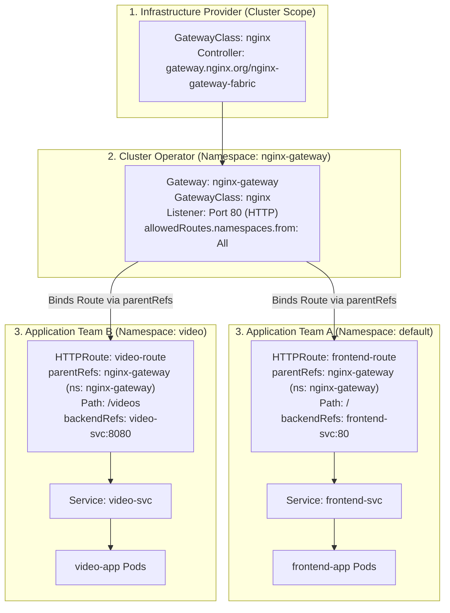

---

## 3. Deep-Dive Technical Breakdown

### The Three Limitations of Traditional Ingress

#### 1. Lack of Multi-Tenancy & Team Isolation

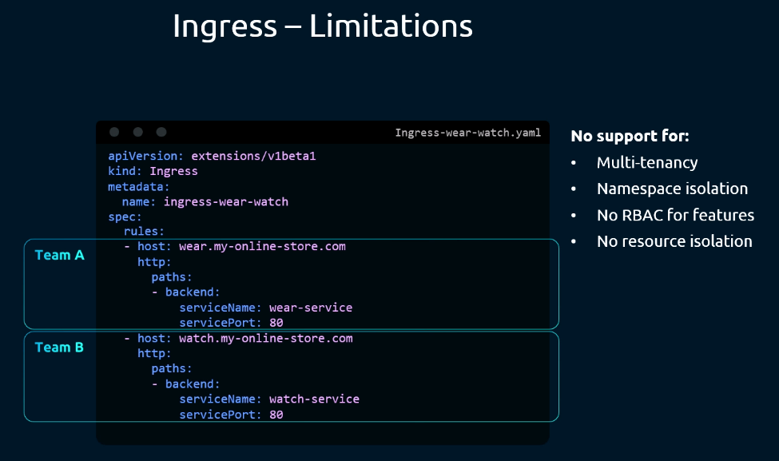

In traditional Ingress, if Team A manages `web-service` and Team B manages `video-service`:
- The routes exist inside a single `Ingress` object.
- Kubernetes RBAC cannot grant Team A permission to edit `/web` without also granting them permission to accidentally overwrite Team B's `/video` route.
- There is no native delegation across namespaces.

---

#### 2. Protocol & Feature Limitations

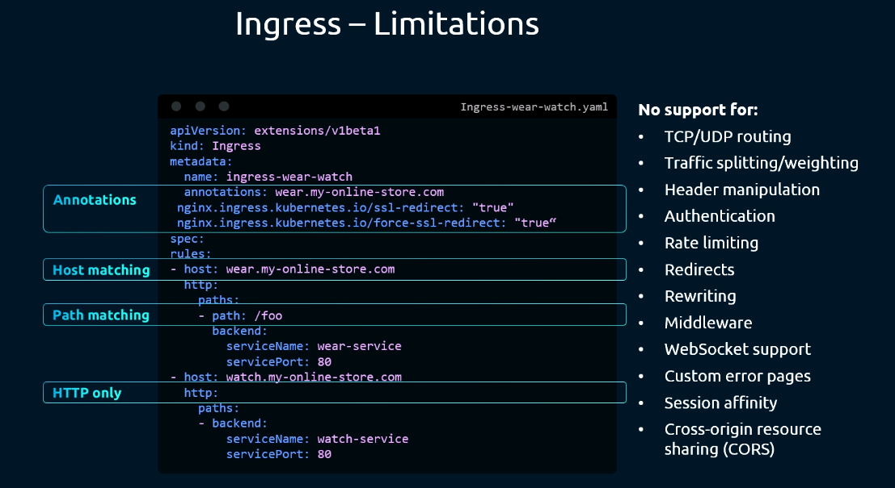

- Ingress is strictly Layer 7 HTTP/HTTPS.
- It cannot route raw Layer 4 `TCP` (e.g. database connections to MySQL/Postgres), `UDP` (e.g. DNS, VoIP, gaming), or `gRPC` streams natively.
- Features like traffic splitting, header manipulation, rate limiting, and authentication have no standardized representation in the Ingress specification.

---

#### 3. Vendor Annotation Fragmentation

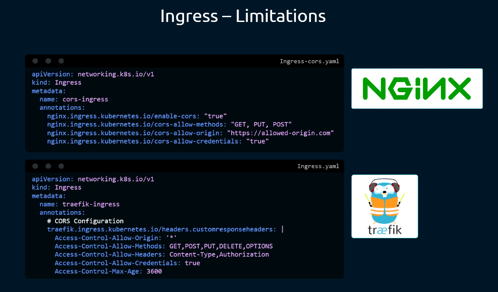

To support advanced routing, controllers relied on annotations:
- NGINX: `nginx.ingress.kubernetes.io/rewrite-target: /`
- Traefik: `traefik.ingress.kubernetes.io/router.middlewares: ...`
- HAProxy: `haproxy.org/path-rewrite: ...`
- **The Problem**: Kubernetes control plane does not validate annotations (they are raw string maps). If an annotation has a typo, `kubectl apply` succeeds, but the routing silently breaks. Switching ingress controllers requires rewriting all annotations across every manifest!

---

### The Gateway API Resource Model

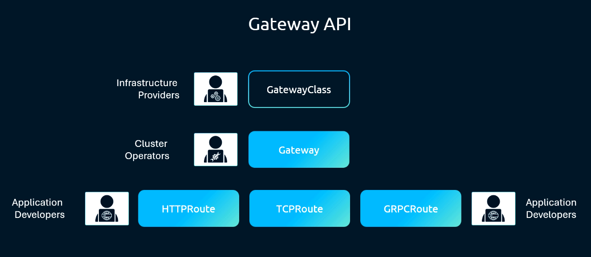

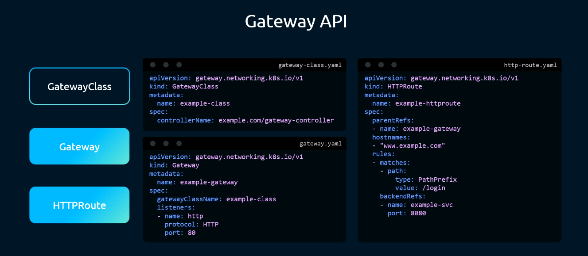

The Gateway API breaks down monolithic routing into three distinct resource layers:

| Resource Kind | API Group / Version | Scope | Persona Owner | Primary Function |
| :--- | :--- | :--- | :--- | :--- |
| **`GatewayClass`** | `gateway.networking.k8s.io/v1` | Cluster | Infrastructure Provider | Defines the controller implementation (e.g. NGINX Gateway Fabric, Envoy Gateway, Istio). |
| **`Gateway`** | `gateway.networking.k8s.io/v1` | Namespace | Cluster Operator | Defines point of ingress: network listeners, ports, protocols, TLS secrets, and allowed route policies. |
| **`HTTPRoute`** | `gateway.networking.k8s.io/v1` | Namespace | Application Developer | Defines protocol routing rules: path matches, header filters, traffic splits, and backend services. |

---

### Route Types & Protocol Support Matrix

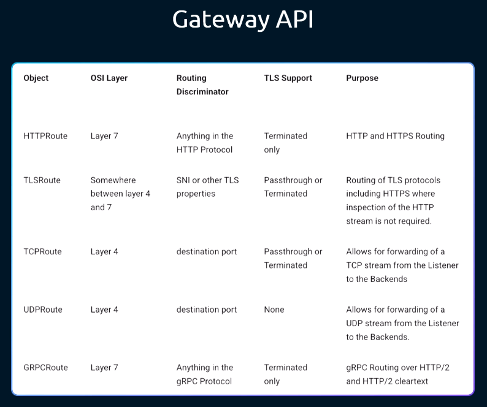

| Route Resource | Layer | Supported Protocols | Key Capabilities |
| :--- | :--- | :--- | :--- |
| **`HTTPRoute`** | Layer 7 | `HTTP`, `HTTPS` | Path/method matching, header filtering, query param routing, weighted traffic splitting, URL rewrites. |
| **`GRPCRoute`** | Layer 7 | `gRPC` | Native gRPC service/method matching, gRPC header routing, cross-service RPC splitting. |
| **`TLSRoute`** | Layer 4/7 | `TLS` (without decrypting)| SNI-based passthrough routing without terminating TLS at the gateway. |
| **`TCPRoute`** | Layer 4 | `TCP` | Port-based raw byte stream forwarding to databases and custom TCP workloads. |
| **`UDPRoute`** | Layer 4 | `UDP` | Media streaming, DNS forwarders, and gaming server packet delivery. |

> [!IMPORTANT]
> **Protocol Support**: Gateway API supports `HTTP`, `HTTPS`, `TLS`, `TCP`, `UDP`, and `gRPC`. It does **NOT** support `ICMP` (ping requests cannot be routed through a Gateway).

---

### Side-by-Side Architectural Comparisons: Ingress vs. Gateway API

#### Comparison 1: Structured TLS Termination vs. Unchecked Annotations

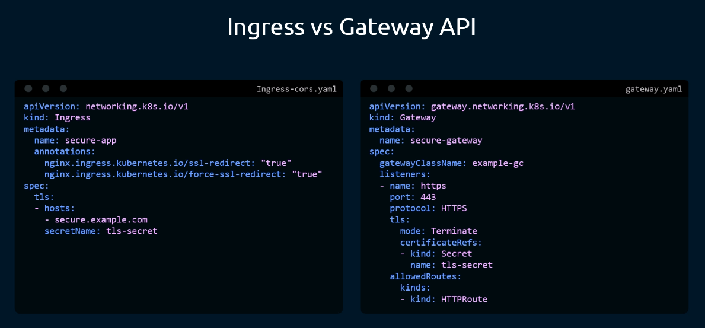

- **Ingress**: TLS settings often require mixing `spec.tls` with controller annotations like `nginx.ingress.kubernetes.io/ssl-redirect: "true"`.
- **Gateway API**: TLS is explicitly declared on the Gateway listener with structured fields:
  ```yaml
  listeners:
  - name: https
    protocol: HTTPS
    port: 443
    tls:
      mode: Terminate
      certificateRefs:
      - name: app-tls-secret
    allowedRoutes:
      namespaces:
        from: All
  ```

---

#### Comparison 2: Native Canary Traffic Splitting (80/20 Weights)

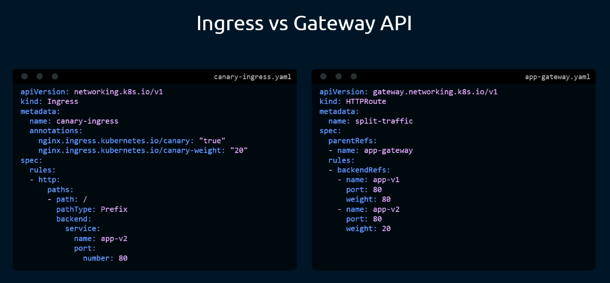

- **Ingress (NGINX Canary Hack)**:
  Requires creating **two separate Ingress resources**. The secondary ingress contains magic annotations:
  `nginx.ingress.kubernetes.io/canary: "true"`
  `nginx.ingress.kubernetes.io/canary-weight: "20"`
  This is invisible from the primary ingress and breaks completely on non-NGINX controllers.
- **Gateway API (Native Traffic Splitting)**:
  Both versions are explicitly declared in a single `HTTPRoute` rule using `weight`:
  ```yaml
  rules:
  - backendRefs:
    - name: app-v1-service
      port: 80
      weight: 80
    - name: app-v2-service
      port: 80
      weight: 20
  ```
  This is fully validated by the Kubernetes API and functions identically across all Gateway API controllers!

---

#### Comparison 3: Response Header Modifiers (CORS & Custom Headers)

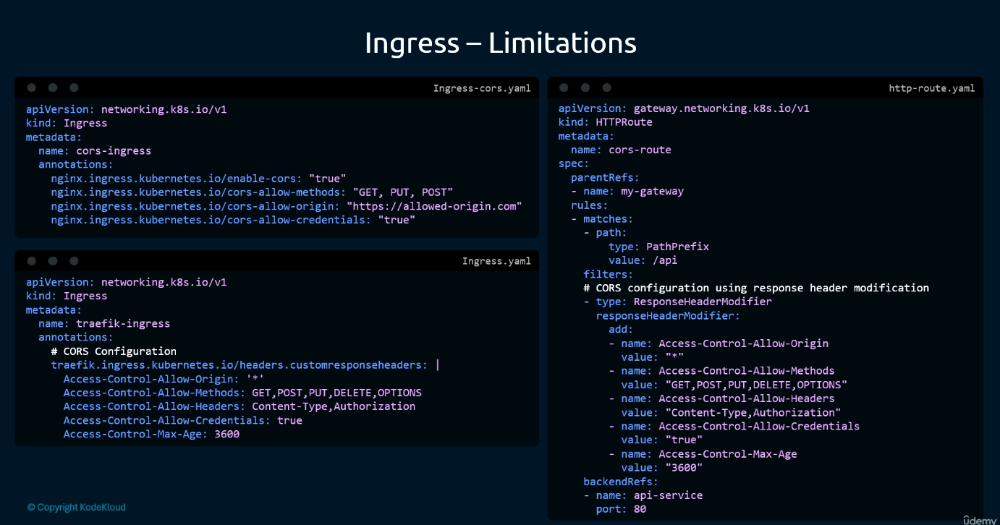

- **Ingress**: Relied on complex configuration snippets or controller-specific CORS annotations.
- **Gateway API**: Uses structured native filters inside the `HTTPRoute` rule:
  ```yaml
  rules:
  - filters:
    - type: ResponseHeaderModifier
      responseHeaderModifier:
        add:
        - name: Access-Control-Allow-Origin
          value: "https://myonlinestore.com"
        - name: X-Service-Version
          value: "v2.1"
    backendRefs:
    - name: frontend-svc
      port: 80
  ```

---

### Cross-Namespace Binding Mechanics: `allowedRoutes` vs. `parentRefs`

The key to Gateway API multi-tenancy is the bidirectional handshake between the `Gateway` and the `HTTPRoute`:

```mermaid
sequenceDiagram
    autonumber
    participant Op as Cluster Operator (ns: nginx-gateway)
    participant GW as Gateway (nginx-gateway)
    participant Dev as App Developer (ns: default)
    participant HR as HTTPRoute (frontend-route)
    participant Ctrl as Gateway Controller

    Op->>GW: 1. Deploy Gateway with allowedRoutes.namespaces.from: All
    Dev->>HR: 2. Deploy HTTPRoute with parentRefs: name=nginx-gateway, namespace=nginx-gateway
    Ctrl->>GW: 3. Verify listener allows routes from namespace 'default' (PASS)
    Ctrl->>HR: 4. Bind route to listener; update Status: Accepted=True, Attached=True
```

#### The `allowedRoutes` Policy Options:
```yaml
allowedRoutes:
  namespaces:
    from: All        # All namespaces in cluster can attach
    # from: Same      # (Default) Only routes in gateway's namespace can attach
    # from: Selector  # Only namespaces matching selector can attach:
    #   selector:
    #     matchLabels:
    #       team: frontend
```

#### The `parentRefs` Attachment:
In the `HTTPRoute`, you specify the Gateway name and its namespace:
```yaml
spec:
  parentRefs:
  - name: nginx-gateway
    namespace: nginx-gateway  # Mandatory if Gateway is in a different namespace!
```

---

## 4. Command Translation & Mapping Tables

### Ingress vs. Gateway API Architecture Mapping

| Capability | Ingress Specification | Gateway API Specification |
| :--- | :--- | :--- |
| **API Version** | `networking.k8s.io/v1` | `gateway.networking.k8s.io/v1` |
| **Cluster Template** | `IngressClass` | `GatewayClass` |
| **Listener Entrypoint** | Ingress Controller Service (Implicit) | `Gateway` Resource (Explicit) |
| **Routing Rules** | `Ingress` (`spec.rules[]`) | `HTTPRoute`, `GRPCRoute`, `TCPRoute` |
| **Multi-Tenancy** | Monolithic (1 resource per domain) | Decoupled (Cross-namespace `parentRefs`) |
| **Traffic Splitting** | Proprietary annotations (e.g. NGINX canary)| Native `weight` under `backendRefs` |
| **Header Manipulation** | Config snippets / custom annotations | Native `filters[]` (`ResponseHeaderModifier`) |
| **L4 TCP/UDP Routing** | ❌ Not supported | ✅ Native `TCPRoute` & `UDPRoute` |
| **ICMP Routing** | ❌ Not supported | ❌ Not supported |

---

## 5. High-Yield CLI & Imperative Commands

### Installing and Verifying Gateway API Controller (NGINX Fabric Example)
```bash
# 1. Install Gateway API Standard CRDs (GatewayClass, Gateway, HTTPRoute)
kubectl kustomize "https://github.com/nginx/nginx-gateway-fabric/config/crd/gateway-api/standard?ref=v1.5.1" | kubectl apply -f -

# 2. Deploy NGINX Gateway Fabric CRDs and Controller
kubectl apply -f https://raw.githubusercontent.com/nginx/nginx-gateway-fabric/v1.6.1/deploy/crds.yaml
kubectl apply -f https://raw.githubusercontent.com/nginx/nginx-gateway-fabric/v1.6.1/deploy/nodeport/deploy.yaml

# 3. Verify controller deployment and pod status
kubectl get pods -n nginx-gateway

# 4. Patch Gateway NodePort Service to bind custom external ports
kubectl patch svc nginx-gateway -n nginx-gateway --type='json' -p='[
  {"op": "replace", "path": "/spec/ports/0/nodePort", "value": 30080},
  {"op": "replace", "path": "/spec/ports/1/nodePort", "value": 30081}
]'
```

### Inspecting Gateway API Resources
```bash
# 1. View all GatewayClasses in the cluster
kubectl get gatewayclasses

# 2. View all Gateways across all namespaces
kubectl get gateways -A

# 3. View all HTTPRoutes across all namespaces
kubectl get httproutes -A

# 4. Check detailed status and conditions of a Gateway
kubectl describe gateway nginx-gateway -n nginx-gateway
# Look for: Status: Conditions: Type: Programmed, Status: True

# 5. Check if an HTTPRoute successfully attached to its parent Gateway
kubectl describe httproute frontend-route -n default
# Look for: Status: Parents: Conditions: Type: Accepted, Status: True
```

### Deploying Gateway and Cross-Namespace HTTPRoute Manifests

#### Step 1: Create the Gateway (Cluster Operator in `nginx-gateway` ns)
```yaml
# nginx-gateway.yaml
apiVersion: gateway.networking.k8s.io/v1
kind: Gateway
metadata:
  name: nginx-gateway
  namespace: nginx-gateway
spec:
  gatewayClassName: nginx
  listeners:
  - name: http
    protocol: HTTP
    port: 80
    allowedRoutes:
      namespaces:
        from: All
```
```bash
kubectl apply -f nginx-gateway.yaml
```

#### Step 2: Create the HTTPRoute (App Developer in `default` ns)
```yaml
# frontend-route.yaml
apiVersion: gateway.networking.k8s.io/v1
kind: HTTPRoute
metadata:
  name: frontend-route
  namespace: default
spec:
  parentRefs:
  - name: nginx-gateway
    namespace: nginx-gateway  # Target Gateway namespace
  rules:
  - matches:
    - path:
        type: PathPrefix
        value: /
    backendRefs:
    - name: frontend-svc
      port: 80
```
```bash
kubectl apply -f frontend-route.yaml
```

---

## 6. Troubleshooting & Diagnostic Runbook

### Diagnostic Decision Tree

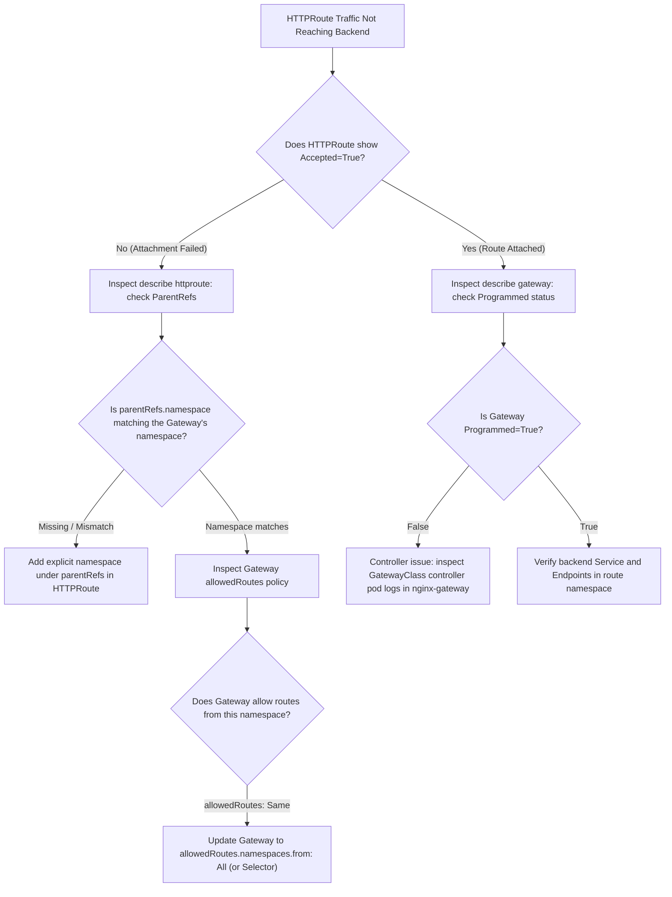

### Triage Sequence Matrix

| Step | Failure Condition | Diagnostic Command | Expected Healthy Output | Remediation Action |
| :--- | :--- | :--- | :--- | :--- |
| **1. Gateway Class** | Missing controller | `kubectl get gatewayclass` | Status `Accepted: True` | Ensure controller deployment exists matching `spec.controllerName`. |
| **2. Gateway Listener**| Port conflict / unprogrammed| `kubectl describe gateway <gw>` | `Conditions: Programmed: True` | Fix duplicate listener names, invalid TLS secrets, or conflicting ports. |
| **3. Route Binding** | Route rejected | `kubectl describe httproute <route>` | `Conditions: Accepted: True` | Check `allowedRoutes` on Gateway and `parentRefs.namespace` on Route. |
| **4. Parent Namespace**| Route detached | `grep -A 2 parentRefs route.yaml` | Contains `namespace: <gw-ns>` | Add `namespace` under `parentRefs` when Gateway is in a different namespace. |
| **5. Backend Endpoints**| 503 Service Unavailable | `kubectl get endpoints <svc>` | Valid `<pod-ip>:<port>` list | Fix backend Service selector; verify application pods are running. |
| **6. Traffic Split** | 100% traffic to one app | `grep -A 5 backendRefs route.yaml` | `weight: 80` and `weight: 20` | Check `backendRefs` weights; verify both target services are active. |

---

## 7. CKA Exam Tips, Gotchas & Traps

> [!WARNING]
> **The `parentRefs.namespace` Omission Trap**
> In the CKA exam, the `Gateway` is almost always deployed in a dedicated namespace (e.g., `nginx-gateway` or `gateway-system`), while your application `HTTPRoute` lives in `default` or an application namespace.
> If you write:
> ```yaml
> spec:
>   parentRefs:
>   - name: nginx-gateway   # ❌ TRAP!
> ```
> The route will default to searching for a Gateway named `nginx-gateway` in the **current namespace**, fail to find it, and silently refuse to attach!
> **You MUST specify the namespace**:
> ```yaml
> spec:
>   parentRefs:
>   - name: nginx-gateway
>     namespace: nginx-gateway  # ✅ CORRECT
> ```

> [!IMPORTANT]
> **The `allowedRoutes` Lockdown Gotcha**
> If you create a `Gateway` and omit the `allowedRoutes` section under a listener, Kubernetes defaults to:
> `allowedRoutes.namespaces.from: Same`.
> This means **ONLY routes in the Gateway's own namespace can attach**. Any `HTTPRoute` created by application teams in other namespaces will be rejected!
> For cross-namespace setups, always configure:
> ```yaml
> allowedRoutes:
>   namespaces:
>     from: All
> ```

> [!IMPORTANT]
> **ICMP is NOT Supported in Gateway API**
> If an exam or lab prompt asks: *"Which of the following protocols is NOT supported by the Kubernetes Gateway API?"*
> The answer is **ICMP**. Gateway API routes Layer 4 transport streams (TCP/UDP) and Layer 7 application protocols (HTTP/HTTPS/TLS/gRPC), but does not route network-layer ICMP ping requests.

> [!TIP]
> **Checking Gateway Programming Status**
> Under exam time pressure, run:
> ```bash
> kubectl get gateway -A
> ```
> Check the `PROGRAMMED` column. If it says `True`, the underlying proxy engine has accepted and compiled the routing configuration. If it says `False`, run `kubectl describe gateway <name> -n <ns>` to see the exact validation error.

---

## 8. Self-Test / Active Recall

<details>
<summary><strong>1. What are the three organizational personas defined by the Kubernetes Gateway API, and which resource does each manage?</strong></summary>

1. Infrastructure Provider: manages `GatewayClass` (cluster-scoped).
2. Cluster Operator: manages `Gateway` (namespace-scoped).
3. Application Developer: manages Route resources (e.g. `HTTPRoute`, `GRPCRoute`, `TCPRoute`).
</details>

<details>
<summary><strong>2. Why does traditional Ingress struggle in multi-tenant environments compared to Gateway API?</strong></summary>

Traditional Ingress is a single monolithic resource; multiple teams sharing the same ingress must coordinate on a single file, creating configuration collisions and preventing granular RBAC delegation across namespaces.
</details>

<details>
<summary><strong>3. Which protocol is NOT supported by the Kubernetes Gateway API: HTTP, TCP, ICMP, or UDP?</strong></summary>

`ICMP` (ping). Gateway API supports HTTP, HTTPS, TCP, UDP, TLS, and gRPC.
</details>

<details>
<summary><strong>4. What is the difference between a <code>GatewayClass</code> and a <code>Gateway</code>?</strong></summary>

A `GatewayClass` is a cluster-wide template defining the controller implementation (e.g. NGINX Gateway Fabric), whereas a `Gateway` is a concrete instance of that class defining entrypoint listeners, ports, and allowed routes.
</details>

<details>
<summary><strong>5. What does the <code>allowedRoutes.namespaces.from</code> field in a Gateway listener control?</strong></summary>

It defines which namespaces' Route resources (e.g. `HTTPRoute`) are permitted to attach to that listener (`All`, `Same`, or `Selector`).
</details>

<details>
<summary><strong>6. If an HTTPRoute is in the <code>default</code> namespace and the Gateway is in the <code>nginx-gateway</code> namespace, what must be included under <code>spec.parentRefs</code>?</strong></summary>

Both `name: nginx-gateway` and `namespace: nginx-gateway`.
</details>

<details>
<summary><strong>7. How is Canary traffic splitting (e.g., 80% to v1, 20% to v2) configured natively in an HTTPRoute?</strong></summary>

By specifying `weight: 80` and `weight: 20` directly on the respective services under `spec.rules[].backendRefs[]`.
</details>

<details>
<summary><strong>8. What native HTTPRoute filter is used to inject custom response headers (such as CORS headers) without annotations?</strong></summary>

The `ResponseHeaderModifier` filter (`spec.rules[].filters[].responseHeaderModifier`).
</details>

<details>
<summary><strong>9. What API group and version governs the Gateway API v1 core resources?</strong></summary>

`gateway.networking.k8s.io/v1`.
</details>

<details>
<summary><strong>10. What Gateway status condition indicates that the underlying controller has successfully reconciled the configuration?</strong></summary>

`Programmed: True` (and `Accepted: True`).
</details>

---

## 9. Official Documentation Bookmarks

| Resource | Documentation Path / Anchor | Purpose |
| :--- | :--- | :--- |
| **Gateway API Overview** | `https://gateway-api.sigs.k8s.io/` | Official Kubernetes SIG-Network Gateway API documentation |
| **Gateway Resource Spec** | `https://gateway-api.sigs.k8s.io/api-types/gateway/` | Listener configurations, TLS termination, and `allowedRoutes` |
| **HTTPRoute Resource Spec** | `https://gateway-api.sigs.k8s.io/api-types/httproute/` | Routing rules, traffic splitting (`weight`), and header filters |
| **NGINX Gateway Fabric** | `https://docs.nginx.com/nginx-gateway-fabric/` | Reference implementation guide and deployment architecture |

