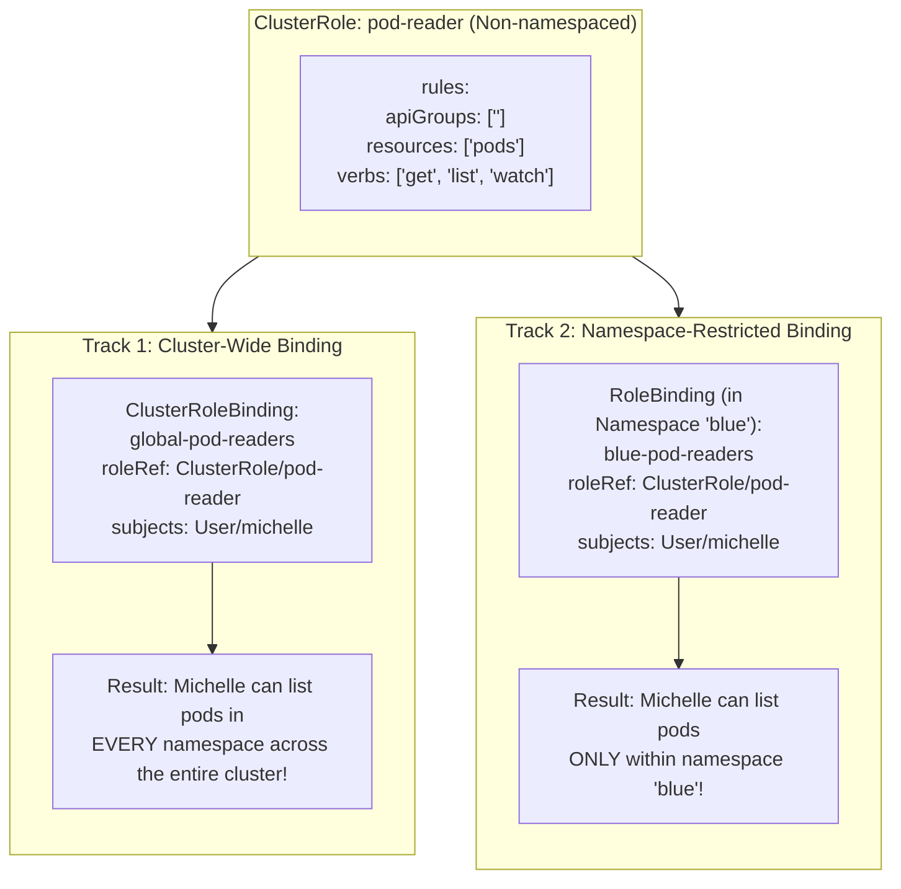
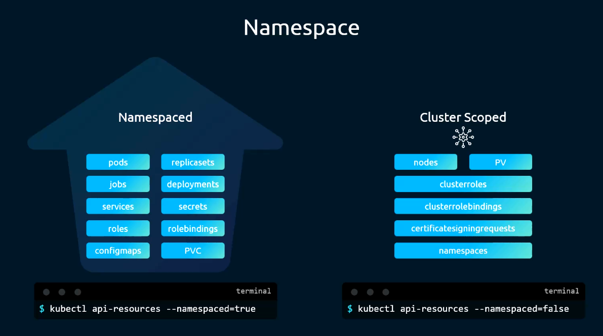
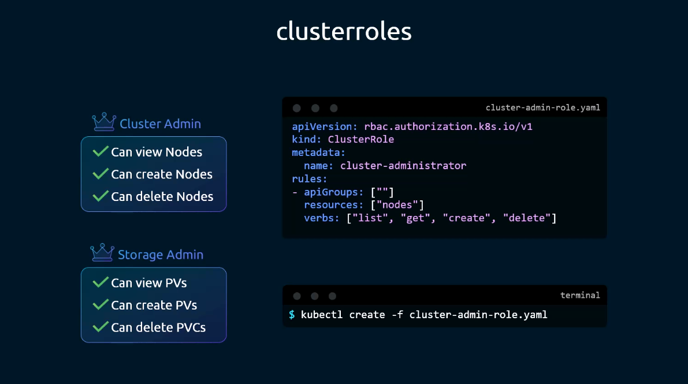
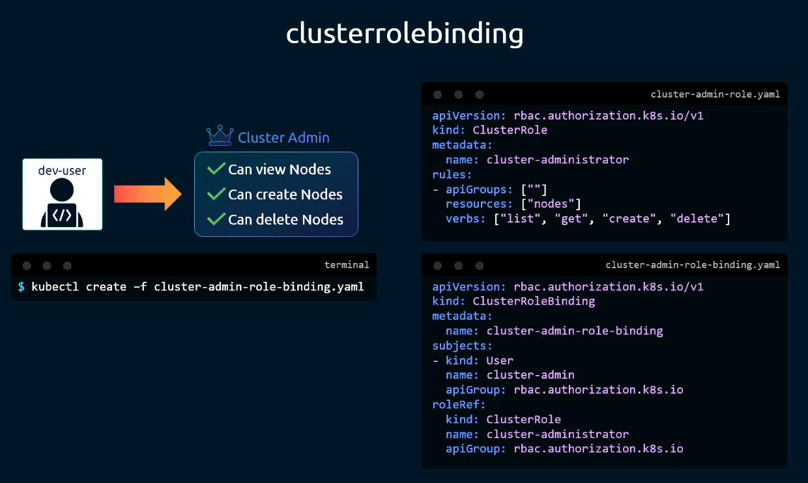
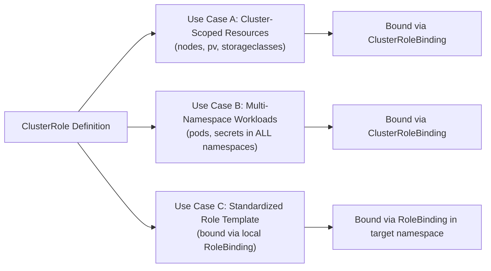
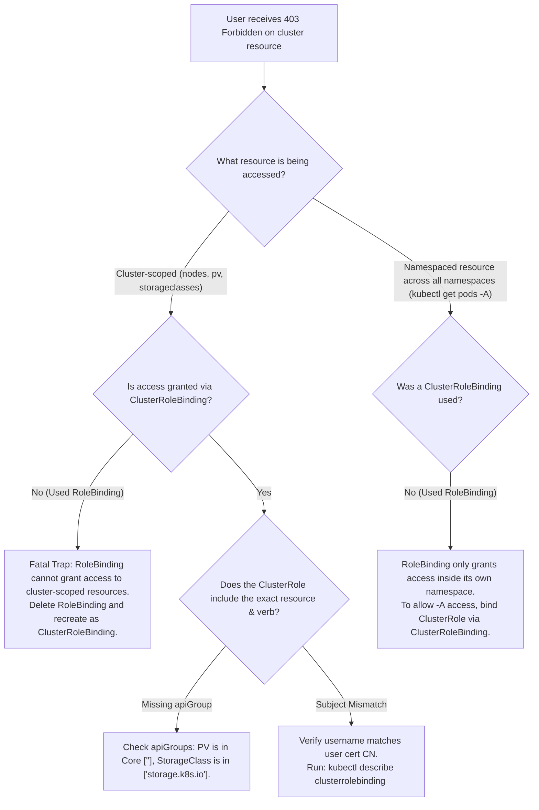

# ClusterRoles & ClusterRoleBindings - CKA Exam Notes

> **Exam Domain**: Cluster Architecture, Installation & Configuration (25%) / Cluster Security  
> **Weight / Importance**: Critical (Top-tier hands-on CKA exam topic tested in nearly 100% of exams: creating ClusterRoles for cluster-scoped or multi-namespace resources, creating ClusterRoleBindings, differentiating when to bind a ClusterRole with a RoleBinding vs a ClusterRoleBinding, configuring storage/node administrative access, and auditing via `kubectl auth can-i`)  
> **Target Version**: Verified against v1.31 / v1.32 (Current CKA Curriculum)  
> **Allowed Docs Search Keywords**: `Using RBAC Authorization`, `ClusterRole`, `ClusterRoleBinding`, `kubectl create clusterrole`, `kubectl create clusterrolebinding`  
> **Source**: Generated from `security/10-cluster-role-raw.md`

---

## 1. Quick-Reference Summary

- **Namespaced vs. Cluster-Scoped Resources**:
  - **Namespaced Resources**: Grouped logically inside namespaces (`pods`, `deployments`, `services`, `configmaps`, `secrets`, `pvc`, `roles`, `rolebindings`).
    - Discovered via: `kubectl api-resources --namespaced=true`
  - **Cluster-Scoped Resources**: Exist globally across the entire physical and logical cluster; cannot be assigned to a namespace (`nodes`, `namespaces`, `persistentvolumes`, `storageclasses`, `certificatesigningrequests`, `clusterroles`, `clusterrolebindings`).
    - Discovered via: `kubectl api-resources --namespaced=false`
- **Core RBAC Definitions**:
  - **`ClusterRole`**: Cluster-scoped RBAC resource definition. Can define permissions for:
    1. **Cluster-scoped resources** (`nodes`, `persistentvolumes`, `storageclasses`).
    2. **Namespaced resources across all namespaces** (`pods` or `services` cluster-wide).
    3. **Non-resource endpoints** (`/healthz`, `/metrics`, `/version`).
  - **`ClusterRoleBinding`**: Binds subjects (Users, Groups, ServiceAccounts) to a `ClusterRole` with **cluster-wide scope** (grants permissions across all namespaces and cluster-scoped resources).
  - **`RoleBinding` referencing a `ClusterRole`**: Binds subjects to a `ClusterRole` with **namespace-scoped restriction** (grants the ClusterRole's permissions *strictly within that specific namespace*).
- **Imperative Creation Commands**:
  ```bash
  # Create ClusterRole for nodes
  kubectl create clusterrole node-admin --verb=get,list,watch --resource=nodes --dry-run=client -o yaml
  
  # Create ClusterRole for mixed-group storage resources (PV in Core, StorageClass in storage.k8s.io)
  kubectl create clusterrole storage-admin --verb=get,list,watch,create --resource=storageclasses,persistentvolumes --dry-run=client -o yaml
  
  # Create ClusterRoleBinding linking user 'michelle' to ClusterRole
  kubectl create clusterrolebinding michelle-node-admin --clusterrole=node-admin --user=michelle --dry-run=client -o yaml
  ```
- **Permission Auditing**:
  ```bash
  # Check cluster-scoped access
  kubectl auth can-i get nodes --as=michelle
  
  # Check global cross-namespace access
  kubectl auth can-i list pods -A --as=michelle
  ```

---

## 2. Conceptual Overview & Mental Model

### Dual-Layer Architectural Understanding

- **Simple English Explanation (How It Works)**:
  - In Kubernetes, namespaces act like rooms in an office building. You can put Pods, Deployments, and ConfigMaps inside a specific room.
  - However, some things belong to the entire building and cannot be put inside a single room:
    - The physical walls and structure (**Nodes**).
    - The rooms themselves (**Namespaces**).
    - The shared basement storage lockers (**PersistentVolumes** and **StorageClasses**).
  - Standard **`Roles` and `RoleBindings`** only work inside a single room. If you create a `Role` in room `blue`, it cannot grant access to physical servers (`nodes`) or storage (`pv`) because those resources don't belong to room `blue`.
  - For this reason, Kubernetes introduces **`ClusterRoles` and `ClusterRoleBindings`**:
    - A **`ClusterRole`** defines global permissions.
    - A **`ClusterRoleBinding`** gives a user those permissions across the entire building.
  - **The "Template" Magic of ClusterRoles**:
    You can also write a `ClusterRole` that lists room-level resources (like Pods). If you connect it using a **`ClusterRoleBinding`**, the user can see Pods in *all* rooms. But if you connect it using a standard **`RoleBinding`** inside room `blue`, the user can only see Pods inside room `blue`! This saves you from creating the same `Role` YAML fifty times across fifty different namespaces.

- **Formal Kubernetes Definition**:
  - A `ClusterRole` is a non-namespaced resource in the `rbac.authorization.k8s.io/v1` API group containing permission rules that govern either cluster-scoped resources, namespaced resources across the entire cluster namespace spectrum, or non-resource URLs. A `ClusterRoleBinding` grants those permissions cluster-wide to a set of subjects (Users, Groups, ServiceAccounts). When bound via a namespaced `RoleBinding`, evaluation limits the authorization scope strictly to the namespace of the binding.

### Architectural Binding Matrix Diagram



---

## 3. Deep-Dive Technical Breakdown

### 1. Resource Categorization: Namespaced vs. Cluster-Scoped



Every Kubernetes resource is either namespaced or cluster-scoped. This property is fixed in the resource's CustomResourceDefinition (CRD) or internal Go schema:

#### Discovery Commands:
```bash
# View all namespaced resources
kubectl api-resources --namespaced=true

# View all cluster-scoped resources
kubectl api-resources --namespaced=false
```

| Resource Category | Defining Characteristics | Examples | Governing RBAC Objects |
| :--- | :--- | :--- | :--- |
| **Namespaced** | Belongs to a single logical partition (`metadata.namespace`). Deleted if namespace is deleted. | `pods`, `deployments`, `services`, `configmaps`, `secrets`, `pvc`, `jobs` | `Role` or `ClusterRole` (via `RoleBinding` or `ClusterRoleBinding`) |
| **Cluster-Scoped** | Exists globally at cluster root. Has no `metadata.namespace` field. | `nodes`, `namespaces`, `persistentvolumes`, `storageclasses`, `certificatesigningrequests` | **`ClusterRole` + `ClusterRoleBinding` ONLY** |

---

### 2. Anatomy of a `ClusterRole` Manifest



A `ClusterRole` omits `metadata.namespace`:

```yaml
apiVersion: rbac.authorization.k8s.io/v1
kind: ClusterRole
metadata:
  name: node-and-storage-admin
rules:
# 1. Cluster-scoped Core resources (Nodes & PVs)
- apiGroups: [""]
  resources: ["nodes", "persistentvolumes"]
  verbs: ["get", "list", "watch", "create", "delete"]

# 2. Cluster-scoped Storage group resources
- apiGroups: ["storage.k8s.io"]
  resources: ["storageclasses"]
  verbs: ["get", "list", "watch", "create", "delete"]

# 3. Non-resource URLs (Optional cluster health endpoints)
- nonResourceURLs: ["/healthz", "/metrics"]
  verbs: ["get"]
```

#### Detailed Rule Fields:
- **`apiGroups`**: `[""]` for Core primitives (`nodes`, `persistentvolumes`). For `storageclasses`, use `["storage.k8s.io"]`.
- **`resources`**: Plural names of target resources.
- **`nonResourceURLs`**: Specific HTTP paths outside the standard REST API tree (e.g. `/healthz`, `/metrics`, `/version`). Useful for monitoring agents.

---

### 3. Anatomy of a `ClusterRoleBinding` Manifest



A `ClusterRoleBinding` connects subjects to a `ClusterRole` across the entire cluster:

```yaml
apiVersion: rbac.authorization.k8s.io/v1
kind: ClusterRoleBinding
metadata:
  name: michelle-node-admin-binding
roleRef:
  apiGroup: rbac.authorization.k8s.io
  kind: ClusterRole
  name: node-and-storage-admin
subjects:
- apiGroup: rbac.authorization.k8s.io
  kind: User
  name: michelle
- apiGroup: rbac.authorization.k8s.io
  kind: Group
  name: infrastructure-admins
- kind: ServiceAccount
  name: storage-controller
  namespace: kube-system
```

#### Crucial Behavioral Rules:
1. **`roleRef.kind` must be `ClusterRole`**: A `ClusterRoleBinding` can **never** reference a namespaced `Role`.
2. **`roleRef` is Immutable**: Once created, `roleRef` cannot be modified. You must delete and recreate the binding.
3. **No Namespace in Metadata**: A `ClusterRoleBinding` has no `metadata.namespace`.

---

### 4. The Three Distinct Operational Use Cases of `ClusterRole`



1. **Use Case A: Authorizing Cluster-Scoped Resources**:
   - Accessing `nodes`, `persistentvolumes`, `storageclasses`, or `certificatesigningrequests`.
   - **Must use `ClusterRoleBinding`**. A namespaced `RoleBinding` cannot grant access to cluster-scoped resources.
2. **Use Case B: Authorizing Resources Across All Namespaces**:
   - Security auditors, monitoring daemons, and cluster admins who require visibility into `pods`, `deployments`, or `events` across all namespaces simultaneously (e.g. `kubectl get pods -A`).
   - **Must use `ClusterRoleBinding`**.
3. **Use Case C: Reusable RBAC Templates Scoped to a Namespace**:
   - Defining a common role (such as read-only pod viewer) once as a `ClusterRole`, and binding it locally in namespace `blue` using a `RoleBinding`.
   - **Must use `RoleBinding`**. The user's permissions are strictly restricted to namespace `blue`.

---

## 4. Command Translation & Mapping Tables

### Table 1: RBAC Object Scope & Binding Capability Matrix

| Object Combination | Target Resource Scope | Resulting Permission Boundary | Allowed? |
| :--- | :--- | :--- | :--- |
| **`Role` + `RoleBinding`** | Namespaced resources | Strictly restricted to `metadata.namespace` | **Yes** (Standard namespaced RBAC) |
| **`Role` + `ClusterRoleBinding`** | *N/A* | Invalid: `ClusterRoleBinding` cannot reference a `Role` | **NO (API Validation Error)** |
| **`ClusterRole` + `ClusterRoleBinding`** | Cluster-scoped OR Namespaced | Grants access **cluster-wide** across all namespaces and nodes | **Yes** (Full cluster-wide access) |
| **`ClusterRole` + `RoleBinding`** | Namespaced resources | Grants access **strictly within the RoleBinding's namespace** | **Yes** (Reusable template pattern) |
| **`ClusterRole` (nodes/pv) + `RoleBinding`** | Cluster-scoped resources | **Ineffective**: RoleBinding cannot grant cluster-scoped access | **Technically creates, but yields NO permissions!** |

---

### Table 2: Namespaced vs. Cluster-Scoped Common Resources

| Resource Plural | Kind | Scope | API Group | Discovery Verification |
| :--- | :--- | :--- | :--- | :--- |
| **`pods`** | `Pod` | Namespaced | Core (`""`) | `kubectl api-resources --namespaced=true` |
| **`services`** | `Service` | Namespaced | Core (`""`) | `kubectl api-resources --namespaced=true` |
| **`deployments`** | `Deployment` | Namespaced | `apps` | `kubectl api-resources --namespaced=true` |
| **`persistentvolumeclaims`** | `PersistentVolumeClaim` | Namespaced | Core (`""`) | `kubectl api-resources --namespaced=true` |
| **`nodes`** | `Node` | **Cluster-Scoped** | Core (`""`) | `kubectl api-resources --namespaced=false` |
| **`namespaces`** | `Namespace` | **Cluster-Scoped** | Core (`""`) | `kubectl api-resources --namespaced=false` |
| **`persistentvolumes`** | `PersistentVolume` | **Cluster-Scoped** | Core (`""`) | `kubectl api-resources --namespaced=false` |
| **`storageclasses`** | `StorageClass` | **Cluster-Scoped** | `storage.k8s.io` | `kubectl api-resources --namespaced=false` |
| **`certificatesigningrequests`** | `CertificateSigningRequest` | **Cluster-Scoped** | `certificates.k8s.io` | `kubectl api-resources --namespaced=false` |

---

## 5. High-Yield CLI & Imperative Commands

### 1. Lab Practice Recipes: Auditing ClusterRoles & Bindings
```bash
# 1. Count total ClusterRoles configured in the cluster
kubectl get clusterrole --no-headers | wc -l

# 2. Count total ClusterRoleBindings configured in the cluster
kubectl get clusterrolebindings.rbac.authorization.k8s.io --no-headers | wc -l

# 3. Find non-namespaced storage resources
kubectl api-resources --namespaced=false | grep -i stor
```

---

### 2. Creating Node Administrator RBAC (Imperative)
A common exam task is granting a user or service account read access to physical cluster nodes:

```bash
# 1. Create ClusterRole for nodes with get, list, watch
kubectl create clusterrole michelle-role \
  --resource=nodes \
  --verb=get,list,watch \
  --dry-run=client -o yaml > michelle-clusterrole.yaml

kubectl apply -f michelle-clusterrole.yaml

# 2. Create ClusterRoleBinding linking user michelle to michelle-role
kubectl create clusterrolebinding michelle-rolebinding \
  --clusterrole=michelle-role \
  --user=michelle \
  --dry-run=client -o yaml > michelle-binding.yaml

kubectl apply -f michelle-binding.yaml

# 3. Verify Michelle can access nodes
kubectl auth can-i get nodes --as=michelle
kubectl auth can-i list nodes --as=michelle
```

---

### 3. Creating Multi-Resource Storage Administrator RBAC
Provision permissions for `StorageClass` and `PersistentVolume`:

```bash
# 1. Create ClusterRole for StorageClass and PersistentVolume
kubectl create clusterrole storage-admin \
  --resource=StorageClass,PersistentVolume \
  --verb=list,create,get,watch \
  --dry-run=client -o yaml | kubectl apply -f -

# 2. Bind storage-admin to user michelle
kubectl create clusterrolebinding michelle-storage-admin \
  --clusterrole=storage-admin \
  --user=michelle \
  --dry-run=client -o yaml | kubectl apply -f -

# 3. Verify permissions
kubectl auth can-i create persistentvolumes --as=michelle
kubectl auth can-i get storageclasses --as=michelle
```

---

### 4. Scoping a ClusterRole to a Single Namespace (Template Pattern)
```bash
# User 'developer-alice' needs read-only view access, but ONLY inside namespace 'blue'
kubectl create rolebinding alice-blue-view \
  --clusterrole=view \
  --user=alice \
  -n blue

# Verify Alice can list pods in 'blue'
kubectl auth can-i list pods -n blue --as=alice
# Returns: yes

# Verify Alice CANNOT list pods in 'default'
kubectl auth can-i list pods -n default --as=alice
# Returns: no
```

---

## 6. Troubleshooting & Diagnostic Runbook

### Diagnostic Decision Tree



---

### Step-by-Step Triage Runbook

| Failure Symptom | Probable Root Cause | Verification Command | Remediation Action |
| :--- | :--- | :--- | :--- |
| `User cannot list resource "nodes" at the cluster scope` | Admin created a `Role` and `RoleBinding` instead of `ClusterRole` and `ClusterRoleBinding` | `kubectl get roles,rolebindings -A \| grep node` | Nodes are cluster-scoped; delete `RoleBinding` and create a `ClusterRole` and `ClusterRoleBinding`. |
| User with `RoleBinding` to `ClusterRole` cannot run `kubectl get pods -A` | `RoleBinding` restricts permissions to its single namespace | `kubectl get rolebinding -A` | Cross-namespace queries (`-A`) require a `ClusterRoleBinding`. |
| `ClusterRoleBinding` creation fails: `invalid: roleRef: kind: Role` | Attempted to bind a namespaced `Role` with a `ClusterRoleBinding` | `kubectl get clusterrolebinding -o yaml` | Change `roleRef.kind` to `ClusterRole`. |
| User cannot create `StorageClass` despite `storage-admin` role | ClusterRole specified `apiGroups: [""]` for `StorageClass` | `kubectl describe clusterrole storage-admin` | Update ClusterRole rule: `apiGroups: ["storage.k8s.io"]` for `storageclasses`. |
| `kubectl auth can-i` returns `no` for ServiceAccount | ServiceAccount subject omitted `namespace: <sa-ns>` | `kubectl describe clusterrolebinding <name>` | Update subject definition to explicitly specify `namespace`. |

---

## 7. CKA Exam Tips, Gotchas & Traps

> [!CAUTION]
> **Trap 1: Attempting to Manage Nodes with a `Role`**  
> If an exam question asks: *"Grant user `dave` permissions to view nodes"*, and you write a namespaced `Role`:
> ```yaml
> kind: Role
> metadata:
>   name: node-viewer
>   namespace: default  # INVALID!
> ```
> This is an **immediate failure**. `Node` is a cluster-scoped resource. You **must** create a `ClusterRole` and bind it with a `ClusterRoleBinding`.

> [!IMPORTANT]
> **Trap 2: `ClusterRole` Bound with `RoleBinding` vs `ClusterRoleBinding`**  
> Pay close attention to question phrasing:
> - If the question says *"Grant user `bob` view access **in namespace frontend**"*, create a **`RoleBinding`** referencing `clusterrole=view` with `-n frontend`.
> - If the question says *"Grant user `bob` view access **across the entire cluster**"*, create a **`ClusterRoleBinding`** referencing `clusterrole=view`.

> [!WARNING]
> **Trap 3: The StorageClass API Group Trap**  
> When creating a storage admin ClusterRole for `PersistentVolume` and `StorageClass`:
> - `PersistentVolume` is in the **Core API group (`""`)**.
> - `StorageClass` is in the **`storage.k8s.io` API group**.  
> If you combine them under a single rule with `apiGroups: [""]`, access to `storageclasses` will fail. The imperative CLI handles this automatically:
> ```bash
> kubectl create clusterrole storage-admin --verb=get,list,create --resource=persistentvolumes,storageclasses
> ```

> [!TIP]
> **Exam Tip 4: Fast Resource Scope Checking**  
> If you are unsure whether a resource is namespaced or cluster-scoped during the exam, check instantly:
> ```bash
> kubectl api-resources | grep -E 'nodes|persistentvolumes|storageclasses'
> ```
> Look at the `NAMESPACED` column (`true` or `false`).

---

## 8. Self-Test / Active Recall

<details>
<summary><strong>1. What happens if you create a <code>RoleBinding</code> in namespace <code>finance</code> that references a <code>ClusterRole</code> containing rules for Pods?</strong></summary>

The user is granted the permissions defined in the `ClusterRole`, but **strictly within the <code>finance</code> namespace**. The user has zero access to Pods in other namespaces.
</details>

<details>
<summary><strong>2. Can a <code>RoleBinding</code> grant permissions to view physical cluster <code>nodes</code>? Explain why.</strong></summary>

**No.** Nodes are cluster-scoped resources (`namespaced: false`). A `RoleBinding` can only authorize access to resources within its own namespace. Granting permissions to `nodes` strictly requires a `ClusterRole` bound via a `ClusterRoleBinding`.
</details>

<details>
<summary><strong>3. How do you list all resources in the cluster that are NOT bound to any namespace?</strong></summary>

```bash
kubectl api-resources --namespaced=false
```
</details>

<details>
<summary><strong>4. Can a <code>ClusterRoleBinding</code> reference a namespaced <code>Role</code> in its <code>roleRef</code>?</strong></summary>

**No.** The Kubernetes API server strictly rejects `ClusterRoleBinding` manifests where `roleRef.kind` is `Role`. It must always reference a `ClusterRole`.
</details>

<details>
<summary><strong>5. Which API group does the <code>StorageClass</code> resource belong to, and which API group does the <code>PersistentVolume</code> resource belong to?</strong></summary>

- `StorageClass` belongs to **`storage.k8s.io`**.
- `PersistentVolume` belongs to the **Core group (`""`)**.
</details>

<details>
<summary><strong>6. What imperative command creates a <code>ClusterRole</code> named <code>pv-admin</code> allowing all verbs on PersistentVolumes?</strong></summary>

```bash
kubectl create clusterrole pv-admin --verb="*" --resource=persistentvolumes
```
</details>

<details>
<summary><strong>7. How do you test whether user <code>michelle</code> can list nodes across the cluster using <code>kubectl auth can-i</code>?</strong></summary>

```bash
kubectl auth can-i list nodes --as=michelle
```
*(Do not include a `-n` namespace flag, since nodes are cluster-scoped).*
</details>

<details>
<summary><strong>8. What built-in <code>ClusterRole</code> provides unrestricted superuser access across the entire cluster?</strong></summary>

**`cluster-admin`**, which is bound by default to the group `system:masters`.
</details>

<details>
<summary><strong>9. If a user needs to run <code>kubectl get pods -A</code>, what RBAC binding is required?</strong></summary>

A **`ClusterRoleBinding`** referencing a `ClusterRole` that grants `list` and `get` on `pods`. (A namespaced `RoleBinding` cannot authorize cross-namespace queries).
</details>

<details>
<summary><strong>10. How can you permit a monitoring ServiceAccount to scrape <code>/metrics</code> using RBAC?</strong></summary>

Define a `ClusterRole` with `nonResourceURLs: ["/metrics"]` and `verbs: ["get"]`, and bind it to the ServiceAccount using a `ClusterRoleBinding`.
</details>

---

## 9. Official Documentation Bookmarks

| Documentation Page | Official URL | Search Keywords | High-Yield Section for Exam |
| :--- | :--- | :--- | :--- |
| **Using RBAC Authorization** | `https://kubernetes.io/docs/reference/access-authn-authz/rbac/` | `Using RBAC Authorization`, `ClusterRole`, `ClusterRoleBinding` | Complete YAML examples for ClusterRole and ClusterRoleBinding |
| **RoleBinding with ClusterRole Reference** | `https://kubernetes.io/docs/reference/access-authn-authz/rbac/#rolebinding-example` | `RoleBinding to ClusterRole` | Explains the namespace-scoped template binding pattern |
| **Default Roles and Role Bindings** | `https://kubernetes.io/docs/reference/access-authn-authz/rbac/#default-roles-and-role-bindings` | `cluster-admin`, `admin`, `edit`, `view` | Reference table of built-in ClusterRoles |
| **API Resources Reference** | `https://kubernetes.io/docs/reference/generated/kubectl/kubectl-commands#api-resources` | `kubectl api-resources` | Options for filtering namespaced vs cluster-scoped resources |

