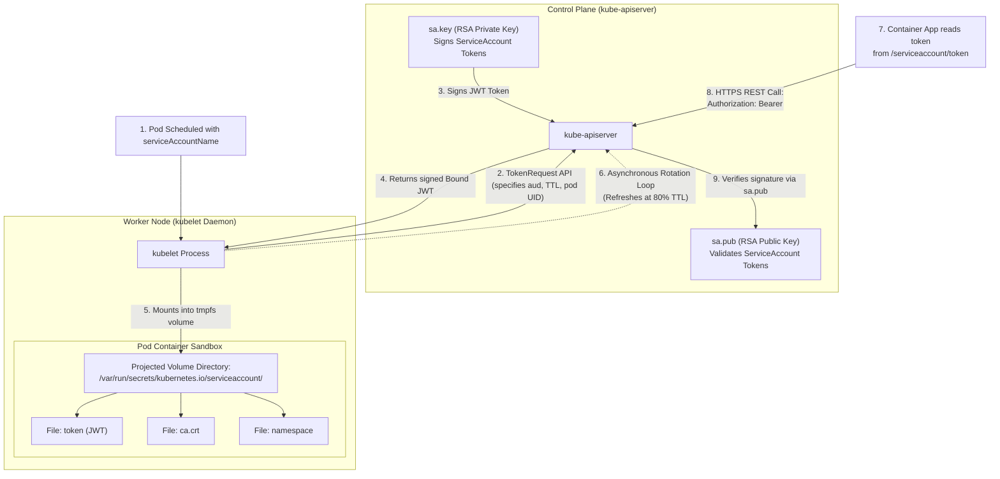
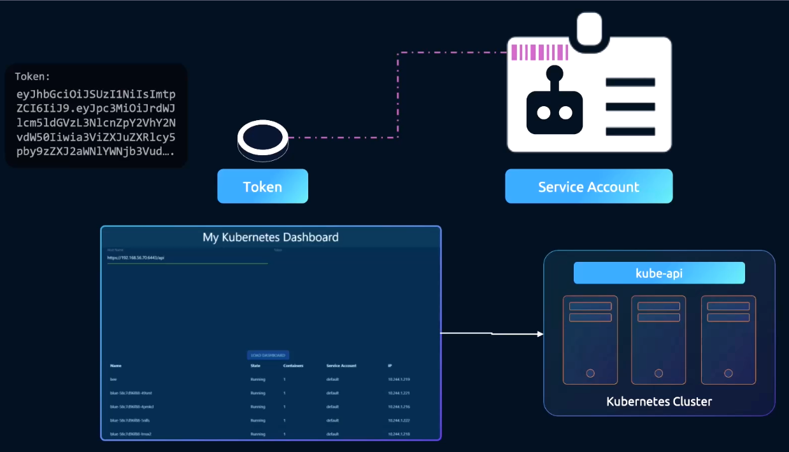
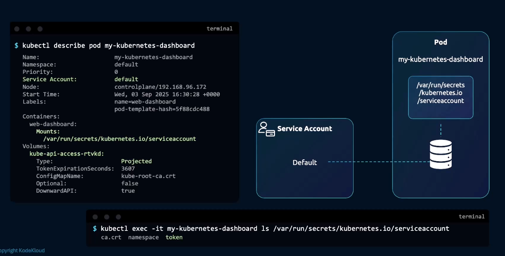
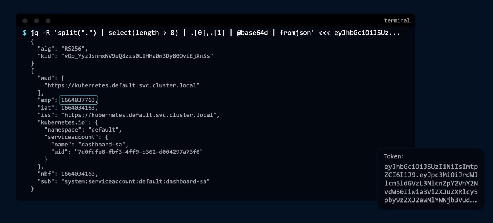
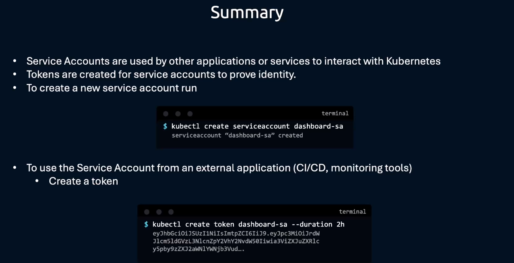
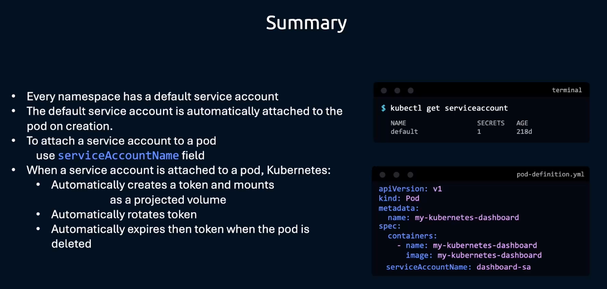
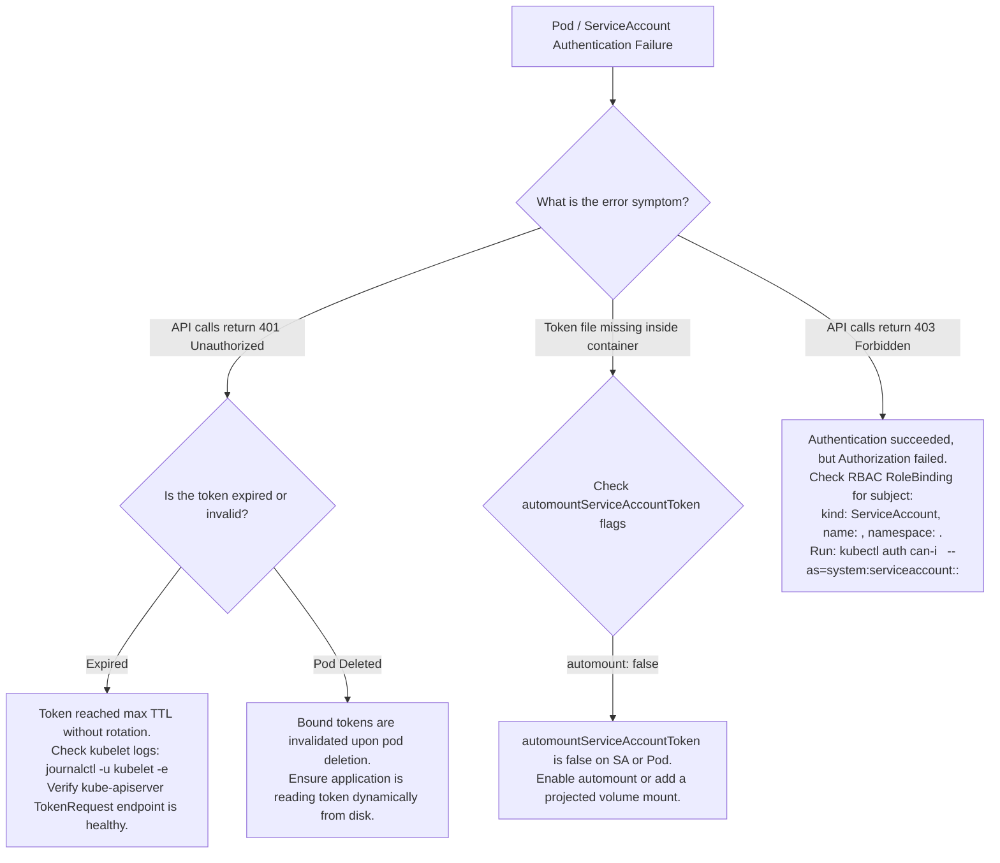

# Kubernetes ServiceAccounts & Projected Tokens - CKA Exam Notes

> **Exam Domain**: Cluster Architecture, Installation & Configuration (25%) / Cluster Security  
> **Weight / Importance**: Critical (Top-tier hands-on CKA exam topic tested in nearly 100% of exams: creating ServiceAccounts, controlling `automountServiceAccountToken`, associating `serviceAccountName` with Pods/Deployments, generating short-lived bearer tokens via `kubectl create token`, configuring manual projected volume token mounts, and auditing permissions via `kubectl auth can-i`)  
> **Target Version**: Verified against v1.31 / v1.32 (Current CKA Curriculum)  
> **Allowed Docs Search Keywords**: `Service Accounts`, `Configure Service Accounts for Pods`, `Bound Service Account Token Volume`, `kubectl create token`  
> **Source**: Generated from `security/11-service-accounts-raw.md`

---

## 1. Quick-Reference Summary

- **User Accounts vs. ServiceAccounts**:
  - **User Accounts**: Intended for human actors (administrators, developers). Authenticated externally via X.509 client certificates, OIDC, or external webhooks. Not managed via Kubernetes API objects (no `kind: User`).
  - **ServiceAccounts**: Intended for software processes (in-cluster workloads, Prometheus, CI/CD pipelines, dashboard controllers). Managed as native Kubernetes API resources (`kind: ServiceAccount`).
- **Modern Bound ServiceAccount Token Architecture (v1.22+ GA, standard in v1.31/v1.32)**:
  - **Legacy Tokens (pre-v1.22)**: Created static, non-expiring JWT tokens stored indefinitely in `Secret` objects. Posed severe security leakage risks.
  - **Bound Tokens (v1.22+)**: Short-lived, dynamically generated JSON Web Tokens (JWT) requested via the `TokenRequest` API.
  - **Cryptographic Binding**: Bound directly to the Pod's lifecycle (token immediately invalidates if the Pod is deleted), time-bound (expiration timestamp), and audience-bound (`aud: ["https://kubernetes.default.svc..."]`).
  - **Automatic Rotation**: Managed by the local **`kubelet`** daemon before expiration (rotated automatically at 80% of TTL or after 24 hours).
- **Default In-Pod Projected Filesystem Path**:
  Mounted at `/var/run/secrets/kubernetes.io/serviceaccount/`:
  - `token`: Short-lived signed JWT bearer token.
  - `ca.crt`: Cluster Root CA public certificate (used by the pod to verify the API server).
  - `namespace`: Plaintext string of the pod's current namespace.
- **Disabling Automatic Token Injection**:
  - **ServiceAccount Level**: `automountServiceAccountToken: false` (defaults all pods using this SA to skip mounting credentials).
  - **Pod Spec Level**: `spec.automountServiceAccountToken: false` (overrides the ServiceAccount setting for that specific pod).
- **External Token Generation**:
  - `kubectl create token <sa-name> [--duration=2h]`
  - Generates an out-of-band JWT bearer token used by external tools (dashboards, curl, CI/CD).
- **Subject Representation in RBAC**:
  $$\text{User ID format: } \texttt{system:serviceaccount:<namespace>:<serviceaccount-name>}$$

---

## 2. Conceptual Overview & Mental Model

### Dual-Layer Architectural Understanding

- **Simple English Explanation (How It Works)**:
  - When humans access a Kubernetes cluster, they use client certificates or Single Sign-On. But what happens when an application running *inside* the cluster needs to talk to the API server (for instance, Prometheus discovering new pods or a deployment dashboard reading cluster state)?
  - An application cannot type a password. Instead, it uses a **ServiceAccount**.
  - When a Pod starts, Kubernetes automatically provisions an identity badge (a digital **token**) and mounts it as a secure file inside the container at `/var/run/secrets/kubernetes.io/serviceaccount/token`.
  - In older versions of Kubernetes, this token was a permanent secret stored forever in etcd. If an attacker stole it from a container, they could use it forever.
  - In modern Kubernetes, tokens are **Bound ServiceAccount Tokens**:
    1. They expire quickly (typically within 1 hour).
    2. They are tied directly to the physical life of the container—if the Pod is deleted, the token dies instantly.
    3. The local node agent (**`kubelet`**) continuously refreshes the token file in the background before it expires, so your application never gets locked out.
  - If a pod does not need to talk to the Kubernetes API, keeping a valid token inside the container is an unnecessary security risk. You can disable this by setting `automountServiceAccountToken: false`.
  - If you need a token for an external program (like a Jenkins server outside the cluster), you generate a temporary one using `kubectl create token`.

- **Formal Kubernetes Definition**:
  - A `ServiceAccount` is a namespaced API object within the core group (`/api/v1`) that defines a machine identity principal evaluated by the API server's service account authenticator. Under the TokenRequest API and Projected Volume plugin architecture, the `kubelet` requests short-lived, audience-restricted, and object-bound JSON Web Tokens (JWT) signed by the cluster's private key (`--service-account-private-key-file`). Tokens are injected into containers via a memory-backed (`tmpfs`) volume mount, refreshed asynchronously before expiration, and revoked upon pod termination.

### Architectural Token Provisioning & Rotation Lifecycle



---

## 3. Deep-Dive Technical Breakdown

### 1. User Accounts vs. ServiceAccounts



| Architectural Dimension | User Account | ServiceAccount |
| :--- | :--- | :--- |
| **Intended Entity** | Humans (Admins, Developers, Auditors) | Machine processes, automated daemons, in-pod applications |
| **API Server Resource** | **None** (No `kind: User` exists in etcd) | **`kind: ServiceAccount`** in Core API group (`/api/v1`) |
| **Scope** | Cluster-wide (Namespaces do not apply to users) | Strictly namespaced (`metadata.namespace`) |
| **Authentication Form** | X.509 Client Certificates, OIDC tokens, Webhook | Short-lived signed JWT bearer tokens |
| **Default Provisioning** | Manual (OpenSSL, cloud IAM, or Certificates API) | Automatic: every namespace has a `default` ServiceAccount |
| **RBAC Identifier** | `<username>` (e.g. `jane`, `admin`) | `system:serviceaccount:<namespace>:<sa-name>` |

---

### 2. Evolution of Tokens: Legacy Secrets vs. Modern Bound Tokens

#### The Legacy Model (Pre-Kubernetes v1.22):
- When a `ServiceAccount` was created, a background controller in `kube-controller-manager` automatically minted a companion `Secret` of type `kubernetes.io/service-account-token`.
- *Vulnerability*: The token had **no expiration date** and was **not bound to any pod**. If an attacker compromised a pod and copied the token, they could use it from anywhere on the internet indefinitely until the ServiceAccount was deleted.

#### The Modern Bound Token Model (v1.22+ GA / v1.31 Current):
- The creation of static token Secrets is **disabled by default**.
- When a pod starts, the `kubelet` requests a time-bound, audience-bound token directly via the API server `TokenRequest` subresource.
- **Three-Fold Binding**:
  1. **Time-Bound**: Fixed lifetime (default 1 hour; max clamped by cluster settings).
  2. **Audience-Bound**: Restricted to specific API server target identifiers (`aud`).
  3. **Object-Bound**: Contains the Pod's specific `metadata.uid`. If the pod is deleted, the API server rejects the token even if its expiration timestamp has not yet passed.

---

### 3. In-Pod Projected Volume Layout



When a Pod runs with a ServiceAccount, `kubelet` mounts three files into `/var/run/secrets/kubernetes.io/serviceaccount/`:

```plaintext
/var/run/secrets/kubernetes.io/serviceaccount/
├── ca.crt     -> ..data/ca.crt     # Public root CA certificate of the cluster
├── namespace  -> ..data/namespace  # Plaintext string of current namespace (e.g. "default")
└── token      -> ..data/token      # Raw base64-encoded signed JWT bearer token
```

> [!NOTE]
> The directory is backed by a **`tmpfs` (RAM filesystem)**. The token is never written to the host's physical hard disk, ensuring that physical node drive scrapers or unallocated disk analyzers cannot recover expired credentials.

---

### 4. Kubelet Token Rotation Mechanics



1. The `kubelet` tracks the residual lifetime of the mounted token file.
2. When the token reaches **80% of its total Time-To-Live (TTL)** (or if the token is older than 24 hours), `kubelet` initiates a rotation request to `kube-apiserver`.
3. The API server signs a new JWT with an extended expiration.
4. **Atomic In-Place Swap**:
   - `kubelet` writes the new token to a hidden temporary file in the pod volume directory (`..data_tmp`).
   - `kubelet` executes an atomic symlink update (`symlink()` syscall) pointing `..data` to the new directory.
   - Applications that reload the file periodically observe the updated token seamlessly without container restarts.

---

### 5. Disabling Automatic Token Injection




If an application does not interact with the Kubernetes API, mounting API credentials violates the principle of least privilege. You can disable mounting at two levels:

#### Option A: On the ServiceAccount (Applies to all pods using it)
```yaml
apiVersion: v1
kind: ServiceAccount
metadata:
  name: dashboard-sa
  namespace: default
automountServiceAccountToken: false
```

#### Option B: On the Pod Specification (Overrides the ServiceAccount)
```yaml
apiVersion: v1
kind: Pod
metadata:
  name: web-app
spec:
  serviceAccountName: dashboard-sa
  automountServiceAccountToken: false  # Explicitly disables injection
  containers:
  - name: nginx
    image: nginx
```

---

### 6. Deconstructing a ServiceAccount JWT Token

A decoded ServiceAccount token (via `jwt.io` or `jq`) contains three segments:

```json
// 1. HEADER: Cryptographic algorithm and signing key ID
{
  "alg": "RS256",
  "kid": "k8s-sa-key-1"
}

// 2. PAYLOAD: Identity, audience, bounds, and expiration claims
{
  "iss": "https://kubernetes.default.svc.cluster.local",
  "sub": "system:serviceaccount:default:dashboard-sa",
  "aud": ["https://kubernetes.default.svc.cluster.local"],
  "exp": 1729000000,
  "nbf": 1728996400,
  "kubernetes.io": {
    "namespace": "default",
    "serviceaccount": {
      "name": "dashboard-sa",
      "uid": "3b29c51a-7b3c-4d8e-9b8e-1234567890ab"
    },
    "pod": {
      "name": "web-dashboard-7b98d4bfd-xyz",
      "uid": "8f9a0c1b-2d3e-4f5a-6b7c-0987654321fe"
    }
  }
}
```

---

## 4. Command Translation & Mapping Tables

### Table 1: ServiceAccount Token Architecture: Legacy vs. Modern Bound

| Architectural Feature | Legacy ServiceAccount Token (Pre-v1.22) | Modern Bound Token (v1.22+ / v1.31 Current) |
| :--- | :--- | :--- |
| **Storage Mechanism** | Persistent `Secret` object stored in etcd | Ephemeral `TokenRequest` projection via `kubelet` |
| **Token Expiration** | **Never expires** (Infinite lifetime) | Time-bound (Default: 1 hour; customizable) |
| **Pod Lifecycle Binding**| Unbound; valid even after pod is deleted | **Bound to Pod UID**; invalidated instantly upon pod deletion |
| **Audience Restriction**| Unrestricted; accepted by any endpoint | Restricted to specific API server audience (`aud`) |
| **Rotation Mechanism** | None; manual secret deletion required | **Automatic rotation by kubelet** at 80% TTL |
| **Filesystem Storage** | Mounted from `Secret` volume | Mounted from `projected` volume (`tmpfs` in RAM) |

---

### Table 2: `automountServiceAccountToken` Precedence Matrix

| ServiceAccount Setting | Pod Spec Setting | Resulting Pod In-Container Behavior |
| :--- | :--- | :--- |
| `automountServiceAccountToken: true` | *Not Specified* | **Mounted** (Default behavior) |
| `automountServiceAccountToken: false`| *Not Specified* | **NOT Mounted** (Inherits SA setting) |
| `automountServiceAccountToken: true` | `automountServiceAccountToken: false` | **NOT Mounted** (Pod spec overrides SA) |
| `automountServiceAccountToken: false`| `automountServiceAccountToken: true` | **Mounted** (Pod spec overrides SA) |

---

### Table 3: Mounted Credential Files inside `/var/run/secrets/kubernetes.io/serviceaccount/`

| Filename | Data Type | Encoding | Purpose / Consumer |
| :--- | :--- | :--- | :--- |
| **`token`** | String (JWT) | ASCII Base64URL | Bearer token passed in HTTP `Authorization: Bearer <token>` header |
| **`ca.crt`** | Certificate | ASCII PEM | Used by client inside container to verify API server's TLS certificate |
| **`namespace`**| String | UTF-8 Plaintext | Contains the namespace name, allowing in-pod clients to self-identify |

---

## 5. High-Yield CLI & Imperative Commands

### 1. Basic ServiceAccount Management
```bash
# 1. Create a ServiceAccount imperatively
kubectl create serviceaccount dashboard-sa -n default

# 2. Inspect ServiceAccount details
kubectl get serviceaccount dashboard-sa -n default -o yaml

# 3. List all ServiceAccounts across all namespaces
kubectl get sa -A
```

---

### 2. Generating Out-of-Band Tokens for External Systems
```bash
# 1. Generate a temporary token with default 1-hour expiration
kubectl create token dashboard-sa

# 2. Generate a token with a custom duration (e.g. 2 hours)
kubectl create token dashboard-sa --duration=2h

# 3. Generate a token for a specific audience
kubectl create token dashboard-sa --audience=https://my-dashboard.internal
```

---

### 3. Testing API Calls Using a ServiceAccount Bearer Token
```bash
# 1. Generate token and capture in shell variable
TOKEN=$(kubectl create token dashboard-sa)

# 2. Fetch cluster API server endpoint
APISERVER=$(kubectl config view --minify -o jsonpath='{.clusters[0].cluster.server}')

# 3. Query the API server using curl with the bearer token
curl -k -H "Authorization: Bearer $TOKEN" $APISERVER/api/v1/namespaces/default/pods
```

---

### 4. Practice Lab Walkthrough: Manual Projected Token Injection in a Deployment

#### Task Objective:
1. Modify `dashboard-sa` to disable automatic token mounting.
2. Update the `web-dashboard` Deployment to manually inject a projected ServiceAccount token at `/var/run/secrets/kubernetes.io/serviceaccount/token` with `readOnly: true`.

```yaml
# Step 1: Update ServiceAccount manifest
apiVersion: v1
kind: ServiceAccount
metadata:
  name: dashboard-sa
  namespace: default
automountServiceAccountToken: false
---
# Step 2: Deployment with Projected Volume Token Mount
apiVersion: apps/v1
kind: Deployment
metadata:
  name: web-dashboard
  namespace: default
  labels:
    name: web-dashboard
spec:
  replicas: 1
  selector:
    matchLabels:
      name: web-dashboard
  template:
    metadata:
      labels:
        name: web-dashboard
    spec:
      serviceAccountName: dashboard-sa
      containers:
      - name: web-dashboard
        image: gcr.io/kodekloud/customimage/my-kubernetes-dashboard
        ports:
        - containerPort: 8080
        env:
        - name: PYTHONUNBUFFERED
          value: "1"
        volumeMounts:
        # Mount the projected token file explicitly
        - name: token-volume
          mountPath: /var/run/secrets/kubernetes.io/serviceaccount/token
          subPath: token
          readOnly: true
      volumes:
      # Define projected volume source requesting a short-lived token
      - name: token-volume
        projected:
          sources:
          - serviceAccountToken:
              path: token
              expirationSeconds: 3600
```

#### Step 3: Verification
```bash
# Verify the token is mounted inside the container
POD_NAME=$(kubectl get pod -l name=web-dashboard -o jsonpath='{.items[0].metadata.name}')
kubectl exec $POD_NAME -- ls -la /var/run/secrets/kubernetes.io/serviceaccount/
```

---

## 6. Troubleshooting & Diagnostic Runbook

### Diagnostic Decision Tree



---

### Step-by-Step Triage Runbook

| Failure Symptom | Probable Root Cause | Verification Command | Remediation Action |
| :--- | :--- | :--- | :--- |
| `Unauthorized (401)` when pod queries API | Application read token once on startup and did not re-read rotated token from disk | `kubectl exec <pod> -- cat /var/run/secrets/.../token \| cut -d. -f2 \| base64 -d` | Update application logic to re-read `/var/run/secrets/.../token` on 401 or periodically. |
| `/var/run/secrets/kubernetes.io/serviceaccount` does not exist | `automountServiceAccountToken: false` set on Pod or ServiceAccount | `kubectl get pod <pod> -o yaml \| grep automount` | Set `automountServiceAccountToken: true` or define explicit projected volume. |
| `User "system:serviceaccount:default:sa" cannot list pods` | ServiceAccount lacks RBAC RoleBinding | `kubectl auth can-i list pods --as=system:serviceaccount:default:sa` | Create `Role` and `RoleBinding` targeting `kind: ServiceAccount`. |
| `kubectl create token` fails with `TokenRequest: feature disabled` | API server lacks `--service-account-key-file` configuration | Check `/etc/kubernetes/manifests/kube-apiserver.yaml` | Ensure `--service-account-key-file` and `--service-account-signing-key-file` are set. |
| Pod fails to start: `mount failed for projected volume` | Invalid `expirationSeconds` or unrecognized audience | `kubectl describe pod <pod-name>` | Set `expirationSeconds` $\ge 600$ (10 minutes) and verify volume syntax. |

---

## 7. CKA Exam Tips, Gotchas & Traps

> [!CAUTION]
> **Trap 1: `serviceAccount` vs. `serviceAccountName`**  
> In Pod specifications, the field `serviceAccount` is **deprecated**. Always use:
> ```yaml
> spec:
>   serviceAccountName: dashboard-sa  # Correct!
> ```
> While `serviceAccount` is still accepted for backward compatibility, modern automated grading scripts strictly check for `serviceAccountName`.

> [!IMPORTANT]
> **Trap 2: `RoleBinding` Subject Namespace is Mandatory**  
> When binding a ServiceAccount in a `RoleBinding` or `ClusterRoleBinding`, the subject **MUST include the `namespace` field**:
> ```yaml
> subjects:
> - kind: ServiceAccount
>   name: dashboard-sa
>   namespace: default    # MANDATORY!
> ```
> Omitting `namespace:` causes Kubernetes to default to the RoleBinding's namespace or fail admission, resulting in zero permissions.

> [!WARNING]
> **Trap 3: Pod `serviceAccountName` is Immutable**  
> You cannot edit `spec.serviceAccountName` on an existing, running Pod via `kubectl edit`. If you need to change a pod's ServiceAccount:
> 1. Export: `kubectl get pod <pod> -o yaml > pod.yaml`
> 2. Edit `serviceAccountName` in `pod.yaml`.
> 3. Recreate: `kubectl replace --force -f pod.yaml`.  
> *(Deployments, however, can be patched dynamically; modifying the template triggers a standard rolling update).*

> [!TIP]
> **Exam Tip 4: Auditing ServiceAccount Permissions**  
> Test what a ServiceAccount can do without running `kubectl exec`:
> ```bash
> kubectl auth can-i list secrets -n default --as=system:serviceaccount:default:dashboard-sa
> ```

---

## 8. Self-Test / Active Recall

<details>
<summary><strong>1. What is the fundamental difference between a User Account and a ServiceAccount in Kubernetes?</strong></summary>

User Accounts represent human actors, are not stored as API objects in etcd, and authenticate via external systems (certificates, OIDC). ServiceAccounts represent machine processes, are stored as native Kubernetes API resources (`kind: ServiceAccount`), and authenticate via short-lived JWT bearer tokens.
</details>

<details>
<summary><strong>2. Why were legacy ServiceAccount Secret tokens deprecated in favor of Bound ServiceAccount Tokens?</strong></summary>

Legacy tokens were stored indefinitely in `Secret` objects, never expired, and had no binding to specific pods, creating severe credential theft and leakage risks. Bound tokens expire quickly, are bound to the pod's lifecycle (invalidated upon pod deletion), and are rotated automatically by `kubelet`.
</details>

<details>
<summary><strong>3. Which component on the node is responsible for rotating ServiceAccount tokens mounted inside running pods?</strong></summary>

The **`kubelet`** daemon. It requests a new token from the API server before the old one reaches 80% of its lifetime and atomically updates the mounted file.
</details>

<details>
<summary><strong>4. Where are default ServiceAccount credentials mounted inside a container?</strong></summary>

At `/var/run/secrets/kubernetes.io/serviceaccount/` containing `token`, `ca.crt`, and `namespace`.
</details>

<details>
<summary><strong>5. How do you generate an out-of-band token for a ServiceAccount named <code>ci-bot</code> that expires in 4 hours?</strong></summary>

```bash
kubectl create token ci-bot --duration=4h
```
</details>

<details>
<summary><strong>6. What happens if <code>automountServiceAccountToken: false</code> is set on a ServiceAccount, but a Pod using it sets <code>automountServiceAccountToken: true</code>?</strong></summary>

The Pod specification takes precedence: the credentials **will be mounted** inside that specific pod.
</details>

<details>
<summary><strong>7. What is the exact string format used to represent a ServiceAccount in RBAC authorization checks?</strong></summary>

`system:serviceaccount:<namespace>:<serviceaccount-name>`  
(e.g., `system:serviceaccount:default:dashboard-sa`).
</details>

<details>
<summary><strong>8. Why is the token directory mounted as a <code>tmpfs</code> filesystem inside the container?</strong></summary>

To store the sensitive JWT in volatile RAM memory only, ensuring that token data is never written to persistent host storage where it could be recovered after pod deletion.
</details>

<details>
<summary><strong>9. Can you change the <code>serviceAccountName</code> of a running Pod by modifying it directly with <code>kubectl edit</code>?</strong></summary>

**No.** The `serviceAccountName` field on an active Pod is immutable. The Pod must be deleted and recreated with the new ServiceAccount name.
</details>

<details>
<summary><strong>10. How can you verify whether a ServiceAccount named <code>monitor-sa</code> in namespace <code>monitoring</code> can read pods across all namespaces?</strong></summary>

```bash
kubectl auth can-i list pods -A --as=system:serviceaccount:monitoring:monitor-sa
```
</details>

---

## 9. Official Documentation Bookmarks

| Documentation Page | Official URL | Search Keywords | High-Yield Section for Exam |
| :--- | :--- | :--- | :--- |
| **Managing Service Accounts** | `https://kubernetes.io/docs/tasks/configure-pod-container/configure-service-account/` | `Configure Service Accounts for Pods`, `automountServiceAccountToken` | Declaring ServiceAccounts and disabling token automounting |
| **Bound Service Account Token Volume** | `https://kubernetes.io/docs/reference/access-authn-authz/service-accounts-admin/#bound-service-account-token-volume` | `Bound Service Account Token Volume`, `TokenRequest` | Technical mechanics of token projection and rotation |
| **kubectl create token Reference** | `https://kubernetes.io/docs/reference/generated/kubectl/kubectl-commands#create-token` | `kubectl create token` | CLI parameters for duration, audience, and bound objects |
| **Authenticating with Service Account Tokens** | `https://kubernetes.io/docs/reference/access-authn-authz/authentication/#service-account-tokens` | `service account tokens`, `system:serviceaccount` | User format and verification flags on kube-apiserver |

