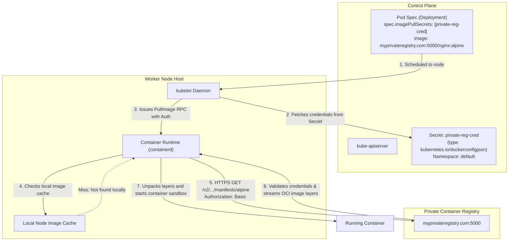
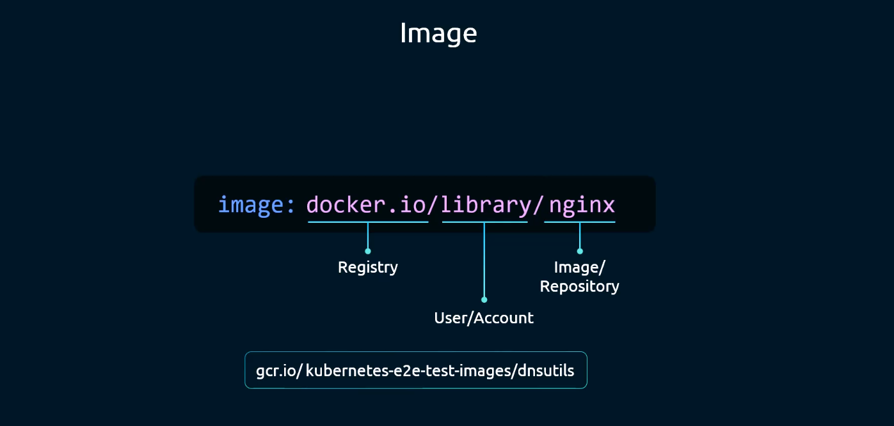
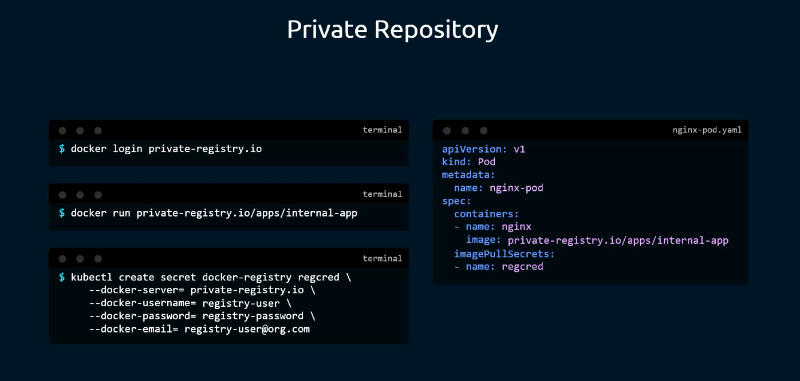
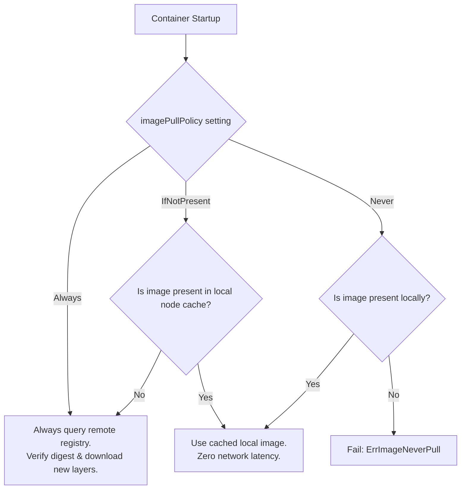
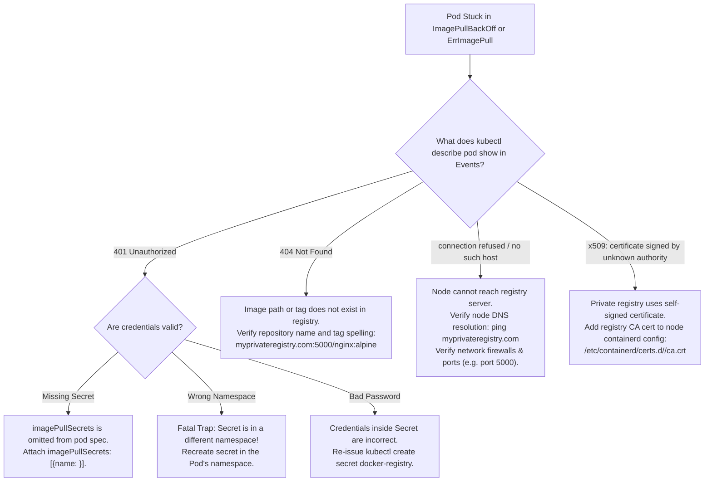

# Container Image Security & Private Registry Authentication - CKA Exam Notes

> **Exam Domain**: Cluster Architecture, Installation & Configuration (25%) / Cluster Security  
> **Weight / Importance**: Critical (Core hands-on CKA exam topic tested in nearly 100% of exams: creating `docker-registry` Secrets, attaching `imagePullSecrets` to Pods and ServiceAccounts, resolving `ImagePullBackOff` errors, configuring image pull policies, and authenticating to private registries)  
> **Target Version**: Verified against v1.31 / v1.32 (Current CKA Curriculum)  
> **Allowed Docs Search Keywords**: `Pull an Image from a Private Registry`, `imagePullSecrets`, `docker-registry secret`, `imagePullPolicy`  
> **Source**: Generated from `security/12-image-security-raw.md`

---

## 1. Quick-Reference Summary

- **Fully Qualified Container Image Structure**:
  All container image strings follow the standard Open Container Initiative (OCI) reference syntax:
  $$\texttt{[registry-host[:port]/][user-or-org/]repository[:tag|@digest]}$$
  - **Default Registry**: `docker.io` (Docker Hub).
  - **Default Org/User**: `library` (official Docker Hub root images).
  - **Default Tag**: `latest` (used if no tag or digest is specified).
  - *Example*: `nginx` $\implies$ `docker.io/library/nginx:latest`.
- **Private Registry Authentication Mechanism**:
  - Requires a Kubernetes Secret of type **`kubernetes.io/dockerconfigjson`**.
  - Generated imperatively via:
    ```bash
    kubectl create secret docker-registry <secret-name> \
      --docker-server=<registry-url> \
      --docker-username=<user> \
      --docker-password=<password> \
      --docker-email=<email> \
      -n <namespace>
    ```
- **Consuming Credentials via `imagePullSecrets`**:
  - **Per-Pod / Per-Deployment**: Specified under `spec.imagePullSecrets` (or `spec.template.spec.imagePullSecrets` in controllers):
    ```yaml
    imagePullSecrets:
    - name: private-reg-cred
    ```
  - **Per-ServiceAccount (Global Inheritance)**: Attaching `imagePullSecrets` to a `ServiceAccount` automatically injects the secret into all Pods running with that ServiceAccount.
- **Image Pull Policies (`imagePullPolicy`)**:
  - **`Always`**: Forces the container runtime to contact the remote registry on every container start to verify digest and pull fresh layers. (Default if tag is `:latest` or omitted).
  - **`IfNotPresent`**: Pulls the image only if it does not already exist in the node's local container runtime cache. (Default if a specific tag is provided, e.g. `:alpine`).
  - **`Never`**: Instructs `kubelet` never to pull; the image must be pre-loaded on the node host.
- **Digest Pinning (Cryptographic Immutability)**:
  - Using an explicit SHA256 digest (`nginx@sha256:4c0f...`) guarantees that the container runtime runs the exact verified binary image, protecting against tag mutation attacks.

---

## 2. Conceptual Overview & Mental Model

### Dual-Layer Architectural Understanding

- **Simple English Explanation (How It Works)**:
  - When you tell Kubernetes to run a Pod with `image: nginx`, the worker node's container runtime (`containerd`) needs to download that image from the internet.
  - Public images on Docker Hub are free for anyone to download anonymously. But proprietary enterprise software is stored in **Private Registries** (e.g. AWS ECR, Google Artifact Registry, Azure ACR, or a private Harbor server).
  - When the worker node attempts to pull from a private registry without credentials, the registry responds with `HTTP 401 Unauthorized`, and Kubernetes enters an **`ImagePullBackOff`** crash loop.
  - To allow the node to pull the image securely, you store the registry username and password inside a special Kubernetes Secret called a **`docker-registry` Secret**.
  - You then tell the Pod to use that Secret via the **`imagePullSecrets`** field.
  - When the Pod is scheduled onto a worker node, the `kubelet` extracts the credentials from the Secret, passes them to the local container runtime (`containerd`), and `containerd` securely logs into the private registry to download the container layers.
  - **Namespace Isolation Rule**: Secrets are namespaced. The `docker-registry` Secret must exist in the **same namespace** as the Pod or Deployment that needs it!

- **Formal Kubernetes Definition**:
  - Container image retrieval is executed by the Container Runtime Interface (CRI) worker daemon. Private registry authentication implements the Docker Registry HTTP API V2 token authentication specification. Credential injection is mediated through `kubernetes.io/dockerconfigjson` Secrets referenced in the Pod spec's `imagePullSecrets` slice or inherited from the pod's associated `ServiceAccount`. The CRI runtime authenticates via HTTP Basic Auth or Bearer tokens to acquire layer blob descriptors and verifies manifest cryptographic hashes.

### Architectural Image Pull & Authentication Workflow



---

## 3. Deep-Dive Technical Breakdown

### 1. Anatomy of a Container Image Reference



When an image string is supplied to Kubernetes, the container runtime normalizes it into four distinct components:

```plaintext
      registry-host:port           user/org       repository     tag
┌─────────────────────────────┐ ┌───────────┐ ┌──────────────┐ ┌──────┐
 myprivateregistry.com:5000    /   finance   /   ledger-app   :  v2.1
└─────────────────────────────┘ └───────────┘ └──────────────┘ └──────┘
```

#### Parsing Rules:
1. **Registry Host (`myprivateregistry.com:5000`)**:
   - If omitted, defaults to Docker Hub (`docker.io`).
   - For Google Container Registry: `gcr.io` or `us-docker.pkg.dev`.
   - For Quay: `quay.io`.
2. **Organization / Username (`finance`)**:
   - The user account or organization namespace within the registry.
   - For official root Docker Hub images, defaults to `library`.
3. **Repository Name (`ledger-app`)**:
   - The specific image repository.
4. **Tag or Digest (`:v2.1` or `@sha256:...`)**:
   - Tag: A mutable human-readable pointer. Defaults to `latest` if omitted.
   - Digest: An immutable cryptographic SHA256 hash of the image manifest.

---

### 2. The `kubernetes.io/dockerconfigjson` Secret



When you create a secret of type `docker-registry`, Kubernetes stores the credentials in a standardized JSON payload under the `.dockerconfigjson` key:

```bash
kubectl create secret docker-registry private-reg-cred \
  --docker-server=myprivateregistry.com:5000 \
  --docker-username=dock_user \
  --docker-password=dock_password \
  --docker-email=dock_user@myprivateregistry.com \
  -n default
```

#### The Decoded Internal Secret Structure:
```json
{
  "auths": {
    "myprivateregistry.com:5000": {
      "username": "dock_user",
      "password": "dock_password",
      "email": "dock_user@myprivateregistry.com",
      "auth": "ZG9ja191c2VyOmRvY2tfcGFzc3dvcmQ="
    }
  }
}
```
*Note*: The `auth` field is simply a base64 encoding of `username:password`.

---

### 3. Consuming Image Pull Secrets in Workloads

#### Method A: Direct Injection in a Deployment Manifest
Under `spec.template.spec`, define `imagePullSecrets`:

```yaml
apiVersion: apps/v1
kind: Deployment
metadata:
  name: web
  namespace: default
spec:
  replicas: 2
  selector:
    matchLabels:
      app: web
  template:
    metadata:
      labels:
        app: web
    spec:
      # Attach private registry credentials
      imagePullSecrets:
      - name: private-reg-cred
      containers:
      - name: nginx
        image: myprivateregistry.com:5000/nginx:alpine
        imagePullPolicy: IfNotPresent
```

#### Method B: Global ServiceAccount Injection (Enterprise Pattern)
Instead of manually defining `imagePullSecrets` in hundreds of Deployment YAML files, attach the secret to the namespace's `ServiceAccount`:

```bash
# Patch the ServiceAccount to inherit imagePullSecrets
kubectl patch serviceaccount default -p '{"imagePullSecrets": [{"name": "private-reg-cred"}]}'
```

```yaml
apiVersion: v1
kind: ServiceAccount
metadata:
  name: default
  namespace: default
imagePullSecrets:
- name: private-reg-cred
```

*Architectural Impact*: Any Pod created in the `default` namespace using the `default` ServiceAccount automatically inherits `private-reg-cred` into its pod spec at admission time!

---

### 4. Image Pull Policies (`imagePullPolicy`) & Behavior



#### The Mutability Risk of `IfNotPresent`:
If you tag an image with a mutable tag like `:v1.0` and later overwrite `:v1.0` in the registry with new code:
- Node A (which pulled the old `:v1.0` yesterday) will **not** pull the new image because it is already present in its local cache.
- Node B (which has never run `:v1.0`) will pull the new image.
- *Result*: Cluster nodes run completely different versions of the application simultaneously!
- **Remediation**: Always use immutable tags, digest pinning (`@sha256:...`), or `imagePullPolicy: Always`.

---

## 4. Command Translation & Mapping Tables

### Table 1: Container Image String Normalization

| Raw Image String Passed | Registry Resolved | Org / User Resolved | Repository | Resolved Tag / Digest |
| :--- | :--- | :--- | :--- | :--- |
| `nginx` | `docker.io` | `library` | `nginx` | `latest` |
| `redis:7-alpine` | `docker.io` | `library` | `redis` | `7-alpine` |
| `bitnami/postgresql:15` | `docker.io` | `bitnami` | `postgresql` | `15` |
| `quay.io/prometheus/node-exporter:v1.6` | `quay.io` | `prometheus` | `node-exporter` | `v1.6` |
| `myprivateregistry.com:5000/nginx:alpine` | `myprivateregistry.com:5000` | *Root* | `nginx` | `alpine` |
| `gcr.io/google-samples/gb-frontend@sha256:abc...`| `gcr.io` | `google-samples` | `gb-frontend` | Immutable SHA256 digest |

---

### Table 2: `imagePullPolicy` Default Rules & Constraints

| Manifest Configuration | Resulting Default Policy | Network Pull Behavior | Recommended Domain |
| :--- | :--- | :--- | :--- |
| `image: nginx:latest` | **`Always`** | Contacts registry on every container start | Development / Testing |
| `image: nginx` (No tag specified) | **`Always`** | Contacts registry on every container start | Testing |
| `image: nginx:1.25.3` | **`IfNotPresent`** | Uses cached image if available on the node | Production (Tagged) |
| `image: nginx@sha256:abc...` | **`IfNotPresent`** | Uses cached layer if exact hash matches | Production (Immutable) |
| Explicit `imagePullPolicy: Never` | **`Never`** | Never contacts registry; fails if not cached | Air-gapped / Local nodes |

---

## 5. High-Yield CLI & Imperative Commands

### 1. Creating the Docker Registry Secret (Imperative)
```bash
# 1. Create secret in the target namespace
kubectl create secret docker-registry private-reg-cred \
  --docker-server=myprivateregistry.com:5000 \
  --docker-username=dock_user \
  --docker-password=dock_password \
  --docker-email=dock_user@myprivateregistry.com \
  -n default

# 2. Verify secret creation
kubectl get secret private-reg-cred -n default
```

---

### 2. Inspecting and Decoding the Secret Content
```bash
# 1. Inspect Secret metadata and type
kubectl describe secret private-reg-cred -n default

# 2. Extract and decode the underlying .dockerconfigjson configuration
kubectl get secret private-reg-cred -n default \
  -o jsonpath='{.data.\.dockerconfigjson}' | base64 -d | jq .
```

---

### 3. Attaching `imagePullSecrets` to an Existing Deployment
```bash
# Patch the Deployment template to inject imagePullSecrets
kubectl patch deployment web -n default -p '
spec:
  template:
    spec:
      imagePullSecrets:
      - name: private-reg-cred
'
```

---

### 4. Patching the ServiceAccount for Automatic Inheritance
```bash
# Automatically inject the secret into all future pods using the default ServiceAccount
kubectl patch serviceaccount default -n default -p '
imagePullSecrets:
- name: private-reg-cred
'
```

---

### 5. Diagnosing Image Pull Failures
```bash
# 1. View pods stuck in ImagePullBackOff
kubectl get pods -n default -l app=web

# 2. Inspect exact failure events from the container runtime
kubectl describe pod <pod-name> -n default | grep -A 10 Events:

# 3. Filter cluster-wide image pull failures
kubectl get events -A --field-selector reason=Failed
```

---

## 6. Troubleshooting & Diagnostic Runbook

### Diagnostic Decision Tree



---

### Step-by-Step Triage Runbook

| Failure Symptom | Probable Root Cause | Verification Command | Remediation Action |
| :--- | :--- | :--- | :--- |
| `ErrImagePull: rpc error: ... status 401 Unauthorized` | Missing or invalid `imagePullSecrets` | `kubectl describe pod <pod>` | Create `docker-registry` secret and add to `spec.imagePullSecrets`. |
| `Failed to pull image ...: name unknown` (HTTP 404) | Image repository name or tag misspelled | `curl https://<registry>/v2/<repo>/tags/list` | Correct image name or tag in the pod specification. |
| `imagePullSecrets "my-secret" not found` | Secret created in a different namespace | `kubectl get secrets -n <pod-namespace>` | Secrets are namespaced! Recreate the secret in the pod's namespace. |
| `ErrImageNeverPull: Container image is not present with pull policy of Never` | Policy set to `Never` but image is missing on the node | `crictl images` on the worker node | Change `imagePullPolicy` to `IfNotPresent` or pre-load image on node. |
| `x509: certificate signed by unknown authority` | Private registry uses private/untrusted TLS certificate | `curl -k https://<registry-url>` | Install registry CA certificate on worker node at `/etc/containerd/certs.d/` and restart containerd. |

---

## 7. CKA Exam Tips, Gotchas & Traps

> [!CAUTION]
> **Trap 1: The Namespace Boundary Trap**  
> Kubernetes Secrets are **namespaced objects**.  
> If an exam question asks: *"Deploy a pod named `secure-app` in namespace `prod` using private registry secret `reg-cred`"*, and you create `reg-cred` in the `default` namespace, the pod in `prod` will fail to start with `secret "reg-cred" not found`.  
> Always ensure the Secret is created in the **same namespace** as the workload:
> ```bash
> kubectl create secret docker-registry reg-cred --namespace=prod ...
> ```

> [!IMPORTANT]
> **Trap 2: `imagePullSecrets` Placement in Deployments**  
> In Deployment, DaemonSet, or StatefulSet manifests, `imagePullSecrets` belongs inside the **Pod Template Specification** (`spec.template.spec`), **NOT** under top-level `spec`:
> ```yaml
> spec:
>   template:
>     spec:
>       imagePullSecrets:    # CORRECT!
>       - name: my-cred
>       containers:
>       - ...
> ```

> [!WARNING]
> **Trap 3: Special Characters in Passwords**  
> If the exam provides a password containing special characters (e.g. `p@$$w0rd!`), wrapping it improperly in bash will corrupt the string. Always single-quote passwords in the CLI:
> ```bash
> --docker-password='p@$$w0rd!'
> ```

> [!TIP]
> **Exam Tip 4: Fast Verification via Events**  
> If a pod fails to pull an image, do not wait for the pod to cycle into `ImagePullBackOff`. Check the events immediately:
> ```bash
> kubectl describe pod <pod-name> | tail -n 15
> ```
> The last event will explicitly state whether the error is `401 Unauthorized` (bad secret), `404 Not Found` (bad image name), or `DNS resolution failure`.

---

## 8. Self-Test / Active Recall

<details>
<summary><strong>1. What is the full canonical URL of the image specified as <code>image: redis</code>?</strong></summary>

`docker.io/library/redis:latest`.  
(Registry: `docker.io`, Organization: `library`, Repository: `redis`, Tag: `latest`).
</details>

<details>
<summary><strong>2. What specific Secret type is required to authenticate against a private Docker or OCI registry?</strong></summary>

**`kubernetes.io/dockerconfigjson`** (created imperatively via `kubectl create secret docker-registry`).
</details>

<details>
<summary><strong>3. Where in a Deployment manifest must the <code>imagePullSecrets</code> field be placed?</strong></summary>

Under **`spec.template.spec.imagePullSecrets`** (inside the Pod template specification).
</details>

<details>
<summary><strong>4. How can you configure automatic private registry credential injection for all pods in a namespace without manually editing each Pod spec?</strong></summary>

Attach the secret to the namespace's `ServiceAccount` (e.g. `default`):
```bash
kubectl patch serviceaccount default -p '{"imagePullSecrets": [{"name": "<secret-name>"}]}'
```
</details>

<details>
<summary><strong>5. What is the default <code>imagePullPolicy</code> for a container with <code>image: nginx:1.25.3</code>?</strong></summary>

**`IfNotPresent`**. When an image tag other than `:latest` is specified, Kubernetes defaults to `IfNotPresent`.
</details>

<details>
<summary><strong>6. What is the default <code>imagePullPolicy</code> for a container with <code>image: nginx</code> (no tag specified)?</strong></summary>

**`Always`**. When no tag or the `:latest` tag is specified, Kubernetes defaults to `Always`.
</details>

<details>
<summary><strong>7. Why can a Pod in namespace <code>finance</code> NOT use a <code>docker-registry</code> Secret created in namespace <code>default</code>?</strong></summary>

Because Kubernetes Secrets are namespaced resources. A pod can only mount or reference secrets that reside within its own namespace.
</details>

<details>
<summary><strong>8. What is the difference between an image tag and an image digest?</strong></summary>

An image tag (e.g. `:v1.0`) is a mutable string pointer that can be overwritten in the registry. An image digest (e.g. `@sha256:4c0f...`) is an immutable cryptographic hash of the image manifest, guaranteeing exact binary identity.
</details>

<details>
<summary><strong>9. What imperative command generates a Secret named <code>quay-cred</code> for a private Quay registry?</strong></summary>

```bash
kubectl create secret docker-registry quay-cred \
  --docker-server=quay.io \
  --docker-username=myuser \
  --docker-password=mypass \
  --docker-email=myuser@example.com
```
</details>

<details>
<summary><strong>10. If <code>kubectl describe pod</code> shows <code>Failed to pull image: rpc error: code = NotFound</code>, what is the most likely cause?</strong></summary>

The image name, repository path, or tag is misspelled or does not exist in the remote registry. (HTTP 404).
</details>

---

## 9. Official Documentation Bookmarks

| Documentation Page | Official URL | Search Keywords | High-Yield Section for Exam |
| :--- | :--- | :--- | :--- |
| **Pull an Image from a Private Registry** | `https://kubernetes.io/docs/tasks/configure-pod-container/pull-image-private-registry/` | `Pull an Image from a Private Registry`, `docker-registry` | Complete guide to `docker-registry` Secret creation and Pod manifests |
| **Images Reference** | `https://kubernetes.io/docs/concepts/containers/images/` | `imagePullPolicy`, `imagePullSecrets` | Explanation of image pull policies and image formats |
| **Configure Service Accounts for Pods** | `https://kubernetes.io/docs/tasks/configure-pod-container/configure-service-account/#add-imagepullsecrets-to-a-service-account` | `add imagePullSecrets to a service account` | Patching ServiceAccounts for universal registry authentication |
| **Secrets Overview** | `https://kubernetes.io/docs/concepts/configuration/secret/#docker-config-secrets` | `kubernetes.io/dockerconfigjson` | Structure and format of `.dockerconfigjson` Secrets |

