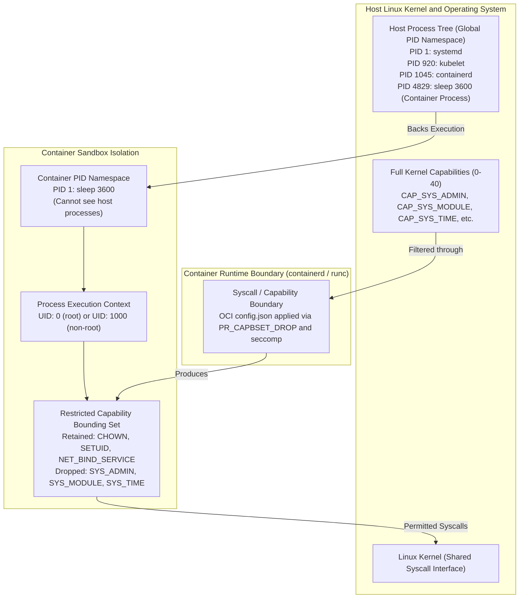
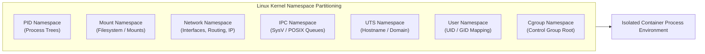
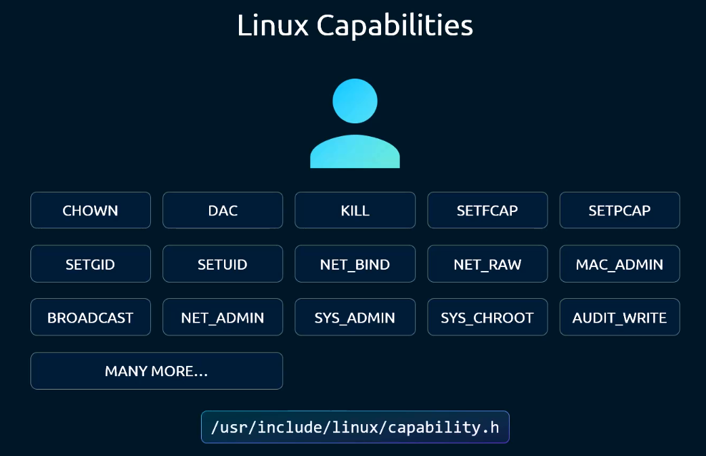
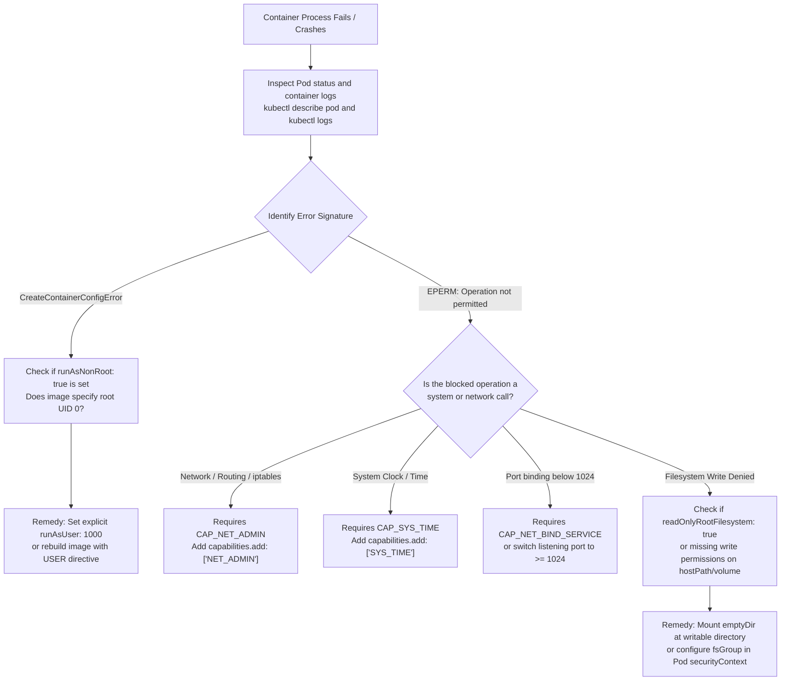

# Linux Container Security & Capabilities - CKA Exam Notes

> **Exam Domain**: Cluster Architecture, Installation & Configuration (25%) / Cluster Security  
> **Weight / Importance**: Critical (Fundamental architectural prerequisite for Pod Security Contexts, Pod Security Standards, container privilege isolation, and troubleshooting runtime permission failures in CKA v1.31 / v1.32)  
> **Target Version**: Verified against v1.31 / v1.32 (Current CKA Curriculum)  
> **Allowed Docs Search Keywords**: `Configure a Security Context for a Pod or Container`, `securityContext`, `capabilities`, `runAsUser`, `runAsNonRoot`, `privileged`  
> **Source**: Generated from `security/13-docker-security-raw.md`

---

## 1. Quick-Reference Summary

- **Kernel Sharing vs. Hypervisor Isolation**:
  - Virtual machines execute separate guest kernels over a hypervisor layer.
  - Containers are standard Linux processes executing directly on the **shared host Linux kernel**, isolated via kernel namespaces and constrained by control groups (cgroups).
- **Process ID (PID) Namespace Mechanics**:
  - A process inside a container's PID namespace sees itself as PID 1 (`init` / entrypoint).
  - On the host root PID namespace, the exact same process exists with a standard host PID (e.g., PID 28419).
  - The host process tree (`ps aux` on the node) reveals all container processes; inside the container, `ps aux` only exposes processes residing within its localized PID namespace.
- **User ID (UID) Security Model**:
  - By default, container runtimes run processes as `root` (UID 0).
  - Because containers share the host kernel, **UID 0 inside the container maps directly to UID 0 on the host** unless user namespace remapping (`userns`) is explicitly enabled.
  - Mitigations: Enforce non-root execution via Dockerfile `USER 1000`, CLI `--user 1000:1000`, or Kubernetes `spec.securityContext.runAsUser: 1000`.
- **Linux Capabilities (`capabilities(7)`)**:
  - Linux decomposes superuser root privileges into ~40 discrete capabilities (defined in `/usr/include/linux/capability.h`).
  - Container runtimes (Docker, containerd, runc) restrict container root processes by default to a safe whitelist (~14 capabilities, such as `CHOWN`, `DAC_OVERRIDE`, `FOWNER`, `SETUID`, `SETGID`, `NET_BIND_SERVICE`).
  - Critical dropped capabilities include: `SYS_ADMIN` (filesystem/namespace control), `SYS_MODULE` (kernel modules), `SYS_RAWIO` (hardware memory), `SYS_TIME` (host clock), and `SYS_PTRACE` (process tracing).
- **Capability Manipulation Syntax**:
  - Adding privileges: `--cap-add <CAP>` (Docker) $\implies$ `securityContext.capabilities.add: ["<CAP>"]` (Kubernetes).
  - Dropping privileges: `--cap-drop <CAP>` (Docker) $\implies$ `securityContext.capabilities.drop: ["<CAP>"]` (Kubernetes).
  - Hardening best practice: Drop all capabilities and explicitly add back only required flags: `drop: ["ALL"]` + `add: ["NET_BIND_SERVICE"]`.
- **The `--privileged` Flag (Total Isolation Collapse)**:
  - Docker `--privileged` / Kubernetes `securityContext.privileged: true` grants all kernel capabilities to the container, disables seccomp and AppArmor/SELinux filters, and exposes all host `/dev` hardware device nodes. It is equivalent to full root access on the host node.

---

## 2. Conceptual Overview & Mental Model

### Dual-Layer Architectural Understanding

- **Simple English Explanation (How It Works)**:
  - When you launch a container, you are not booting an operating system. You are starting a regular Linux process on the host operating system.
  - To prevent that process from seeing other software or monopolizing hardware, the Linux kernel applies boundaries:
    1. **Namespaces**: Limit what the process can **see** (its own process table, its own network interfaces, its own filesystem mounts, its own hostname).
    2. **Control Groups (cgroups)**: Limit what the process can **consume** (maximum CPU cycles, RAM limit, disk I/O throughput, maximum number of child processes).
    3. **Linux Capabilities**: Limit what privileged operations the process can **execute** (binding to network ports below 1024, changing file ownership, sending kill signals).
  - If a container runs as the `root` user (UID 0), it has the user identity of root, but the container runtime drops dangerous kernel capabilities before launching the process.
  - Therefore, a container root process cannot reboot the physical machine, cannot alter the host system clock, and cannot load hardware drivers into the kernel, because its capability bitmask excludes those system calls.
  - When an administrator configures `securityContext` in a Kubernetes Pod, they are instructing the container runtime (`containerd` via `runc`) to tune those exact Linux namespace, user ID, and capability bitmasks.

- **Formal Linux & Kubernetes Definition**:
  - An Open Container Initiative (OCI) container is an instantiation of Linux kernel namespaces (`CLONE_NEWPID`, `CLONE_NEWNET`, `CLONE_NEWNS`, `CLONE_NEWIPC`, `CLONE_NEWUTS`, `CLONE_NEWUSER`), cgroups (v1 controllers or v2 unified hierarchy), and restricted POSIX capability sets (`cap_get_proc(3)`). The container runtime (`containerd`) constructs an OCI runtime specification (`config.json`) derived from the Pod's `SecurityContext`. The OCI runtime (`runc`) invokes `clone(2)` / `unshare(2)` system calls, drops capabilities from the bounding set via `PR_CAPBSET_DROP`, applies seccomp-bpf syscall filters, and executes `setuid(2)` / `setgid(2)` prior to `execve(2)`.

### Host Linux Kernel Process & Capability Architecture



---

## 3. Deep-Dive Technical Breakdown

### 1. Virtual Machines vs. Linux Containers

Understanding why container security differs fundamentally from hypervisor security is essential for the CKA exam:

| Architectural Property | Virtual Machines (VMs) | Linux Containers (OCI / Docker / containerd) |
| :--- | :--- | :--- |
| **Isolation Boundary** | Hardware virtualization (Hypervisor Type 1 / 2) | OS kernel software primitives (Namespaces and cgroups) |
| **Kernel Instance** | Dedicated guest kernel per VM | Single, shared host Linux kernel |
| **Startup Latency** | Minutes (boots full virtual hardware and OS) | Milliseconds (spawns native process via `fork`/`clone`) |
| **Kernel Attack Surface** | Isolated; kernel panics in guest do not crash host | Shared; kernel exploit or panic affects entire host node |
| **Process Visibility** | Host OS cannot inspect guest OS process tables | Host OS directly lists and manages all container processes |
| **Root Execution** | Root in VM has no native access to host kernel | Root in container is UID 0 on host kernel unless constrained |

---

### 2. The Seven Core Linux Namespaces

Containers achieve process and environment isolation by partitioning system resources across Linux namespaces (`clone(2)` flags):



1. **PID Namespace (`CLONE_NEWPID`)**:
   - Isolates the process ID number space.
   - The primary container process is registered as PID 1 inside the container namespace.
   - PID 1 is responsible for signal handling (`SIGTERM`, `SIGKILL`) and reaping orphaned child processes inside the container.
   - On the host, the process receives an arbitrary unused PID in the host PID namespace.
2. **Mount Namespace (`CLONE_NEWNS`)**:
   - Isolates the filesystem hierarchy and mount points.
   - Combined with `pivot_root(2)`, the container receives its own independent root filesystem (`/`) constructed from OCI container image layers and volume mounts.
3. **Network Namespace (`CLONE_NEWNET`)**:
   - Isolates physical/virtual network devices, IP routing tables, firewall (`iptables` / `nftables`) rules, and port binding tables (`sockets`).
   - Every Kubernetes Pod receives a dedicated network namespace shared across all containers within that Pod via the pause container.
4. **IPC Namespace (`CLONE_NEWIPC`)**:
   - Isolates Inter-Process Communication resources, including System V IPC message queues, semaphores, and POSIX shared memory (`/dev/shm`).
5. **UTS Namespace (`CLONE_NEWUTS`)**:
   - Isolates the hostname and NIS domain name (`sethostname(2)`).
   - Allows each container/Pod to have its own network hostname independent of the node's hostname.
6. **User Namespace (`CLONE_NEWUSER`)**:
   - Maps user and group IDs between the container and the host.
   - Allows a process to have UID 0 inside the container while mapping to an unprivileged UID (e.g., UID 100000) on the host kernel.
   - *Kubernetes Note*: User namespaces in Kubernetes graduated to Beta in v1.30 (`hostUsers: false` field in Pod spec).
7. **Cgroup Namespace (`CLONE_NEWCGROUP`)**:
   - Virtualizes the view of `/proc/self/cgroup`, hiding host cgroup hierarchy paths from the container.

---

### 3. User Identity (UID/GID) Security Model

When a container process executes:
- By default, the container runtime uses UID 0 (`root`) unless configured otherwise in the image or runtime spec.
- Because the kernel is shared, if an attacker breaks out of the container boundary while running as UID 0, **they possess root authority over the host operating system**.

#### Defense-in-Depth User Constraints:
1. **Build-Time Hardening (Dockerfile)**:
   ```dockerfile
   FROM ubuntu:24.04
   RUN useradd -u 1000 -m appuser
   USER 1000:1000
   ENTRYPOINT ["app-binary"]
   ```
2. **CLI Runtime Override (Docker)**:
   ```bash
   docker run --user 1000:1000 ubuntu id
   # Output: uid=1000 gid=1000 groups=1000
   ```
3. **Kubernetes Declarative Enforcement (`securityContext`)**:
   ```yaml
   apiVersion: v1
   kind: Pod
   metadata:
     name: non-root-pod
   spec:
     securityContext:
       runAsUser: 1000
       runAsGroup: 1000
       runAsNonRoot: true
     containers:
     - name: app
       image: ubuntu
       command: ["sleep", "3600"]
   ```
   > [!IMPORTANT]
   > Setting `runAsNonRoot: true` instructs the `kubelet` to inspect the image metadata and the specified UID. If the container would run as UID 0, `kubelet` refuses to start the container and emits a `CreateContainerConfigError`.

---

### 4. Linux Capabilities (`capabilities(7)`) Mechanics

Traditional UNIX privilege models are binary: either a process has effective UID 0 (unrestricted superuser access) or an unprivileged UID (access denied to privileged system calls).

Linux decomposes superuser privileges into discrete, independent units called **Capabilities**:



*Source: `/usr/include/linux/capability.h`*

#### Capability Sets Maintained by the Linux Kernel:
- **Permitted Set (`cap_permitted`)**: The limiting superset of capabilities the thread is permitted to assume.
- **Inheritable Set (`cap_inheritable`)**: Capabilities preserved across an `execve(2)` call when not running as root.
- **Effective Set (`cap_effective`)**: The active capability bitmask used by the kernel to perform permission checks.
- **Bounding Set (`cap_bounding`)**: The mechanism used by container runtimes to permanently limit the capabilities a thread can acquire.
- **Ambient Set (`cap_ambient`)**: Capabilities preserved across unprivileged `execve(2)` invocations without requiring file capabilities.

#### Default Whitelist vs. High-Risk Dropped Capabilities:

| Capability Name | Default Status | System Operations Governed | Exam Relevance & Risk Level |
| :--- | :--- | :--- | :--- |
| **`CAP_CHOWN`** | **Retained** | Change file UID and GID ownership arbitrarily | Low risk; needed for package managers |
| **`CAP_DAC_OVERRIDE`** | **Retained** | Bypass file read, write, and execute permission bits | Medium risk; allows reading root-owned config files |
| **`CAP_FOWNER`** | **Retained** | Bypass permission checks for operations requiring file owner ID | Low risk; allows modifying permissions on files |
| **`CAP_KILL`** | **Retained** | Bypass permission checks for sending signals (`kill(2)`) | Low risk; needed for process managers |
| **`CAP_SETUID`** | **Retained** | Make arbitrary manipulations of process UIDs | Medium risk; allows dropping or assuming user IDs |
| **`CAP_SETGID`** | **Retained** | Make arbitrary manipulations of process GIDs | Medium risk; allows group ID manipulation |
| **`CAP_NET_BIND_SERVICE`** | **Retained** | Bind a socket to privileged standard ports ($< 1024$) | Essential for web servers listening on 80/443 |
| **`CAP_NET_RAW`** | **Retained** | Use RAW and PACKET sockets (e.g., ICMP `ping`) | Low risk; used by diagnostic network utilities |
| **`CAP_NET_ADMIN`** | **DROPPED** | Configure network interfaces, IP routing, iptables, IPsec | **High Exam Yield**: Required by CNI plugins, Service Mesh proxies, VPNs |
| **`CAP_SYS_ADMIN`** | **DROPPED** | Overloaded catch-all: mount/umount, set cgroups, BPF, chroot | **CRITICAL**: The most dangerous capability; equivalent to root |
| **`CAP_SYS_MODULE`** | **DROPPED** | Load and unload kernel modules (`init_module(2)`) | **CRITICAL**: Allows injecting malicious code into host kernel |
| **`CAP_SYS_RAWIO`** | **DROPPED** | Perform raw I/O port operations, access `/dev/mem` | **CRITICAL**: Direct access to host physical memory |
| **`CAP_SYS_TIME`** | **DROPPED** | Alter system real-time clock (`settimeofday(2)`) | Disrupts host NTP and cluster etcd synchronization |
| **`CAP_SYS_PTRACE`** | **DROPPED** | Trace arbitrary processes using `ptrace(2)` | Allows inspecting memory and hijacking other host processes |
| **`CAP_SYS_BOOT`** | **DROPPED** | Reboot or restart the host system (`reboot(2)`) | Host disruption |

---

### 5. Anatomy of the `--privileged` Flag

When a container is started with `--privileged` (Docker CLI) or `securityContext.privileged: true` (Kubernetes):
1. **Bounding Set Reset**: The container runtime does **not** drop any capabilities from the bounding set. All ~40 Linux capabilities are granted (`CAP_SYS_ADMIN`, `CAP_SYS_MODULE`, `CAP_SYS_RAWIO`, etc.).
2. **Device Whitelist Disabled**: The cgroup device controller restrictions are lifted. The runtime passes all host device nodes (`/dev/*`, including disk drives `/dev/sda`, physical memory `/dev/mem`, and `/dev/kmsg`) directly into the container filesystem.
3. **Seccomp Filters Disabled**: The default seccomp profile (which blocks ~44 dangerous system calls like `reboot`, `sys_chroot`, `kexec_load`) is completely deactivated.
4. **AppArmor / SELinux Disabled**: Mandatory Access Control (MAC) confinement profiles (`docker-default` or `containerd` profiles) are removed.
5. **Masked & Read-Only Paths Unlocked**: Kernel filesystem safety overlays (masking `/proc/kcore`, `/proc/sysrq-trigger`, `/sys/firmware`) are mounted read-write.

> [!CAUTION]
> A privileged container provides zero effective security isolation. Any root process inside a privileged container can mount the host's root block device (`mount /dev/sda1 /mnt`) and modify host credentials, install kernel rootkits, or terminate the host node.

---

## 4. Command Translation & Mapping Tables

### Docker CLI vs. `crictl` vs. Kubernetes Pod Spec

| Security Setting | Docker CLI Flag | `crictl` Pod/Container Config | Kubernetes Pod Spec (`securityContext`) |
| :--- | :--- | :--- | :--- |
| **Run as Non-Root UID** | `docker run --user 1000:1000` | `security_context.run_as_user: 1000` | `spec.securityContext.runAsUser: 1000`<br/>`spec.securityContext.runAsGroup: 1000` |
| **Enforce Non-Root Execution** | *(Not natively enforced by CLI)* | *(Runtime configuration)* | `spec.securityContext.runAsNonRoot: true` |
| **Add Capability** | `docker run --cap-add NET_ADMIN` | `security_context.capabilities.add_capabilities: ["NET_ADMIN"]` | `spec.containers[].securityContext.capabilities.add: ["NET_ADMIN"]` |
| **Drop Capability** | `docker run --cap-drop KILL` | `security_context.capabilities.drop_capabilities: ["KILL"]` | `spec.containers[].securityContext.capabilities.drop: ["KILL"]` |
| **Drop All Capabilities** | `docker run --cap-drop ALL` | `security_context.capabilities.drop_capabilities: ["ALL"]` | `spec.containers[].securityContext.capabilities.drop: ["ALL"]` |
| **Full Privileged Mode** | `docker run --privileged` | `security_context.privileged: true` | `spec.containers[].securityContext.privileged: true` |
| **Read-Only Root Filesystem** | `docker run --read-only` | `security_context.readonly_rootfs: true` | `spec.containers[].securityContext.readOnlyRootFilesystem: true` |
| **Allow Privilege Escalation** | `docker run --security-opt no-new-privileges:false` | `security_context.no_new_privs: false` | `spec.containers[].securityContext.allowPrivilegeEscalation: true` |

> [!NOTE]
> In Kubernetes manifests, capability names are specified without the `CAP_` prefix (e.g., `NET_ADMIN`, `SYS_TIME`, `KILL`), although Kubernetes API also accepts `CAP_`-prefixed strings. Best practice for the CKA exam is to use standard uppercase without prefix: `["NET_ADMIN"]`.

---

## 5. High-Yield CLI & Imperative Commands

### 1. Inspecting Host Processes and Container Namespaces

```bash
# 1. Identify the container process running on the host node
ps aux | grep -i sleep

# 2. View the namespace symlinks for a specific host PID
ls -la /proc/<HOST-PID>/ns/
# Sample output:
# cgroup -> 'cgroup:[4026531835]'
# ipc    -> 'ipc:[4026532588]'
# mnt    -> 'mnt:[4026532586]'
# net    -> 'net:[4026532591]'
# pid    -> 'pid:[4026532589]'
# user   -> 'user:[4026531837]'
# uts    -> 'uts:[4026532587]'

# 3. Execute a diagnostic command inside an existing container's namespaces via nsenter
nsenter -t <HOST-PID> -m -u -i -n -p ps aux
```

### 2. Auditing Process Capabilities on Linux

```bash
# 1. Inspect the capability status of any running process via /proc
grep -i Cap /proc/<HOST-PID>/status
# Output provides hexadecimal capability bitmasks:
# CapInh: 0000000000000000 (Inherited)
# CapPrm: 00000000a80425fb (Permitted)
# CapEff: 00000000a80425fb (Effective)
# CapBnd: 00000000a80425fb (Bounding)
# CapAmb: 0000000000000000 (Ambient)

# 2. Decode the hexadecimal capability bitmask into human-readable names using capsh
capsh --decode=00000000a80425fb

# 3. View the capabilities of a specific running process via getpcaps
getpcaps <HOST-PID>

# 4. Display the capability bounding set of the current shell session
capsh --print
```

### 3. Imperative Kubernetes Manifest Generation & Patching

```bash
# 1. Generate an imperative Pod manifest template with dry-run
kubectl run security-test --image=ubuntu:24.04 --dry-run=client -o yaml --command -- sleep 3600 > pod.yaml

# 2. Verify effective UID inside a running pod
kubectl exec -it security-test -- id

# 3. Test capability addition inside a Pod
kubectl exec -it security-test -- ip link add dummy0 type dummy
# Without NET_ADMIN: RTNETLINK answers: Operation not permitted
# With NET_ADMIN: Creates the dummy interface successfully
```

---

## 6. Troubleshooting & Diagnostic Runbook

### Capability & Permission Failure Decision Tree



### Step-by-Step Triage Sequence

| Issue / Symptom | Root Cause | Verification Command | Resolution Strategy |
| :--- | :--- | :--- | :--- |
| **`CreateContainerConfigError`** | `runAsNonRoot: true` is configured, but the image defaults to UID 0 and no `runAsUser` is declared | `kubectl get pod <pod> -o jsonpath='{.status.containerStatuses[0].state.waiting.message}'` | Add `securityContext.runAsUser: 1000` to the Pod or container spec. |
| **`Operation not permitted` (binding port 80)** | Container runs as non-root user (e.g. UID 1000) without `CAP_NET_BIND_SERVICE` | `kubectl logs <pod>` showing `bind: Permission denied` | Add `NET_BIND_SERVICE` capability or change application to listen on high ports (e.g., 8080). |
| **`Operation not permitted` (iptables / ip link)** | Process requires `CAP_NET_ADMIN` to manipulate network interfaces or packet filtering | `kubectl logs <pod>` showing `RTNETLINK answers: Operation not permitted` | Add `securityContext.capabilities.add: ["NET_ADMIN"]` under container spec. |
| **Read-only file system error** | `readOnlyRootFilesystem: true` is enabled, and application attempts to write to `/tmp` or `/var/log` | `kubectl logs <pod>` showing `touch: cannot touch '/tmp/test': Read-only file system` | Mount a writable `emptyDir` volume at the required path (`/tmp` or `/var/log`). |
| **Host process interference** | Container running with `hostPID: true` or `privileged: true` | `kubectl get pod <pod> -o yaml \| grep -E 'hostPID\|privileged'` | Remove `hostPID: true` and remove `privileged: true` to restore namespace isolation. |

---

## 7. CKA Exam Tips, Gotchas & Traps

> [!WARNING]
> **Trap 1: Pod-Level vs. Container-Level `securityContext` Scope**  
> In Kubernetes, `capabilities` can **ONLY** be declared at the container level (`spec.containers[].securityContext.capabilities`). Declaring `capabilities` under `spec.securityContext` (Pod level) causes schema validation rejection by the API server: `error: error validating data: ValidationError(Pod.spec.securityContext): unknown field "capabilities"`.  
> Conversely, `runAsUser`, `runAsGroup`, `fsGroup`, and `runAsNonRoot` can be defined at the Pod level and are inherited by all containers in the Pod.

> [!IMPORTANT]
> **Trap 2: `NET_ADMIN` vs. `--privileged` in Exam Questions**  
> If an exam question states: *"Configure the container to allow network routing manipulation without running as full privileged"*, **DO NOT** set `privileged: true`! You will receive zero marks. The correct solution is:
> ```yaml
> securityContext:
>   capabilities:
>     add: ["NET_ADMIN"]
> ```

> [!TIP]
> **Trap 3: Non-Root User Filesystem Permission Denied on Volumes**  
> When you configure `runAsUser: 1000`, the container process runs as an unprivileged user. If that container mounts a persistent volume or `hostPath` created by root, writes will fail with `Permission Denied`.  
> Always use `fsGroup: 1000` or `fsGroup: 2000` at the Pod level:
> ```yaml
> spec:
>   securityContext:
>     runAsUser: 1000
>     fsGroup: 1000 # Automatically changes ownership of mounted volumes to GID 1000
> ```

> [!IMPORTANT]
> **Trap 4: Modern CRI Runtimes and the Dockershim Removal**  
> Kubernetes removed `dockershim` in v1.24. On modern CKA clusters (v1.31 / v1.32), `docker ps` is not available on worker nodes. The container runtime is `containerd`. Use **`crictl`** for node-level container troubleshooting:
> - `crictl ps` (list containers)
> - `crictl pods` (list pods)
> - `crictl logs <container-id>`
> - `crictl inspect <container-id>`

---

## 8. Self-Test / Active Recall

Try answering the questions below without looking at the notes, then expand each question to check your understanding.

<details>
<summary><b>1. Why does a process running inside a container have two distinct PIDs?</b></summary>

Because of Linux PID namespaces. Inside the container's isolated PID namespace, the process is registered as PID 1 to handle signal propagation and process lifecycle. In the host node's global root PID namespace, the exact same process is assigned a standard host PID (e.g. PID 4829) in the host process tree.
</details>

<details>
<summary><b>2. If a container runs as UID 0 by default, why can it not reboot the host physical node?</b></summary>

Because the container runtime drops dangerous Linux capabilities from the container's capability bounding set upon initialization. Rebooting a host requires `CAP_SYS_BOOT`, which is omitted from the default runtime capability whitelist.
</details>

<details>
<summary><b>3. What are the three primary Linux kernel isolation primitives that make up a container?</b></summary>

1. **Namespaces** (isolates what processes can see: PID, Mount, Net, IPC, UTS, User, Cgroup).
2. **Control Groups / cgroups** (isolates what resources processes can consume: CPU, Memory, Disk I/O, PIDs).
3. **Capabilities & Seccomp** (isolates what system calls and privileged actions processes can execute).
</details>

<details>
<summary><b>4. Where in a Kubernetes Pod manifest must the `capabilities` field be specified?</b></summary>

Exclusively under the individual container's security context: `spec.containers[].securityContext.capabilities`. It is invalid at the Pod-level `spec.securityContext`.
</details>

<details>
<summary><b>5. What occurs if `runAsNonRoot: true` is configured on a Pod, but the container image has no `USER` directive and no `runAsUser` is specified?</b></summary>

The `kubelet` fails container admission and enters a `CreateContainerConfigError` state, stating that the container has `runAsNonRoot` enforced but the image defaults to running as root (UID 0).
</details>

<details>
<summary><b>6. What are the four major security features disabled when `privileged: true` is set on a container?</b></summary>

1. All ~40 Linux capabilities are granted in the bounding set (including `SYS_ADMIN`).
2. Seccomp system call filtering is disabled.
3. AppArmor / SELinux security profiles are deactivated.
4. All host device nodes in `/dev` are exposed directly to the container.
</details>

<details>
<summary><b>7. How do you configure a container to drop all default capabilities and only add `NET_BIND_SERVICE`?</b></summary>

```yaml
securityContext:
  capabilities:
    drop:
    - ALL
    add:
    - NET_BIND_SERVICE
```
</details>

<details>
<summary><b>8. Which Linux capability is required for a container to alter network routing tables and configure iptables rules?</b></summary>

`CAP_NET_ADMIN` (specified as `NET_ADMIN` in Kubernetes YAML).
</details>

<details>
<summary><b>9. What Linux command decodes a hexadecimal capability bitmask obtained from `/proc/<pid>/status`?</b></summary>

`capsh --decode=<HEX_BITMASK>` (e.g., `capsh --decode=00000000a80425fb`).
</details>

<details>
<summary><b>10. Which command-line tool replaced `docker` for node-level container inspection on Kubernetes v1.24+ nodes?</b></summary>

`crictl` (Container Runtime Interface CLI), configured to communicate with the CRI runtime socket (e.g., `/run/containerd/containerd.sock`).
</details>

---

### Official Documentation Bookmarks

| Documentation Page Title | Allowed Search Query Keyword | Direct Documentation URL |
| :--- | :--- | :--- |
| **Configure a Security Context for a Pod or Container** | `securityContext capabilities` | [https://kubernetes.io/docs/tasks/configure-pod-container/security-context/](https://kubernetes.io/docs/tasks/configure-pod-container/security-context/) |
| **Pod Security Standards** | `pod security standards restricted baseline` | [https://kubernetes.io/docs/concepts/security/pod-security-standards/](https://kubernetes.io/docs/concepts/security/pod-security-standards/) |
| **Set capabilities for a Container** | `capabilities add drop` | [https://kubernetes.io/docs/tasks/configure-pod-container/security-context/#set-capabilities-for-a-container](https://kubernetes.io/docs/tasks/configure-pod-container/security-context/#set-capabilities-for-a-container) |
| **Linux Capabilities Reference Manual** | `man 7 capabilities` | [https://man7.org/linux/man-pages/man7/capabilities.7.html](https://man7.org/linux/man-pages/man7/capabilities.7.html) |
