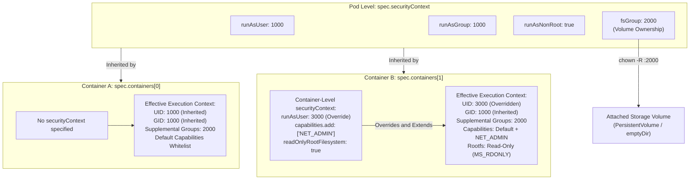
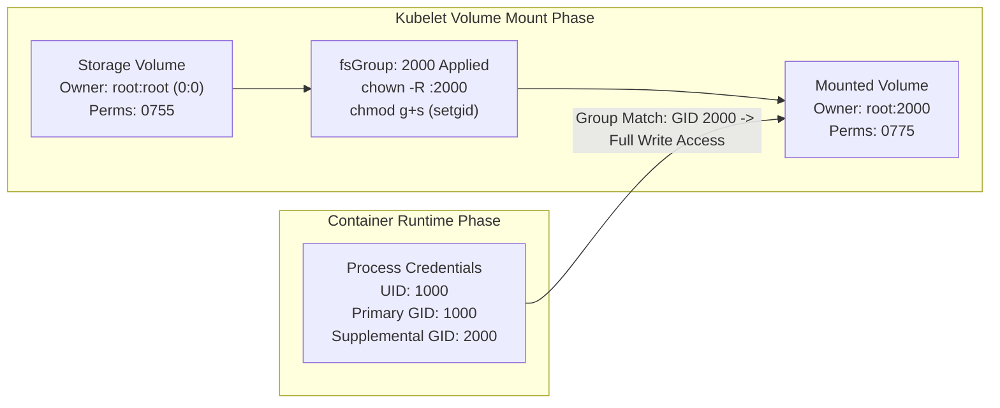
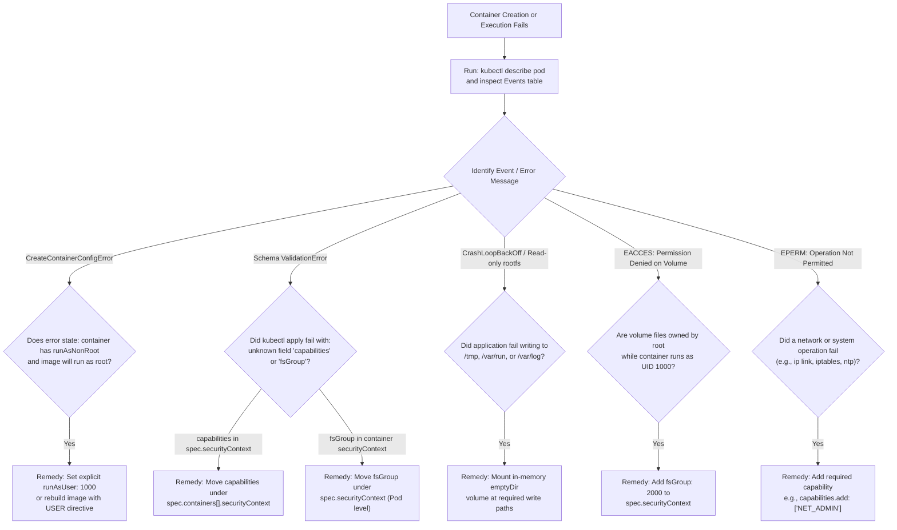

# Pod & Container Security Context - CKA Exam Notes

> **Exam Domain**: Cluster Architecture, Installation & Configuration (25%) / Cluster Security  
> **Weight / Importance**: Critical (Frequently tested hands-on topic in CKA: defining Pod-level and Container-level security contexts, configuring non-root user/group IDs, resolving volume permission issues with `fsGroup`, adding/dropping Linux capabilities, enforcing read-only root filesystems, and troubleshooting `CreateContainerConfigError`)  
> **Target Version**: Verified against v1.31 / v1.32 (Current CKA Curriculum)  
> **Allowed Docs Search Keywords**: `Configure a Security Context for a Pod or Container`, `securityContext`, `runAsUser`, `runAsGroup`, `fsGroup`, `capabilities`, `privileged`, `readOnlyRootFilesystem`, `allowPrivilegeEscalation`  
> **Source**: Generated from `security/14-security-context-raw.md`

---

## 1. Quick-Reference Summary

- **Security Context Scope Hierarchy**:
  - **Pod-Level (`spec.securityContext`)**: Applies default security credentials across all containers (including init and ephemeral containers) inside the Pod, as well as Pod-wide storage volume ownership.
  - **Container-Level (`spec.containers[].securityContext`)**: Applies security settings to an individual container. Container-level definitions **override** overlapping Pod-level definitions for that specific container.
- **Strict Scope Boundaries (API Schema Enforcement)**:
  - **Valid ONLY at Container Level**:
    - `capabilities` (`add` / `drop`)
    - `privileged` (`true` / `false`)
    - `readOnlyRootFilesystem` (`true` / `false`)
    - `allowPrivilegeEscalation` (`true` / `false`)
    - `procMount` (`Default` / `Unmasked`)
  - **Valid ONLY at Pod Level**:
    - `fsGroup` (sets group ownership on mounted volumes)
    - `fsGroupChangePolicy` (`OnRootMismatch` / `Always`)
    - `supplementalGroups` (adds GIDs to process supplemental group list)
    - `sysctls` (configures safe/unsafe kernel network/IPC parameters)
  - **Valid at BOTH Levels (Container Overrides Pod)**:
    - `runAsUser` (POSIX UID)
    - `runAsGroup` (POSIX primary GID)
    - `runAsNonRoot` (enforces UID $\neq 0$)
    - `seccompProfile` (`RuntimeDefault`, `Localhost`, `Unconfined`)
    - `seLinuxOptions` (SELinux labels)
    - `appArmorProfile` (AppArmor profile configuration)
- **Non-Root Execution Trap**:
  - If `runAsNonRoot: true` is configured, but the image defaults to UID 0 and no `runAsUser` is declared, `kubelet` aborts container launch with **`CreateContainerConfigError`**.
- **Volume Ownership with `fsGroup`**:
  - Non-root containers (`runAsUser: 1000`) cannot write to volumes owned by root (`0:0`).
  - Declaring `fsGroup: 2000` under `spec.securityContext` causes `kubelet` to recursively set group ownership of mounted volumes to GID 2000 and appends GID 2000 to the container process's supplemental groups.
- **Linux Capabilities Syntax**:
  - Specified exclusively under `spec.containers[].securityContext.capabilities`.
  - Values are standard uppercase capability strings without the `CAP_` prefix (e.g. `add: ["NET_ADMIN"]`, `drop: ["ALL"]`).
- **Privilege Escalation Prevention**:
  - `allowPrivilegeEscalation: false` sets the Linux kernel `PR_SET_NO_NEW_PRIVS` flag, preventing setuid binaries (such as `sudo` or `ping`) from elevating privileges. Mandatory for Pod Security Standards Restricted profile.

---

## 2. Conceptual Overview & Mental Model

### Dual-Layer Architectural Understanding

- **Simple English Explanation (How It Works)**:
  - When the Kubernetes `kubelet` launches a container process through the container runtime (`containerd`), it must configure that process's operating system credentials and security boundaries.
  - A **Security Context** is a set of instructions in the YAML manifest that tells `kubelet` exactly how to launch that process:
    1. Which user ID (UID) and primary group ID (GID) should own the process.
    2. Which group ID should own files stored on mounted disk volumes (`fsGroup`).
    3. Which specific kernel superpowers (Linux Capabilities) the process should keep or have revoked.
    4. Whether the container's root filesystem is locked as read-only.
  - Kubernetes provides two places to define this configuration:
    - **Pod Level (`spec.securityContext`)**: Sets common defaults (like run as UID 1000 and mount volumes with GID 2000) so you don't have to repeat the configuration for every container.
    - **Container Level (`spec.containers[].securityContext`)**: Sets container-specific controls. If a container defines its own UID (e.g. UID 2000), it overrides the Pod-level UID 1000. Furthermore, because Linux capabilities and read-only filesystem locks are attached to individual processes and mount namespaces, Kubernetes requires capabilities and root filesystem flags to be declared strictly at the container level.

- **Formal Kubernetes & Linux Architecture Definition**:
  - In the Kubernetes API (`k8s.io/api/core/v1`), `PodSecurityContext` governs Pod-wide execution attributes, kernel sysctls, and VFS volume ownership permissions mediated by `kubelet` during volume attachment. `SecurityContext` governs container-level process isolation implemented via OCI runtime specification (`config.json`). During container initialization, the OCI runtime (`runc`) executes `setresuid(2)`, `setresgid(2)`, `setgroups(2)`, adjusts capability bounding and ambient sets via `PR_CAPBSET_DROP`, enables `PR_SET_NO_NEW_PRIVS`, sets the root mount as `MS_RDONLY`, and applies seccomp-bpf syscall filters.

### Pod vs. Container Security Context Inheritance and Overrides



---

## 3. Deep-Dive Technical Breakdown

### 1. Scope Reference Matrix: Pod vs. Container Security Context

The following matrix defines the exact schema boundaries enforced by the Kubernetes API server (`kube-apiserver`):

| Security Parameter | Pod Level (`spec.securityContext`) | Container Level (`spec.containers[].securityContext`) | Overrides Pod? | Underlying Linux Kernel Mechanism |
| :--- | :---: | :---: | :---: | :--- |
| **`runAsUser`** | Yes | Yes | **Yes** | `setuid(2)` / `setresuid(2)` |
| **`runAsGroup`** | Yes | Yes | **Yes** | `setgid(2)` / `setresgid(2)` |
| **`runAsNonRoot`** | Yes | Yes | **Yes** | Kubelet pre-start validation check (UID $\neq 0$) |
| **`fsGroup`** | **Yes** | **No** | N/A | `chown -R :<GID>` on volume mount + `setgroups(2)` |
| **`fsGroupChangePolicy`** | **Yes** | **No** | N/A | Kubelet volume permission update strategy |
| **`supplementalGroups`** | **Yes** | **No** | N/A | `setgroups(2)` process supplemental GID list |
| **`sysctls`** | **Yes** | **No** | N/A | `/proc/sys/` namespaced kernel tunables |
| **`capabilities`** | **No** | **Yes** | N/A | `PR_CAPBSET_DROP`, ambient and permitted sets |
| **`privileged`** | **No** | **Yes** | N/A | Grants all capabilities, disables seccomp/cgroup device whitelist |
| **`readOnlyRootFilesystem`** | **No** | **Yes** | N/A | `mount(2)` with `MS_RDONLY` flag on rootfs |
| **`allowPrivilegeEscalation`** | **No** | **Yes** | N/A | `prctl(PR_SET_NO_NEW_PRIVS, 1, 0, 0, 0)` |
| **`procMount`** | **No** | **Yes** | N/A | Masks sensitive paths in `/proc` (`Default` vs `Unmasked`) |
| **`seccompProfile`** | Yes | Yes | **Yes** | `seccomp(2)` system call BPF filters |
| **`seLinuxOptions`** | Yes | Yes | **Yes** | SELinux process security context labels |
| **`appArmorProfile`** | Yes | Yes | **Yes** | AppArmor Mandatory Access Control profiles |

---

### 2. User & Group ID Mechanics (`runAsUser`, `runAsGroup`, `runAsNonRoot`)

When `kubelet` instructs the container runtime to launch a container:
1. **`runAsUser`**: Sets the numeric POSIX user ID of the primary entrypoint process.
2. **`runAsGroup`**: Sets the numeric POSIX primary group ID of the process. If omitted, the container runtime defaults to the primary GID associated with the user in the container image's `/etc/passwd`.
3. **`runAsNonRoot`**: A safety constraint enforced by `kubelet` before calling the CRI runtime:
   - If `runAsNonRoot: true` is set, `kubelet` verifies that the effective UID is not `0`.
   - If `runAsUser` is explicitly set to a non-zero integer (e.g. `1000`), validation passes.
   - If `runAsUser` is omitted, `kubelet` queries the image metadata (`Config.User`). If the image specifies a non-zero numeric user, validation passes.
   - If the image defaults to root (or user is unspecified), `kubelet` refuses container creation with `CreateContainerConfigError`:
     ```text
     Error: container has runAsNonRoot and image will run as root (uid 0)
     ```

```yaml
apiVersion: v1
kind: Pod
metadata:
  name: hardened-user-pod
spec:
  securityContext:
    runAsNonRoot: true
    runAsUser: 10001
    runAsGroup: 10001
  containers:
  - name: secure-app
    image: cgr.dev/chainguard/static:latest
```

---

### 3. Volume Permission Management with `fsGroup`

A common issue in Kubernetes arises when a container runs as an unprivileged user (e.g., `runAsUser: 1000`) and mounts a `PersistentVolumeClaim` or an `emptyDir` volume:
- The default Linux owner of freshly formatted volumes or empty directories is `root:root` (`0:0`) with permissions `0755` (`drwxr-xr-x`).
- When the process (UID 1000) tries to write a file or directory, the kernel checks POSIX permissions:
  - UID 1000 is not owner (`root`).
  - GID 1000 is not group (`root`).
  - Other permissions allow only read and execute (`r-x`).
  - Result: Write operation terminates with `EACCES: Permission denied`.

#### The `fsGroup` Solution:
- Setting `fsGroup: 2000` under `spec.securityContext` tells `kubelet`:
  1. Add GID 2000 to the container process's supplemental groups (`groups` command will show GID 2000).
  2. Change group ownership of the volume root directory and all its contents to GID 2000 (`chown -R :2000 /mount-path`).
  3. Set the `setgid` bit on directories within the volume so that new files created inside inherit GID 2000.



#### `fsGroupChangePolicy` Optimization:
When mounting large persistent volumes with millions of files, recursive `chown` causes massive pod startup latency (several minutes). In Kubernetes v1.23+ (GA), `fsGroupChangePolicy` controls this behavior:
- **`Always` (Default)**: Volume ownership and permissions are recursively changed on every volume mount.
- **`OnRootMismatch`**: Volume permissions are changed **only if** the top-level root directory's permission or ownership does not match `fsGroup`. Drastically accelerates pod startup for large datasets.

```yaml
spec:
  securityContext:
    runAsUser: 1000
    fsGroup: 2000
    fsGroupChangePolicy: "OnRootMismatch"
```

---

### 4. Linux Capabilities Configuration (`capabilities.add` & `capabilities.drop`)

Linux capabilities divide monolithic root powers into ~40 discrete flags. In Kubernetes manifests, capabilities are managed under `spec.containers[].securityContext.capabilities`:

```yaml
apiVersion: v1
kind: Pod
metadata:
  name: network-tuning-pod
spec:
  containers:
  - name: net-tool
    image: alpine:latest
    command: ["sleep", "3600"]
    securityContext:
      capabilities:
        drop:
        - ALL
        add:
        - NET_ADMIN
        - NET_RAW
```

#### Key Rules for Capabilities in Kubernetes:
1. **Case and Prefix**: Best practice is uppercase without the `CAP_` prefix: `["NET_ADMIN"]`, `["SYS_TIME"]`, `["KILL"]`.
2. **`drop: ["ALL"]` Pattern**: The gold standard for container hardening. Drops all default capabilities (such as `CHOWN`, `DAC_OVERRIDE`, `FOWNER`, `SETUID`), then explicitly whitelists only the exact capability needed.
3. **Cannot Be Declared at Pod Level**: Capabilities are process-specific. Placing `capabilities` under `spec.securityContext` results in immediate API rejection.

---

### 5. Privilege Escalation & Read-Only Root Filesystem

#### `allowPrivilegeEscalation: false`
- Under standard Linux execution, a non-root process can execute a binary marked with the `setuid` bit (`-rwsr-xr-x`, such as `/usr/bin/passwd` or `/bin/mount`) and temporarily gain root privileges.
- Setting `allowPrivilegeEscalation: false` invokes the kernel system call:
  $$\texttt{prctl(PR\_SET\_NO\_NEW\_PRIVS, 1, 0, 0, 0)}$$
- Once `no_new_privs` is active, the kernel guarantees that neither the current process nor any of its child processes can ever gain additional privileges through `execve(2)`. Even if a setuid-root binary is invoked, it runs with only the privileges of the calling process.
- **Pod Security Standards Alignment**: Mandatory for the `Restricted` profile.

#### `readOnlyRootFilesystem: true`
- Mounts the container's root filesystem (`/`) with the kernel `MS_RDONLY` flag.
- Prevents malicious actors or compromised applications from modifying application binaries, overwriting system configuration files (`/etc`), or installing rootkits.
- **The Writable Directory Pattern**: Real-world applications frequently require writing temporary files, PID files, or logs (e.g. to `/tmp` or `/var/run`). If `readOnlyRootFilesystem: true` is configured without providing writable mounts, the application crashes immediately.
- **Solution**: Mount an in-memory `emptyDir` volume at the required writable locations:

```yaml
apiVersion: v1
kind: Pod
metadata:
  name: readonly-app
spec:
  containers:
  - name: web
    image: nginx:alpine
    securityContext:
      readOnlyRootFilesystem: true
    volumeMounts:
    - name: tmp-dir
      mountPath: /tmp
    - name: cache-dir
      mountPath: /var/cache/nginx
    - name: run-dir
      mountPath: /var/run
  volumes:
  - name: tmp-dir
    emptyDir: {}
  - name: cache-dir
    emptyDir: {}
  - name: run-dir
    emptyDir: {}
```

---

## 4. Command Translation & Mapping Tables

### Complete Pod-Level vs. Container-Level Manifest Syntax

```yaml
apiVersion: v1
kind: Pod
metadata:
  name: comprehensive-security-context
spec:
  # ==========================================
  # 1. POD-LEVEL SECURITY CONTEXT (spec.securityContext)
  # ==========================================
  securityContext:
    runAsUser: 1000            # Default UID for all containers
    runAsGroup: 1000           # Default primary GID for all containers
    runAsNonRoot: true         # Enforce that no container runs as root
    fsGroup: 2000              # Volume ownership GID
    fsGroupChangePolicy: "OnRootMismatch"
    supplementalGroups: [3000, 4000] # Additional GIDs for process
    seccompProfile:
      type: RuntimeDefault     # Default secure seccomp BPF profile

  containers:
  # ==========================================
  # Container 1: Inherits all Pod-level settings
  # ==========================================
  - name: default-worker
    image: busybox:1.36
    command: ["sleep", "3600"]

  # ==========================================
  # Container 2: Overrides UID and adds Container-only settings
  # ==========================================
  - name: privileged-network-worker
    image: alpine:latest
    command: ["sleep", "3600"]
    securityContext:
      runAsUser: 2000          # Overrides Pod-level runAsUser: 1000
      allowPrivilegeEscalation: false
      readOnlyRootFilesystem: true
      capabilities:
        drop:
        - ALL
        add:
        - NET_ADMIN            # Container-only field
```

---

### Pod Security Standards (PSS) Compliance Matrix

| Security Context Field | Privileged Profile | Baseline Profile | Restricted Profile (Hardened) |
| :--- | :--- | :--- | :--- |
| **`privileged`** | Allowed (`true`) | **Forbidden** (must be `false` or omitted) | **Forbidden** |
| **`capabilities`** | Unrestricted | Must not add capabilities beyond default set | Must drop `ALL`; may only add `NET_BIND_SERVICE` |
| **`runAsNonRoot`** | Unrestricted | Unrestricted | **Required** (`true` or non-zero `runAsUser`) |
| **`allowPrivilegeEscalation`** | Unrestricted | Unrestricted | **Forbidden** (must be `false`) |
| **`seccompProfile`** | Unrestricted | Unrestricted | Must be `RuntimeDefault` or `Localhost` |
| **Host Namespaces (`hostPID`, `hostNetwork`, `hostIPC`)** | Allowed | **Forbidden** | **Forbidden** |

---

## 5. High-Yield CLI & Imperative Commands

### 1. Generating Pod Manifests and Appending Security Context

```bash
# 1. Imperatively generate a clean YAML template for a Pod
kubectl run secure-pod --image=alpine --dry-run=client -o yaml --command -- sleep 3600 > secure-pod.yaml

# 2. Imperatively generate a Deployment YAML template
kubectl create deployment secure-deploy --image=nginx:alpine --dry-run=client -o yaml > deploy.yaml
```

### 2. Inspecting Live Security Context State Inside Containers

```bash
# 1. Check effective UID, GID, and supplemental groups of the running container
kubectl exec secure-pod -- id
# Sample output: uid=1000(appuser) gid=1000(appgroup) groups=1000(appgroup),2000

# 2. Check active capabilities bounding and effective sets
kubectl exec secure-pod -- capsh --print

# 3. Verify read-only root filesystem enforcement
kubectl exec secure-pod -- touch /test.txt
# Output: touch: /test.txt: Read-only file system

# 4. Verify volume write permissions under fsGroup
kubectl exec secure-pod -- touch /mounted-volume/test.txt
kubectl exec secure-pod -- ls -la /mounted-volume/
```

### 3. Querying Security Context Configurations with `kubectl` JSONPath

```bash
# 1. Query Pod-level securityContext across all pods in a namespace
kubectl get pods -n default -o jsonpath='{range .items[*]}{.metadata.name}{"\tPodSC: "}{.spec.securityContext}{"\n"}{end}'

# 2. Query Container-level capabilities across all pods
kubectl get pods -n default -o custom-columns=NAME:.metadata.name,CAPS:.spec.containers[*].securityContext.capabilities

# 3. Check for any pods running in privileged mode
kubectl get pods -A -o jsonpath='{range .items[*]}{range .spec.containers[?(@.securityContext.privileged==true)]}{$.metadata.namespace}{"/"}{$.metadata.name}{": "}{.name}{"\n"}{end}{end}'
```

---

## 6. Troubleshooting & Diagnostic Runbook

### Security Context Failure Decision Tree



### Step-by-Step Triage Sequence

| Issue / Error Signature | Root Cause | Immediate Verification Command | Remediation Action |
| :--- | :--- | :--- | :--- |
| **`CreateContainerConfigError`** | `runAsNonRoot: true` is configured, but image lacks `USER` instruction and `runAsUser` is omitted | `kubectl get pod <pod> -o jsonpath='{.status.containerStatuses[0].state.waiting.message}'` | Specify explicit `runAsUser: <non-zero-uid>` under `spec.securityContext` or container `securityContext`. |
| **`ValidationError(Pod.spec.securityContext): unknown field "capabilities"`** | `capabilities` block placed at Pod level instead of container level | `kubectl apply -f pod.yaml` terminal output | Move `capabilities` block inside `spec.containers[].securityContext`. |
| **`touch: /mount/file: Permission denied`** | Container runs as non-root UID, but mounted PV/emptyDir directory is owned by `0:0` | `kubectl exec <pod> -- ls -ld /mount` | Add `fsGroup: <gid>` to `spec.securityContext`. |
| **`Read-only file system` Crash** | `readOnlyRootFilesystem: true` enabled, but app needs to write PID files, temp files, or sockets | `kubectl logs <pod>` showing write failure to `/tmp` or `/run` | Define `emptyDir: {}` volume and mount it at the path where the app writes temp data. |
| **`RTNETLINK answers: Operation not permitted`** | Container executing network routing (`ip`, `iptables`, `route`) without `CAP_NET_ADMIN` | Inspect container logs or exec output | Add `capabilities.add: ["NET_ADMIN"]` under container `securityContext`. |

---

## 7. CKA Exam Tips, Gotchas & Traps

> [!WARNING]
> **Trap 1: The Capabilities Placement Syntax Error**  
> In almost every exam session covering security contexts, candidates mistakenly write `capabilities` directly under `spec.securityContext`.  
> - **WRONG**:
>   ```yaml
>   spec:
>     securityContext:
>       capabilities: # INVALID! Schema rejection!
>         add: ["NET_ADMIN"]
>   ```
> - **CORRECT**:
>   ```yaml
>   spec:
>     containers:
>     - name: app
>       securityContext:
>         capabilities: # VALID: Container level only
>           add: ["NET_ADMIN"]
>   ```

> [!IMPORTANT]
> **Trap 2: Deployment Nesting Hierarchy**  
> When modifying Deployments, DaemonSets, or StatefulSets, pay careful attention to the YAML nesting levels:
> - Pod-level security context belongs under **`spec.template.spec.securityContext`**.
> - Container-level security context belongs under **`spec.template.spec.containers[].securityContext`**.  
> Placing `securityContext` directly under `spec.securityContext` of the Deployment will result in schema rejection: `unknown field "spec.securityContext"`.

> [!TIP]
> **Trap 3: Adding Capabilities vs. Privileged Containers**  
> When an exam task instructs: *"Ensure container web-app can change system clock / configure network interfaces without running as a privileged container"*:
> - Setting `privileged: true` gives 0 points.
> - The exam tests surgical capability assignment:
>   ```yaml
>   securityContext:
>     capabilities:
>       add: ["NET_ADMIN"] # Or ["SYS_TIME"]
>   ```

> [!IMPORTANT]
> **Trap 4: `runAsUser` Container-Level Overrides**  
> When both Pod-level and Container-level `runAsUser` are defined, the container-level value always wins. If an exam question asks you to run a multi-container Pod where Container A runs as UID 1000 and Container B runs as UID 2000:
> - Define `runAsUser: 1000` at the Pod level (or on Container A).
> - Define `runAsUser: 2000` at Container B's level.

---

## 8. Self-Test / Active Recall

Try answering the questions below without looking at the notes, then expand each question to check your understanding.

<details>
<summary><b>1. If a Pod specifies `runAsUser: 1000` at the Pod level, and one of its containers specifies `runAsUser: 2000` at the container level, which UID does that container run as?</b></summary>

It runs as UID 2000. Container-level security context settings take precedence and override overlapping Pod-level security context settings.
</details>

<details>
<summary><b>2. Why does declaring `capabilities` under `spec.securityContext` cause `kubectl apply` to fail?</b></summary>

Because in the Kubernetes API schema, Linux capabilities are process-specific and can only be applied to individual containers. The `capabilities` field is strictly defined in `SecurityContext` (container level) and does not exist in `PodSecurityContext` (Pod level).
</details>

<details>
<summary><b>3. What concrete problem does `fsGroup` solve for non-root containers mounting storage volumes?</b></summary>

Storage volumes are typically mounted with root ownership (`0:0`). An unprivileged container process (e.g. UID 1000) cannot write to root-owned directories. Setting `fsGroup: 2000` causes `kubelet` to change the group ownership of the volume to GID 2000 and adds GID 2000 to the container process's supplemental groups, granting write access.
</details>

<details>
<summary><b>4. What error occurs if `runAsNonRoot: true` is configured on a container whose image defaults to running as root, and no `runAsUser` is defined?</b></summary>

The Pod fails admission and enters a `CreateContainerConfigError` state with the event message: `Error: container has runAsNonRoot and image will run as root (uid 0)`.
</details>

<details>
<summary><b>5. Which Linux kernel mechanism is activated when `allowPrivilegeEscalation: false` is configured?</b></summary>

The kernel system call `prctl(PR_SET_NO_NEW_PRIVS, 1, 0, 0, 0)` is invoked, preventing the process and all its child processes from gaining elevated privileges through `setuid` or `setgid` binaries.
</details>

<details>
<summary><b>6. When `readOnlyRootFilesystem: true` is enabled, how can an application that requires writing temporary files to `/tmp` be accommodated?</b></summary>

By attaching an `emptyDir` volume to the Pod and mounting it into the container at the `/tmp` directory path (`volumeMounts.mountPath: /tmp`).
</details>

<details>
<summary><b>7. Name three security parameters that can ONLY be configured at the container level and NOT at the Pod level.</b></summary>

Any three of: `capabilities`, `privileged`, `readOnlyRootFilesystem`, `allowPrivilegeEscalation`, `procMount`.
</details>

<details>
<summary><b>8. Name two security parameters that can ONLY be configured at the Pod level and NOT at the container level.</b></summary>

`fsGroup` (and `fsGroupChangePolicy`), `supplementalGroups`, or `sysctls`.
</details>

<details>
<summary><b>9. What is the YAML snippet to drop all default capabilities and add only `NET_BIND_SERVICE`?</b></summary>

```yaml
securityContext:
  capabilities:
    drop:
    - ALL
    add:
    - NET_BIND_SERVICE
```
</details>

<details>
<summary><b>10. In a Kubernetes Deployment manifest, what is the exact YAML path where Pod-level security context is declared?</b></summary>

`spec.template.spec.securityContext`.
</details>

---

### Official Documentation Bookmarks

| Documentation Page Title | Allowed Search Query Keyword | Direct Documentation URL |
| :--- | :--- | :--- |
| **Configure a Security Context for a Pod or Container** | `securityContext runAsUser fsGroup` | [https://kubernetes.io/docs/tasks/configure-pod-container/security-context/](https://kubernetes.io/docs/tasks/configure-pod-container/security-context/) |
| **Set capabilities for a Container** | `securityContext capabilities add drop` | [https://kubernetes.io/docs/tasks/configure-pod-container/security-context/#set-capabilities-for-a-container](https://kubernetes.io/docs/tasks/configure-pod-container/security-context/#set-capabilities-for-a-container) |
| **Configure volume permission and ownership change policy for Pods** | `fsGroupChangePolicy OnRootMismatch` | [https://kubernetes.io/docs/tasks/configure-pod-container/security-context/#configure-volume-permission-and-ownership-change-policy-for-pods](https://kubernetes.io/docs/tasks/configure-pod-container/security-context/#configure-volume-permission-and-ownership-change-policy-for-pods) |
| **Pod Security Standards (Restricted Profile)** | `pod security standards restricted allowPrivilegeEscalation` | [https://kubernetes.io/docs/concepts/security/pod-security-standards/](https://kubernetes.io/docs/concepts/security/pod-security-standards/) |

