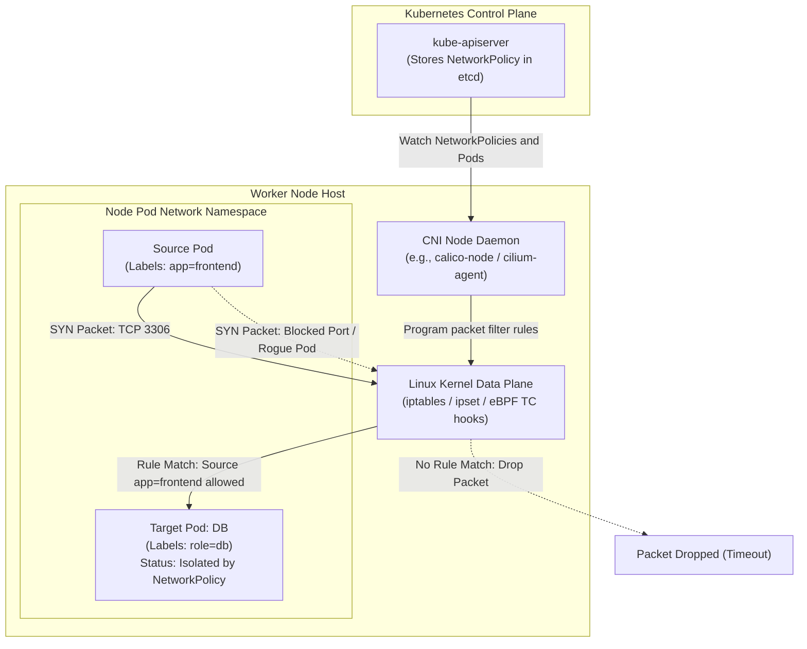
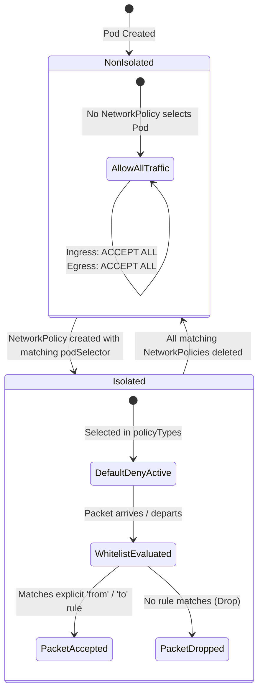
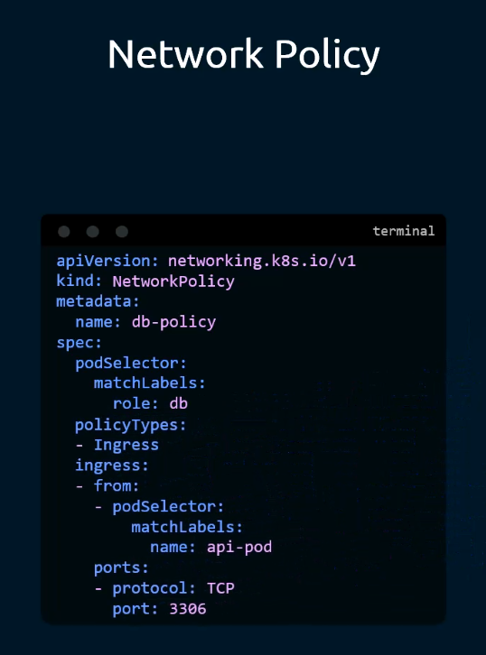
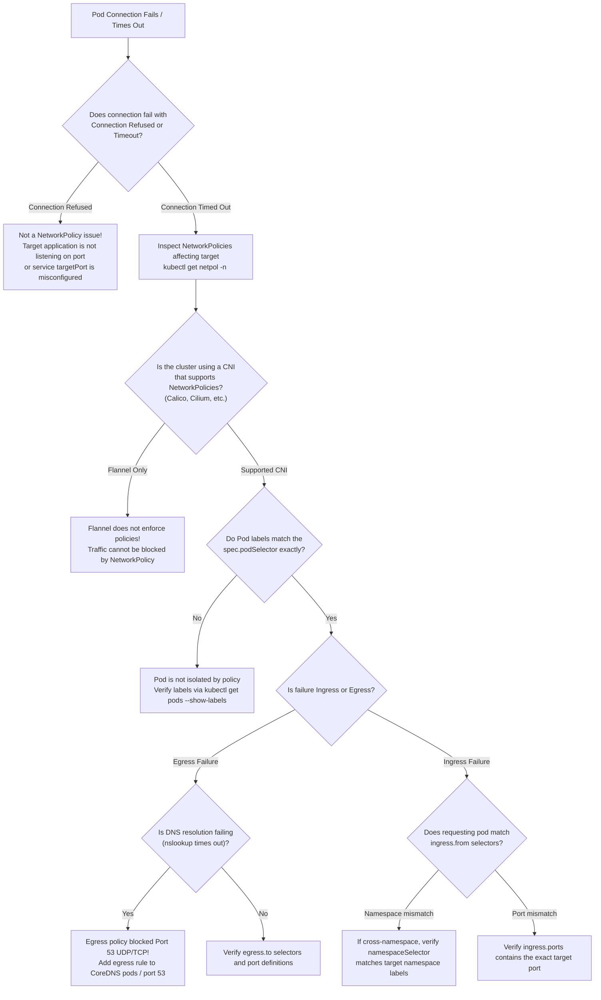

# Kubernetes Network Policies - CKA Exam Notes

> **Exam Domain**: Cluster Architecture, Installation & Configuration (25%) / Cluster Security / Services & Networking (20%)  
> **Weight / Importance**: Critical (Tested in nearly 100% of CKA exams: defining ingress/egress network isolation, label selectors, default deny patterns, DNS egress preservation, and diagnosing CNI enforcement)  
> **Target Version**: Verified against v1.31 / v1.32 (Current CKA Curriculum)  
> **Allowed Docs Search Keywords**: `Network Policies`, `NetworkPolicy`, `Declare Network Policy`, `Default deny all ingress traffic`, `podSelector`, `ipBlock`, `namespaceSelector`  
> **Source**: Generated from `security/15-Network-policy-raw.md`

---

## 1. Quick-Reference Summary

- **Default Networking Behavior (Flat All-Allow Model)**:
  - By default, Kubernetes implements an unconstrained flat network: **all Pods can communicate with all other Pods** across all nodes and all namespaces without Network Address Translation (NAT) or intermediate routers.
  - Pods are **non-isolated** by default for both incoming (Ingress) and outgoing (Egress) traffic.
- **The Isolation Trigger (The Whitelist Pivot)**:
  - A Pod becomes **isolated** for a direction (Ingress and/or Egress) the moment it is selected by at least one `NetworkPolicy` (`spec.podSelector`) that lists that direction in `spec.policyTypes`.
  - Once isolated, all traffic in that direction is **blocked by default** unless explicitly allowed by an ingress or egress whitelist rule.
- **Enforcement Prerequisite (The CNI Requirement)**:
  - The Kubernetes control plane (`kube-apiserver`, `kubelet`) **does not enforce network policies**.
  - Enforcement is delegated entirely to the **Container Network Interface (CNI)** plugin.
  - **Supporting CNIs**: Calico, Cilium, Kube-router, Antrea, Weave Net, Romana.
  - **Non-Supporting CNIs (Silent Non-Enforcement Trap)**: **Flannel** does not enforce network policies. In a Flannel-only cluster, creating a `NetworkPolicy` succeeds via the API, but **no packet filtering occurs**—all traffic remains unblocked.
- **Stateful Connection Tracking (`conntrack`)**:
  - Kubernetes Network Policies are **stateful**. If incoming traffic is allowed via an `ingress` rule, the return response packets are automatically permitted back to the client via Linux kernel connection tracking (`conntrack`), without requiring a reciprocal `egress` rule.
- **Imperative CLI Limitation**:
  - `kubectl` **does NOT have** an imperative creation command like `kubectl create networkpolicy`. Manifests must be authored via YAML or copied from Kubernetes documentation.
- **`policyTypes` Defaulting Trap**:
  - If `spec.policyTypes` is omitted, Kubernetes defaults it to `["Ingress"]`.
  - If you write `spec.egress` rules but omit `Egress` from `spec.policyTypes`, **your egress rules are completely ignored** by the CNI plugin!
- **DNS Egress Black Hole**:
  - Restricting egress on a Pod blocks DNS resolution unless UDP/TCP port 53 to CoreDNS (`kube-system`) is explicitly whitelisted. Without DNS egress, application lookups like `curl http://db-service` time out immediately.

---

## 2. Conceptual Overview & Mental Model

### Dual-Layer Architectural Understanding

- **Simple English Explanation (How It Works)**:
  - When you install a standard Kubernetes cluster, every container can connect to any other container anywhere in the cluster simply by knowing its IP address or DNS name.
  - A **NetworkPolicy** acts as an internal packet firewall for Pods. It operates at Layer 3 (IP addresses) and Layer 4 (TCP/UDP/SCTP ports).
  - You identify which Pods you want to protect by targeting their **Labels** using a `podSelector`.
  - The moment you attach a NetworkPolicy to a Pod, the cluster switches that Pod from "allow everything" to "deny everything by default".
  - You then add explicit whitelist entries to permit legitimate incoming connections (`ingress.from`) or outgoing connections (`egress.to`).
  - Network policies are applied at the network data plane on each worker node. When an application attempts to send a TCP packet, the node's network plugin inspects the source IP, destination IP, protocol, and port against the active policy rules. If no rule matches, the Linux kernel drops the packet.

- **Formal Kubernetes Architecture Definition**:
  - `NetworkPolicy` (`networking.k8s.io/v1`) is an API resource that defines ingress and egress packet filtering specifications based on label selectors (`LabelSelector`), namespace selectors, and CIDR blocks (`IPBlock`). Enforcement is offloaded to the CNI data plane running on each node. The CNI agent daemon watches the `NetworkPolicy`, `Pod`, and `Namespace` endpoints via the Kubernetes API server, translates selectors into kernel data plane rules (such as Linux `iptables` chains, `ipset` hash tables, or eBPF bytecode programs loaded into Linux Traffic Control / XDP hooks), and executes stateful Layer 3/4 packet filtering.

### Architectural Network Policy Enforcement Workflow



---

## 3. Deep-Dive Technical Breakdown

### 1. The CNI Enforcement Landscape

The Kubernetes API server accepts any syntactically valid `NetworkPolicy` object, validates its schema, and writes it to etcd. However, **the API server does not filter network packets**. 

Filtering occurs exclusively at the worker node network layer, requiring a CNI plugin equipped with a Network Policy controller:

| CNI Plugin | Network Policy Enforcement Support | Underlying Data Plane Implementation | Exam Relevance & Behavioral Characteristics |
| :--- | :---: | :--- | :--- |
| **Project Calico** | **YES** | Linux `iptables`, `ipset`, or native eBPF data plane | Default CNI in many CKA exam environments; high performance |
| **Cilium** | **YES** | Linux eBPF (Extended Berkeley Packet Filter) socket / TC programs | High-efficiency kernel bypass; Layer 3/4/7 filtering |
| **Kube-router** | **YES** | Linux `ipset` and `iptables` | Lightweight; integrates BGP routing with policy enforcement |
| **Antrea** | **YES** | Open vSwitch (OVS) flow tables | Standard for VMware Tanzu and OpenFlow environments |
| **Flannel** | **NO** | Overlay only (VXLAN / host-gw); **no policy engine** | **CRITICAL CKA TRAP**: Accepts YAML without errors, but **enforces nothing** |
| **AWS-VPC CNI** | Optional | Requires AWS Network Policy Agent or Calico addon | Without addon, policies are ignored |
| **Azure CNI** | Optional | Requires Azure Network Policy Manager or Cilium | Without addon, policies are ignored |

> [!CAUTION]
> **The Silent Flannel Trap**: In an exam question or troubleshooting scenario, if you create a NetworkPolicy on a cluster utilizing vanilla Flannel, `kubectl describe networkpolicy` shows the policy as active, but traffic will **not** be blocked. To enforce policies with Flannel, an auxiliary network policy engine like `canal` (Flannel for networking + Calico for policy) must be installed.

---

### 2. The Pod Isolation Lifecycle

Kubernetes dynamically computes whether a Pod is isolated or non-isolated:



- **Additive Whitelist Behavior**: Network policies are purely **additive**. There are no "deny" rules in standard Kubernetes NetworkPolicies. You define what is **allowed**. If multiple policies select the same Pod, the allowed traffic is the union (`OR`) of all individual whitelist rules.

---

### 3. Anatomy of a NetworkPolicy Resource

The raw notes reference the standard database policy manifest:



```yaml
apiVersion: networking.k8s.io/v1
kind: NetworkPolicy
metadata:
  name: db-policy
  namespace: prod             # NetworkPolicies are strictly namespaced!
spec:
  podSelector:                # TARGET: Which pods does this policy protect?
    matchLabels:
      role: db
  policyTypes:                # DIRECTIONS: Which traffic directions are isolated?
  - Ingress
  ingress:                    # WHITELIST: What traffic is permitted?
  - from:
    - podSelector:            # SOURCE: Only pods matching this label in 'prod'
        matchLabels:
          name: api-pod
    ports:                    # PORTS: Only traffic on TCP port 3306 is allowed
    - protocol: TCP
      port: 3306
```

#### Line-by-Line Breakdown:
1. `apiVersion: networking.k8s.io/v1`: The core networking API group.
2. `kind: NetworkPolicy`: Declares this object as a network filtering configuration.
3. `metadata.name`: Unique identifier within the namespace (`db-policy`).
4. `metadata.namespace`: Defines the scope. A policy in namespace `prod` **only selects target pods in `prod`**.
5. `spec.podSelector`: Selects target pods. Here, all pods in namespace `prod` labeled `role: db`. If `podSelector: {}` is passed, it selects **all pods** in that namespace.
6. `spec.policyTypes`: Declares which traffic streams are placed into default-deny isolation. Here, `Ingress` is isolated. Since `Egress` is omitted, the database pod's outbound traffic remains completely unconstrained.
7. `spec.ingress`: A list of ingress rules. Each item in the list defines a set of allowed sources (`from`) and ports (`ports`).
8. `ingress.from.podSelector`: Whitelists traffic from pods within the same namespace (`prod`) that possess the label `name: api-pod`.
9. `ingress.ports`: Restricts the whitelist to protocol `TCP` and port `3306`. Packets sent to any other port (e.g., SSH port 22 or HTTP port 80) from `api-pod` are dropped.

---

### 4. The 4 Target Whitelist Selectors

Kubernetes provides four distinct selectors inside `ingress.from` and `egress.to`:

1. **`podSelector` (Same Namespace)**:
   - Selects specific pods within the **same namespace** as the NetworkPolicy.
   ```yaml
   from:
   - podSelector:
       matchLabels:
         app: backend
   ```
2. **`namespaceSelector` (Cross-Namespace)**:
   - Selects **all pods** inside any namespace that matches the label selector.
   ```yaml
   from:
   - namespaceSelector:
       matchLabels:
         environment: production
   ```
   > [!NOTE]
   > Modern Kubernetes (v1.22+) automatically labels every namespace with `kubernetes.io/metadata.name: <namespace-name>`. You can target a specific namespace without manually labeling it:
   > ```yaml
   > - namespaceSelector:
   >     matchLabels:
   >       kubernetes.io/metadata.name: frontend-ns
   > ```
3. **Combined `namespaceSelector` AND `podSelector` (Single Array Element)**:
   - When placed in the **same YAML list item**, both conditions must be true:
   ```yaml
   from:
   - namespaceSelector:        # AND: Must be in 'prod' namespace
       matchLabels:
         environment: prod
     podSelector:              # AND: Must have label app=api
       matchLabels:
         app: api
   ```
4. **`ipBlock` (CIDR Range / External Traffic)**:
   - Matches external IP CIDR blocks outside the cluster pod network.
   ```yaml
   from:
   - ipBlock:
       cidr: 192.168.1.0/24
       except:
       - 192.168.1.50/32
   ```

---

### 5. Essential Default Policy Patterns

In enterprise hardening and CKA exam questions, you are frequently asked to establish baseline security postures for namespaces:

#### Pattern A: Default Deny All Ingress Traffic
Isolates all pods in the namespace, dropping all incoming connections unless another policy explicitly permits them:
```yaml
apiVersion: networking.k8s.io/v1
kind: NetworkPolicy
metadata:
  name: default-deny-ingress
  namespace: secure-ns
spec:
  podSelector: {}             # Selects all pods in secure-ns
  policyTypes:
  - Ingress
```

#### Pattern B: Default Deny All Egress Traffic
Isolates all pods in the namespace, dropping all outbound connections:
```yaml
apiVersion: networking.k8s.io/v1
kind: NetworkPolicy
metadata:
  name: default-deny-egress
  namespace: secure-ns
spec:
  podSelector: {}
  policyTypes:
  - Egress
```

#### Pattern C: Default Deny All Ingress & Egress (Total Isolation)
Completely air-gaps all pods in the namespace:
```yaml
apiVersion: networking.k8s.io/v1
kind: NetworkPolicy
metadata:
  name: default-deny-all
  namespace: secure-ns
spec:
  podSelector: {}
  policyTypes:
  - Ingress
  - Egress
```

#### Pattern D: Default Allow All Ingress & Egress
Explicitly ensures all pods remain completely accessible and unconstrained:
```yaml
apiVersion: networking.k8s.io/v1
kind: NetworkPolicy
metadata:
  name: allow-all
  namespace: open-ns
spec:
  podSelector: {}
  ingress:
  - {}                        # Empty rule matches all ingress traffic
  egress:
  - {}                        # Empty rule matches all egress traffic
  policyTypes:
  - Ingress
  - Egress
```

---

## 4. Command Translation & Mapping Tables

### NetworkPolicy Schema Reference

| YAML Key Path | Type | Allowed Values / Purpose | Default Value (If Omitted) |
| :--- | :--- | :--- | :--- |
| `spec.podSelector` | Object | Label selector targeting protected pods in namespace | Mandatory field (use `{}` for all pods) |
| `spec.policyTypes` | String List | `["Ingress"]`, `["Egress"]`, or `["Ingress", "Egress"]` | Defaults to `["Ingress"]` |
| `spec.ingress` | List | Whitelist rules for incoming traffic | `[]` (If Ingress is in policyTypes, blocks all incoming) |
| `spec.ingress[].from` | List | Allowed sources (`podSelector`, `namespaceSelector`, `ipBlock`) | Matches any source |
| `spec.ingress[].ports` | List | Allowed ports and protocols (`TCP`, `UDP`, `SCTP`) | Matches all ports/protocols |
| `spec.egress` | List | Whitelist rules for outbound traffic | `[]` (If Egress is in policyTypes, blocks all outbound) |
| `spec.egress[].to` | List | Allowed destinations (`podSelector`, `namespaceSelector`, `ipBlock`) | Matches any destination |
| `spec.egress[].ports` | List | Allowed destination ports and protocols | Matches all ports/protocols |

---

## 5. High-Yield CLI & Imperative Commands

### 1. Generating NetworkPolicy Manifests

> [!IMPORTANT]
> `kubectl` has no imperative `kubectl create networkpolicy` subcommand! You must generate manifests using `cat <<EOF` or extract templates from `kubectl explain`.

```bash
# 1. Inspect the NetworkPolicy schema using kubectl explain
kubectl explain networkpolicy.spec
kubectl explain networkpolicy.spec.ingress.from

# 2. Fast generation of a default-deny ingress policy using stdin
cat <<EOF | kubectl apply -f -
apiVersion: networking.k8s.io/v1
kind: NetworkPolicy
metadata:
  name: default-deny-ingress
  namespace: default
spec:
  podSelector: {}
  policyTypes:
  - Ingress
EOF

# 3. Fast generation of an isolated DB policy with port restriction
cat <<EOF | kubectl apply -f -
apiVersion: networking.k8s.io/v1
kind: NetworkPolicy
metadata:
  name: db-netpol
  namespace: default
spec:
  podSelector:
    matchLabels:
      role: db
  policyTypes:
  - Ingress
  ingress:
  - from:
    - podSelector:
        matchLabels:
          role: frontend
    ports:
    - protocol: TCP
      port: 5432
EOF
```

### 2. Inspecting and Auditing Network Policies

```bash
# 1. List all network policies in the current namespace
kubectl get networkpolicy (or: kubectl get netpol)

# 2. List all network policies across all namespaces
kubectl get netpol -A

# 3. Detailed inspection of rules, selectors, and isolated directions
kubectl describe netpol db-netpol

# 4. Check which pods match the policy's target selector
kubectl get pods -l role=db -n default

# 5. Check which pods match the allowed source selector
kubectl get pods -l role=frontend -n default
```

### 3. Active Connectivity Verification Recipes

```bash
# 1. Test allowed TCP connectivity from frontend to backend using busybox/wget
kubectl run test-conn --rm -it --image=busybox:1.36 --restart=Never --labels="role=frontend" -- \
  wget -qO- --timeout=3 http://db-service:5432

# 2. Test blocked connectivity from unauthorized pod (should time out)
kubectl run rogue-test --rm -it --image=busybox:1.36 --restart=Never --labels="role=attacker" -- \
  wget -qO- --timeout=3 http://db-service:5432
# Expected output: wget: download timed out (Packets dropped by kernel)

# 3. Test DNS resolution inside a pod with restricted egress
kubectl run dns-test --rm -it --image=busybox:1.36 --restart=Never -- nslookup kubernetes.default
```

---

## 6. Troubleshooting & Diagnostic Runbook

### Network Policy Diagnostic Decision Tree



### Step-by-Step Triage Matrix

| Symptom / Observation | Underlying Root Cause | Verification Command | Remediation Action |
| :--- | :--- | :--- | :--- |
| **`wget: download timed out`** | Target pod is isolated by a NetworkPolicy and the requesting pod does not match any `from` rule | `kubectl describe netpol <name>` | Add a rule under `ingress.from` matching the client's labels or namespace. |
| **`Connection refused`** | Traffic reaches the node, but no process is listening on the target port | `kubectl get endpoints <svc>` | Verify application container is healthy and listening on the expected port. |
| **Policy created, but all traffic still passes** | Cluster runs Flannel without a policy controller daemon | `kubectl get pods -n kube-system -l k8s-app=flannel` | Install a supporting policy controller (Calico/Canal) or check CNI configuration. |
| **`nslookup: can't resolve host` inside Pod** | Egress policy isolates outbound traffic, blocking UDP port 53 to CoreDNS | `kubectl exec <pod> -- nslookup kubernetes.default` | Add egress rule allowing UDP/TCP port 53 to CoreDNS in `kube-system`. |
| **Cross-namespace traffic blocked despite matching label** | `podSelector` was used alone without `namespaceSelector`, restricting matches to local namespace | Inspect NetworkPolicy YAML | Add `namespaceSelector` to match the remote namespace. |

---

## 7. CKA Exam Tips, Gotchas & Traps

> [!WARNING]
> **Trap 1: The CoreDNS Egress Black Hole**  
> When an exam task asks you to *“isolate egress traffic from pod-x so it can only talk to db-service”*, if you only allow egress to `db-service` on port 5432:
> - `pod-x` will try to resolve `db-service` via DNS.
> - Because egress to port 53 (CoreDNS) is not in the whitelist, DNS lookups time out, and `curl http://db-service:5432` fails!
> - **Always whitelist DNS egress when isolating outbound traffic**:
>   ```yaml
>   egress:
>   - to:
>     - podSelector:
>         matchLabels:
>           role: db
>     ports:
>     - protocol: TCP
>       port: 5432
>   - ports:                      # Preserves cluster DNS resolution
>     - protocol: UDP
>       port: 53
>     - protocol: TCP
>       port: 53
>   ```

> [!IMPORTANT]
> **Trap 2: Forgetting `policyTypes: ["Egress"]`**  
> If you create a policy with an `egress:` block, but omit `policyTypes:`:
> - Kubernetes defaults `policyTypes` to `["Ingress"]`.
> - The CNI completely ignores your `egress:` rules!
> - Outbound traffic will remain completely open (or closed depending on other policies).
> - **Rule**: Whenever you write `egress:`, you **MUST** include `policyTypes: ["Egress"]` (or `["Ingress", "Egress"]`).

> [!TIP]
> **Trap 3: Fast CKA Documentation Navigation**  
> Since `kubectl create netpol` does not exist, do not waste time typing YAML from memory.  
> Open the official docs search in your exam browser and search: **`Declare Network Policy`**.  
> Copy the complete example manifest from the official page, paste it into `netpol.yaml`, and edit the selectors with `vim`.

> [!IMPORTANT]
> **Trap 4: NetworkPolicies are Namespace-Scoped**  
> A `NetworkPolicy` created in namespace `development` cannot protect pods in namespace `production`. Its `podSelector` applies **only** to pods located in its own `metadata.namespace`.

---

## 8. Self-Test / Active Recall

Try answering the questions below without looking at the notes, then expand each question to check your understanding.

<details>
<summary><b>1. What is the default network communication model between Pods in a Kubernetes cluster without NetworkPolicies?</b></summary>

A flat all-allow network model where all Pods can communicate with all other Pods across all nodes and all namespaces without NAT or routers. Pods are non-isolated by default.
</details>

<details>
<summary><b>2. What triggers a Pod to switch from non-isolated to isolated status?</b></summary>

A Pod becomes isolated for a direction (Ingress or Egress) as soon as it is selected by `spec.podSelector` in at least one `NetworkPolicy` that includes that direction in its `policyTypes`.
</details>

<details>
<summary><b>3. Why does creating a NetworkPolicy on a vanilla Flannel CNI cluster fail to block network traffic?</b></summary>

Because Flannel is strictly an overlay networking provider that lacks a network policy controller and packet filtering data plane. The API server stores the resource, but no kernel firewall rules are programmed.
</details>

<details>
<summary><b>4. If a NetworkPolicy specifies an `egress` rule list but omits the `spec.policyTypes` field, what happens?</b></summary>

Kubernetes defaults `policyTypes` to `["Ingress"]`. Because `Egress` is not listed, the CNI ignores the `egress` rules entirely, leaving outbound traffic unmanaged.
</details>

<details>
<summary><b>5. Why is a return egress rule not required when an ingress rule permits incoming TCP traffic?</b></summary>

Because Kubernetes Network Policies are stateful. The Linux kernel connection tracker (`conntrack`) automatically tracks established sessions and allows return response packets.
</details>

<details>
<summary><b>6. What YAML configuration isolates all pods in a namespace and drops all incoming traffic?</b></summary>

```yaml
spec:
  podSelector: {}
  policyTypes:
  - Ingress
```
</details>

<details>
<summary><b>7. Why does an application in a Pod fail to connect to `http://backend-service` when egress is restricted, even if traffic to the backend Pod IP is allowed?</b></summary>

Because DNS resolution on UDP/TCP port 53 is blocked by the egress policy, preventing the application from resolving the service hostname to an IP address.
</details>

<details>
<summary><b>8. In an ingress `from` block, what is the difference between having `namespaceSelector` and `podSelector` in the same list element vs. separate list elements?</b></summary>

In the same list element, it represents an **AND** operation (source must be in the matching namespace AND have the matching pod label). In separate list elements (each starting with a `-`), it represents an **OR** operation (source can be ANY pod in the matching namespace OR any pod in the local namespace with the matching label).
</details>

<details>
<summary><b>9. What automatic label is present on all namespaces in Kubernetes v1.22+ to allow targeting namespaces by name without custom labels?</b></summary>

`kubernetes.io/metadata.name: <namespace-name>`.
</details>

<details>
<summary><b>10. Is there an imperative `kubectl` command to generate a NetworkPolicy YAML file directly from flags?</b></summary>

No. `kubectl` has no imperative `kubectl create networkpolicy` subcommand. Manifests must be authored via YAML or copied from Kubernetes documentation.
</details>

---

### Official Documentation Bookmarks

| Documentation Page Title | Allowed Search Query Keyword | Direct Documentation URL |
| :--- | :--- | :--- |
| **Network Policies** | `Network Policies` | [https://kubernetes.io/docs/concepts/services-networking/network-policies/](https://kubernetes.io/docs/concepts/services-networking/network-policies/) |
| **Declare Network Policy** | `Declare Network Policy` | [https://kubernetes.io/docs/tasks/administer-cluster/declare-network-policy/](https://kubernetes.io/docs/tasks/administer-cluster/declare-network-policy/) |
| **Default deny all ingress traffic** | `Default deny all ingress traffic` | [https://kubernetes.io/docs/concepts/services-networking/network-policies/#default-deny-all-ingress-traffic](https://kubernetes.io/docs/concepts/services-networking/network-policies/#default-deny-all-ingress-traffic) |
| **Default deny all egress traffic** | `Default deny all egress traffic` | [https://kubernetes.io/docs/concepts/services-networking/network-policies/#default-deny-all-egress-traffic](https://kubernetes.io/docs/concepts/services-networking/network-policies/#default-deny-all-egress-traffic) |

