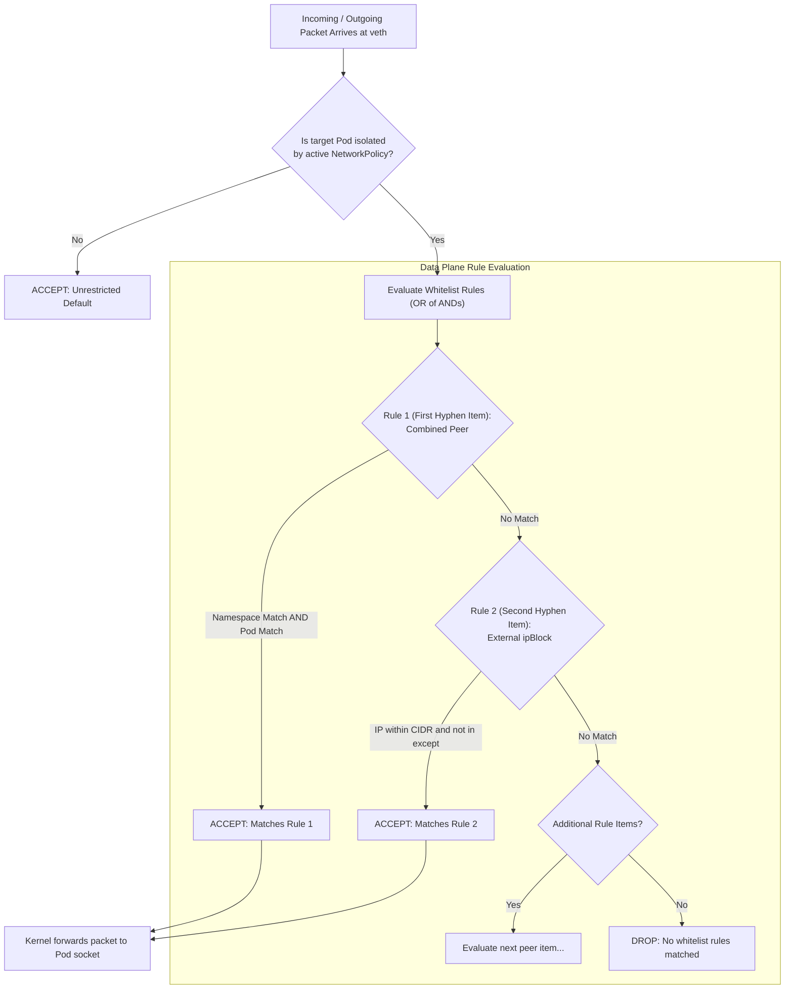
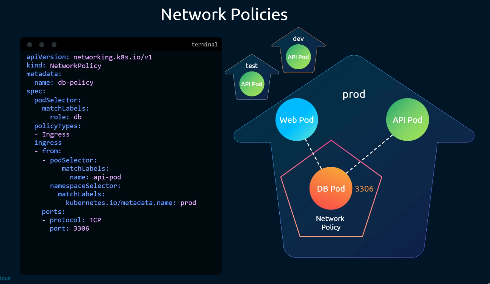
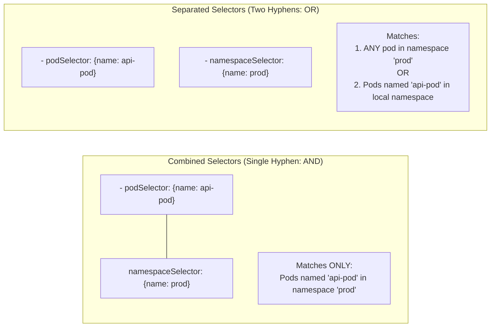
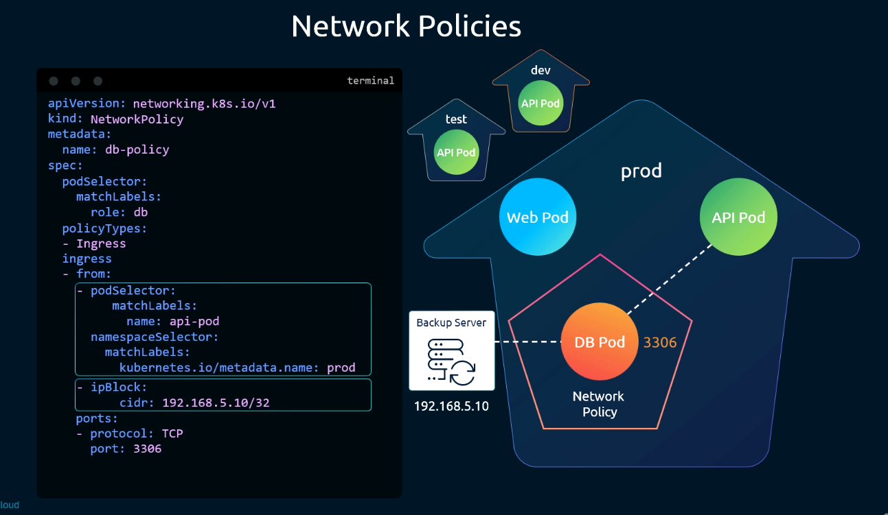
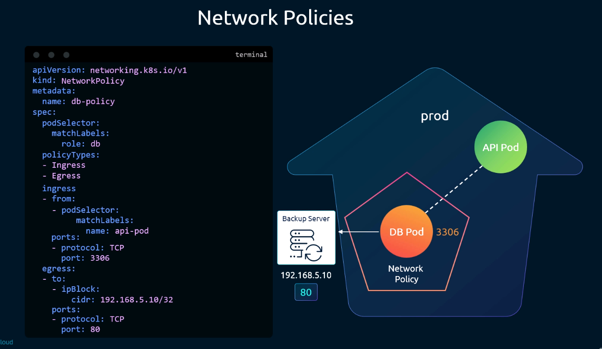

# Developing Advanced Network Policies - CKA Exam Notes

> **Exam Domain**: Cluster Architecture, Installation & Configuration (25%) / Cluster Security / Services & Networking (20%)  
> **Weight / Importance**: Critical (High-frequency hands-on CKA exam topic: developing complex Ingress and Egress policies, cross-namespace filtering, the AND vs. OR YAML hyphen trap, CIDR `ipBlock` rules, CoreDNS port 53 egress whitelisting, and solving multi-tier application network isolation challenges)  
> **Target Version**: Verified against v1.31 / v1.32 (Current CKA Curriculum)  
> **Allowed Docs Search Keywords**: `Network Policies`, `NetworkPolicy`, `Declare Network Policy`, `namespaceSelector`, `podSelector`, `ipBlock`, `NetworkPolicyPeer`  
> **Source**: Generated from `security/16-developing-network-policies-raw.md`

---

## 1. Quick-Reference Summary

- **Cross-Namespace Scoping Rules**:
  - `podSelector` alone: Selects pods **strictly within the same namespace** as the NetworkPolicy.
  - `namespaceSelector` alone: Selects **all pods** across any namespace whose labels match the selector.
  - `kubernetes.io/metadata.name`: Built-in immutable label present on all namespaces (v1.22+), allowing namespace targeting by name without manual labeling.
- **The YAML Hyphen Rule (AND vs. OR Logic)**:
  - **Single Array Item (AND Logic)**:
    ```yaml
    - namespaceSelector:
        matchLabels:
          kubernetes.io/metadata.name: prod
      podSelector:
        matchLabels:
          name: api-pod
    ```
    *Traffic must originate from a pod that matches `name: api-pod` **AND** resides in namespace `prod`.*
  - **Multiple Array Items (OR Logic)**:
    ```yaml
    - namespaceSelector:
        matchLabels:
          kubernetes.io/metadata.name: prod
    - podSelector:
        matchLabels:
          name: api-pod
    ```
    *Traffic is permitted if it originates from **ANY** pod in namespace `prod` **OR** from any pod in the local namespace labeled `name: api-pod`.*
- **External Network Filtering (`ipBlock`)**:
  - Used strictly for IP addresses **outside** the cluster pod network (e.g., external backup servers, cloud databases, public internet).
  - Do not use `ipBlock` for Pod IPs; Pod IPs are ephemeral and dynamically reallocated.
  - Supports CIDR masking (`cidr: 192.168.5.10/32`) and subnet exclusion (`except: [192.168.5.0/28]`).
- **Combining Ingress and Egress**:
  - Both directions can be governed in a single manifest by including both `Ingress` and `Egress` in `spec.policyTypes` along with corresponding `spec.ingress` and `spec.egress` rule blocks.
- **Mandatory DNS Egress Rule**:
  - Any policy restricting egress **must** explicitly allow traffic to CoreDNS (port 53 UDP and TCP). Without it, internal service name resolution fails immediately.

---

## 2. Conceptual Overview & Mental Model

### Dual-Layer Architectural Understanding

- **Simple English Explanation (How It Works)**:
  - In a production cluster, applications are split into multiple tiers and namespaces (e.g., `frontend`, `backend`, `database`, `prod`, `dev`).
  - To prevent unauthorized lateral movement, you write Network Policies that specify exactly which source pods, namespaces, or external IP addresses are permitted to communicate with protected target pods.
  - The most critical syntax detail when authoring these policies in YAML is the **hyphen (`-`)**:
    - A hyphen creates a **new item** in a YAML list.
    - When you put `namespaceSelector` and `podSelector` under the **same hyphen**, Kubernetes treats them as a single combined requirement (**AND** logic). The calling pod must satisfy both criteria.
    - When you put a hyphen in front of `namespaceSelector` and **another hyphen** in front of `podSelector`, Kubernetes treats them as two separate list entries (**OR** logic). The calling pod only needs to satisfy either one of the criteria.
  - In addition to filtering traffic inside the cluster, you can permit communication with external infrastructure (such as an off-cluster database or backup server) by specifying its IP range in an `ipBlock`.
  - When restricting outbound traffic (`egress`), you must remember that applications rarely connect directly to raw IP addresses; they connect to DNS names (like `db.prod.svc.cluster.local`). If you lock down egress without permitting traffic to DNS servers on port 53, the application will not be able to resolve hostnames.

- **Formal Kubernetes Architecture Definition**:
  - `NetworkPolicy` ingress and egress rules are expressed as slices of `NetworkPolicyIngressRule` and `NetworkPolicyEgressRule` structs. Each rule consists of a `ports` slice and a `from` / `to` slice of `NetworkPolicyPeer` objects. The API server models the peer slice as a logical disjunction (**OR** condition) between peer entries. Within a single `NetworkPolicyPeer` object, `podSelector` and `namespaceSelector` are evaluated as a logical conjunction (**AND** condition) representing the intersection of the two label sets. The node CNI daemon compiles these Boolean conditions into kernel data plane structures (`ipset` combinations or eBPF hash tables) applied to the target pod's virtual Ethernet interface (`veth`).

### Boolean Logic Flowchart of Network Policy Rule Evaluation



---

## 3. Deep-Dive Technical Breakdown

### 1. Cross-Namespace Ingress Mechanics

When a protected pod needs to accept traffic from another namespace, `namespaceSelector` must be utilized:



```yaml
apiVersion: networking.k8s.io/v1
kind: NetworkPolicy
metadata:
  name: db-policy
  namespace: prod
spec:
  podSelector:
    matchLabels:
      role: db
  policyTypes:
  - Ingress
  ingress:
  - from:
    - podSelector:
        matchLabels:
          name: api-pod
      namespaceSelector:
        matchLabels:
          kubernetes.io/metadata.name: prod
    ports:
    - protocol: TCP
      port: 3306
```

#### Key Architectural Behaviors:
1. **Omitting `namespaceSelector`**:
   - If `ingress.from` defines `podSelector: {matchLabels: {name: api-pod}}` without a `namespaceSelector`, the CNI runtime restricts matches **strictly to the local namespace** (`prod`). An `api-pod` running in `dev` or `test` cannot connect.
2. **Omitting `podSelector`**:
   - If `ingress.from` defines `namespaceSelector: {matchLabels: {kubernetes.io/metadata.name: prod}}` without a `podSelector`, **every pod** in namespace `prod` (e.g., `web-pod`, `api-pod`, `monitoring-pod`) is allowed to connect to port 3306.
3. **Targeting by Namespace Name**:
   - Prior to Kubernetes v1.22, administrators had to manually label namespaces (e.g. `kubectl label ns prod name=prod`).
   - In modern Kubernetes (v1.31 / v1.32), the control plane automatically injects the immutable label `kubernetes.io/metadata.name: <namespace-name>` onto all namespaces, simplifying cross-namespace selectors.

---

### 2. The Critical YAML Hyphen Trap: AND vs. OR Selectors

The distinction between a combined peer item and separate peer items is one of the most frequently tested topics in the CKA exam:



#### Case A: Combined Selector (AND Operation)
*Shown in: `network-policy-combined-pod-and-namespace-selector.png`*



```yaml
  ingress:
  - from:
    # --- START OF PEER ITEM 1 (AND Logic) ---
    - podSelector:
        matchLabels:
          name: api-pod
      namespaceSelector:
        matchLabels:
          kubernetes.io/metadata.name: prod
    # --- START OF PEER ITEM 2 (OR with Peer Item 1) ---
    - ipBlock:
        cidr: 192.168.5.10/32
    ports:
    - protocol: TCP
      port: 3306
```

- **Execution Analysis**:
  - Peer Item 1 has **one hyphen** at `- podSelector:`. `namespaceSelector:` is indented underneath without a hyphen.
  - This instructs the CNI: *"Allow incoming traffic if the source pod is labeled `name: api-pod` **AND** resides in namespace `prod`"*.
  - Peer Item 2 has a separate hyphen `- ipBlock:`. This is evaluated as an **OR**: traffic is also allowed if it originates from external IP `192.168.5.10/32`.
  - Notice that in the diagram, `Web Pod` in `prod` is **denied**, because while it is in namespace `prod`, its label is not `name: api-pod`.

---

#### Case B: Separated Selectors (OR Operation)
*Shown in: `network-policy-seperated-pod-and-namespace-selector.png`*


```yaml
  ingress:
  - from:
    # --- PEER ITEM 1 (OR) ---
    - podSelector:
        matchLabels:
          name: api-pod
    # --- PEER ITEM 2 (OR) ---
    - namespaceSelector:
        matchLabels:
          kubernetes.io/metadata.name: prod
    # --- PEER ITEM 3 (OR) ---
    - ipBlock:
        cidr: 192.168.5.10/32
    ports:
    - protocol: TCP
      port: 3306
```

- **Execution Analysis**:
  - Each entry begins with its own hyphen: `- podSelector:`, `- namespaceSelector:`, `- ipBlock:`.
  - This instructs the CNI: *"Allow traffic if the source pod has label `name: api-pod` in the local namespace **OR** if the source is **ANY pod** residing in namespace `prod` **OR** if the source is IP `192.168.5.10/32`"*.
  - Notice that in this diagram, `Web Pod` is **permitted** access, because it resides in namespace `prod`, completely bypassing the `api-pod` label requirement.

---

### 3. External Network Filtering with `ipBlock`

The `ipBlock` selector enables Layer 3 ingress and egress filtering to/from IP CIDR blocks outside the cluster:

```yaml
- to:
  - ipBlock:
      cidr: 10.0.0.0/16
      except:
      - 10.0.1.0/24
      - 10.0.2.0/24
```

#### Technical Considerations for `ipBlock`:
1. **Dynamic Pod IP Warning**: Do not use `ipBlock` to target Pods within the cluster. Pod IPs are dynamically allocated by the CNI IPAM controller upon creation and change on restart. Use `podSelector` and `namespaceSelector` for all intra-cluster communication.
2. **Ingress Source IP Preservation**: When external traffic enters a cluster through a NodePort or LoadBalancer Service, kube-proxy SNAT (Source Network Address Translation) may rewrite the client's source IP to the node's internal IP unless the Service is configured with `spec.externalTrafficPolicy: Local`. If SNAT occurs, `ipBlock` ingress rules matching the original client IP will fail to match.

---

### 4. Advanced Egress Filtering and CoreDNS Preservation

A complete policy can restrict both incoming connections and outgoing connections simultaneously:



```yaml
apiVersion: networking.k8s.io/v1
kind: NetworkPolicy
metadata:
  name: db-policy
  namespace: prod
spec:
  podSelector:
    matchLabels:
      role: db
  policyTypes:
  - Ingress
  - Egress
  ingress:
  - from:
    - podSelector:
        matchLabels:
          name: api-pod
    ports:
    - protocol: TCP
      port: 3306
  egress:
  - to:
    - ipBlock:
        cidr: 192.168.5.10/32
    ports:
    - protocol: TCP
      port: 80
```

#### The CoreDNS Egress Imperative:
In the diagram above, `role: db` is restricted to only sending outbound traffic to `192.168.5.10:80`.
If the database process attempts to resolve any hostname (e.g. `backup.internal.org`), **the DNS query will be dropped**, because UDP port 53 is not whitelisted.

To preserve cluster DNS resolution while locking down all other egress traffic, always include a CoreDNS egress rule:

```yaml
  egress:
  # 1. Allowed Application Destination
  - to:
    - ipBlock:
        cidr: 192.168.5.10/32
    ports:
    - protocol: TCP
      port: 80

  # 2. Whitelist Cluster DNS Resolution (CoreDNS)
  - to:
    - namespaceSelector:
        matchLabels:
          kubernetes.io/metadata.name: kube-system
      podSelector:
        matchLabels:
          k8s-app: kube-dns
    ports:
    - protocol: UDP
      port: 53
    - protocol: TCP
      port: 53
```

---

### 5. Detailed Breakdown of Practice Lab Scenarios

The raw notes provide two practical policy implementations commonly encountered in CKA exam labs:

#### Practice Scenario 1: Multi-Destination Egress Policy (`internal-policy`)

An internal application pod needs to communicate with two distinct backend services (`payroll` on port 8080 and `mysql` on port 3306), while maintaining DNS resolution:

```yaml
apiVersion: networking.k8s.io/v1
kind: NetworkPolicy
metadata:
  name: internal-policy
  namespace: default
spec:
  podSelector:
    matchLabels:
      name: internal
  policyTypes:
  - Egress
  egress:
  # Rule 1: Egress to Payroll Pod on port 8080 TCP and port 53 UDP
  - to:
    - podSelector:
        matchLabels:
          name: payroll
    ports:
    - port: 8080
      protocol: TCP
    - port: 53
      protocol: UDP

  # Rule 2: Egress to MySQL Pod on port 3306 TCP and port 53 UDP
  - to:
    - podSelector:
        matchLabels:
          name: mysql
    ports:
    - port: 3306
      protocol: TCP
    - port: 53
      protocol: UDP
```

> [!NOTE]
> In the manifest above, port 53 UDP is included alongside the service port in each rule. While functional, best practice is to separate DNS egress into its own independent rule targeting `kube-system` CoreDNS pods so DNS lookups don't depend on the target application pod matching.

---

#### Practice Scenario 2: Ingress Restriction on Payroll Service (`payroll-policy`)

Restricting the `payroll` pod so that only the `internal` pod can access it on TCP port 8080:

```yaml
apiVersion: networking.k8s.io/v1
kind: NetworkPolicy
metadata:
  name: payroll-policy
  namespace: default
spec:
  podSelector:
    matchLabels:
      name: payroll
  policyTypes:
  - Ingress
  ingress:
  - from:
    - podSelector:
        matchLabels:
          name: internal
    ports:
    - port: 8080
      protocol: TCP
```

- **Resulting Security State**:
  - Any pod labeled `name: internal` in the `default` namespace can connect to `payroll` on TCP port 8080.
  - Any connection from another pod (e.g., `web`, `monitoring`, or rogue pods) to `payroll` is dropped.
  - Any connection to `payroll` on other ports (e.g. port 22 or port 9090) is dropped.

---

## 4. Command Translation & Mapping Tables

### Selector Combinations Reference Matrix

| YAML Structure | Logical Operator | Behavior & Effective Target | Exam Pitfall / Risk |
| :--- | :---: | :--- | :--- |
| `from:`<br/>`- podSelector:`<br/>`    matchLabels: {app: web}` | **Local Namespace** | Matches pods with `app: web` **only** in the policy's own namespace. | Assuming it matches `app: web` across all namespaces. |
| `from:`<br/>`- namespaceSelector:`<br/>`    matchLabels: {env: prod}` | **Entire Namespace** | Matches **ALL pods** in any namespace with `env: prod`. | Granting unintended access to all pods in that namespace. |
| `from:`<br/>`- podSelector:`<br/>`    matchLabels: {app: web}`<br/>`  namespaceSelector:`<br/>`    matchLabels: {env: prod}` | **AND**<br/>(Single Item) | Matches pods with `app: web` **that also reside** in a namespace with `env: prod`. | Accidental extra hyphen converting this to an OR rule. |
| `from:`<br/>`- podSelector:`<br/>`    matchLabels: {app: web}`<br/>`- namespaceSelector:`<br/>`    matchLabels: {env: prod}` | **OR**<br/>(Multiple Items) | Matches **ANY** pod in `env: prod` **OR** any pod with `app: web` in local namespace. | Over-permissive access granted to all pods in `env: prod`. |
| `from:`<br/>`- ipBlock:`<br/>`    cidr: 192.168.1.0/24`<br/>`    except: [192.168.1.50/32]` | **External IP Match** | Matches external IPs in `192.168.1.0/24` excluding `192.168.1.50`. | Attempting to use `ipBlock` to filter cluster Pod IPs. |

---

## 5. High-Yield CLI & Imperative Commands

### 1. Generating Complex Multi-Selector NetworkPolicies

```bash
# 1. Author a comprehensive cross-namespace AND policy with CoreDNS egress
cat <<EOF | kubectl apply -f -
apiVersion: networking.k8s.io/v1
kind: NetworkPolicy
metadata:
  name: secured-backend-policy
  namespace: backend-ns
spec:
  podSelector:
    matchLabels:
      app: backend
  policyTypes:
  - Ingress
  - Egress
  ingress:
  - from:
    - namespaceSelector:
        matchLabels:
          kubernetes.io/metadata.name: frontend-ns
      podSelector:
        matchLabels:
          app: frontend
    ports:
    - protocol: TCP
      port: 8080
  egress:
  - to:
    - namespaceSelector:
        matchLabels:
          kubernetes.io/metadata.name: db-ns
      podSelector:
        matchLabels:
          app: database
    ports:
    - protocol: TCP
      port: 5432
  - ports:
    - protocol: UDP
      port: 53
    - protocol: TCP
      port: 53
EOF
```

### 2. Live Verification Across Namespaces

```bash
# 1. Query namespace labels to verify target metadata
kubectl get namespaces --show-labels

# 2. Test cross-namespace connection from authorized frontend pod
kubectl run test-client -n frontend-ns --rm -it --image=busybox:1.36 --restart=Never \
  --labels="app=frontend" -- wget -qO- --timeout=3 http://backend.backend-ns.svc:8080

# 3. Test cross-namespace connection from unauthorized pod in same frontend namespace
kubectl run rogue-client -n frontend-ns --rm -it --image=busybox:1.36 --restart=Never \
  --labels="app=unauthorized" -- wget -qO- --timeout=3 http://backend.backend-ns.svc:8080
# Expected: download timed out

# 4. Verify DNS egress functionality
kubectl run dns-check -n backend-ns --rm -it --image=busybox:1.36 --restart=Never \
  --labels="app=backend" -- nslookup database.db-ns.svc.cluster.local
```

---

## 6. Troubleshooting & Diagnostic Runbook

### Advanced Network Policy Diagnostic Decision Tree

```mermaid
flowchart TD
    Start["Cross-Namespace / Egress Traffic Fails"] --> Step1{"Does connection fail with<br/>Timeout or Host Lookup Failure?"}

    Step1 -->|Host Lookup Failure (DNS)| CheckDNS["Did egress policy omit Port 53 UDP/TCP?"]
    CheckDNS -->|Yes| FixDNS["Remedy: Add CoreDNS egress rule for port 53"]
    CheckDNS -->|No| CheckCoreDNSPods["Verify CoreDNS pods are running in kube-system"]

    Step1 -->|Timeout| CheckHyphen{"Is traffic unexpectedly allowed<br/>or unexpectedly blocked?"}

    CheckHyphen -->|Unexpectedly Allowed| CheckOR["Check YAML indentation:<br/>Are podSelector and namespaceSelector<br/>on separate hyphens (OR logic)?"]
    CheckOR -->|Yes| FixAND["Remedy: Remove hyphen on namespaceSelector<br/>to convert into combined AND rule"]

    CheckHyphen -->|Unexpectedly Blocked| CheckNS{"Does target namespace possess the exact<br/>label used in namespaceSelector?"}
    CheckNS -->|No| FixNS["Remedy: Use kubernetes.io/metadata.name: <ns><br/>or label the namespace"]
    CheckNS -->|Yes| CheckPorts["Verify target port number and protocol<br/>match application container listening port"]
```

### Step-by-Step Triage Matrix

| Observed Issue | Root Cause | Verification Command | Remediation Action |
| :--- | :--- | :--- | :--- |
| **Rogue pods in `prod` can access DB** | `namespaceSelector` and `podSelector` are written with separate hyphens, creating an OR rule that permits all pods in `prod` | `kubectl get netpol <name> -o yaml` | Remove the second hyphen so both selectors sit inside the same array element (AND condition). |
| **`wget: bad address '<service-name>'`** | Outbound traffic to CoreDNS is blocked by an active egress policy lacking port 53 UDP/TCP | `kubectl exec <pod> -- nslookup kubernetes.default` | Add egress rule allowing ports 53 UDP and 53 TCP to cluster DNS. |
| **Cross-namespace connection dropped** | `podSelector` defined without `namespaceSelector`, limiting evaluation to the local namespace | `kubectl describe netpol <name>` | Add `namespaceSelector` matching the client's namespace. |
| **External database unreachable** | External IP is not matched by `ipBlock` or client IP was rewritten by kube-proxy SNAT | `kubectl exec <pod> -- nc -zvw3 <ext-ip> <port>` | Verify `ipBlock.cidr` covers external IP, or configure `externalTrafficPolicy: Local`. |

---

## 7. CKA Exam Tips, Gotchas & Traps

> [!WARNING]
> **Trap 1: The Accidental Extra Dash (OR vs. AND)**  
> This is the single most common grading pitfall in CKA networking questions.  
> If an exam question asks: *"Allow connections from pods labeled `access=granted` located in namespace `finance`"*:
> - **WRONG (Grants access to ALL pods in `finance`)**:
>   ```yaml
>   - from:
>     - podSelector:
>         matchLabels: {access: granted}
>     - namespaceSelector: # SEPARATE DASH = OR
>         matchLabels: {kubernetes.io/metadata.name: finance}
>   ```
> - **CORRECT (Requires BOTH conditions)**:
>   ```yaml
>   - from:
>     - podSelector:
>         matchLabels: {access: granted}
>       namespaceSelector: # NO DASH = AND
>         matchLabels: {kubernetes.io/metadata.name: finance}
>   ```

> [!IMPORTANT]
> **Trap 2: `ipBlock` Slicing for Pod IPs**  
> If an exam question asks you to allow traffic between two pods, **NEVER** use `ipBlock` with the pod's current IP address! Pod IPs change whenever pods restart or scale. You will lose points. Always use `podSelector` and `namespaceSelector`.

> [!TIP]
> **Trap 3: Using Built-in Namespace Labels**  
> Don't waste time running `kubectl label namespace <name> env=<name>` in the exam unless explicitly instructed. Always target namespaces using the automatic system label:
> ```yaml
> namespaceSelector:
>   matchLabels:
>     kubernetes.io/metadata.name: <target-namespace>
> ```

> [!IMPORTANT]
> **Trap 4: Missing `policyTypes: ["Egress"]`**  
> If an exam task asks you to configure egress filtering, you **must** include `policyTypes: ["Egress"]` (or `["Ingress", "Egress"]`). If you write an `egress:` section without listing `Egress` under `policyTypes`, Kubernetes ignores your egress rules completely.

---

## 8. Self-Test / Active Recall

Try answering the questions below without looking at the notes, then expand each question to check your understanding.

<details>
<summary><b>1. What is the logical relationship between `podSelector` and `namespaceSelector` when they are placed under the same list item (single hyphen)?</b></summary>

A logical **AND** condition. Traffic is only permitted if the source/destination pod matches the specified pod labels **AND** resides in a namespace matching the specified namespace labels.
</details>

<details>
<summary><b>2. What is the logical relationship when `podSelector` and `namespaceSelector` each have their own preceding hyphen (`-`)?</b></summary>

A logical **OR** condition. Traffic is permitted if the source/destination is **ANY** pod in the matched namespace, **OR** if it is a pod with the specified label in the local namespace.
</details>

<details>
<summary><b>3. Why is using `ipBlock` to whitelist a specific Pod's IP address an anti-pattern in Kubernetes?</b></summary>

Because Pod IPs in Kubernetes are ephemeral; they change whenever pods are rescheduled, restarted, or updated. `ipBlock` is strictly intended for static IP CIDRs external to the cluster pod network.
</details>

<details>
<summary><b>4. How can you target a specific namespace in a `namespaceSelector` without creating custom labels on that namespace?</b></summary>

By matching the built-in system label: `kubernetes.io/metadata.name: <namespace-name>`.
</details>

<details>
<summary><b>5. If a Pod is configured with an egress policy that allows outbound traffic on TCP port 3306 to a MySQL pod, why does `curl` or database connection strings using hostnames fail?</b></summary>

Because the egress policy isolates all outbound traffic and does not include an egress rule for DNS queries (UDP and TCP port 53) to CoreDNS.
</details>

<details>
<summary><b>6. What does `podSelector: {}` signify when placed in `spec.podSelector`?</b></summary>

It selects **all pods** within the namespace where the NetworkPolicy is defined, applying the policy's isolation rules namespace-wide.
</details>

<details>
<summary><b>7. What is the effect of an `ingress` rule that contains an empty from list item (`- from: []` or `- {}`)?</b></summary>

An empty peer rule (`- {}`) acts as a wildcard whitelist, permitting ingress traffic from **all sources** (both inside and outside the cluster).
</details>

<details>
<summary><b>8. What does the `except` field inside an `ipBlock` configuration accomplish?</b></summary>

It carves out specific subnets or IP addresses from the broader CIDR range defined in `cidr`, ensuring that packets matching the `except` range are not permitted by that rule.
</details>

<details>
<summary><b>9. If a Pod is targeted by two separate NetworkPolicies, one allowing ingress on port 80 and the other allowing ingress on port 443, what is the resulting firewall behavior?</b></summary>

Both port 80 and port 443 are allowed. Kubernetes NetworkPolicies are additive; the effective allowed traffic is the union (**OR**) of all matching policies.
</details>

<details>
<summary><b>10. If an application in a Pod connects to an external API over HTTPS (port 443), does the return traffic from the API require an explicit ingress rule?</b></summary>

No. NetworkPolicies are stateful. The Linux kernel connection tracker (`conntrack`) automatically tracks established sessions and permits return response packets without an ingress rule.
</details>

---

### Official Documentation Bookmarks

| Documentation Page Title | Allowed Search Query Keyword | Direct Documentation URL |
| :--- | :--- | :--- |
| **Network Policies** | `Network Policies` | [https://kubernetes.io/docs/concepts/services-networking/network-policies/](https://kubernetes.io/docs/concepts/services-networking/network-policies/) |
| **Declare Network Policy** | `Declare Network Policy` | [https://kubernetes.io/docs/tasks/administer-cluster/declare-network-policy/](https://kubernetes.io/docs/tasks/administer-cluster/declare-network-policy/) |
| **Targeting Multiple Namespaces and Pods** | `NetworkPolicy namespaceSelector podSelector` | [https://kubernetes.io/docs/concepts/services-networking/network-policies/#behavior-of-to-and-from-selectors](https://kubernetes.io/docs/concepts/services-networking/network-policies/#behavior-of-to-and-from-selectors) |
| **NetworkPolicy v1 API Reference** | `NetworkPolicy networking.k8s.io/v1` | [https://kubernetes.io/docs/reference/kubernetes-api/policy-resources/network-policy-v1/](https://kubernetes.io/docs/reference/kubernetes-api/policy-resources/network-policy-v1/) |

