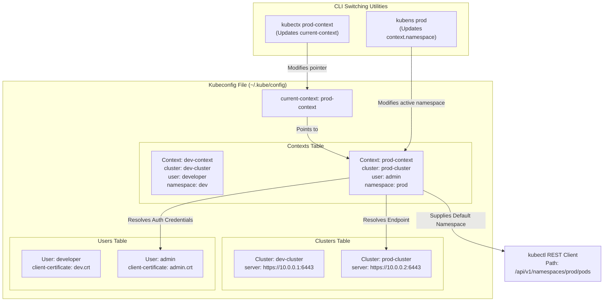
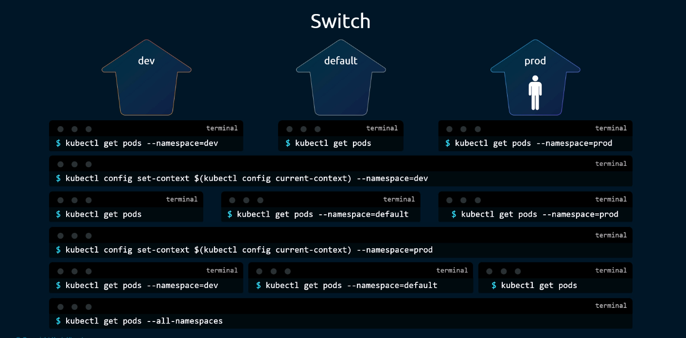
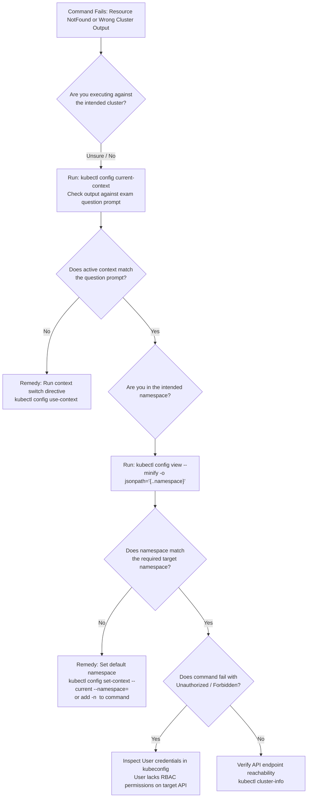

# Kubeconfig Context & Namespace Management (`kubectx` & `kubens`) - CKA Exam Notes

> **Exam Domain**: Cluster Architecture, Installation & Configuration (25%) / Cluster Management & CLI Workflow Efficiency  
> **Weight / Importance**: High (Critical operational multiplier for the CKA exam: rapid context switching across multi-cluster environments, default namespace manipulation, avoiding out-of-context execution failures, and native `kubectl config` equivalents)  
> **Target Version**: Verified against v1.31 / v1.32 (Current CKA Curriculum)  
> **Allowed Docs Search Keywords**: `kubectl config`, `current-context`, `set-context`, `get-contexts`, `use-context`, `Organizing Cluster Access Using kubeconfig Files`  
> **Source**: Generated from `security/17-kubectx-kubens-raw.md`

---

## 1. Quick-Reference Summary

- **What is a Kubeconfig Context?**:
  - An associative tuple binding three elements: **Cluster** (API server endpoint + CA certificate), **User** (authentication token or client TLS certificate/key), and an optional default **Namespace**.
- **`kubectx` Fast Reference**:
  - List all contexts: `kubectx`
  - Show active context: `kubectx -c`
  - Switch to a context: `kubectx <context_name>`
  - Toggle back to previous context: `kubectx -`
  - Rename context: `kubectx <new_name>=<old_name>`
  - Delete context: `kubectx -d <context_name>`
- **`kubens` Fast Reference**:
  - List all namespaces: `kubens`
  - Show active default namespace: `kubens -c`
  - Switch default namespace: `kubens <namespace_name>`
  - Toggle back to previous namespace: `kubens -`
- **Mandatory Native `kubectl` Equivalents (Always Available on Exam)**:
  - Switch context: `kubectl config use-context <context_name>`
  - Get active context: `kubectl config current-context`
  - List contexts: `kubectl config get-contexts`
  - Switch default namespace: `kubectl config set-context --current --namespace=<namespace_name>`
  - Get active namespace: `kubectl config view --minify --output 'jsonpath={..namespace}'`
- **The CKA Exam Multi-Cluster Golden Rule**:
  - Every CKA exam question begins with an explicit context switch directive (e.g. `kubectl config use-context k8s`). **You must run this command first before executing any work**. Performing steps in the wrong cluster context or namespace yields **zero marks** for that question.

---

## 2. Conceptual Overview & Mental Model

### Dual-Layer Architectural Understanding

- **Simple English Explanation (How It Works)**:
  - When you type `kubectl get pods`, `kubectl` does not automatically know which physical Kubernetes cluster to speak with or which namespace to query.
  - It reads a configuration file on your disk (by default at `~/.kube/config`).
  - Inside this file is a pointer called **`current-context`**.
  - That pointer references a named **Context** block. The context defines:
    1. The API server URL (e.g., `https://192.168.1.10:6443`).
    2. The TLS credentials used to prove who you are (e.g., a client certificate or ServiceAccount bearer token).
    3. The default namespace to query if you omit the `-n` flag (e.g., `default`, `finance`, or `production`).
  - In a production environment or during the CKA exam, you frequently switch between 4 to 6 different clusters and dozens of namespaces.
  - Typing the full native commands (`kubectl config set-context $(kubectl config current-context) --namespace=prod`) requires dozens of keystrokes.
  - The open-source utilities **`kubectx`** and **`kubens`** solve this friction by directly modifying the `current-context` and `context.namespace` values in your `~/.kube/config` file in a single, short command.

- **Formal Kubernetes Architecture Definition**:
  - `kubectl` client configuration is serialized in the `Config` struct defined in `k8s.io/client-go/tools/clientcmd/api/v1`. The client loader parses files resolved via `$KUBECONFIG` (or `~/.kube/config`). When a request is constructed, client-go inspects `current-context` to identify the active `Context` object, resolves the `Cluster` configuration (endpoint URL, certificate-authority-data, TLS SNI), and applies the `AuthInfo` credentials. If `context.namespace` is defined, the REST client prepends `/api/v1/namespaces/{namespace}/` to namespaced API paths unless explicitly overridden by the `--namespace` CLI argument. `kubectx` and `kubens` are user-space helper utilities that perform atomic read-modify-write operations on this YAML schema.

### Kubeconfig Context and Namespace Architecture



---

## 3. Deep-Dive Technical Breakdown

### 1. Anatomy of the Kubeconfig Schema

A standard `~/.kube/config` file consists of four primary sections:

```yaml
apiVersion: v1
kind: Config
preferences: {}

# 1. CLUSTERS: Where to connect
clusters:
- name: production-cluster
  cluster:
    server: https://k8s-prod-api.example.com:6443
    certificate-authority-data: LS0tLS1CRUdJTi...

# 2. USERS: How to authenticate
users:
- name: cluster-admin-user
  user:
    client-certificate-data: LS0tLS1CRUdJTi...
    client-key-data: LS0tLS1CRUdJTi...

# 3. CONTEXTS: The association binding Cluster + User + Default Namespace
contexts:
- name: prod-admin
  context:
    cluster: production-cluster
    user: cluster-admin-user
    namespace: production       # Default namespace when using this context

- name: prod-monitoring
  context:
    cluster: production-cluster
    user: cluster-admin-user
    namespace: monitoring

# 4. CURRENT-CONTEXT: The active pointer
current-context: prod-admin
```

---

### 2. Mechanics of `kubectx`

The `kubectx` utility manages the `current-context` field:

1. **Listing Contexts (`kubectx`)**:
   - Parses the `contexts` list from `~/.kube/config`.
   - Highlights the context currently designated by `current-context` (often rendered in bold/color or with an asterisk `*`).
2. **Switching Contexts (`kubectx <name>`)**:
   - Updates the top-level `current-context: <name>` field in `~/.kube/config`.
   - Subsequent `kubectl` invocations immediately communicate with the new cluster using that context's associated credentials and endpoint.
3. **Previous Context Toggling (`kubectx -`)**:
   - Maintains a local state cache (written to `~/.kube/kubectx` or `~/.cache/kubectx/`).
   - Toggles back and forth between the previous and active context, mimicking UNIX `cd -` or `git checkout -`.
4. **Renaming Contexts (`kubectx <new_name>=<old_name>`)**:
   - Rewrites verbose or complex cloud-generated context names (e.g., `arn:aws:eks:us-east-1:123456789:cluster/prod-eks`) into short, ergonomic handles (e.g., `eks-prod`).

---

### 3. Mechanics of `kubens` & Native Namespace Switching

The raw notes reference the challenge of switching namespaces using native `kubectl`:



When you run `kubectl get pods`, if no `--namespace` flag is supplied:
1. `kubectl` checks the `context.namespace` field for the active `current-context`.
2. If `namespace` is defined, `kubectl` queries that namespace.
3. If `namespace` is missing, `kubectl` falls back to the `default` namespace.

#### Native Switching Complexity:
To switch default namespace natively without third-party tools:
```bash
# Old / verbose approach (as shown in raw notes):
kubectl config set-context $(kubectl config current-context) --namespace=dev

# Modern / cleaner native approach (Kubernetes v1.14+):
kubectl config set-context --current --namespace=dev
```

#### How `kubens` Simplifies the Workflow:
```bash
# 1. Switch to 'dev' namespace
kubens dev

# 2. Switch to 'prod' namespace
kubens prod

# 3. Toggle back to 'dev' namespace
kubens -
```
Under the hood, `kubens` modifies the active context's `namespace:` entry in `~/.kube/config` and stores the previous namespace in a state file (`~/.kube/kubens` or `~/.cache/kubens/`).

---

### 4. Installation & Architecture of the Utilities

Both `kubectx` and `kubens` are lightweight POSIX shell scripts (or standalone Go binaries) with zero runtime dependencies.

```bash
# Installation via manual Git clone (from raw notes):
sudo git clone https://github.com/ahmetb/kubectx /opt/kubectx
sudo ln -s /opt/kubectx/kubectx /usr/local/bin/kubectx
sudo ln -s /opt/kubectx/kubens /usr/local/bin/kubens

# Verification:
kubectx --version
kubens --version
```

- **Interactive Selection with `fzf`**:
  If the `fzf` (Fuzzy Finder) binary is present on the system, running `kubectx` or `kubens` without arguments opens an interactive, searchable terminal menu allowing instant keyboard-driven selection.

---

## 4. Command Translation & Mapping Tables

### Master Translation: `kubectx` vs. Native `kubectl config`

| Operational Objective | `kubectx` Utility Command | Mandatory Native `kubectl` Equivalent |
| :--- | :--- | :--- |
| **List all contexts** | `kubectx` | `kubectl config get-contexts -o name`<br/>*(or: `kubectl config get-contexts`)* |
| **Show active context** | `kubectx -c` | `kubectl config current-context` |
| **Switch to another context** | `kubectx <context-name>` | `kubectl config use-context <context-name>` |
| **Toggle to previous context** | `kubectx -` | *(Requires custom shell function or manual switch)* |
| **Rename a context** | `kubectx <new>=<old>` | `kubectl config rename-context <old> <new>` |
| **Delete a context** | `kubectx -d <context-name>` | `kubectl config delete-context <context-name>` |

---

### Master Translation: `kubens` vs. Native `kubectl config`

| Operational Objective | `kubens` Utility Command | Mandatory Native `kubectl` Equivalent |
| :--- | :--- | :--- |
| **List all namespaces** | `kubens` | `kubectl get namespaces -o custom-columns=NAME:.metadata.name` |
| **Show current default namespace** | `kubens -c` | `kubectl config view --minify --output 'jsonpath={..namespace}'` |
| **Switch default namespace** | `kubens <namespace>` | `kubectl config set-context --current --namespace=<namespace>` |
| **Toggle to previous namespace** | `kubens -` | *(Requires custom shell function or manual switch)* |
| **Clear default namespace (reset to default)** | `kubens default` | `kubectl config set-context --current --namespace=default` |

---

## 5. High-Yield CLI & Imperative Commands

### 1. Essential Exam Shell Aliases

In the CKA exam terminal, setting fast aliases in your session saves valuable minutes:

```bash
# 1. Core kubectl aliases
alias k=kubectl
alias kgp='kubectl get pods'
alias kgs='kubectl get svc'
alias kgn='kubectl get nodes'

# 2. Native context and namespace switching aliases
alias kctx='kubectl config use-context'
alias kns='kubectl config set-context --current --namespace'
alias kcurr='kubectl config current-context'

# 3. Set up bash auto-completion for kubectl and aliases
source <(kubectl completion bash)
complete -o default -F __start_kubectl k
```

### 2. Inspecting and Extracting Kubeconfig Properties

```bash
# 1. Display active configuration minified to only the current context
kubectl config view --minify

# 2. Extract only the active namespace string using jsonpath
kubectl config view --minify -o jsonpath='{.contexts[0].context.namespace}'

# 3. Extract the active cluster API server URL
kubectl config view --minify -o jsonpath='{.clusters[0].cluster.server}'

# 4. View all contexts formatted as a clean table with active marked by '*'
kubectl config get-contexts
```

### 3. Managing Contexts Programmatically

```bash
# 1. Manually construct a new context binding an existing cluster and user
kubectl config set-context dev-test --cluster=k8s-cluster --user=dev-user --namespace=test

# 2. Switch to the newly created context
kubectl config use-context dev-test

# 3. Delete a context without modifying cluster or user definitions
kubectl config delete-context dev-test
```

---

## 6. Troubleshooting & Diagnostic Runbook

### Context & Namespace Failure Decision Tree



### Step-by-Step Triage Matrix

| Observed Issue | Root Cause | Verification Command | Remediation Action |
| :--- | :--- | :--- | :--- |
| **`Error from server (NotFound): pods "web" not found`** | Command executed in wrong namespace (default instead of target namespace) | `kubectl config view --minify -o jsonpath='{..namespace}'` | Switch namespace via `kubens <ns>` or `kubectl config set-context --current --namespace=<ns>`, or pass `-n <ns>`. |
| **Resources created in previous question appear** | Forgot to switch context before starting new exam question | `kubectl config current-context` | Execute `kubectl config use-context <context-name>` specified at the top of the question. |
| **`error: no context exists with the given name`** | Typo in context name | `kubectl config get-contexts -o name` | Verify exact context name spelling from the context list. |
| **`kubectx: command not found`** | Third-party utility not installed in exam terminal environment | `which kubectx` | Fall back immediately to native `kubectl config use-context <name>`. |
| **`kubens: command not found`** | Third-party utility not installed in exam terminal environment | `which kubens` | Fall back immediately to native `kubectl config set-context --current --namespace=<ns>`. |

---

## 7. CKA Exam Tips, Gotchas & Traps

> [!WARNING]
> **Trap 1: The Context Amnesia Trap (The #1 Cause of Failed Questions)**  
> In the CKA exam, each question is independent and targets a specific cluster context (e.g. `k8s`, `cluster2`, `prod-cluster`).  
> - **Failure Mode**: You successfully finish Question 4 on `cluster2`. You move to Question 5, which targets `k8s`. If you forget to execute `kubectl config use-context k8s`, you will perform all Question 5 steps on `cluster2`!  
> - **Consequence**: The automated grader checks `k8s`, finds nothing, and awards **0%** for Question 5. Furthermore, your unwanted changes on `cluster2` might invalidate Question 4!  
> - **Golden Rule**: **Always copy and execute the `use-context` command provided at the top of every single exam question before reading the prompt**.

> [!IMPORTANT]
> **Trap 2: The `--current` Flag Requirement**  
> When switching namespaces natively, candidates frequently forget the `--current` flag:
> - **WRONG**: `kubectl config set-context --namespace=dev` *(Creates a context literally named `""` or errors out!)*
> - **CORRECT**:
>   ```bash
>   kubectl config set-context --current --namespace=dev
>   ```

> [!TIP]
> **Trap 3: Availability of `kubectx` and `kubens` in the Exam**  
> While modern PSI exam environments frequently include `kubectx` and `kubens`, you should **never rely exclusively on them**. If they are absent, do not waste time attempting to install them. Use the native aliases:
> ```bash
> alias kctx='kubectl config use-context'
> alias kns='kubectl config set-context --current --namespace'
> ```

> [!IMPORTANT]
> **Trap 4: Multi-Namespace Operations**  
> Switching default namespace with `kubens` or `kubectl config set-context` changes your global default for that context. If a question specifically asks you to inspect resources across all namespaces, always remember the `-A` flag (`kubectl get pods -A`), which overrides any default namespace set in your kubeconfig.

---

## 8. Self-Test / Active Recall

Try answering the questions below without looking at the notes, then expand each question to check your understanding.

<details>
<summary><b>1. What three components make up a Kubernetes Context object in a kubeconfig file?</b></summary>

1. **Cluster** (API server endpoint and certificate authority data).
2. **User** (authentication credentials such as client certificates or bearer tokens).
3. **Namespace** (optional default namespace applied to commands when `-n` is omitted).
</details>

<details>
<summary><b>2. What is the native `kubectl` command to switch the active context to `cluster-prod`?</b></summary>

`kubectl config use-context cluster-prod`.
</details>

<details>
<summary><b>3. What is the native `kubectl` command to set the default namespace of the current context to `finance`?</b></summary>

`kubectl config set-context --current --namespace=finance`.
</details>

<details>
<summary><b>4. How does `kubectx -` know which previous context to switch back to?</b></summary>

`kubectx` writes the name of the previous active context to a temporary state cache file (typically located at `~/.kube/kubectx` or in `~/.cache/kubectx/`).
</details>

<details>
<summary><b>5. What native command outputs only the name of the currently active context?</b></summary>

`kubectl config current-context`.
</details>

<details>
<summary><b>6. What happens if you run `kubectl get pods` when the active context has no `namespace` field defined in `~/.kube/config`?</b></summary>

`kubectl` defaults to querying the `default` namespace.
</details>

<details>
<summary><b>7. Why is it dangerous in the CKA exam to rely on the default namespace remaining `default`?</b></summary>

Because prior tasks or previous commands might have modified the context's default namespace (via `kubens` or `kubectl config set-context`), causing subsequent commands to run against the wrong namespace unless `-n default` is explicitly passed or `kubens default` is executed.
</details>

<details>
<summary><b>8. What native `kubectl` command displays the merged configuration for only the currently active context and its cluster/user details?</b></summary>

`kubectl config view --minify`.
</details>

<details>
<summary><b>9. What JSONPath expression extracts the active namespace from `kubectl config view --minify`?</b></summary>

`kubectl config view --minify -o jsonpath='{..namespace}'` (or `{.contexts[0].context.namespace}`).
</details>

<details>
<summary><b>10. If an exam question asks to delete a context named `old-cluster`, what is the native `kubectl` command?</b></summary>

`kubectl config delete-context old-cluster`.
</details>

---

### Official Documentation Bookmarks

| Documentation Page Title | Allowed Search Query Keyword | Direct Documentation URL |
| :--- | :--- | :--- |
| **Organizing Cluster Access Using kubeconfig Files** | `kubeconfig current-context set-context` | [https://kubernetes.io/docs/concepts/configuration/organize-cluster-access-kubeconfig/](https://kubernetes.io/docs/concepts/configuration/organize-cluster-access-kubeconfig/) |
| **Configure Access to Multiple Clusters** | `Configure Access to Multiple Clusters` | [https://kubernetes.io/docs/tasks/access-application-cluster/configure-access-multiple-clusters/](https://kubernetes.io/docs/tasks/access-application-cluster/configure-access-multiple-clusters/) |
| **kubectl config Reference** | `kubectl config use-context` | [https://kubernetes.io/docs/reference/generated/kubectl/kubectl-commands#config](https://kubernetes.io/docs/reference/generated/kubectl/kubectl-commands#config) |

