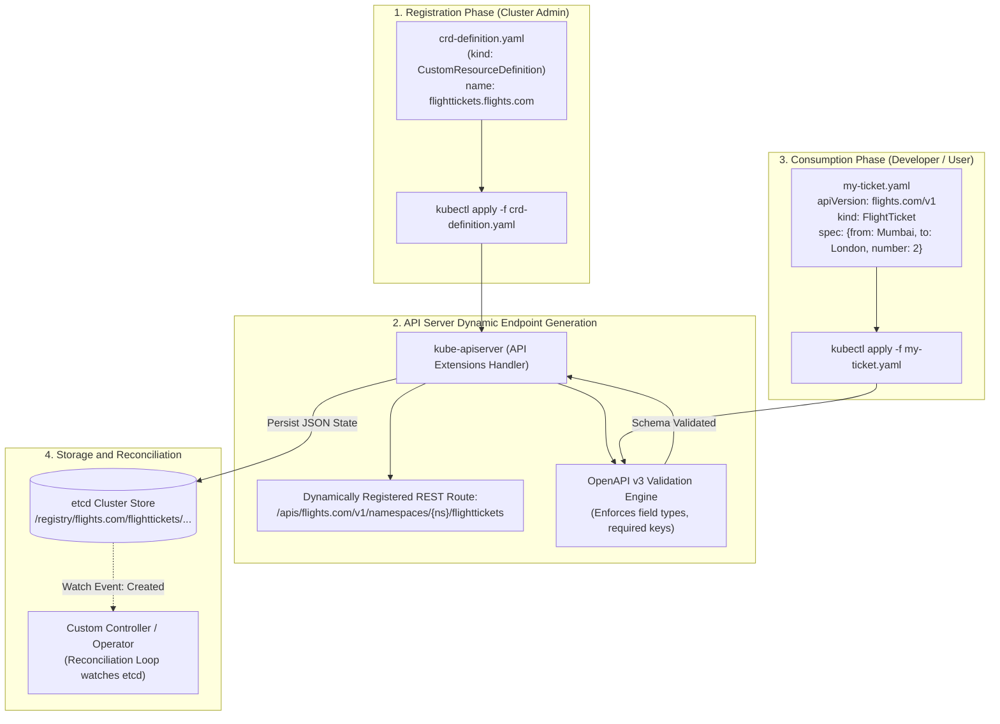
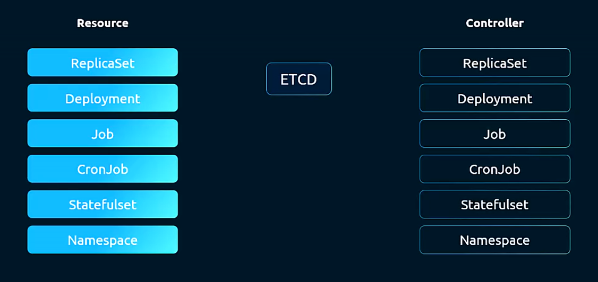
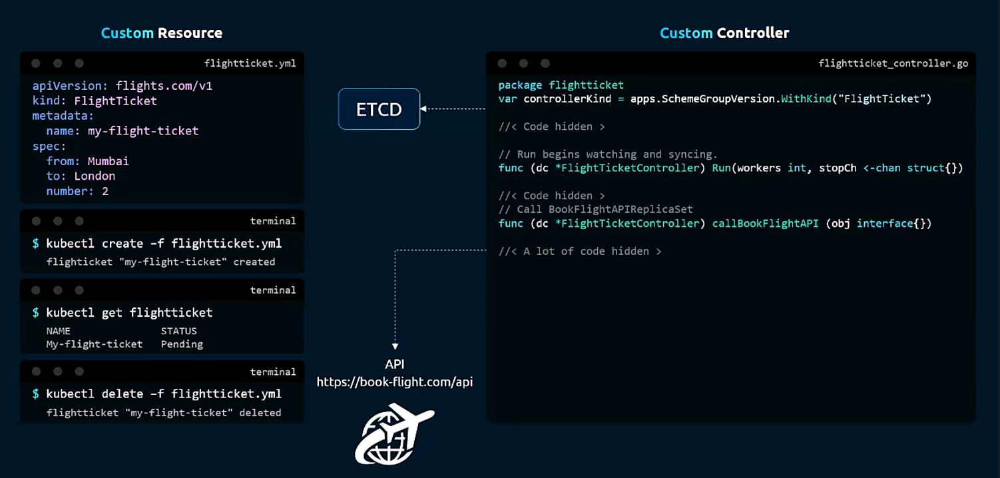
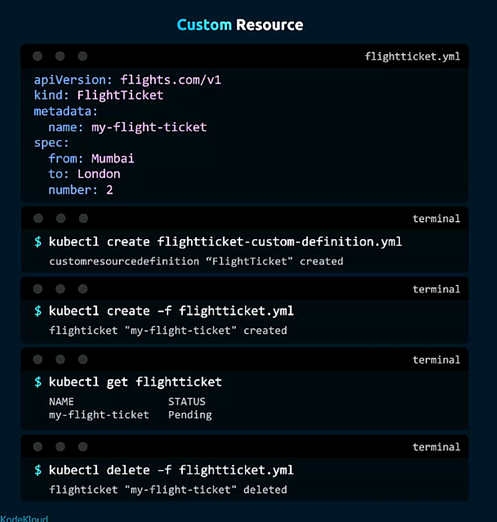
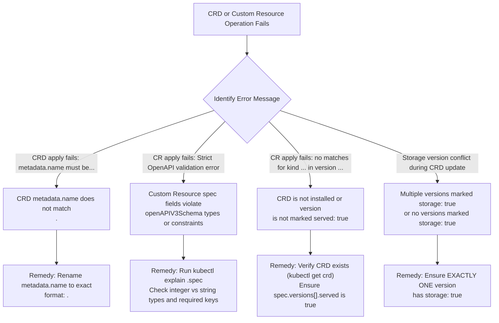

# Custom Resource Definitions (CRDs) - CKA Exam Notes

> **Exam Domain**: Cluster Architecture, Installation & Configuration (25%) / API Extensions  
> **Weight / Importance**: High (Core Kubernetes extensibility topic: dynamic API registration, OpenAPI v3 structural schema validation, the strict `<plural>.<group>` naming rule, multi-versioning semantics, and managing Custom Resource instances)  
> **Target Version**: Verified against v1.31 / v1.32 (Current CKA Curriculum)  
> **Allowed Docs Search Keywords**: `CustomResourceDefinition`, `Extend the Kubernetes API with CustomResourceDefinitions`, `apiextensions.k8s.io/v1`, `OpenAPIV3Schema`, `crds`  
> **Source**: Generated from `security/18-custom-resource-definition-raw.md`

---

## 1. Quick-Reference Summary

- **Resource vs. Custom Resource (CR)**:
  - **Resource**: An HTTP REST endpoint in the Kubernetes API that stores a collection of API objects of a certain kind (e.g., built-in `/api/v1/pods` stores `Pod` objects).
  - **Custom Resource (CR)**: An extension endpoint registered dynamically into the cluster that allows users to store custom structured data via the standard Kubernetes API without modifying the core Kubernetes codebase.
- **Role of Custom Resource Definition (CRD)**:
  - A CRD (`apiextensions.k8s.io/v1`) registers the new resource type with `kube-apiserver`.
  - Once a CRD is created, `kube-apiserver` dynamically creates corresponding REST endpoints (e.g., `/apis/flights.com/v1/namespaces/{ns}/flighttickets`).
- **The Mandatory Naming Constraint**:
  - The CRD's `metadata.name` **MUST strictly match** the format:
    $$\texttt{metadata.name = <spec.names.plural>.<spec.group>}$$
  - *Example*: Plural `flighttickets` + Group `flights.com` $\implies$ `metadata.name: flighttickets.flights.com`. Any other name triggers immediate API schema rejection.
- **Scope Options (`spec.scope`)**:
  - **`Namespaced`**: Objects reside within specific namespaces (`/apis/<group>/<version>/namespaces/<ns>/<plural>`).
  - **`Cluster`**: Objects are cluster-scoped, accessible across the entire cluster without a namespace (`/apis/<group>/<version>/<plural>`).
- **Versioning Constraints (`spec.versions`)**:
  - **`served: true`**: Tells `kube-apiserver` whether this version is exposed via the REST API.
  - **`storage: true`**: Tells `kube-apiserver` which version is used to persist the resource in etcd. **Exactly ONE version in the CRD must have `storage: true`**.
- **Structural Schema Validation (`openAPIV3Schema`)**:
  - Enforces field types (`string`, `integer`, `boolean`, `object`, `array`) and constraints on custom resources at admission time. Malformed CRs are rejected by `kube-apiserver` before reaching etcd.
- **The CRD Deletion Cascade Warning**:
  - Deleting a `CustomResourceDefinition` automatically deletes **all existing custom resource instances** of that kind across the entire cluster from etcd.

---

## 2. Conceptual Overview & Mental Model

### Dual-Layer Architectural Understanding

- **Simple English Explanation (How It Works)**:
  - Out of the box, Kubernetes understands built-in primitives like Pods, Services, and Deployments. When you run `kubectl apply -f pod.yaml`, the API server validates your YAML, saves it in the `etcd` database, and the controller ensures the container starts.
  - But what if you want Kubernetes to manage resources specific to your business or infrastructure—such as a database backup, a flight booking, or an internal machine learning dataset?
  - A **Custom Resource Definition (CRD)** allows you to teach Kubernetes new object types without recompiling the Kubernetes source code.
  - You submit a CRD manifest describing:
    1. The new object's API group and kind name (e.g., `FlightTicket` in `flights.com/v1`).
    2. The schema and data types expected under `spec` (e.g., `from: string`, `to: string`, `number: integer`).
  - The moment the CRD is applied, the `kube-apiserver` dynamically establishes new REST endpoints. You can now run `kubectl get flighttickets`, `kubectl create -f ticket.yaml`, and `kubectl describe ft` exactly like built-in Pods.
  - On its own, a Custom Resource is simply structured data stored in `etcd`. To make it actively perform work, you run a **Custom Controller** that watches for changes to those custom objects and executes real-world actions.

- **Formal Kubernetes Architecture Definition**:
  - `CustomResourceDefinition` (`apiextensions.k8s.io/v1`) is a meta-resource managed by the API Extensions controller embedded within `kube-apiserver`. Upon CRD admission, `kube-apiserver` registers dynamic REST storage paths under `/apis/<group>/<version>/...`, establishes OpenAPI v3 validation endpoints, generates OpenAPI discovery documents consumed by `kubectl`, and registers custom resources for RBAC authorization checks. State changes are serialized into Protocol Buffers or JSON and committed directly to the cluster's BoltDB-backed etcd key-value store.

### CustomResourceDefinition Registration & Custom Resource Lifecycle



---

## 3. Deep-Dive Technical Breakdown

### 1. Built-in Resources vs. Built-in Controllers

In Kubernetes, every built-in resource is paired with an active reconciliation loop running inside the `kube-controller-manager`:



| Built-in Resource | API Group | Reconciling Controller | Controller Action |
| :--- | :--- | :--- | :--- |
| **`ReplicaSet`** | `apps/v1` | `replicaset-controller` | Ensures exact replica count of pods match spec |
| **`Deployment`** | `apps/v1` | `deployment-controller` | Manages declarative rollouts and rollbacks of ReplicaSets |
| **`Job`** | `batch/v1` | `job-controller` | Spawns pods to run until specified completion count |
| **`CronJob`** | `batch/v1` | `cronjob-controller` | Triggers Job execution based on temporal cron schedules |
| **`StatefulSet`** | `apps/v1` | `statefulset-controller` | Manages ordered deployment and stable network/storage identities |
| **`Namespace`** | `core (v1)` | `namespace-controller` | Cleans up namespaced resources upon namespace deletion |

---

### 2. The Custom Resource & Custom Controller Paradigm

A Custom Resource by itself only provides declarative storage in etcd. Pairing it with a Custom Controller implements the **Operator Pattern**:



#### Declarative vs. Imperative API Models:
- **Imperative API**: Instructs a server *what commands to execute* (e.g., `POST /api/book-flight?from=Mumbai&to=London`). If network connectivity fails midway, the state becomes unpredictable.
- **Declarative API**: Declares *what desired state should exist* (e.g., `FlightTicket` object specifying desired flight booking). The Custom Controller executes a continuous reconciliation loop:
  $$\text{Reconcile}(\text{Desired State in etcd}, \text{Current Real-World State})$$
  If the real-world flight is not yet booked, the controller issues API calls to book it, then updates `status: Booked` in etcd.

---

### 3. Anatomical Breakdown of a CRD Manifest

The raw notes provide the canonical flight ticket CRD specification:

```yaml
apiVersion: apiextensions.k8s.io/v1
kind: CustomResourceDefinition
metadata:
  # Mandatory rule: <plural>.<group>
  name: flighttickets.flights.com
spec:
  # 1. API Group: Appears in custom object apiVersion: flights.com/v1
  group: flights.com

  # 2. Scope: Namespaced or Cluster
  scope: Namespaced

  # 3. Naming Metadata
  names:
    kind: FlightTicket        # CamelCase singular used in object manifests
    singular: flightticket    # Lowercase singular used in CLI commands
    plural: flighttickets     # Plural used in API URL endpoints and kubectl get
    shortNames:
    - ft                      # Ergonomic short CLI alias (kubectl get ft)

  # 4. Multi-Versioning Configuration
  versions:
  - name: v1
    served: true              # Must be true for API server to accept this version
    storage: true             # Exactly ONE version must be marked as storage: true
    schema:
      openAPIV3Schema:
        type: object
        properties:
          spec:
            type: object
            required:
            - from
            - to
            properties:
              from:
                type: string
              to:
                type: string
              number:
                type: integer
                minimum: 1
                maximum: 10
          status:
            type: object
            properties:
              confirmationNumber:
                type: string
              state:
                type: string
```

#### Key Schema Elements Explained:
1. **`spec.group`**: Defines the logical domain name for the API group (e.g., `flights.com`, `monitoring.coreos.com`, `cert-manager.io`).
2. **`spec.scope`**:
   - `Namespaced`: Object instances belong to a namespace (default for most application resources).
   - `Cluster`: Object instances are global (like `Node`, `PersistentVolume`, or `ClusterRole`).
3. **`spec.names`**:
   - `kind`: PascalCase singular name representing the schema type in YAML (`FlightTicket`).
   - `plural`: Lowercase plural matching the URL endpoint and default `kubectl get` name (`flighttickets`).
   - `shortNames`: Fast aliases for kubectl commands (`kubectl get ft`).
4. **`spec.versions`**:
   - **`served`**: Exposes the version endpoint `/apis/flights.com/v1/...` to clients.
   - **`storage`**: Specifies which version representation is written to etcd. Only one version can have `storage: true`.
5. **`schema.openAPIV3Schema`**:
   - Implements OpenAPI Specification v3 validation.
   - Prevents users from storing arbitrary or corrupt fields in etcd by rejecting non-conforming objects at admission.

---

### 4. Custom Resource Object Creation Lifecycle

Once the CRD is registered, instances can be created, inspected, and deleted:



```yaml
apiVersion: flights.com/v1
kind: FlightTicket
metadata:
  name: my-flight-ticket
  namespace: default
spec:
  from: Mumbai
  to: London
  number: 2
```

#### Lifecycle CLI Sequence:
```bash
# 1. Register the CRD schema
kubectl create -f flightticket-custom-definition.yml

# 2. Instantiate a Custom Resource object
kubectl create -f flightticket.yml

# 3. Query the custom object using its kind, plural, or shortName
kubectl get flightticket
kubectl get ft

# 4. Delete the custom object
kubectl delete -f flightticket.yml
```

---

### 5. Detailed Breakdown of Practice Session Lab Scenario

The practice lab tests creating a custom resource for managing dataset ingestion:

#### Step 1: The CRD Manifest (`internals.datasets.kodekloud.com`)
```yaml
apiVersion: apiextensions.k8s.io/v1
kind: CustomResourceDefinition
metadata:
  name: internals.datasets.kodekloud.com
spec:
  group: datasets.kodekloud.com
  scope: Namespaced
  names:
    plural: internals
    singular: internal
    kind: Internal
    shortNames:
    - int
  versions:
  - name: v1
    served: true
    storage: true
    schema:
      openAPIV3Schema:
        type: object
        properties:
          spec:
            type: object
            properties:
              internalLoad:
                type: string
              range:
                type: integer
              percentage:
                type: string
```

#### Step 2: The Custom Resource Manifest (`internal-space`)
```yaml
apiVersion: datasets.kodekloud.com/v1
kind: Internal
metadata:
  name: internal-space
  namespace: default
spec:
  internalLoad: "high"
  range: 80
  percentage: "50"
```

#### Step 3: Discovering Schema from Existing CRDs
If an exam task asks you to create a custom resource from an existing CRD already installed on the cluster, inspect the CRD's validation schema to discover the required fields:
```bash
kubectl describe crd globals.traffic.controller
# or inspect the openAPIV3Schema via JSONPath / explain:
kubectl explain globals.traffic.controller.spec
```

---

## 4. Command Translation & Mapping Tables

### CRD Definition vs. Custom Resource (CR) Manifest Alignment

| Architectural Component | CRD Definition Location | CR Manifest Consumer Location | Example Value |
| :--- | :--- | :--- | :--- |
| **API Group & Version** | `spec.group` + `spec.versions[].name` | `apiVersion: <group>/<version>` | `apiVersion: datasets.kodekloud.com/v1` |
| **Object Kind** | `spec.names.kind` | `kind: <Kind>` | `kind: Internal` |
| **Object Scope** | `spec.scope: Namespaced` | `metadata.namespace: <name>` | `metadata.namespace: default` |
| **Spec Fields** | `spec.versions[].schema.openAPIV3Schema.properties.spec` | `spec:` block in manifest | `spec.internalLoad: "high"` |
| **Short CLI Handle** | `spec.names.shortNames` | `kubectl` CLI commands | `kubectl get int` |

---

## 5. High-Yield CLI & Imperative Commands

### 1. Inspecting and Discovering CRDs

```bash
# 1. List all registered CustomResourceDefinitions in the cluster
kubectl get crd (or: kubectl get customresourcedefinitions)

# 2. View details, API group, scope, and short names of a CRD
kubectl describe crd internals.datasets.kodekloud.com

# 3. Dynamic schema discovery using kubectl explain on a custom resource!
kubectl explain internal.spec
kubectl explain flightticket.spec

# 4. View raw OpenAPI v3 validation schema using jsonpath
kubectl get crd internals.datasets.kodekloud.com -o jsonpath='{.spec.versions[*].schema.openAPIV3Schema}'
```

### 2. Managing Custom Resource Instances

```bash
# 1. Create a custom resource from a local YAML file
kubectl apply -f custom-object.yaml

# 2. Query custom objects using plural name, singular name, kind, or shortName
kubectl get internals
kubectl get internal
kubectl get Internal
kubectl get int

# 3. Query custom objects across all namespaces
kubectl get ft -A

# 4. Inspect custom object details and status
kubectl describe int internal-space -n default
```

### 3. Deleting and Cleaning Up Custom Resources

```bash
# 1. Delete a specific custom object instance
kubectl delete internal internal-space -n default

# 2. Delete the entire CRD (WARNING: Deletes ALL instances across all namespaces!)
kubectl delete crd internals.datasets.kodekloud.com
```

---

## 6. Troubleshooting & Diagnostic Runbook

### CRD & Custom Resource Diagnostic Decision Tree



### Step-by-Step Triage Matrix

| Observed Error | Root Cause | Diagnostic Command | Remediation Action |
| :--- | :--- | :--- | :--- |
| **`CustomResourceDefinition.apiextensions.k8s.io "..." is invalid: metadata.name: Invalid value`** | `metadata.name` does not match `<spec.names.plural>.<spec.group>` | Inspect CRD `metadata.name` vs `spec.names.plural` | Set `metadata.name: <plural>.<group>`. |
| **`error: unable to recognize "...": no matches for kind "Internal" in version "datasets/v1"`** | Wrong `apiVersion` in CR manifest or CRD is missing | `kubectl get crd` | Check exact `apiVersion` by concatenating `spec.group` and `spec.versions[0].name`. |
| **`ValidationError(Internal.spec.range): invalid type for integer`** | CR spec passed string (`"80"`) where schema expects integer (`80`) | `kubectl explain internal.spec` | Correct data type in CR manifest to match OpenAPI schema. |
| **`must have exactly one storage version`** | More than one version in `spec.versions` has `storage: true` | Inspect `spec.versions[*].storage` | Set `storage: false` on older versions, keeping only one `storage: true`. |
| **`error: unknown command "kubectl get ft"`** | `shortNames` was omitted from CRD definition | `kubectl get crd <name> -o yaml` | Use full plural name (`flighttickets`) or update CRD to add shortNames. |

---

## 7. CKA Exam Tips, Gotchas & Traps

> [!WARNING]
> **Trap 1: The Strict `<plural>.<group>` Naming Law**  
> In almost every exam question requiring CRD authoring, points are lost because candidates pick arbitrary names like `metadata.name: flight-crd` or `metadata.name: FlightTicket`.  
> - **The Kubernetes Rule**: `metadata.name` **MUST** be `<spec.names.plural>.<spec.group>`.  
> - If `plural` is `internals` and `group` is `datasets.kodekloud.com`, the name **must** be:
>   ```yaml
>   metadata:
>     name: internals.datasets.kodekloud.com
>   ```

> [!IMPORTANT]
> **Trap 2: Cascading Deletion of Custom Resources**  
> If an exam question asks you to delete or update a CRD, be aware:  
> Running `kubectl delete crd <crd-name>` **immediately deletes all existing Custom Resource objects of that type across the entire cluster** without confirmation!

> [!TIP]
> **Trap 3: Using `kubectl explain` on Custom Resources**  
> Once a CRD with an `openAPIV3Schema` is installed, Kubernetes generates real-time documentation for it!  
> If you are tasked with creating a Custom Resource and don't know the field names:
> ```bash
> kubectl explain <kind>.spec
> ```
> This lists all permitted fields, types, and descriptions directly in your terminal.

> [!IMPORTANT]
> **Trap 4: String vs. Integer Type Precision in OpenAPI**  
> Pay strict attention to quotes in custom resource manifests:
> - If schema defines `type: integer`, writing `range: "80"` causes admission rejection. Write `range: 80`.
> - If schema defines `type: string`, writing `percentage: 50` causes rejection. Write `percentage: "50"`.

---

## 8. Self-Test / Active Recall

Try answering the questions below without looking at the notes, then expand each question to check your understanding.

<details>
<summary><b>1. What is the mandatory naming convention for `metadata.name` in a CustomResourceDefinition manifest?</b></summary>

`metadata.name` must be formatted as `<spec.names.plural>.<spec.group>` (e.g. `flighttickets.flights.com`).
</details>

<details>
<summary><b>2. What is the difference between `served` and `storage` in a CRD version specification?</b></summary>

`served: true` controls whether that version is exposed via the API server REST endpoints. `storage: true` designates which version schema is written to etcd. Exactly one version can have `storage: true`.
</details>

<details>
<summary><b>3. What happens to existing custom resource instances if their parent CRD is deleted?</b></summary>

All existing custom resource instances of that kind across all namespaces are permanently deleted from etcd.
</details>

<details>
<summary><b>4. How does `kube-apiserver` validate fields inside a Custom Resource manifest?</b></summary>

Using the `openAPIV3Schema` defined under `spec.versions[].schema` in the CRD, which specifies data types, required fields, and value constraints.
</details>

<details>
<summary><b>5. Can you use `kubectl explain` on custom resources?</b></summary>

Yes. Kubernetes dynamically generates `kubectl explain` documentation for custom resources using the OpenAPI v3 schema provided in the CRD.
</details>

<details>
<summary><b>6. What are the two valid values for `spec.scope` in a CRD?</b></summary>

`Namespaced` (instances belong to specific namespaces) and `Cluster` (instances exist cluster-wide).
</details>

<details>
<summary><b>7. If a CRD has `spec.names.shortNames: ["int"]`, what command lists all instances in namespace `prod`?</b></summary>

`kubectl get int -n prod`.
</details>

<details>
<summary><b>8. In a Custom Resource manifest, what should be the value of `apiVersion`?</b></summary>

`<spec.group>/<spec.versions.name>` (e.g., `datasets.kodekloud.com/v1`).
</details>

<details>
<summary><b>9. Does creating a Custom Resource Definition automatically deploy a controller to reconcile that resource?</b></summary>

No. A CRD only creates the API endpoint and allows data storage in etcd. An external custom controller or operator must be deployed to reconcile the declared state.
</details>

<details>
<summary><b>10. Which core API group provides the `CustomResourceDefinition` kind?</b></summary>

`apiextensions.k8s.io/v1`.
</details>

---

### Official Documentation Bookmarks

| Documentation Page Title | Allowed Search Query Keyword | Direct Documentation URL |
| :--- | :--- | :--- |
| **Extend the Kubernetes API with CustomResourceDefinitions** | `CustomResourceDefinition apiextensions` | [https://kubernetes.io/docs/tasks/extend-kubernetes/custom-resources/custom-resource-definitions/](https://kubernetes.io/docs/tasks/extend-kubernetes/custom-resources/custom-resource-definitions/) |
| **Custom Resources Concepts** | `Custom Resources` | [https://kubernetes.io/docs/concepts/extend-kubernetes/api-extension/custom-resources/](https://kubernetes.io/docs/concepts/extend-kubernetes/api-extension/custom-resources/) |
| **OpenAPI v3 Schema Validation for CRDs** | `openAPIV3Schema CustomResourceDefinition` | [https://kubernetes.io/docs/tasks/extend-kubernetes/custom-resources/custom-resource-definitions/#validation](https://kubernetes.io/docs/tasks/extend-kubernetes/custom-resources/custom-resource-definitions/#validation) |
