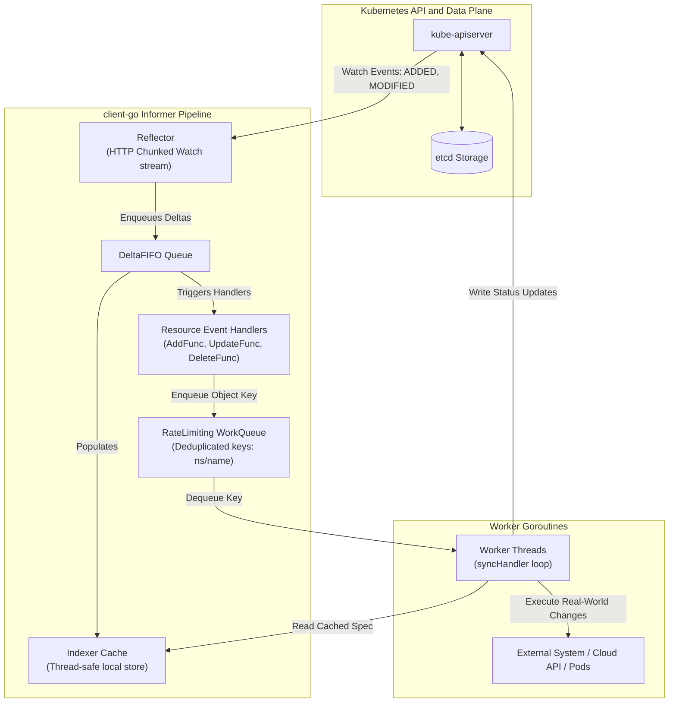
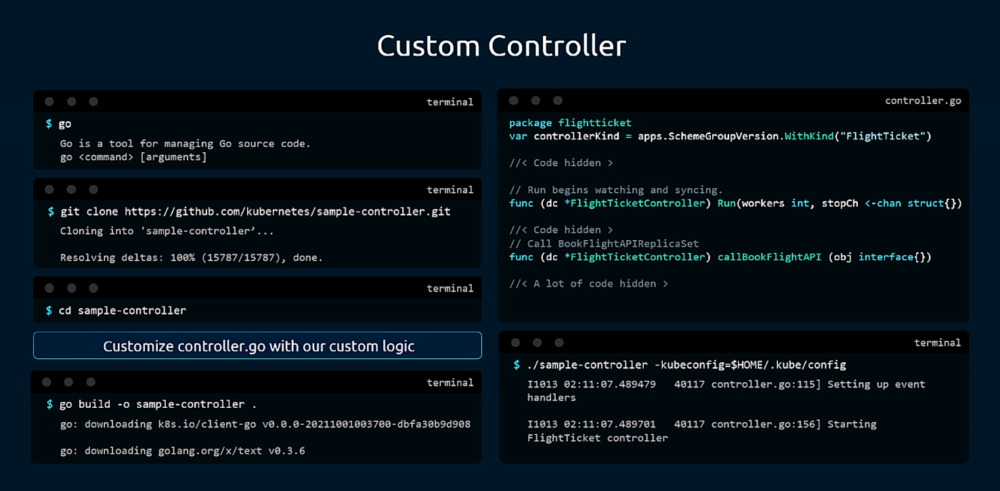
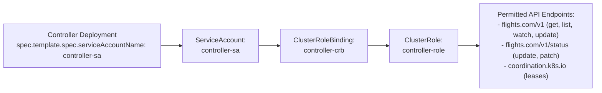
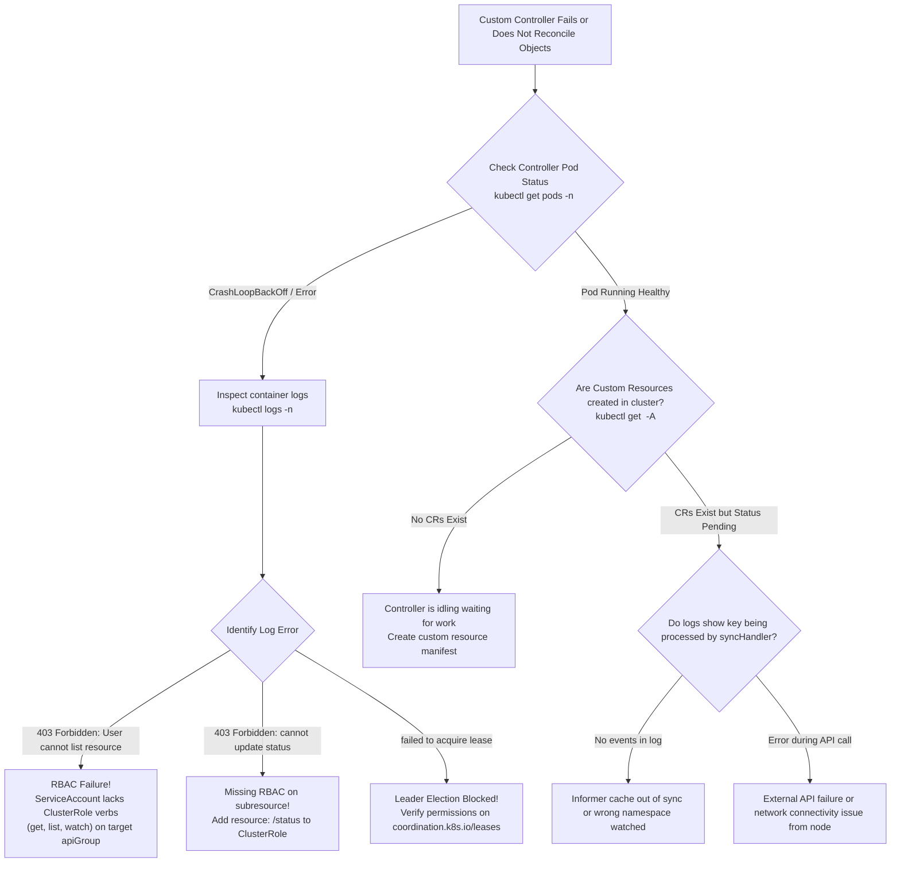

# Kubernetes Custom Controllers & client-go Architecture - CKA Exam Notes

> **Exam Domain**: Cluster Architecture, Installation & Configuration (25%) / Application Lifecycle & Architecture  
> **Weight / Importance**: High (Core Kubernetes architecture topic: understanding the controller reconciliation loop, client-go Informers, WorkQueues, in-cluster ServiceAccount authentication, and RBAC authorization for controllers)  
> **Target Version**: Verified against v1.31 / v1.32 (Current CKA Curriculum)  
> **Allowed Docs Search Keywords**: `Custom Controllers`, `Controller pattern`, `client-go`, `sample-controller`, `In-cluster client configuration`  
> **Source**: Generated from `security/19-custom-controllers-raw.md`

---

## 1. Quick-Reference Summary

- **Definition of a Controller**:
  - An active, non-terminating loop that continuously tracks the desired state of Kubernetes objects (stored in etcd) and executes operations to drive the actual real-world state toward that desired state.
- **Level-Triggered vs. Edge-Triggered Reconciliation**:
  - Kubernetes controllers are **level-triggered**, not edge-triggered. They do not merely react to point-in-time events; they continuously inspect the current state against desired state, ensuring self-healing even if individual change events were missed.
- **The `client-go` Informer Architecture**:
  - Instead of repeatedly polling `kube-apiserver` with expensive `GET` requests, controllers use **SharedInformers**.
  - Components: **Reflector** (establishes HTTP chunked Watch connection) $\to$ **DeltaFIFO Queue** $\to$ **Indexer** (in-memory thread-safe cache) $\to$ **ResourceEventHandler** $\to$ **RateLimitingWorkQueue** $\to$ **Worker Reconcile Loop**.
- **Execution Modes**:
  - **Out-of-Cluster (Development)**: Runs as a native host binary communicating with `kube-apiserver` via a local kubeconfig file (`-kubeconfig=$HOME/.kube/config`).
  - **In-Cluster (Production)**: Packaged as an OCI container image, deployed via a Kubernetes `Deployment`, authenticating automatically using the projected `ServiceAccount` token at `/var/run/secrets/kubernetes.io/serviceaccount/token`.
- **RBAC Security Requirement**:
  - A custom controller requires explicit RBAC permissions. It must be granted `get`, `list`, and `watch` to populate its Informer cache, and `create`, `update`, `patch`, `delete` to reconcile resources and their `/status` subresources.
- **Leader Election (`coordination.k8s.io/v1`)**:
  - When running multiple replicas of a controller for high availability, leader election leases ensure only one replica actively executes reconciliation logic, avoiding split-brain race conditions.

---

## 2. Conceptual Overview & Mental Model

### Dual-Layer Architectural Understanding

- **Simple English Explanation (How It Works)**:
  - In Kubernetes, creating a Custom Resource Definition (CRD) only creates a place to store data in the `etcd` database. The cluster will accept your YAML, but nothing will actually happen in the real world unless you have software that reads that data and acts upon it.
  - A **Custom Controller** is that software. It is a process running in an infinite loop that:
    1. Opens a live HTTP streaming connection (a Watch) to `kube-apiserver`.
    2. Caches the objects locally in memory so it does not overload the API server.
    3. Whenever an object is created, updated, or deleted, it adds the object's key (e.g. `namespace/name`) to a work queue.
    4. Worker threads pull keys from the queue, read the desired state from the local cache, inspect the real-world system (e.g. cloud APIs, external servers, or other Kubernetes pods), and perform the necessary actions to make the real world match the desired state.
    5. Finally, the controller updates the object's `status` subresource in `etcd` to reflect the outcome.
  - While developing, you run the controller binary locally on your laptop using your admin `kubeconfig`. In production, you package the binary into a Docker container and run it as a standard Kubernetes Deployment with a dedicated ServiceAccount.

- **Formal Kubernetes Architecture Definition**:
  - The Kubernetes Controller Pattern implements an asynchronous, idempotent control loop driven by `k8s.io/client-go`. The `Reflector` establishes an HTTP chunked GET watch stream against resource version endpoints on `kube-apiserver`, emits events into a `DeltaFIFO` queue, and syncs an in-memory thread-safe `cache.Indexer`. The Informer dispatches resource keys to a `workqueue.RateLimitingInterface` through `ResourceEventHandlerFuncs` (`AddFunc`, `UpdateFunc`, `DeleteFunc`). Concurrently, worker goroutines dequeue keys, execute an idempotent `syncHandler` function reconciling desired state with actual state, and write status updates via the API server.

### Custom Controller Internal Architecture (client-go Pipeline)



---

## 3. Deep-Dive Technical Breakdown

### 1. The Reconciliation Loop Mechanics

The controller operates as an infinite state reconciliation loop:

$$\text{Observe Current State} \longrightarrow \text{Compare with Desired State in Spec} \longrightarrow \text{Execute Actions} \longrightarrow \text{Update Status}$$

#### Key Characteristics:
1. **Idempotence**: Running the reconciliation function multiple times with the same input must produce the exact same outcome without causing unintended side effects.
2. **Level-Triggered Resilience**: If network connectivity drops between the controller and `kube-apiserver`, the controller does not fail catastrophically. Upon reconnection, the Reflector resynchronizes all resources via a fresh `List` operation, updating the local cache and catching up on missed changes.
3. **Queue Deduplication**: If an object is modified 10 times in 2 seconds, the `WorkQueue` collapses multiple identical keys into a single entry, preventing redundant processing.

---

### 2. Building a Custom Controller with `sample-controller`

The official reference implementation provided by the Kubernetes project is `kubernetes/sample-controller`:



#### Development Workflow Stages:
1. **Clone the Sample Controller**:
   ```bash
   git clone https://github.com/kubernetes/sample-controller.git
   cd sample-controller
   ```
2. **Define Custom Types**:
   - Define Go structs representing the CRD schema in `pkg/apis/<group>/<version>/types.go`:
   ```go
   package v1alpha1

   import metav1 "k8s.io/apimachinery/pkg/apis/meta/v1"

   type FlightTicket struct {
       metav1.TypeMeta   `json:",inline"`
       metav1.ObjectMeta `json:"metadata,omitempty"`

       Spec   FlightTicketSpec   `json:"spec"`
       Status FlightTicketStatus `json:"status,omitempty"`
   }

   type FlightTicketSpec struct {
       From   string `json:"from"`
       To     string `json:"to"`
       Number int    `json:"number"`
   }
   ```
3. **Run Code Generation**:
   - Execute `hack/update-codegen.sh` to automatically generate deep-copy functions, typed clientsets, informers, and listers.
4. **Implement the `syncHandler`**:
   - Write custom business logic in `controller.go` to reconcile the object:
   ```go
   func (c *Controller) syncHandler(key string) error {
       namespace, name, err := cache.SplitMetaNamespaceKey(key)
       if err != nil {
           return err
       }

       // 1. Fetch object from local Indexer cache
       ticket, err := c.flightTicketsLister.FlightTickets(namespace).Get(name)
       if errors.IsNotFound(err) {
           // Object was deleted; clean up external state
           return nil
       }

       // 2. Execute reconciliation logic (e.g. call external booking API)
       confirmation, err := c.bookFlightAPI(ticket.Spec.From, ticket.Spec.To, ticket.Spec.Number)
       if err != nil {
           return err
       }

       // 3. Update status in Kubernetes
       ticketCopy := ticket.DeepCopy()
       ticketCopy.Status.State = "Confirmed"
       ticketCopy.Status.ConfirmationNumber = confirmation
       _, err = c.customClientset.FlightsV1().FlightTickets(namespace).UpdateStatus(context.TODO(), ticketCopy, metav1.UpdateOptions{})
       return err
   }
   ```
5. **Build Binary**:
   ```bash
   go build -o flight-controller .
   ```

---

### 3. Out-of-Cluster vs. In-Cluster Execution

| Property | Out-of-Cluster Execution (Development) | In-Cluster Execution (Production) |
| :--- | :--- | :--- |
| **Runtime Environment** | Developer workstation or standalone VM | Inside Kubernetes as a `Deployment` |
| **Authentication** | Reads local kubeconfig file (`$HOME/.kube/config`) | Injected `ServiceAccount` projected token volume |
| **Invocation** | `./flight-controller -kubeconfig=$HOME/.kube/config` | Executed automatically by container runtime (`containerd`) |
| **High Availability** | Single process (manual restart on crash) | Deployment replica management + Leader Election leases |
| **Security Risk** | Uses developer's broad admin credentials | Uses least-privilege RBAC role bound to ServiceAccount |

---

### 4. RBAC Configuration for In-Cluster Controllers

When deployed in-cluster, the controller runs under a dedicated `ServiceAccount`. The API server rejects any operations unless an appropriate `ClusterRole` and `ClusterRoleBinding` are established:



#### Production RBAC Manifest:
```yaml
# 1. Dedicated ServiceAccount
apiVersion: v1
kind: ServiceAccount
metadata:
  name: flight-controller-sa
  namespace: custom-controllers

---
# 2. ClusterRole defining exact controller permissions
apiVersion: rbac.authorization.k8s.io/v1
kind: ClusterRole
metadata:
  name: flight-controller-role
rules:
# Permissions for Custom Resources
- apiGroups: ["flights.com"]
  resources: ["flighttickets"]
  verbs: ["get", "list", "watch", "create", "update", "patch", "delete"]

# Permissions for Status Subresource
- apiGroups: ["flights.com"]
  resources: ["flighttickets/status"]
  verbs: ["get", "update", "patch"]

# Permissions for Events
- apiGroups: [""]
  resources: ["events"]
  verbs: ["create", "patch"]

# Permissions for Leader Election Leases
- apiGroups: ["coordination.k8s.io"]
  resources: ["leases"]
  verbs: ["get", "list", "watch", "create", "update", "patch", "delete"]

---
# 3. ClusterRoleBinding linking ServiceAccount to ClusterRole
apiVersion: rbac.authorization.k8s.io/v1
kind: ClusterRoleBinding
metadata:
  name: flight-controller-crb
roleRef:
  apiGroup: rbac.authorization.k8s.io
  kind: ClusterRole
  name: flight-controller-role
subjects:
- kind: ServiceAccount
  name: flight-controller-sa
  namespace: custom-controllers
```

---

### 5. In-Cluster Deployment Manifest

```yaml
apiVersion: apps/v1
kind: Deployment
metadata:
  name: flight-controller-deployment
  namespace: custom-controllers
spec:
  replicas: 2                 # HA deployment running with leader election
  selector:
    matchLabels:
      app: flight-controller
  template:
    metadata:
      labels:
        app: flight-controller
    spec:
      serviceAccountName: flight-controller-sa # Uses our RBAC credentials
      containers:
      - name: controller
        image: myregistry.com/flight-controller:v1.0.0
        command:
        - ./flight-controller
        - --leader-elect=true
        resources:
          limits:
            cpu: 200m
            memory: 256Mi
          requests:
            cpu: 50m
            memory: 64Mi
```

---

## 4. Command Translation & Mapping Tables

### Controller Pipeline Component Roles

| Pipeline Component | Go Package / Type | Primary Responsibility | Data Source |
| :--- | :--- | :--- | :--- |
| **`Reflector`** | `k8s.io/client-go/tools/cache` | Maintains persistent HTTP Watch connection to API server | `kube-apiserver` |
| **`DeltaFIFO`** | `k8s.io/client-go/tools/cache` | Queues state changes (`Added`, `Updated`, `Deleted`) | `Reflector` |
| **`Indexer`** | `k8s.io/client-go/tools/cache` | Local in-memory thread-safe key-value cache | `DeltaFIFO` |
| **`Lister`** | Generated code | Provides read-only query access to the Indexer cache | `Indexer` |
| **`WorkQueue`** | `k8s.io/client-go/util/workqueue` | Thread-safe queue with rate limiting and deduplication | Event Handlers |
| **`syncHandler`** | Custom User Code | Idempotent function reconciling actual state to desired state | WorkQueue keys |

---

## 5. High-Yield CLI & Imperative Commands

### 1. Generating Controller RBAC Imperatively

```bash
# 1. Create the controller namespace and ServiceAccount
kubectl create namespace custom-controllers
kubectl create sa flight-controller-sa -n custom-controllers

# 2. Create ClusterRole with required verbs for the custom resource
kubectl create clusterrole flight-controller-role \
  --verb=get,list,watch,create,update,patch,delete \
  --resource=flighttickets.flights.com

# 3. Bind the ServiceAccount to the ClusterRole
kubectl create clusterrolebinding flight-controller-crb \
  --clusterrole=flight-controller-role \
  --serviceaccount=custom-controllers:flight-controller-sa
```

### 2. Monitoring & Debugging Controllers

```bash
# 1. Stream real-time logs from the controller deployment
kubectl logs -f -n custom-controllers -l app=flight-controller

# 2. Inspect active leader election leases in the cluster
kubectl get leases -A
kubectl describe lease flight-controller-lease -n custom-controllers

# 3. View cluster events generated by the controller
kubectl get events -n default --field-selector reason=FlightBooked

# 4. Check whether controller ServiceAccount has permission to patch CR status
kubectl auth can-i patch flighttickets.flights.com/status \
  --as=system:serviceaccount:custom-controllers:flight-controller-sa
```

---

## 6. Troubleshooting & Diagnostic Runbook

### Custom Controller Diagnostic Decision Tree



### Step-by-Step Triage Matrix

| Observed Symptom | Root Cause | Verification Command | Remediation Action |
| :--- | :--- | :--- | :--- |
| **`User "system:serviceaccount:..." cannot list resource "..."`** | ServiceAccount lacks `list` / `watch` verbs in RBAC ClusterRole | `kubectl auth can-i watch <resource> --as=...` | Update ClusterRole to include `get`, `list`, `watch` on target API group. |
| **`cannot update resource ".../status" in API group "..."`** | ClusterRole permits the main resource but omits `/status` subresource | Inspect ClusterRole `resources` list | Add `"<resource>/status"` to ClusterRole rules. |
| **Controller pod crashes immediately on start** | Binary cannot find kubeconfig file in-cluster | `kubectl logs <pod>` showing `open ~/.kube/config: no such file` | Update code to use `rest.InClusterConfig()` instead of reading local file. |
| **Multiple replicas executing duplicate work** | Leader election disabled; both replicas actively processing queue | Check controller startup arguments | Add `--leader-elect=true` and grant permissions on `coordination.k8s.io/leases`. |
| **Custom objects never updated after manual edit** | Controller syncHandler fails silently or crashes on unexpected data types | Inspect controller stdout logs | Add proper error logging in `syncHandler` and handle missing keys gracefully. |

---

## 7. CKA Exam Tips, Gotchas & Traps

> [!WARNING]
> **Trap 1: The `/status` Subresource RBAC Permission**  
> If an exam question involves troubleshooting a controller that reads objects but fails to mark them as `Ready` or `Confirmed`:
> - Checking `kubectl logs` will reveal: `User cannot patch resource "myresources/status"`.
> - **In Kubernetes RBAC, subresources are treated as separate resource strings**:
>   ```yaml
>   rules:
>   - apiGroups: ["flights.com"]
>     resources:
>     - flighttickets
>     - flighttickets/status # MANDATORY for updating status!
>     verbs: ["get", "update", "patch"]
>   ```

> [!IMPORTANT]
> **Trap 2: `watch` and `list` Are Mandatory for Informers**  
> An Informer **cannot start** without both `list` and `watch` permissions. If you only grant `get` and `update`, the controller crashes on startup during the initial cache synchronization phase with an authorization error.

> [!TIP]
> **Trap 3: Testing Permissions with `kubectl auth can-i`**  
> You do not need to wait for controller logs to verify RBAC permissions. Test your ServiceAccount imperatively before deploying the controller:
> ```bash
> kubectl auth can-i watch flighttickets.flights.com \
>   --as=system:serviceaccount:custom-controllers:flight-controller-sa
> ```

> [!IMPORTANT]
> **Trap 4: In-Cluster Configuration vs. Kubeconfig Flag**  
> When running a controller inside a Kubernetes cluster, **do not pass `-kubeconfig`**. Standard Go client-go applications automatically fall back to `rest.InClusterConfig()`, reading the mounted token at `/var/run/secrets/kubernetes.io/serviceaccount/token` and the cluster CA certificate at `/var/run/secrets/kubernetes.io/serviceaccount/ca.crt`.

---

## 8. Self-Test / Active Recall

Try answering the questions below without looking at the notes, then expand each question to check your understanding.

<details>
<summary><b>1. What is the fundamental difference between an edge-triggered controller and a level-triggered controller?</b></summary>

An edge-triggered controller acts only when a state change event arrives; if an event is missed, state divergence persists. A level-triggered controller inspects the current state against the desired state at any time, ensuring eventual consistency even after network partitions or dropped events.
</details>

<details>
<summary><b>2. Why do Kubernetes controllers use Informers instead of issuing periodic `GET` requests to `kube-apiserver`?</b></summary>

Periodic polling creates severe API server CPU and etcd I/O bottlenecks. Informers use HTTP chunked Watch streaming and maintain an in-memory thread-safe cache (`Indexer`), allowing read operations to occur locally with zero API server load.
</details>

<details>
<summary><b>3. What are the three primary callbacks defined on a client-go `ResourceEventHandler`?</b></summary>

`AddFunc(obj interface{})`, `UpdateFunc(oldObj, newObj interface{})`, and `DeleteFunc(obj interface{})`.
</details>

<details>
<summary><b>4. What role does the `WorkQueue` serve in a client-go controller?</b></summary>

It decouples event delivery from event processing, deduplicates rapid updates to the same object, enforces rate limiting with exponential backoff, and distributes keys across concurrent worker goroutines.
</details>

<details>
<summary><b>5. Where does an in-cluster controller pod obtain its authentication credentials?</b></summary>

From the projected ServiceAccount volume mounted at `/var/run/secrets/kubernetes.io/serviceaccount/` containing `token`, `ca.crt`, and `namespace`.
</details>

<details>
<summary><b>6. If a controller needs to update `ticket.status.confirmationNumber`, what additional resource entry must be included in its RBAC ClusterRole?</b></summary>

The status subresource: `flighttickets/status`.
</details>

<details>
<summary><b>7. What is the purpose of Leader Election in high-availability controller deployments?</b></summary>

It ensures that although multiple controller pod replicas are running, only one active leader replica processes the workqueue and reconciles objects, preventing race conditions and conflicting updates.
</details>

<details>
<summary><b>8. Which official Kubernetes repository serves as the reference implementation for custom controllers?</b></summary>

`https://github.com/kubernetes/sample-controller`.
</details>

<details>
<summary><b>9. What `kubectl` command tests whether a specific ServiceAccount can watch custom resources?</b></summary>

`kubectl auth can-i watch <resource>.<group> --as=system:serviceaccount:<namespace>:<sa-name>`.
</details>

<details>
<summary><b>10. What Go client-go function is used by in-cluster controllers to automatically detect API server host and credentials?</b></summary>

`rest.InClusterConfig()`.
</details>

---

### Official Documentation Bookmarks

| Documentation Page Title | Allowed Search Query Keyword | Direct Documentation URL |
| :--- | :--- | :--- |
| **Custom Controllers Concepts** | `Custom Controllers` | [https://kubernetes.io/docs/concepts/extend-kubernetes/api-extension/custom-resources/#custom-controllers](https://kubernetes.io/docs/concepts/extend-kubernetes/api-extension/custom-resources/#custom-controllers) |
| **The Controller Pattern** | `Controller pattern` | [https://kubernetes.io/docs/concepts/architecture/controller/](https://kubernetes.io/docs/concepts/architecture/controller/) |
| **Accessing the API from a Pod (In-Cluster Client)** | `Accessing the API from a Pod InClusterConfig` | [https://kubernetes.io/docs/tasks/run-application/access-api-from-pod/](https://kubernetes.io/docs/tasks/run-application/access-api-from-pod/) |
| **sample-controller Repository** | `sample-controller github kubernetes` | [https://github.com/kubernetes/sample-controller](https://github.com/kubernetes/sample-controller) |
