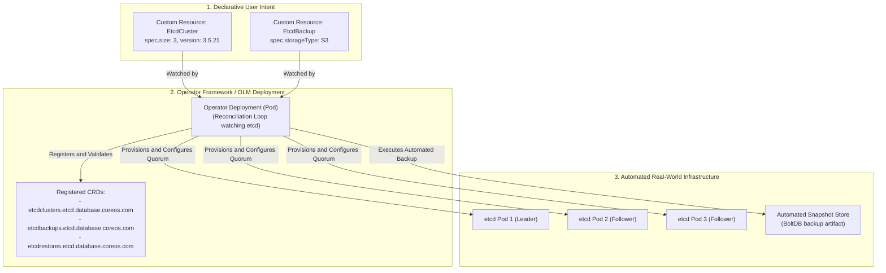
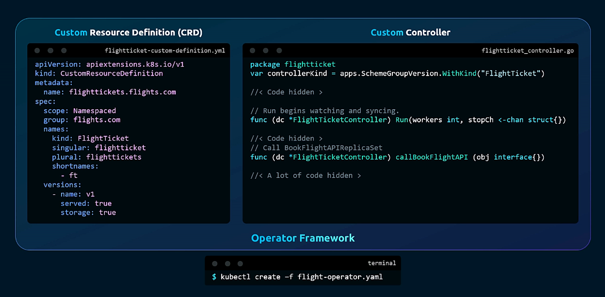
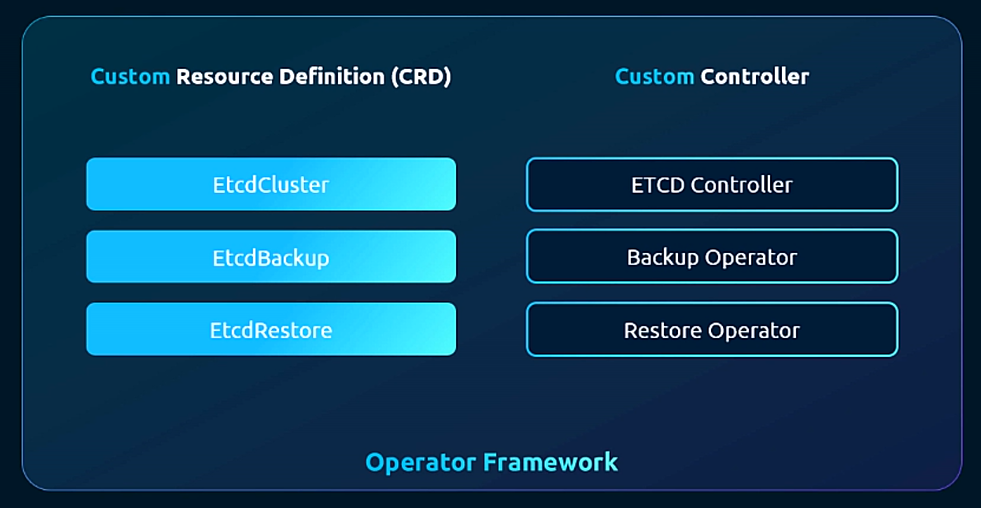
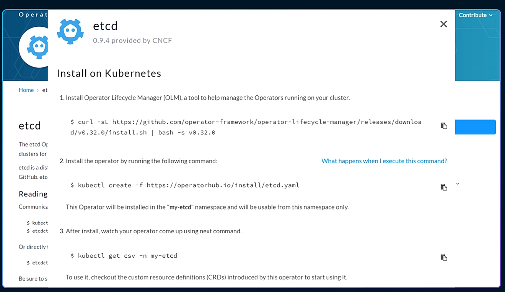
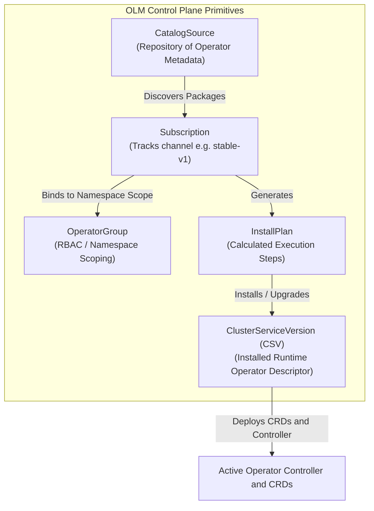

# The Kubernetes Operator Pattern & Operator Framework - CKA Exam Notes

> **Exam Domain**: Cluster Architecture, Installation & Configuration (25%) / Application Lifecycle & Architecture  
> **Weight / Importance**: High (Core architectural pattern for complex stateful applications: packaging CRDs with controllers, Operator Framework, Operator Lifecycle Manager / OLM, OperatorHub, and managing ClusterServiceVersions)  
> **Target Version**: Verified against v1.31 / v1.32 (Current CKA Curriculum)  
> **Allowed Docs Search Keywords**: `Operator pattern`, `Custom Resources`, `Operator Lifecycle Manager`, `OperatorHub`, `ClusterServiceVersion`  
> **Source**: Generated from `security/20-operator-raw.md`

---

## 1. Quick-Reference Summary

- **The Operator Formula**:
  $$\textbf{Operator} = \textbf{Custom Resource Definition (CRD)} + \textbf{Custom Controller (Reconciliation Engine)}$$
  - While a CRD defines the API schema and a controller reconciles state, an **Operator** packages both together to automate the complete Day-1 (install, bootstrap) and Day-2 (backup, restore, rolling upgrade, auto-scaling, failover) lifecycle of complex applications.
- **The Operator Maturity Model (5 Capability Levels)**:
  - **Level 1 (Basic Install)**: Automated provisioning and configuration.
  - **Level 2 (Seamless Upgrades)**: Automated patch and minor version upgrades.
  - **Level 3 (Full Lifecycle)**: Automated backup, restore, and disaster recovery.
  - **Level 4 (Deep Insights)**: Metrics, alerts, telemetry, and log analysis.
  - **Level 5 (Auto-Pilot)**: Horizontal/vertical autoscaling, anomaly detection, automated tuning.
- **Operator Lifecycle Manager (OLM)**:
  - The Kubernetes-native package manager and control plane for managing the installation, upgrading, and role-based access of Operators on a cluster.
  - Core OLM resources: `CatalogSource`, `OperatorGroup`, `Subscription`, `InstallPlan`, `ClusterServiceVersion` (`CSV`).
- **ClusterServiceVersion (`CSV`)**:
  - The fundamental runtime artifact of an installed Operator under OLM. Represents the manifests, RBAC, CRDs, and container deployment requirements of a specific Operator version.
- **OperatorHub (`operatorhub.io`)**:
  - The official public registry and catalog of certified, community, and vendor-supported Kubernetes Operators (e.g. etcd, Prometheus, Grafana, Argo CD, Istio, Strimzi Kafka, CockroachDB).
- **Two-Step Deployment Flow**:
  1. Install OLM control plane into the cluster (`curl -sL ... | bash`).
  2. Subscribe to the desired operator manifest from OperatorHub (`kubectl create -f https://operatorhub.io/install/<operator>.yaml`).

---

## 2. Conceptual Overview & Mental Model

### Dual-Layer Architectural Understanding

- **Simple English Explanation (How It Works)**:
  - Stateless applications (like simple web servers) are easy to manage in Kubernetes using standard Deployments: if a pod dies, Kubernetes just creates another one.
  - Complex stateful applications (like database clusters, message brokers, or distributed key-value stores such as `etcd`) are much harder to manage. Replacing a failed database node requires joining a replication quorum, re-synchronizing data, verifying consensus, taking scheduled snapshots, and performing schema migrations during version upgrades.
  - In traditional operations, a human systems engineer manually executes scripts and runbooks to perform these tasks.
  - An **Operator** encodes that operational knowledge directly into software code running inside Kubernetes.
  - It combines:
    1. A set of **Custom Resource Definitions (CRDs)** that let you declare what you want (e.g., `kind: EtcdCluster`, `kind: EtcdBackup`, `kind: EtcdRestore`).
    2. A **Custom Controller** that runs inside the cluster and knows exactly how to provision nodes, configure peer discovery, take backups, and perform automated failovers when a node crashes.
  - To make finding, installing, and updating operators easy, the community created the **Operator Framework**, **OperatorHub**, and the **Operator Lifecycle Manager (OLM)**.

- **Formal Kubernetes Architecture Definition**:
  - The Operator Pattern is an architectural paradigm that extends the Kubernetes control plane by combining one or more `CustomResourceDefinition` objects with an active custom controller running a continuous level-triggered reconciliation loop. The controller encapsulates domain-specific operational logic for stateful distributed workloads. The Operator Framework provides the software development kit (`operator-sdk`), the testing suite (`scorecard`), and the management engine (`operator-lifecycle-manager`) that handles catalog resolution, dependency resolution, RBAC scoping via `OperatorGroup`, and automated channel-based version rolling updates mediated through `ClusterServiceVersion` (`operators.coreos.com/v1alpha1`) custom resources.

### The Kubernetes Operator Architecture



---

## 3. Deep-Dive Technical Breakdown

### 1. The Anatomy of an Operator: Unifying CRD and Controller

An Operator packages declarative API extensions and operational software into a single unified deliverable:



#### The Component Structure:
1. **The Custom Resource Definitions (CRDs)**:
   - Provide the user interface.
   - Define the schema for declaring clusters, configurations, backups, or restore targets.
2. **The Custom Controller Deployment**:
   - The operational brain.
   - Runs as a standard Kubernetes Deployment (often with leader election for HA).
   - Authenticates using an in-cluster `ServiceAccount` granted least-privilege RBAC permissions.
3. **The Operator Package**:
   - Packaged as a unified YAML manifest (or OLM bundle) that deploys the CRDs, the ServiceAccount, the RBAC Roles/RoleBindings, and the Controller Deployment in one operation (`kubectl create -f flight-operator.yaml`).

---

### 2. The Stateful `etcd` Operator Case Study

The raw notes reference the canonical example that birthed the Operator pattern: the CoreOS `etcd` Operator.



#### How the Operator Solves Complex Operational Tasks:

```yaml
# 1. Automated Cluster Deployment
apiVersion: etcd.database.coreos.com/v1beta2
kind: EtcdCluster
metadata:
  name: production-etcd
  namespace: database
spec:
  size: 3
  version: "3.5.21"
  repository: "quay.io/coreos/etcd"

---
# 2. Automated Scheduled Snapshot Backup
apiVersion: etcd.database.coreos.com/v1beta2
kind: EtcdBackup
metadata:
  name: daily-etcd-snapshot
  namespace: database
spec:
  etcdEndpoints: ["production-etcd-client:2379"]
  storageType: S3
  s3:
    path: my-bucket/etcd-backups
    awsSecret: aws-s3-credentials

---
# 3. Automated Disaster Recovery Restore
apiVersion: etcd.database.coreos.com/v1beta2
kind: EtcdRestore
metadata:
  name: restore-production-etcd
  namespace: database
spec:
  etcdCluster:
    name: production-etcd
  backupStorageType: S3
  s3:
    path: my-bucket/etcd-backups/snapshot-2026-10-15.db
    awsSecret: aws-s3-credentials
```

#### Operational Workflow Breakdown:
- **Quorum Management**: If one etcd pod crashes and is permanently lost, the controller detects quorum degradation, provisions a replacement pod, connects to the existing members, executes `etcdctl member add`, and waits for data re-synchronization.
- **Backup Execution**: When an `EtcdBackup` resource is created, the controller executes `etcdctl snapshot save`, verifies snapshot cryptographic integrity, and uploads the BoltDB file to cloud storage.
- **Restore Automation**: In catastrophic quorum collapse (e.g. 2 out of 3 nodes destroyed), creating an `EtcdRestore` resource triggers the restore controller to download the snapshot, initialize a new cluster with `--force-new-cluster`, and roll out a fresh healthy 3-node topology.

---

### 3. Operator Lifecycle Manager (OLM) Mechanics

Operator Lifecycle Manager (OLM) is part of the CNCF Operator Framework. It provides dependency management, automated upgrades, and RBAC security for operators running in Kubernetes clusters.



#### The 5 Primary OLM Custom Resources:



1. **`CatalogSource`**:
   - Represents a store of metadata that OLM can query to discover and install Operators and their dependencies (e.g., `operatorhubio-catalog`).
2. **`OperatorGroup`**:
   - Selects target namespaces in which to generate required RBAC access for the Operator. Can be multi-namespace or cluster-wide.
3. **`Subscription`**:
   - Describes which channel of an Operator package to track (e.g., `channel: stable`, `installPlanApproval: Automatic`). OLM watches the subscription and triggers updates when new versions appear in the catalog.
4. **`InstallPlan`**:
   - Defines the calculated list of Kubernetes resources (CRDs, ServiceAccounts, Deployments, ClusterRoles) that must be created or updated to satisfy a Subscription.
5. **`ClusterServiceVersion` (`CSV`)**:
   - A detailed manifest containing all technical metadata about an installed operator: version, description, required CRDs, container images, RBAC permissions, and installation status phase (`Succeeded`, `Pending`, `Failed`).

---

### 4. OperatorHub Installation Sequence

Deploying an Operator via OperatorHub follows a standard 3-step operational procedure:

#### Step 1: Install Operator Lifecycle Manager (OLM)
```bash
curl -sL https://github.com/operator-framework/operator-lifecycle-manager/releases/download/v0.32.0/install.sh | bash -s v0.32.0
```
*This bootstraps the `olm` and `operators` namespaces and deploys the OLM catalog and package operator controllers.*

#### Step 2: Install the Operator via OperatorHub Manifest
```bash
kubectl create -f https://operatorhub.io/install/etcd.yaml
```
*This manifest creates the target namespace (e.g. `my-etcd`), defines an `OperatorGroup`, and creates a `Subscription` pointing to the operator package.*

#### Step 3: Verify the Installation via CSV
```bash
# Monitor the ClusterServiceVersion until Phase is Succeeded
kubectl get csv -n my-etcd
# Sample Output:
# NAME                  DISPLAY   VERSION   REPLACES   PHASE
# etcdoperator.v0.9.4   etcd      0.9.4                Succeeded
```

---

## 4. Command Translation & Mapping Tables

### Evolution of Operational Management in Kubernetes

| Operational Tier | Implementation Mechanism | Human Responsibility | System Responsibility |
| :--- | :--- | :--- | :--- |
| **Tier 1: Native Workloads** | Pods, Deployments, Services | Manual scaling, manual backups, manual failover | Process restart, container scheduling |
| **Tier 2: Helm Charts** | Parameterized YAML templates | Executes upgrades, triggers scripts, manages state | Template rendering and initial deployment |
| **Tier 3: Basic Controllers** | Custom Controller + CRD | Performs continuous reconciliation of basic spec | Keeps custom state aligned with desired spec |
| **Tier 4: Full Operators** | Operator Framework / OLM | Declares high-level business intent in CR manifests | **Automates Day-1 and Day-2 operations** (backup, failover, upgrades) |

---

### The 5 Operator Capability Maturity Levels

| Level | Capability Title | Operational Characteristics | Example Feature |
| :---: | :--- | :--- | :--- |
| **1** | **Basic Install** | Automated application provisioning and configuration | Deploy initial 3-node cluster |
| **2** | **Seamless Upgrades** | Automated minor/patch version upgrades | Rolling restart with zero quorum loss |
| **3** | **Full Lifecycle** | Backup, restore, failover, disaster recovery | Automated S3 snapshots and restore CRDs |
| **4** | **Deep Insights** | Prometheus metrics, Grafana dashboards, alerting | Exposes quorum latency and Raft metrics |
| **5** | **Auto-Pilot** | Horizontal/vertical auto-scaling, auto-tuning | Expands disk PVCs when storage reaches 85% |

---

## 5. High-Yield CLI & Imperative Commands

### 1. Inspecting OLM and Operator Status

```bash
# 1. List all installed ClusterServiceVersions across all namespaces
kubectl get csv -A

# 2. Inspect the detailed phase and status of an operator CSV
kubectl describe csv etcdoperator.v0.9.4 -n my-etcd

# 3. List active subscriptions and tracked channels
kubectl get subscriptions -A (or: kubectl get sub -A)

# 4. View active InstallPlans and verify approval status
kubectl get installplan -A (or: kubectl get ip -A)

# 5. List available operator catalog sources
kubectl get catalogsource -n olm
```

### 2. Managing Operator-Provided Custom Resources

```bash
# 1. Identify which CRDs were introduced by an operator
kubectl get crd | grep -iE 'etcd|prometheus|grafana'

# 2. List custom resource instances managed by the operator
kubectl get etcdclusters -A
kubectl get etcdbackups -A

# 3. Create an on-demand backup by submitting a CR manifest
kubectl apply -f etcd-backup.yaml

# 4. Inspect controller logs for the running operator
kubectl logs -f -n my-etcd deployment/etcd-operator
```

---

## 6. Troubleshooting & Diagnostic Runbook

### Operator & OLM Diagnostic Decision Tree

```mermaid
flowchart TD
    Start["Operator Fails to Install or Reconcile"] --> Step1{"Check CSV Status<br/>kubectl get csv -n <namespace>"}

    Step1 -->|Phase: Pending / Failed| CheckIP["Inspect InstallPlan<br/>kubectl get installplan -n <namespace>"]
    CheckIP --> PlanStatus{"Is InstallPlan approved?<br/>spec.approval: Manual vs Automatic"}
    
    PlanStatus -->|Manual and unapproved| ApprovePlan["Remedy: Approve InstallPlan manually<br/>kubectl patch installplan <name> -p '{\"spec\":{\"approved\":true}}'"]
    PlanStatus -->|Failed to resolve| CheckCat["Verify CatalogSource is healthy in olm namespace<br/>kubectl get catalogsource -n olm"]

    Step1 -->|Phase: Succeeded| Step2{"Does Operator Controller Pod crash?"}
    Step2 -->|CrashLoopBackOff| CheckLogs["Inspect controller pod logs<br/>kubectl logs deployment/<operator> -n <ns>"]
    CheckLogs --> FixRBAC["Check ServiceAccount and ClusterRole permissions<br/>Ensure CRD access is permitted"]

    Step2 -->|Running Healthy| Step3{"Custom Resource created but nothing happens?"}
    Step3 --> CheckCRStatus["Inspect Custom Resource status<br/>kubectl describe <kind> <name>"]
    CheckCRStatus --> FixCR["Check operator logs for reconciliation errors<br/>Verify external dependencies (cloud credentials, storage)"]
```

### Step-by-Step Triage Matrix

| Observed Issue | Root Cause | Verification Command | Remediation Action |
| :--- | :--- | :--- | :--- |
| **CSV stuck in `Pending` phase** | `InstallPlan` requires manual approval or is blocked on dependency | `kubectl get installplan -n <ns>` | Patch `InstallPlan` to `spec.approved: true` or inspect blocked requirements. |
| **CSV in `Failed` phase** | Operator deployment unable to schedule (resource limits or missing image) | `kubectl describe csv <name> -n <ns>` | Inspect `status.message` and check underlying Deployment events. |
| **`CustomResource` created but remains unmanaged** | Target namespace is outside the Operator's `OperatorGroup` scope | `kubectl get operatorgroup -n <ns>` | Update `OperatorGroup` to include the target namespace in its target list. |
| **`CatalogSource` connection timeout** | Node unable to pull catalog image or cluster network issue | `kubectl describe catalogsource -n olm` | Verify internet connectivity and check registry pull credentials. |
| **Deleting operator leaves running pods** | Deleting CSV removes the controller, leaving managed pods orphaned | `kubectl get pods -n <ns>` | Clean up managed custom resources (`EtcdCluster`) before uninstalling the operator. |

---

## 7. CKA Exam Tips, Gotchas & Traps

> [!WARNING]
> **Trap 1: Deleting Operators vs. Deleting Custom Resources**  
> If an exam question asks you to remove an application managed by an operator:
> - **WRONG**: Deleting the Operator deployment first leaves all managed workload pods running as orphans with no controller to clean them up!
> - **CORRECT**: **Always delete the Custom Resource instance first** (`kubectl delete etcdcluster my-etcd`). The Operator will cleanly drain and delete all underlying pods, services, and PVCs. Once clean, you can uninstall the Operator.

> [!IMPORTANT]
> **Trap 2: `OperatorGroup` Namespace Scoping**  
> Operators managed by OLM respect `OperatorGroups`. If an operator is installed with an `OperatorGroup` scoped strictly to namespace `team-a`, creating a Custom Resource in namespace `team-b` will be completely ignored! Always check the operator's supported namespace scope.

> [!TIP]
> **Trap 3: Finding CRDs Introduced by Operators**  
> After installing an operator in an exam lab, you frequently need to know what custom kinds are available. Run:
> ```bash
> kubectl api-resources --api-group=<operator-group>
> ```
> *Example*: `kubectl api-resources --api-group=etcd.database.coreos.com` immediately lists all kinds (`EtcdCluster`, `EtcdBackup`, `EtcdRestore`) and their short names.

> [!IMPORTANT]
> **Trap 4: InstallPlan Approval Mode**  
> If an operator subscription is created with `installPlanApproval: Manual`, OLM generates an `InstallPlan` but will **not** install the operator until you manually approve it. If your CSV does not appear, check `kubectl get installplan` and set `approved: true`.

---

## 8. Self-Test / Active Recall

Try answering the questions below without looking at the notes, then expand each question to check your understanding.

<details>
<summary><b>1. What two components constitute the fundamental formula of a Kubernetes Operator?</b></summary>

A Custom Resource Definition (CRD) to define the declarative API, and a Custom Controller to execute the automated reconciliation loop.
</details>

<details>
<summary><b>2. How does an Operator differ from a basic Kubernetes Controller?</b></summary>

A basic controller manages generic primitives (e.g. pods in a Deployment). An Operator encapsulates domain-specific operational knowledge for complex applications (e.g. database quorum management, automated snapshots, seamless rolling upgrades, disaster recovery).
</details>

<details>
<summary><b>3. What role does the Operator Lifecycle Manager (OLM) serve in a cluster?</b></summary>

OLM acts as the Kubernetes-native package manager for Operators, managing catalog discovery, dependency resolution, RBAC scoping, and automated rolling version upgrades.
</details>

<details>
<summary><b>4. What does the `ClusterServiceVersion` (CSV) resource represent in OLM?</b></summary>

A CSV is the runtime manifest descriptor of an installed Operator version, defining its metadata, CRDs, container deployments, RBAC permissions, and installation phase status (`Succeeded`, `Failed`, etc.).
</details>

<details>
<summary><b>5. What are the three custom resources provided by the canonical etcd operator?</b></summary>

`EtcdCluster` (cluster provisioning), `EtcdBackup` (snapshot automation), and `EtcdRestore` (disaster recovery).
</details>

<details>
<summary><b>6. What happens if you delete a CRD that was installed by an Operator?</b></summary>

All Custom Resource instances of that kind across the entire cluster are immediately deleted from etcd, potentially causing catastrophic data loss.
</details>

<details>
<summary><b>7. Why should you delete the Custom Resource object before uninstalling its Operator?</b></summary>

Because deleting the Operator removes the controller first, leaving the application's underlying pods and persistent volumes orphaned without any controller to execute a graceful cleanup.
</details>

<details>
<summary><b>8. What is the highest level (Level 5) in the Operator Capability Maturity Model?</b></summary>

**Auto-Pilot**: includes horizontal and vertical auto-scaling, automated performance tuning, abnormal state detection, and autonomous remediation.
</details>

<details>
<summary><b>9. What command lists all available API resources belonging to a specific operator's API group?</b></summary>

`kubectl api-resources --api-group=<operator-api-group>`.
</details>

<details>
<summary><b>10. What does an `OperatorGroup` resource configure in OLM?</b></summary>

It specifies which target namespaces the Operator has RBAC permission to watch and manage.
</details>

---

### Official Documentation Bookmarks

| Documentation Page Title | Allowed Search Query Keyword | Direct Documentation URL |
| :--- | :--- | :--- |
| **Operator Pattern Concepts** | `Operator pattern` | [https://kubernetes.io/docs/concepts/extend-kubernetes/operator/](https://kubernetes.io/docs/concepts/extend-kubernetes/operator/) |
| **Operator Framework Documentation** | `Operator Framework` | [https://operatorframework.io/](https://operatorframework.io/) |
| **OperatorHub.io Registry** | `OperatorHub` | [https://operatorhub.io/](https://operatorhub.io/) |
| **Operator Lifecycle Manager (OLM) Concepts** | `Operator Lifecycle Manager OLM` | [https://olm.operatorframework.io/docs/concepts/](https://olm.operatorframework.io/docs/concepts/) |
