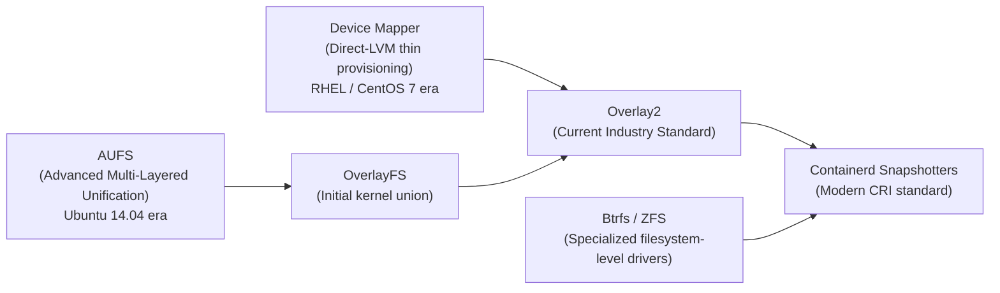
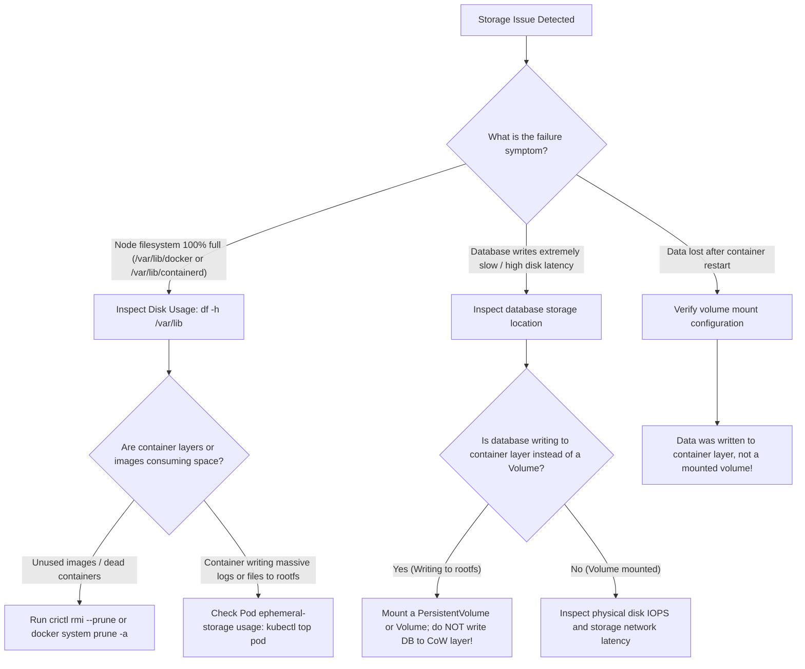

# 01 - Storage Architecture: Storage Drivers vs. Volume Drivers

## Exam Metadata
- **Domain**: Storage (10%) / Fundamental Container Storage Concepts
- **Importance**: High (Architectural Foundation for Ephemeral Container Storage, Persistent Volumes, and the Container Storage Interface)
- **Target Version**: Kubernetes v1.31 / v1.32
- **Allowed Docs Search Keywords**: `storage`, `volumes`, `persistent volumes`, `storage classes`
- **Source**: `storage/01-docker-storage-introduction-raw.md`

---

## 1. Quick-Reference Summary
- **The Two Storage Paradigms**:
  - **Storage Drivers (Graph Drivers / Snapshotters)**: Manage the ephemeral layered union filesystem of images and running container instances. Provide Copy-on-Write (CoW) capabilities. Lifecycle is strictly tied to the container.
  - **Volume Drivers**: Manage persistent, non-layered storage mounted directly into containers from the host filesystem or remote storage fabrics. Lifecycle is independent of the container.
- **Storage Driver Types**:
  - `overlay2`: The current Linux kernel standard storage driver across Docker and containerd.
  - `aufs`: Legacy union filesystem (historical Docker default on Ubuntu).
  - `devicemapper`: Legacy block-based driver (historical default on RHEL/CentOS; deprecated).
  - `btrfs` / `zfs`: Advanced filesystem drivers providing native snapshotting and subvolumes.
- **Copy-On-Write (CoW) Mechanics**:
  - Image layers are immutable and read-only.
  - The runtime adds a thin, writable container layer on top of stacked image layers.
  - Modifications to image files trigger a copy of the target file up into the writable container layer before writing.
  - Deleting the container permanently deletes the writable container layer and all uncommitted changes.
- **Volume Drivers & Persistence**:
  - Volumes bypass the union filesystem and write directly to the host storage subsystem at native I/O speeds.
  - Data written to volumes persists across container restarts, deletions, and upgrades.
- **Evolution to Kubernetes**:
  - Storage Drivers evolve into **CRI Snapshotters** (`overlayfs` in `containerd`).
  - Volume Drivers evolve into the **Container Storage Interface (CSI)** specification in Kubernetes (`csi.storage.k8s.io`).

---

## 2. Conceptual Overview & Mental Model

### Simple English Explanation
When software runs inside a container, it needs to access two completely different kinds of files:
1. **Operating system and application binaries**: These are files like `/bin/bash`, Python runtime libraries, and application source code. They are part of the container image and should never be modified.
2. **Dynamic application data**: These are database files, uploaded customer documents, and transactional records. They must survive even if the container crashes, restarts, or is upgraded.

To handle these two distinct needs, container engines divide storage into two separate systems:

- **Storage Drivers (The Layered System)**:
  When an image is created, each command in the Dockerfile creates an immutable, read-only layer. When the container starts, the storage driver stacks these read-only layers on top of each other and places a thin, temporary read-write layer on top (the container layer). If a process inside the container edits a file from the image, the storage driver copies that file up into the temporary read-write layer before modifying it (this is called Copy-on-Write). When the container is deleted, this temporary read-write layer is destroyed along with all modified files.

- **Volume Drivers (The Permanent System)**:
  For data that must never be lost (like a PostgreSQL database), writing to the temporary container layer is unsafe and slow. Volume drivers bypass the layered union filesystem completely. They mount a dedicated folder from the host machine or an external enterprise storage array directly into a directory inside the container (e.g., `/var/lib/mysql`). The container writes directly to the disk at native speed, and the data remains intact even if the container is removed.

### Formal Technical Definition
Container storage architecture is a bifurcated filesystem management model consisting of Copy-on-Write (CoW) union graph drivers (Storage Drivers / Snapshotters) that compose layered immutable OCI container images with an ephemeral read-write execution layer, and decoupled, host-mounted or network-attached block/filesystem endpoints (Volume Drivers / CSI Plugins) providing durable state persistence outside the container rootfs lifecycle.

### Architecture Flowchart: Storage Drivers vs. Volume Drivers

```mermaid
flowchart TD
    subgraph StorageDrivers["1. Storage Driver Paradigm (Ephemeral Rootfs)"]
        ContainerLayer["Thin Writable Container Layer<br/>(Read-Write: /tmp, ephemeral changes)<br/>DELETED WHEN CONTAINER DIES"]
        CoW["Copy-On-Write (CoW) Engine<br/>(overlay2 / snapshotter)"]
        ImgLayer3["Image Layer 3: Application Code (Read-Only)"]
        ImgLayer2["Image Layer 2: Python / Dependencies (Read-Only)"]
        ImgLayer1["Image Layer 1: Base Ubuntu OS (Read-Only)"]

        ContainerLayer --> CoW
        CoW --> ImgLayer3 --> ImgLayer2 --> ImgLayer1
    end

    subgraph VolumeDrivers["2. Volume Driver Paradigm (Persistent State)"]
        AppProcess["Database Engine Process<br/>(e.g., MySQL / PostgreSQL)"]
        MountPoint["Mount Point inside Container<br/>(/var/lib/mysql)"]
        HostStorage["Host File System / External Block Device<br/>(/var/lib/docker/volumes/my_data/_data<br/>or Cloud SAN/NAS via CSI)"]

        AppProcess -->|"Direct I/O (Bypasses Union FS)"| MountPoint
        MountPoint ===|"Direct Mount / Bind Mount"| HostStorage
    end
```



---

## 3. Deep-Dive Technical Breakdown

### Side-by-Side Architectural Comparison

| Architectural Dimension | Storage Drivers (Graph Drivers) | Volume Drivers |
| :--- | :--- | :--- |
| **Primary Responsibility** | Ephemeral container rootfs and image layer management. | Persistent state storage and data durability. |
| **Filesystem Architecture** | Union / Stacked Layer Filesystem (`overlay2`, `aufs`). | Native Host Filesystem (ext4, XFS) or Network Storage (NFS, CSI). |
| **Write Mechanism** | Copy-on-Write (CoW) layer allocation. | Direct raw filesystem / block device writes. |
| **Performance Profile** | High latency on initial file modification due to copy overhead. | Native host line-rate I/O performance. |
| **Data Lifecycle** | Destroyed when container is removed (`docker rm` / Pod delete). | Survives container deletion, restarts, and rescheduling. |
| **Typical Data Stored** | Operating system utilities, temp files, local stdout logs. | Databases, transaction logs, application state, uploaded assets. |
| **Host Storage Location** | `/var/lib/docker/overlay2/` or containerd snapshotter cache. | `/var/lib/docker/volumes/` or mounted SAN/NAS directories. |
| **Kubernetes Equivalent** | CRI Container Runtime Snapshotters (`containerd`). | Kubernetes Volumes, PersistentVolumes (PVs), and CSI Plugins. |

---

### The Evolution of Storage Drivers

Over the history of container runtimes, several Linux kernel storage drivers were developed:



#### Storage Driver Characteristics:
1. **`overlay2`**:
   - The modern Linux kernel standard for Docker and `containerd`.
   - Requires no special filesystem formatting (runs atop standard `ext4` or `xfs`).
   - Highly efficient page cache sharing and low inode overhead compared to legacy `overlay`.
2. **`aufs`**:
   - The original default union filesystem used by Docker on Debian/Ubuntu.
   - Never merged into the mainline Linux kernel; required custom patched kernels. Deprecated.
3. **`devicemapper`**:
   - Block-based storage driver using Linux LVM thin-provisioning targets.
   - Complex to configure (required `direct-lvm` mode in production); suffered from performance bottlenecks and high memory usage. Deprecated.
4. **`btrfs` and `zfs`**:
   - Filesystem-specific drivers operating on native copy-on-write filesystems.
   - Excel at fast subvolume snapshotting and deduplication, but require dedicated underlying partitions formatted with Btrfs or ZFS.

---

### Understanding the Copy-on-Write (CoW) Mechanism

The Copy-on-Write strategy maximizes efficiency by sharing immutable assets across multiple containers:

1. **Space Efficiency**:
   If ten containers run the same `nginx:latest` image on a host, all ten containers share the exact same read-only image layers on disk. The host only stores the image layers once.
2. **Fast Startup**:
   Creating a new container does not copy gigabytes of operating system files. Instead, the runtime instantiates a lightweight, empty read-write layer (often taking only a few kilobytes initially).
3. **Write Modification Latency**:
   When a process in the container writes to an existing file that originated in an underlying image layer:
   - The kernel pauses the write operation.
   - The storage driver locates the file in the lower read-only layers (`lowerdir`).
   - The storage driver makes a complete duplicate of the file and copies it up into the writable container layer (`upperdir`).
   - The write operation is executed on the newly copied file.
   - **Performance Warning**: For large files (e.g., a 10 GB database file), this copy operation creates severe I/O stalls!

---

### The Evolution from Volume Drivers to Kubernetes CSI

In container runtimes, persistent storage evolved through three distinct generations:

#### 1. Docker Local Volumes & Plugin Drivers
- Docker created local directories under `/var/lib/docker/volumes/<name>/_data` and bind-mounted them into containers.
- Third-party volume plugins (Flocker, Portworx, Convoy) ran as local daemons to manage cloud block storage.

#### 2. Kubernetes In-Tree Volume Plugins (Legacy)
- Early Kubernetes versions embedded storage drivers directly inside the `kubelet` and `kube-controller-manager` source code (e.g., `kubernetes.io/aws-ebs`, `kubernetes.io/gce-pd`, `kubernetes.io/nfs`).
- **Major Problem**: Updating a storage driver or fixing a bug required upgrading the entire Kubernetes cluster!

#### 3. Container Storage Interface (CSI) (Modern Standard)
- Inspired by CNI, the storage community defined the **Container Storage Interface (CSI)**.
- CSI decouples storage plugins from core Kubernetes binaries. Storage vendors write out-of-tree plugins that run as standard Pods inside the cluster (using gRPC services like `Identity`, `Controller`, and `Node`).

---

## 4. Command Translation & Mapping Tables

### Docker Storage Concepts vs. Kubernetes Equivalents

| Docker Primitive | Kubernetes Primitive | Architectural Role |
| :--- | :--- | :--- |
| **Storage Driver (`overlay2`)** | **CRI Snapshotter (`overlayfs`)** | Manages container image caching, layer stacking, and ephemeral rootfs. |
| **Container Layer Write** | **`ephemeral-storage`** | Local disk space consumed by non-volume writes in Pods. |
| **Named Volume (`docker volume`)** | **`PersistentVolumeClaim` (PVC)** | Abstract request for durable, persistent storage. |
| **Volume Driver Plugin** | **Container Storage Interface (CSI)** | Out-of-tree plugin provisioning and attaching storage to nodes. |
| **Bind Mount (`-v /host:/container`)** | **`hostPath` Volume** | Direct mount of a host node filesystem path into a Pod. |
| **Tmpfs Mount (`--tmpfs`)** | **`emptyDir` (with `medium: Memory`)** | RAM-backed ephemeral filesystem for temporary, high-speed storage. |

---

## 5. High-Yield CLI & Imperative Commands

### Inspecting Storage Drivers on Container Runtimes
```bash
# 1. View Docker Storage Driver and Root Directory
docker info | grep -E "Storage Driver|Docker Root Dir"
# Expected Output:
# Storage Driver: overlay2
# Docker Root Dir: /var/lib/docker

# 2. View containerd Snapshotter plugins (Modern CKA nodes)
sudo ctr plugins ls | grep snapshot
# Or using crictl:
sudo crictl info | grep -A 5 "snapshotter"

# 3. Inspect active Overlay2 directories on the host
ls -la /var/lib/docker/overlay2/
```

### Inspecting Docker Volumes & Persistent Data Paths
```bash
# 1. List all volumes managed on the host
docker volume ls

# 2. Inspect a specific volume to identify its host mountpoint
docker volume inspect my_data
# Output reveals: "Mountpoint": "/var/lib/docker/volumes/my_data/_data"

# 3. View disk usage broken down between images, containers, and volumes
docker system df
```

### Demonstrating Storage Driver CoW vs. Volume Performance
```bash
# 1. Benchmarking write to Container Layer (subject to Storage Driver CoW overhead):
docker run --rm ubuntu dd if=/dev/zero of=/test.bin bs=1M count=500 oflag=direct

# 2. Benchmarking write to a Volume (native filesystem speed):
docker run --rm -v /tmp:/data ubuntu dd if=/dev/zero of=/data/test.bin bs=1M count=500 oflag=direct
```

---

## 6. Troubleshooting & Diagnostic Runbook

### Diagnostic Decision Tree



### Triage Sequence Matrix

| Step | Scope | Diagnostic Command | Expected Value | Remediation Action |
| :--- | :--- | :--- | :--- | :--- |
| **1. Storage Driver Health** | Host Kernel | `dmesg \| grep -i overlayfs` | No kernel errors or corruptions | If corrupted, reboot node or re-initialize runtime storage directory. |
| **2. Ephemeral Disk Space**| Filesystem | `df -h /var/lib/containerd` | Usage < 85% | Clean dangling images: `crictl rmi --prune`. |
| **3. High Write Latency** | Performance | `iostat -xz 1` | Low `%util` and `await` | Move transactional workloads off CoW layer to dedicated Volumes. |
| **4. Volume Permissions** | Filesystem | `ls -ld <host-volume-path>` | Correct UID/GID ownership | Adjust permissions or configure Pod `securityContext.fsGroup`. |
| **5. Overlay Inodes** | Filesystem | `df -i /var/lib` | Inode usage < 90% | Storage drivers with thousands of layers exhaust inodes; prune old layers. |

---

## 7. CKA Exam Tips, Gotchas & Traps

> [!WARNING]
> **The Database on Copy-on-Write (CoW) Anti-Pattern**
> Never allow databases (such as MySQL, PostgreSQL, or MongoDB) to store data directly inside the container's root filesystem.
> Because storage drivers enforce Copy-on-Write, modifying existing data blocks requires the kernel to copy the entire file to the writable layer, resulting in catastrophic write latency and potential corruption. Always attach a dedicated `Volume` or `PersistentVolumeClaim`!

> [!IMPORTANT]
> **The Node Disk Exhaustion (`ephemeral-storage`) Trap**
> In Kubernetes, files written to the container layer (outside of volume mounts) consume **Node root filesystem space**.
> If an application misbehaves and writes massive log files or temporary files directly to `/tmp` in the container layer, the Kubelet will detect that the node is running low on disk space and mark the node as `DiskPressure`. Kubelet will then begin **evicting Pods** to save the node.

> [!IMPORTANT]
> **Docker Storage Drivers vs. containerd Snapshotters**
> In modern CKA exams (v1.24 through v1.32), `dockershim` is removed and worker nodes run `containerd`.
> If asked to inspect image and layer storage on a worker node, remember that `docker` commands will fail. Use `crictl` or `ctr` to interact with images and snapshotters!

> [!TIP]
> **Using `emptyDir` for High-Speed Ephemeral Storage**
> If an application needs temporary cache files that must be fast and isolated, do not write to the storage driver rootfs. Define an `emptyDir` volume in the Pod spec:
> ```yaml
> volumes:
> - name: cache-vol
>   emptyDir:
>     medium: Memory  # Backed by RAM (tmpfs) for maximum IOPS
> ```

---

## 8. Self-Test / Active Recall

<details>
<summary><strong>1. What is the fundamental difference in purpose between a Storage Driver and a Volume Driver?</strong></summary>

Storage Drivers manage the ephemeral, layered union filesystem of container images and temporary writable container layers (using Copy-on-Write). Volume Drivers manage persistent, non-layered storage mounted directly into containers, decoupling data from the container's lifecycle.
</details>

<details>
<summary><strong>2. What happens to files written to the container layer when a container is deleted?</strong></summary>

They are permanently deleted along with the container's writable layer.
</details>

<details>
<summary><strong>3. Which storage driver is the modern standard for Linux container runtimes?</strong></summary>

`overlay2`.
</details>

<details>
<summary><strong>4. How does the Copy-on-Write (CoW) mechanism work when a process inside a container edits an existing file from the base image?</strong></summary>

The storage driver pauses the write, copies the original file from the read-only lower image layer up into the top writable container layer, and then executes the modification on the copy.
</details>

<details>
<summary><strong>5. Why is writing database files to a storage driver's Copy-on-Write layer considered an anti-pattern?</strong></summary>

It introduces severe write latency due to the file copy overhead, degrades I/O performance, and risks total data loss when the container terminates.
</details>

<details>
<summary><strong>6. Where on the host filesystem does Docker store named volumes by default?</strong></summary>

`/var/lib/docker/volumes/<volume-name>/_data`.
</details>

<details>
<summary><strong>7. What Kubernetes volume type provides ephemeral storage backed by host memory (RAM)?</strong></summary>

An `emptyDir` volume configured with `medium: Memory` (backed by a Linux `tmpfs` mount).
</details>

<details>
<summary><strong>8. What node condition does Kubelet raise when the host filesystem hosting container layers runs out of space?</strong></summary>

`DiskPressure`, which causes Kubelet to evict Pods from that node.
</details>

<details>
<summary><strong>9. What term does containerd use instead of "storage driver" to refer to its layer and image management plugins?</strong></summary>

**Snapshotters** (e.g., `overlayfs`, `devmapper`, `native`).
</details>

<details>
<summary><strong>10. What open standard replaced in-tree Kubernetes volume plugins to enable third-party storage vendors to build storage drivers out-of-tree?</strong></summary>

The **Container Storage Interface (CSI)** specification.
</details>

---

## 9. Official Documentation Bookmarks

| Resource | Documentation Path / Anchor | Purpose |
| :--- | :--- | :--- |
| **Volumes Overview** | `Concepts > Storage > Volumes` | Fundamental Kubernetes volume types and lifecycle rules |
| **Persistent Volumes** | `Concepts > Storage > Persistent Volumes` | Provisioning, binding, and reclaiming PVs and PVCs |
| **Node-pressure Eviction** | `Concepts > Architecture > Nodes > Node-pressure Eviction` | How ephemeral storage exhaustion triggers DiskPressure |
| **Container Runtimes** | `Getting Started > Production Environment > Container Runtimes` | Containerd snapshotter configuration requirements |

